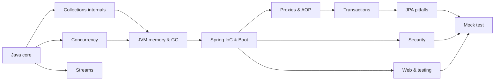

# Java & Spring Boot, Step by Step

A free interview handbook for **Java, the JVM and Spring Boot**, written for senior backend engineers preparing for vetted-network screenings (Toptal, Turing, Arc and similar), MCQ tech-stack tests, and senior/staff backend interviews.

Most resources give you a list of facts to memorise. This one gives you the **mental model first**, then shows the exact places where people (and MCQ distractors) get it wrong.

## What's inside

| Section | What you get |
|---|---|
| [Start here](start-here.md) | A 2-week and a 4-week plan, and how to use the MCQs |
| [Core language traps](java/01-core-language.md) | equals/hashCode, String pool, pass-by-value, generics, exceptions |
| [Collections internals](java/02-collections-internals.md) | HashMap buckets and treeification, ConcurrentHashMap, ArrayList growth, LRU with LinkedHashMap |
| [Concurrency](java/03-concurrency.md) | Java Memory Model, volatile vs synchronized, CAS, thread pools, CompletableFuture, virtual threads |
| [Streams](java/04-streams.md) | Laziness, collectors, `toMap` traps, parallel streams, Optional |
| [Modern Java](java/05-modern-java.md) | Records, sealed types, pattern matching, text blocks, what changed in each LTS |
| [JVM memory](jvm/01-memory.md) | Heap, stack, Metaspace, object layout, class loading, OOM types |
| [Garbage collection](jvm/02-garbage-collection.md) | Generations, G1, ZGC, tuning flags, containers, reference types |
| [JIT & troubleshooting](jvm/03-performance-troubleshooting.md) | Tiered compilation, jcmd/jstack/JFR, high CPU and memory-leak runbooks |
| [IoC & DI](spring/01-ioc-di.md) | Bean lifecycle, scopes, injection styles, circular dependencies |
| [Boot internals](spring/02-boot-internals.md) | Auto-configuration, conditions, property precedence, Actuator |
| [Proxies & AOP](spring/03-proxies-aop.md) | JDK vs CGLIB, self-invocation, advice types |
| [Transactions](spring/04-transactions.md) | Propagation, isolation, rollback rules, the classic traps |
| [JPA pitfalls](spring/05-jpa-pitfalls.md) | N+1, LazyInitializationException, dirty checking, locking, batching |
| [Security](spring/06-security.md) | Filter chain, authentication flow, JWT, CSRF/CORS, method security |
| [Web & testing](spring/07-web-testing.md) | DispatcherServlet flow, error handling, validation, test slices |
| [Mock test](practice/mock-test.md) | 40 mixed MCQs, timed, with explanations |
| [Cheat sheet](practice/cheat-sheet.md) | One page to read the night before |

## Every topic page has the same shape

1. **TL;DR**: three lines you could say out loud.
2. **Mental model**: a diagram of how the thing actually works.
3. **Deep dive**: the internals that MCQs and follow-up questions target.
4. **Code you should be able to write** without an IDE.
5. **Traps**: the exact misconceptions distractor answers are built from.
6. **Say it out loud**: short spoken answers to common interview questions.
7. **Practice MCQs**: with hidden answers and explanations.

## Versions

Examples target **Java 21 (LTS)** and **Spring Boot 3.x** (Spring Framework 6, Jakarta EE namespace). Where behaviour changed between versions, the page says so, because "which version?" is a favourite MCQ trick.

## Contributing

Spotted a mistake? Open an issue or a pull request. Every page is plain Markdown that renders directly on GitHub.
