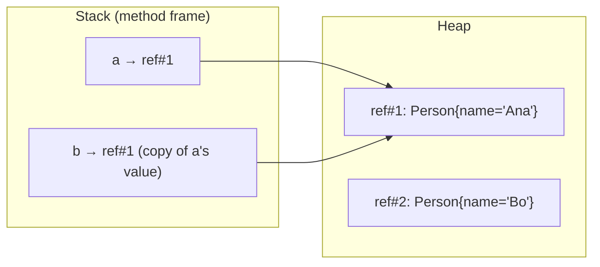

# Core language traps

> **TL;DR** Java passes **everything by value** (object references are copied values). `==` compares identity, `equals` compares meaning, and if you override `equals` you **must** override `hashCode`. Most "what does this print?" MCQs are built from about ten traps on this page.

## Mental model: references are values



When you pass `a` to a method, the method gets a **copy of the reference**. It can mutate the object the reference points to, but reassigning its parameter never changes the caller's variable.

```java
static void rename(Person p) { p.name = "Zed"; }      // caller sees "Zed"
static void replace(Person p) { p = new Person("Q"); } // caller sees no change
```

## Deep dive

### `equals` and `hashCode` contract

- If `a.equals(b)` then `a.hashCode() == b.hashCode()`. The reverse is **not** required (collisions are legal).
- `equals` must be reflexive, symmetric, transitive, consistent, and `x.equals(null)` is `false`.
- Break the contract and `HashMap`/`HashSet` silently misbehave: you put a key in and `get` cannot find it.
- **Mutable keys are dangerous.** If a field used in `hashCode` changes after insertion, the entry is stranded in the wrong bucket.

```java
record Money(String currency, long minorUnits) {}  // records generate equals/hashCode for you
```

### Strings

- String literals live in the **string pool** (part of the heap since Java 7). Identical literals share one object.
- `new String("hi")` always creates a new object. `intern()` returns the pooled instance.
- Compile-time constant expressions are folded: `"a" + "b" == "ab"` is `true`. Concatenation involving a **non-final variable** happens at runtime and creates a new object.
- Strings are immutable: safe as map keys, safe to share across threads, hash code is cached.
- Use `StringBuilder` (not synchronized) in loops; `StringBuffer` is the legacy synchronized version.

```java
String s1 = "hi";
String s2 = new String("hi");
System.out.println(s1 == s2);          // false
System.out.println(s1 == s2.intern()); // true
final String x = "a";
System.out.println(x + "b" == "ab");   // true  (constant folding)
String y = "a";
System.out.println(y + "b" == "ab");   // false (runtime concatenation)
```

### Wrapper caching and autoboxing

- `Integer.valueOf` caches **-128 to 127**. Autoboxing uses `valueOf`, so `Integer a = 127, b = 127; a == b` is `true`, but with 128 it is `false`.
- `Boolean`, `Byte`, `Character` (0–127), `Short` and `Long` (-128 to 127) also cache. `Float` and `Double` do not.
- Unboxing `null` throws `NullPointerException`: `int n = map.get("missing");` crashes when the map returns `null`.

### Numbers

- `0.1 + 0.2 == 0.3` is `false`. Use `BigDecimal` for money, built from a **String**: `new BigDecimal("0.1")`, never `new BigDecimal(0.1)`.
- `BigDecimal.equals` compares scale: `2.0` vs `2.00` is **not equal**. Use `compareTo(...) == 0`.
- Integer overflow wraps silently. `Math.abs(Integer.MIN_VALUE)` is still negative. Use `Math.addExact` when overflow must fail.
- Integer division truncates toward zero: `-7 / 2 == -3`, and `-7 % 2 == -1`.

### Overloading vs overriding

- **Overloading** is resolved at **compile time** from static types. **Overriding** is resolved at **runtime** from the actual object.
- Static methods are **hidden**, not overridden: which one runs depends on the reference type.
- Fields are never polymorphic: `parentRef.field` reads the parent's field.
- With `null` as argument, the **most specific** overload wins (`String` over `Object`). If two unrelated types match (`String` and `Integer`), it is a compile error.

### Generics

- **Type erasure:** generic types exist only at compile time. `List<String>` and `List<Integer>` are both `List` at runtime, so you cannot overload `f(List<String>)` and `f(List<Integer>)`, cannot write `new T()`, and cannot use `instanceof List<String>`.
- `List<String>` is **not** a subtype of `List<Object>` (generics are invariant). Arrays are covariant, which is why `Object[] arr = new String[1]; arr[0] = 1;` compiles but throws `ArrayStoreException`.
- **PECS:** *Producer Extends, Consumer Super*. Read from `List<? extends Number>`, write to `List<? super Integer>`. You cannot add to `? extends` (except `null`).

```java
static double sum(List<? extends Number> xs) { return xs.stream().mapToDouble(Number::doubleValue).sum(); }
static void fill(List<? super Integer> out) { out.add(42); }
```

### Exceptions

- **Checked** (subclasses of `Exception` but not `RuntimeException`) must be declared or caught. **Unchecked** (`RuntimeException`, `Error`) do not.
- `finally` runs even after `return`. A `return` inside `finally` **overrides** the try's return value and **swallows** any exception. Never return from `finally`.
- `finally` does not run if the JVM exits (`System.exit`) or the process is killed.
- **try-with-resources** closes resources in **reverse** declaration order. If both the body and `close()` throw, the body's exception is thrown and the close exception is attached as **suppressed** (`getSuppressed()`).
- Catch order: subclass before superclass, otherwise it is a compile error (unreachable catch).

```java
static int f() {
    try { return 1; }
    finally { return 2; }   // f() returns 2
}
```

### Keywords people mix up

| Term | Meaning |
|---|---|
| `final` | Variable cannot be reassigned; method cannot be overridden; class cannot be extended. A `final` reference to a list can still have elements added. |
| `finally` | Block that runs after try/catch. |
| `finalize()` | Deprecated (for removal) cleanup hook. Use `try-with-resources` or `Cleaner`. |
| `static` | Belongs to the class, not instances. Static nested classes do not hold a reference to the outer instance; inner classes do (a common memory-leak source). |
| `transient` | Field skipped by Java serialization. |
| `volatile` | Visibility and ordering guarantee across threads (see [Concurrency](03-concurrency.md)). |

## Code you should be able to write

```java
public final class Point {
    private final int x, y;
    public Point(int x, int y) { this.x = x; this.y = y; }

    @Override public boolean equals(Object o) {
        if (this == o) return true;
        if (!(o instanceof Point p)) return false;
        return x == p.x && y == p.y;
    }
    @Override public int hashCode() { return Objects.hash(x, y); }
}
```

Immutable class checklist: `final` class, `private final` fields, no setters, defensive copies of mutable inputs and outputs (`List.copyOf`).

## Traps

- "Java passes objects by reference." **False.** References are passed by value.
- "If hash codes are equal, the objects are equal." **False.** Collisions exist.
- "`finally` always runs." Almost: not after `System.exit` or a crash.
- "`Integer a = 1000, b = 1000; a == b` is true." **False**, outside the cache.
- "`final List<String> xs` cannot change." The reference cannot; the contents can.

## Say it out loud

**"Why must hashCode change when equals changes?"**
Hash-based collections first pick a bucket using `hashCode`, then compare with `equals` inside that bucket. If two equal objects have different hash codes they land in different buckets, so lookups fail even though `equals` would say they match.

**"Why are Strings immutable?"**
Security (class names, file paths, URLs can't change after validation), thread safety without locking, safe use as hash keys with a cached hash code, and string-pool sharing.

## Practice MCQs

**Q1.** What does this print?
```java
Integer a = 128, b = 128;
Integer c = 100, d = 100;
System.out.println((a == b) + " " + (c == d));
```
- A) `true true`
- B) `false true`
- C) `false false`
- D) `true false`

<details markdown="1"><summary>Answer</summary>

**B.** `Integer.valueOf` caches -128..127. 100 comes from the cache (same object); 128 creates two objects.
</details>

**Q2.** What does `f()` return?
```java
static int f() { int x = 1; try { return x; } finally { x = 5; } }
```
- A) 1
- B) 5
- C) Compile error
- D) Undefined

<details markdown="1"><summary>Answer</summary>

**A.** The return value (1) is evaluated and saved before `finally` runs. Changing the local variable afterwards does not change the saved value. (A `return` inside `finally` would override it.)
</details>

**Q3.** Which declaration lets you **add** an `Integer` to the list?
- A) `List<? extends Number>`
- B) `List<? super Integer>`
- C) `List<? extends Integer>`
- D) `List<?>`

<details markdown="1"><summary>Answer</summary>

**B.** Consumer super. With `? extends`, the compiler cannot know the exact element type, so only `null` can be added.
</details>

**Q4.** `new BigDecimal("2.0").equals(new BigDecimal("2.00"))` returns:
- A) `true`
- B) `false`
- C) Throws `ArithmeticException`
- D) Depends on the rounding mode

<details markdown="1"><summary>Answer</summary>

**B.** `BigDecimal.equals` compares value **and scale**. Use `compareTo` for numeric equality.
</details>

**Q5.** Two overloads exist: `void m(Object o)` and `void m(String s)`. What does `m(null)` call?
- A) `m(Object)`
- B) `m(String)`
- C) Compile error: ambiguous
- D) `NullPointerException`

<details markdown="1"><summary>Answer</summary>

**B.** The most specific applicable overload wins, and `String` is more specific than `Object`. If the overloads were `m(String)` and `m(Integer)`, it would be ambiguous.
</details>

**Q6.** Why does this fail to compile?
```java
void process(List<String> xs) {}
void process(List<Integer> xs) {}
```
- A) Methods cannot take generic parameters
- B) Both methods have the same erasure
- C) `List` is an interface
- D) It compiles fine

<details markdown="1"><summary>Answer</summary>

**B.** After type erasure both become `process(List)`, which is a duplicate signature.
</details>

**Q7.** A try-with-resources body throws `IOException("body")`, and `close()` throws `IOException("close")`. What is thrown?
- A) `close`, with `body` suppressed
- B) `body`, with `close` suppressed
- C) Both are lost
- D) A new `MultipleException`

<details markdown="1"><summary>Answer</summary>

**B.** The primary exception from the body propagates; exceptions from closing are attached with `addSuppressed`.
</details>

**Q8.** Which statement about a `static` method in a subclass with the same signature as the parent is true?
- A) It overrides the parent method
- B) It hides the parent method; the call depends on the reference type
- C) It is a compile error
- D) It is called via dynamic dispatch

<details markdown="1"><summary>Answer</summary>

**B.** Static methods are bound at compile time from the declared type; this is method hiding, not overriding.
</details>

## Related

- [Collections internals](02-collections-internals.md): why `equals`/`hashCode` matter for buckets.
- [Modern Java](05-modern-java.md): records generate `equals`/`hashCode` for you.
