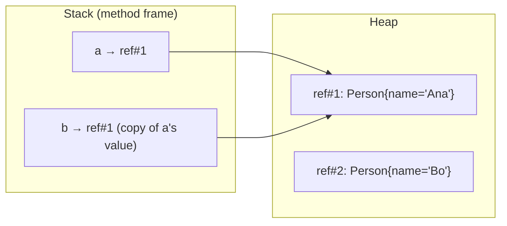

# Core language traps

> **TL;DR** Java passes **everything by value**; for objects, the value that gets copied is the *reference* (think "the address of the object"), not the object itself. `==` asks "are these the same object in memory?", while `equals` asks "do these two objects mean the same thing?". If you override `equals` you **must** also override `hashCode`, because hash-based collections use `hashCode` to decide where to look before they ever call `equals`. Most "what does this print?" MCQs are built from about ten traps on this page.

## Mental model: references are values



A variable of an object type does not hold the object. It holds a **reference**: a small value that tells the JVM where the object lives on the heap. In the diagram, `a` and `b` are two separate variables on the stack, but both contain the same reference (`ref#1`), so both point at the same `Person`.

When you pass `a` to a method, Java copies that reference value into the method's parameter. That gives two consequences you must keep apart:

- **Mutating through the copy is visible to the caller.** The copy points to the same object, so `p.name = "Zed"` changes the one shared object.
- **Reassigning the copy is invisible to the caller.** `p = new Person("Q")` only changes what the method's local parameter points to. The caller's variable still holds the old reference.

```java
static void rename(Person p) { p.name = "Zed"; }      // caller sees "Zed": same object was modified
static void replace(Person p) { p = new Person("Q"); } // caller sees no change: only the local copy was redirected
```

If Java were truly pass-by-reference (like C++ `Person&`), `replace` would change the caller's variable too. It does not, which is the proof that Java is pass-by-value.

## Deep dive

### `equals` and `hashCode` contract

**Why both methods exist.** `HashMap`, `HashSet`, `ConcurrentHashMap` and friends find an entry in two steps:

1. Call `key.hashCode()` and use it to pick a **bucket** (a slot in an internal array). This is fast: one arithmetic step instead of comparing against every entry.
2. Inside that bucket, walk the few entries there and call `equals` on each to find the exact match.

So `hashCode` is a quick "which drawer should I look in?" and `equals` is the careful "is this really the item?". The rules below follow directly from that two-step lookup.

**Rule 1: If `a.equals(b)` is `true`, then `a.hashCode() == b.hashCode()` must be `true`.**
If two equal objects had different hash codes, step 1 would send the lookup to a *different drawer* from the one where the entry was stored. Step 2 would never even see the stored entry, so `map.get(equalKey)` returns `null` even though an equal key is in the map.

**Rule 2 (the reverse): equal hash codes do *not* have to mean equal objects.** Two different objects are allowed to share a hash code. This is called a **collision**, and it is legal for three reasons:

- **It is mathematically unavoidable.** `hashCode()` returns an `int`, which has only about 4.3 billion possible values (2³²). The number of possible distinct objects is far larger: there are infinitely many possible `String`s, and even a class with two `long` fields has 2¹²⁸ possible states. By the *pigeonhole principle* (more items than boxes means some box holds two items), many different objects must share a hash code. A rule demanding "different objects ⇒ different hash codes" would be impossible to satisfy.
- **Collisions are already handled by step 2.** When two unequal keys land in the same bucket, the map simply stores both there and uses `equals` to tell them apart. A collision costs a little speed (one extra `equals` call), never correctness.
- **Real examples exist in the JDK.** `"Aa".hashCode()` and `"BB".hashCode()` are both `2112`, yet `"Aa".equals("BB")` is `false`. Both strings can sit in the same `HashSet` without any problem.

The only thing collisions hurt is performance: if *many* keys share a hash code, one bucket gets crowded and lookups slow down (Java 8+ turns a crowded bucket into a red-black tree so the worst case is `O(log n)` instead of `O(n)`; see [Collections internals](02-collections-internals.md)). That is why a *good* `hashCode` spreads values out, but a *correct* one only has to obey Rule 1. Even `return 42;` is a legal (terribly slow) `hashCode`.

**Rule 3: `equals` must behave like real equality.** The Javadoc lists five properties:

| Property | Meaning | What breaks if you violate it |
|---|---|---|
| Reflexive | `x.equals(x)` is `true` | A set could fail to find an object you just added. |
| Symmetric | `x.equals(y)` ⇔ `y.equals(x)` | `list.contains(x)` and `list.contains(y)` disagree depending on which side calls `equals`. Typical cause: a subclass that adds a field and compares it only one way. |
| Transitive | `x.equals(y)` and `y.equals(z)` ⇒ `x.equals(z)` | Sorting/deduplication gives order-dependent results. |
| Consistent | Repeated calls give the same answer while the objects are unchanged | Lookups succeed sometimes and fail other times. |
| Non-null | `x.equals(null)` is `false` (never throws) | Code that compares against a possibly-null value crashes with `NullPointerException`. |

**What "silently misbehave" looks like.** If you override `equals` but forget `hashCode`, each object keeps the default identity-based hash code from `Object`, so two "equal" objects almost always get different hash codes:

```java
class Key { String id; Key(String id) { this.id = id; }
    @Override public boolean equals(Object o) { return o instanceof Key k && k.id.equals(id); }
    // hashCode NOT overridden
}
Map<Key, String> m = new HashMap<>();
m.put(new Key("A"), "found");
m.get(new Key("A"));   // null — the second Key hashes to a different bucket
new HashSet<>(List.of(new Key("A"), new Key("A"))).size(); // 2 — duplicates not detected
```

No exception is thrown; you just get wrong answers, which is why this bug is so dangerous.

**Mutable keys are dangerous.** A `HashMap` computes the key's hash once, at `put` time, and files the entry in that bucket. If you later change a field that `hashCode` uses, the object's hash changes, but the map does not move the entry. Now `get(key)` computes the *new* hash, looks in the *new* bucket, and finds nothing. The entry is "stranded": it still exists (it shows up when you iterate), but you cannot look it up or remove it by key. The fix is to use immutable keys (`String`, `Integer`, records with immutable fields) or never mutate a key while it is in a map or set.

```java
record Money(String currency, long minorUnits) {}  // records generate equals/hashCode from all components, so the contract is kept for you
```

A record's generated `equals` compares every component, and its generated `hashCode` is computed from the same components, so Rules 1–3 hold automatically. Records are also shallowly immutable, which avoids the mutable-key problem as long as the components themselves are immutable.

### Strings

- **The string pool.** Every string *literal* in your code (`"hi"`) is stored once in a JVM-wide table called the **string pool**, and every occurrence of the same literal refers to that one object. This saves memory because programs repeat the same literals constantly. Since Java 7 the pool lives on the normal heap (before that it was in PermGen, a fixed-size area that could run out), so pooled strings can be garbage-collected like anything else.
- **`new String("hi")` always creates a new object**, even though the literal `"hi"` inside it is pooled. You end up with two objects: the pooled literal and a fresh copy. That is why `"hi" == new String("hi")` is `false`. **`intern()`** looks the string up in the pool and returns the pooled instance (adding it first if absent), so `s.intern() == "hi"` is `true` whenever `s.equals("hi")`.
- **Constant folding.** If every part of a `+` expression is a *compile-time constant* (a literal, or a `final` variable initialized with a literal), the compiler joins them itself and puts the result in the pool. So `"a" + "b"` becomes the literal `"ab"` in the `.class` file, and `"a" + "b" == "ab"` is `true`. If any part is a normal variable, its value is only known at runtime, so the concatenation runs at runtime and produces a **new, unpooled** object, making `==` `false`.
- **Strings are immutable**: no method changes a `String` in place; methods like `toUpperCase()` return a new one. Benefits: a string can be shared between threads with no locking because nobody can change it; it is safe as a `HashMap` key because its hash can never change (the mutable-key problem above cannot happen); and `String` caches its hash code in a field after the first call, so repeated `hashCode()` calls are free.
- **Building strings in a loop.** Because strings are immutable, `s += x` inside a loop creates a new string (and copies all previous characters) on every iteration, which is `O(n²)` work overall. `StringBuilder` keeps one growable buffer and appends into it, which is `O(n)`. `StringBuffer` does the same but every method is `synchronized`; that locking is wasted cost in the usual case where only one thread builds the string, so it survives only in legacy code.

```java
String s1 = "hi";                       // pooled literal
String s2 = new String("hi");           // new heap object with the same characters
System.out.println(s1 == s2);          // false: two different objects
System.out.println(s1 == s2.intern()); // true: intern() returns the pooled "hi", which is s1
final String x = "a";                   // final + literal initializer = compile-time constant
System.out.println(x + "b" == "ab");   // true: compiler folds x + "b" into the pooled literal "ab"
String y = "a";                         // not final, so not a compile-time constant
System.out.println(y + "b" == "ab");   // false: concatenated at runtime into a new object
```

Rule of thumb: **always compare strings with `equals`**. `==` on strings is only ever asked in interviews to test whether you know the pool exists.

### Wrapper caching and autoboxing

- **Autoboxing** is the compiler silently converting a primitive into its wrapper object: `Integer a = 127;` compiles to `Integer a = Integer.valueOf(127);`. `Integer.valueOf` keeps a pre-built array of `Integer` objects for **-128 to 127** (small numbers are used constantly, so sharing them saves allocations) and returns the cached object for those values. Outside that range it creates a new object every time. So `Integer a = 127, b = 127; a == b` is `true` (both are the same cached object) but with `128` it is `false` (two separate objects). `==` on wrappers compares *identity*, never the number. Use `equals`, or unbox to `int` first. (The upper bound can be raised with `-XX:AutoBoxCacheMax`, which is another reason never to rely on it.)
- **Other wrappers:** `Boolean` (both values, `TRUE` and `FALSE`), `Byte` (all 256 values), `Character` (0–127), `Short` and `Long` (-128 to 127) also cache. `Float` and `Double` do not cache, because there is no small, commonly-used set of floating-point values worth sharing.
- **Unboxing `null` throws `NullPointerException`.** Unboxing is the reverse conversion: `int n = map.get("missing");` compiles to `int n = map.get("missing").intValue();`. When the key is missing, `get` returns `null`, and calling `.intValue()` on `null` throws. The crash appears on a line with no visible method call, which is why it confuses people. Use `getOrDefault("missing", 0)` or keep the value as `Integer` and null-check it.

### Numbers

- **`0.1 + 0.2 == 0.3` is `false`.** `double` stores numbers in binary, and most decimal fractions (like 0.1) have no exact binary representation, just as 1/3 has no exact decimal one. Each value is rounded slightly, the rounding errors add up, and the sum comes out as `0.30000000000000004`. For money you need exact decimal arithmetic, so use `BigDecimal`. Build it from a **String**: `new BigDecimal("0.1")` is exactly 0.1. `new BigDecimal(0.1)` takes the already-rounded `double` and faithfully preserves its error, giving `0.1000000000000000055511151231257827...`. (`BigDecimal.valueOf(0.1)` is also fine; it goes through `Double.toString`, which yields `"0.1"`.)
- **`BigDecimal.equals` compares scale.** A `BigDecimal` is an unscaled integer plus a *scale* (number of digits after the point): `2.0` is `20` with scale 1, `2.00` is `200` with scale 2. `equals` treats them as different because they carry different precision information. `compareTo` compares only the numeric value, so `a.compareTo(b) == 0` is the correct "same amount?" test. This also means a `HashSet<BigDecimal>` can contain both `2.0` and `2.00`, while a `TreeSet` (which uses `compareTo`) keeps only one.
- **Integer overflow wraps silently.** `int` is 32-bit two's complement, so `Integer.MAX_VALUE + 1` becomes `Integer.MIN_VALUE` with no error. `Math.abs(Integer.MIN_VALUE)` is still negative because +2,147,483,648 does not fit in an `int` (the max is 2,147,483,647), so it wraps back to itself. When overflow must be an error (money, counters, array sizes), use `Math.addExact`, `multiplyExact`, `toIntExact`, which throw `ArithmeticException` instead of wrapping.
- **Integer division truncates toward zero** (it drops the fractional part, it does not round down): `-7 / 2` is `-3.5` truncated to `-3`, not `-4`. The remainder takes the sign of the left operand so that `(a / b) * b + (a % b) == a` always holds: `-3 * 2 + (-1) == -7`, hence `-7 % 2 == -1`. This is why `n % 2 == 1` is a broken odd-number test for negative numbers; use `n % 2 != 0`. If you need floor behaviour use `Math.floorDiv` / `Math.floorMod`.

### Overloading vs overriding

- **Overloading** means several methods with the same name but different parameter lists in the same class. The compiler picks one **at compile time**, using the *declared* (static) types of the arguments. **Overriding** means a subclass replaces an inherited instance method with the same signature. The JVM picks the implementation **at runtime** from the actual object's class (*dynamic dispatch*). So `Object o = "hi"; print(o);` calls `print(Object)` even if `print(String)` exists, because the compiler only sees `Object`.
- **Static methods are hidden, not overridden.** Static methods belong to the class, not to an object, so there is no object to dispatch on. If `Child` declares a static method with the same signature as `Parent`, `Parent p = new Child(); p.staticMethod()` calls `Parent`'s version, because the compiler decides from the declared type `Parent`. (`@Override` on a static method is a compile error, which is a quick way to prove it.)
- **Fields are never polymorphic.** Only instance methods use dynamic dispatch. If both parent and child declare a field `name`, `parentRef.name` reads the parent's field because field access is also resolved from the declared type. This is called *field hiding* and is a reason to keep fields private and expose them through methods.
- **`null` as an argument.** `null` fits any reference type, so several overloads may apply. The compiler picks the **most specific** one: a method whose parameter type is a subtype of the others' (`String` is a subtype of `Object`, so `m(String)` beats `m(Object)`). If two candidates are unrelated (`String` and `Integer`, neither a subtype of the other), there is no single most specific method, and the call is a **compile error** ("reference to m is ambiguous"). You fix it with a cast: `m((String) null)`.

### Generics

- **Type erasure.** Generic type arguments exist only for the compiler. After checking types, the compiler *erases* them: `List<String>` and `List<Integer>` both become plain `List` in the bytecode, with casts inserted where you read elements. Java did this so code compiled before generics (Java 5) could keep working with new generic libraries. Consequences, each because the runtime does not know `T`:
    - You **cannot overload** `f(List<String>)` and `f(List<Integer>)`: after erasure both are `f(List)`, a duplicate signature.
    - You **cannot write `new T()`**: the runtime does not know which class to instantiate. Pass a `Supplier<T>` or `Class<T>` instead.
    - You **cannot use `instanceof List<String>`**: at runtime the object is just a `List`, so the check could not be performed. (`instanceof List<?>` is allowed.)
- **Generics are invariant: `List<String>` is not a `List<Object>`.** If it were, you could do `List<Object> objs = strings; objs.add(42);` and a number would sneak into a list of strings. Forbidding the assignment at compile time prevents that. **Arrays are covariant** (`String[]` *is* an `Object[]`), an older design choice, so Java must check every array store at runtime instead: `Object[] arr = new String[1]; arr[0] = 1;` compiles but throws `ArrayStoreException`, because the array remembers at runtime that it is really a `String[]`.
- **PECS: Producer Extends, Consumer Super.** Wildcards let one method accept a family of generic types:
    - `List<? extends Number>` means "a list of *some* subtype of `Number`" (could be `List<Integer>`, could be `List<Double>`). **Reading** is safe: whatever comes out is at least a `Number`. **Adding** is unsafe: the compiler cannot know whether the real list holds `Integer`s or `Double`s, so it rejects every `add` except `add(null)`. The list *produces* values for you.
    - `List<? super Integer>` means "a list of `Integer` or some supertype" (`List<Integer>`, `List<Number>`, `List<Object>`). **Adding an `Integer`** is safe, because every one of those lists can hold an `Integer`. **Reading** gives you only `Object`, since you do not know which supertype it is. The list *consumes* values you give it.

```java
static double sum(List<? extends Number> xs) {   // accepts List<Integer>, List<Double>, ...; we only read
    return xs.stream().mapToDouble(Number::doubleValue).sum();
}
static void fill(List<? super Integer> out) {     // accepts List<Integer>, List<Number>, List<Object>; we only write
    out.add(42);
}
```

`Collections.copy(List<? super T> dest, List<? extends T> src)` in the JDK is the textbook example: it reads from `src` (producer) and writes to `dest` (consumer).

### Exceptions

- **Checked vs unchecked.** *Checked* exceptions are subclasses of `Exception` that are not subclasses of `RuntimeException` (for example `IOException`, `SQLException`). The compiler forces you to either catch them or declare them with `throws`, because they represent failures a caller can reasonably expect and recover from (a file is missing, the network dropped). *Unchecked* exceptions are `RuntimeException` and its subclasses (`NullPointerException`, `IllegalArgumentException`) plus `Error` (`OutOfMemoryError`). The compiler does not force handling: runtime exceptions usually signal programming bugs, and errors signal JVM problems you normally cannot fix in code. Spring, by default, rolls a transaction back only for unchecked exceptions, which is why this distinction matters in practice (see [Transactions](../spring/04-transactions.md)).
- **`finally` runs even after `return`.** When the `try` block executes `return x`, the JVM evaluates `x`, stores the result, runs `finally`, and only then returns the stored result. A `return` inside `finally` replaces that stored result, so it **overrides** the try's return value. Worse, if the `try` threw an exception, a `return` in `finally` discards the exception entirely: the caller sees a normal return and never learns something failed. That is why you should never return (or throw) from `finally`.
- **When `finally` does not run.** `finally` is implemented by the JVM executing the block on the way out of `try`. If the JVM itself stops (`System.exit()`, `Runtime.halt()`, `kill -9`, power loss, a fatal JVM crash), there is no "way out" left to run it. Code that must survive such events (for example committing data) needs durable storage, not `finally`.
- **try-with-resources.** Any object implementing `AutoCloseable` declared in `try (...)` is closed automatically when the block ends, whether normally or by exception. Resources are closed in **reverse** declaration order, because later resources often depend on earlier ones (a `PreparedStatement` was created from a `Connection`, so the statement must be closed before the connection). If both the body and `close()` throw, the **body's** exception is the one thrown, because it describes the real failure; the `close()` exception is attached to it as a **suppressed** exception, retrievable via `getSuppressed()`, so no information is lost. (The old manual `try/finally { close(); }` pattern did the opposite: an exception from `close()` replaced the original.)
- **Catch order.** `catch` clauses are checked top to bottom, and the first match wins. If you catch `Exception` before `IOException`, the `IOException` clause could never run, so the compiler reports it as an error ("exception has already been caught"). Put the most specific types first.

```java
static int f() {
    try { return 1; }       // 1 is computed and saved as the pending return value
    finally { return 2; }   // replaces the pending value: f() returns 2 (and would swallow any exception)
}
```

### Keywords people mix up

| Term | Meaning |
|---|---|
| `final` | On a **variable**: it can be assigned only once. On a **method**: subclasses cannot override it. On a **class**: nobody can extend it (`String` is final so nobody can create a mutable subclass of it). Note that `final` protects the *variable*, not the object: a `final List<String>` cannot be pointed at another list, but you can still call `add` on it. For an unmodifiable list use `List.of(...)` or `List.copyOf(...)`. |
| `finally` | A block after `try`/`catch` that runs whether the `try` finished normally, returned early, or threw. Used for cleanup (release locks, close resources). |
| `finalize()` | A method the garbage collector used to call before reclaiming an object. It is deprecated for removal (since Java 9, marked for removal in 18) because it runs at an unpredictable time or never, slows GC, and can accidentally resurrect objects. Use `try-with-resources` for deterministic cleanup, or `java.lang.ref.Cleaner` as a safety net. |
| `static` | The member belongs to the class itself, with one copy shared by all instances, rather than one per object. A **static nested class** is just a class scoped inside another and holds no hidden link to an outer object. A non-static **inner class** silently stores a reference to the outer instance that created it (that is how it can read the outer object's fields). If the inner object lives long (a listener, a cached callback), it keeps the whole outer object alive, which is a common memory leak. Prefer static nested classes unless you really need the outer instance. |
| `transient` | Tells Java serialization (`ObjectOutputStream`) to skip this field, typically for derived values, caches, or secrets like passwords. After deserialization the field holds its default value (`null`, `0`, `false`). It has no effect on JSON libraries like Jackson unless they are configured to honour it. |
| `volatile` | Guarantees that a write by one thread is immediately visible to reads by other threads, and stops the compiler/CPU from reordering accesses around it. It does **not** make compound actions like `count++` atomic. See [Concurrency](03-concurrency.md). |

## Code you should be able to write

```java
public final class Point {                          // final: no subclass can break equals symmetry or mutate state
    private final int x, y;                          // private final: set once in the constructor, never changed
    public Point(int x, int y) { this.x = x; this.y = y; }

    @Override public boolean equals(Object o) {
        if (this == o) return true;                  // fast path: same object is always equal (reflexive)
        if (!(o instanceof Point p)) return false;   // also handles o == null, since null instanceof X is false
        return x == p.x && y == p.y;                 // compare exactly the fields that define identity
    }
    @Override public int hashCode() { return Objects.hash(x, y); } // uses the SAME fields as equals, so Rule 1 holds
}
```

The key discipline: **`hashCode` must use only fields that `equals` also uses.** It may use fewer (that only causes more collisions), but never a field that `equals` ignores, or two equal objects could get different hash codes.

**Immutable class checklist** and why each item is needed:

- **`final` class**: otherwise a subclass could add mutable state or override methods to change behaviour.
- **`private final` fields**: `private` stops outside code from writing them; `final` stops even the class's own methods from reassigning them after construction, and gives safe publication to other threads (see the Java Memory Model in [Concurrency](03-concurrency.md)).
- **No setters**: nothing can change state after construction.
- **Defensive copies of mutable inputs and outputs**: if the constructor stores a `List` the caller passed in, the caller can still modify that list afterwards and change your "immutable" object. Copy it on the way in (`this.items = List.copyOf(items);`). If a getter returns an internal mutable object, the caller could modify it, so return an unmodifiable view or copy.

## Traps

- "Java passes objects by reference." **False.** Java copies the reference value into the parameter. You can mutate the shared object, but reassigning the parameter never affects the caller's variable.
- "If hash codes are equal, the objects are equal." **False.** Collisions are legal and unavoidable (`"Aa"` and `"BB"` share `2112`). The guarantee only goes the other way: equal objects ⇒ equal hash codes.
- "`finally` always runs." **Almost**: it runs on normal completion, `return`, `break`, `continue` and exceptions, but not after `System.exit`, `Runtime.halt`, a killed process or a JVM crash.
- "`Integer a = 1000, b = 1000; a == b` is true." **False.** 1000 is outside the -128..127 cache, so autoboxing creates two separate objects and `==` compares their identities.
- "`final List<String> xs` cannot change." The **reference** cannot be reassigned; the list's **contents** can still be changed with `add`/`remove`. Use `List.of`/`List.copyOf` for an unmodifiable list.

## Say it out loud

**"Why must hashCode change when equals changes?"**
Hash-based collections first pick a bucket using `hashCode`, then compare with `equals` only inside that bucket. If two equal objects had different hash codes, they would be filed in different buckets, so a lookup with one would never even reach the other, and `get` would return `null` even though `equals` would say they match. The reverse is not required because a hash code is just a 32-bit shortcut: there are far more possible objects than `int` values, so collisions must happen, and the collection resolves them with `equals`.

**"Why are Strings immutable?"**
Four reasons. Security: class names, file paths and URLs are validated and then used, and they cannot be changed between the check and the use. Thread safety: an object that never changes can be shared between threads without locks. Hashing: a string's hash code can never change, so it is a safe map key, and `String` caches the hash after the first computation. Memory: immutability is what makes the string pool safe, because many variables can share one pooled object without one of them changing it under the others.

## Practice MCQs

**Q1.** What does this print?
```java
Integer a = 128, b = 128;
Integer c = 100, d = 100;
System.out.println((a == b) + " " + (c == d));
```

- A) `true true`
- B) `false true`
- C) `false false`
- D) `true false`

<details markdown="1"><summary>Answer</summary>

**B.** Autoboxing calls `Integer.valueOf`, which returns a shared cached object for -128..127. `c` and `d` are both the cached `100`, so `==` (identity) is `true`. `128` is outside the cache, so `a` and `b` are two separate objects and `==` is `false`. Using `a.equals(b)` would give `true`.
</details>

**Q2.** What does `f()` return?
```java
static int f() { int x = 1; try { return x; } finally { x = 5; } }
```

- A) 1
- B) 5
- C) Compile error
- D) Undefined

<details markdown="1"><summary>Answer</summary>

**A.** At `return x`, the JVM copies the current value (1) into a hidden return slot, then runs `finally`. Assigning `x = 5` changes the local variable, not the already-saved return value, so the method returns 1. Only a `return` statement inside `finally` would replace the saved value. (If `x` were a mutable object and `finally` mutated it, the caller *would* see the change, because the saved value is a reference to that same object.)
</details>

**Q3.** Which declaration lets you **add** an `Integer` to the list?

- A) `List<? extends Number>`
- B) `List<? super Integer>`
- C) `List<? extends Integer>`
- D) `List<?>`

<details markdown="1"><summary>Answer</summary>

**B.** `? super Integer` means the real list is `List<Integer>`, `List<Number>` or `List<Object>`, and all of those can safely hold an `Integer` ("Consumer Super"). With A or C the real list might be, say, a `List<Double>` or some narrower type, so the compiler cannot prove adding an `Integer` is safe and only allows `null`. D (`?`) means "unknown type", which has the same restriction.
</details>

**Q4.** `new BigDecimal("2.0").equals(new BigDecimal("2.00"))` returns:

- A) `true`
- B) `false`
- C) Throws `ArithmeticException`
- D) Depends on the rounding mode

<details markdown="1"><summary>Answer</summary>

**B.** `BigDecimal.equals` compares both the value **and the scale** (digits after the decimal point): `2.0` has scale 1 and `2.00` has scale 2, so they are not `equals`. `compareTo` ignores scale and returns 0 for these, so use `a.compareTo(b) == 0` when you mean "same number". No rounding happens in either comparison, so D is wrong.
</details>

**Q5.** Two overloads exist: `void m(Object o)` and `void m(String s)`. What does `m(null)` call?

- A) `m(Object)`
- B) `m(String)`
- C) Compile error: ambiguous
- D) `NullPointerException`

<details markdown="1"><summary>Answer</summary>

**B.** `null` matches both, so the compiler chooses the most specific one. `String` is a subtype of `Object`, so `m(String)` is more specific and wins. If the overloads were `m(String)` and `m(Integer)`, neither is a subtype of the other, so there is no single most specific candidate and the call is a compile error. No NPE happens because nothing is dereferenced at the call site.
</details>

**Q6.** Why does this fail to compile?
```java
void process(List<String> xs) {}
void process(List<Integer> xs) {}
```

- A) Methods cannot take generic parameters
- B) Both methods have the same erasure
- C) `List` is an interface
- D) It compiles fine

<details markdown="1"><summary>Answer</summary>

**B.** Type erasure removes `<String>` and `<Integer>` during compilation, so both methods become `process(List)` in bytecode. A class cannot have two methods with the same name and the same erased parameter types ("name clash: have the same erasure"). Rename one method or take a different parameter type.
</details>

**Q7.** A try-with-resources body throws `IOException("body")`, and `close()` throws `IOException("close")`. What is thrown?

- A) `close`, with `body` suppressed
- B) `body`, with `close` suppressed
- C) Both are lost
- D) A new `MultipleException`

<details markdown="1"><summary>Answer</summary>

**B.** The body's exception describes the real failure, so it propagates; the exception from `close()` is attached to it with `addSuppressed` and can be read with `e.getSuppressed()`. Option A describes the behaviour of the old manual `try/finally` pattern, which is exactly the problem try-with-resources was designed to fix. `MultipleException` does not exist.
</details>

**Q8.** Which statement about a `static` method in a subclass with the same signature as the parent is true?

- A) It overrides the parent method
- B) It hides the parent method; the call depends on the reference type
- C) It is a compile error
- D) It is called via dynamic dispatch

<details markdown="1"><summary>Answer</summary>

**B.** Static methods belong to the class, not an object, so there is no object for dynamic dispatch to inspect. The compiler binds the call from the declared type: `Parent p = new Child(); p.s()` calls `Parent.s()`. This is called hiding. It compiles fine (C is wrong), but adding `@Override` to it would be a compile error.
</details>

## Related

- [Collections internals](02-collections-internals.md): how `HashMap` uses `hashCode` to choose a bucket and `equals` to search inside it, and what happens when buckets get crowded.
- [Modern Java](05-modern-java.md): records generate correct `equals`/`hashCode`/`toString` for you.
