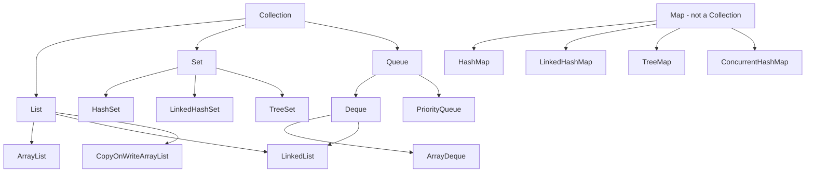
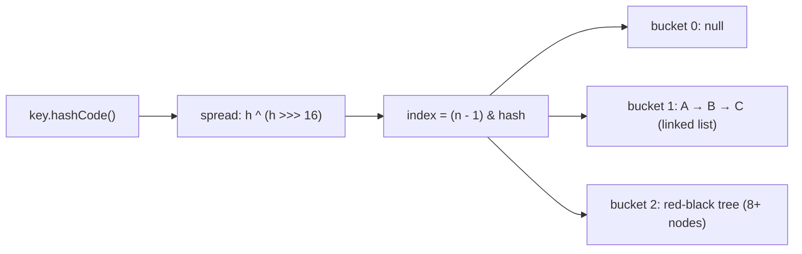

# Collections internals

> **TL;DR** `HashMap` is an array of **buckets**; a key's bucket index is `(n - 1) & hash`, which is a fast way to compute `hash % n` when `n` is a power of two. Each bucket starts as a linked list of entries and is converted to a red-black tree if it gets long, so one bad bucket cannot make lookups linear. `ArrayList` is a plain array that is replaced by a 1.5× bigger copy when it fills up. Know **five numbers** (16, 0.75, 8, 64, 6) and the difference between **fail-fast** and **weakly consistent** iterators, and you can answer most collections MCQs.

## Mental model: the collections family



What each interface promises:

- **`List`**: ordered by position, duplicates allowed, access by index (`get(3)`).
- **`Set`**: no duplicates (as judged by `equals`, or by `compareTo` for sorted sets).
- **`Queue`**: elements are taken from a "head" (`poll`, `peek`), usually first-in-first-out, or by priority for `PriorityQueue`.
- **`Deque`** ("double-ended queue", pronounced "deck"): add and remove at both ends, so it works as a queue *and* a stack.
- **`Map`**: key → value pairs with unique keys.

`Map` does **not** extend `Collection`, because a map is a set of *pairs*, and `Collection` methods like `add(E element)` don't make sense for it (add what, a key or a value?). You get collection views instead: `keySet()`, `values()`, `entrySet()`.

**`HashSet` is a `HashMap` underneath.** A `HashSet<E>` stores each element as a *key* in an internal `HashMap<E, Object>` whose values are all the same shared dummy object (`PRESENT`). Since map keys are unique, set elements are unique for free. In the same way, `TreeSet` is backed by a `TreeMap` and `LinkedHashSet` by a `LinkedHashMap`. So everything below about maps also explains sets.

## Deep dive: HashMap



Internally a `HashMap` is an array called `table`. Each slot is a **bucket** holding zero or more entries (`Node` objects with `hash`, `key`, `value`, `next`). To store a key, the map turns its `hashCode()` into an array index, and to find it again it computes the same index and searches only that one bucket. That is why average lookups are O(1): you go straight to one small bucket instead of scanning everything.

| Fact | Value | Why |
|---|---|---|
| Default capacity | **16** buckets. The array is not created in the constructor but **lazily on the first `put`**. | Many maps are created and never used; lazy allocation avoids wasting memory on them. |
| Default load factor | **0.75**. The map resizes when `size > capacity × 0.75`, which is **12** for 16 buckets. | Load factor is "how full may the table get". Higher means less memory but more collisions; lower means fewer collisions but more wasted slots. 0.75 is the measured sweet spot. |
| Capacity | Always a **power of two** (16, 32, 64, …). Asking for 100 gives 128. | For a power of two `n`, `hash & (n - 1)` gives the same result as `hash % n` for non-negative hashes, but a bitwise AND is much cheaper than a division, and it never produces a negative index. |
| Resize | Capacity **doubles**, and each node either stays at index `i` or moves to exactly `i + oldCap`. | Doubling adds one more bit to the mask. If that new bit of the node's hash is 0 the index is unchanged; if it is 1 the index grows by `oldCap`. So the map can split each bucket into two without recomputing anything else. |
| Treeify | A bucket's list is converted into a red-black tree when it grows past **8** nodes (`TREEIFY_THRESHOLD`) **and** the table has at least **64** buckets (`MIN_TREEIFY_CAPACITY`). | Long chains mean many keys collide; a balanced tree makes searching that bucket O(log k) instead of O(k). Tree nodes use about twice the memory, so it is done only when needed. |
| If capacity < 64 | The table **resizes** instead of treeifying. | In a small table, a long bucket is more likely caused by the table being too small than by truly identical hashes. Doubling spreads the keys out, which is cheaper and fixes the real cause. |
| Untreeify | When a resize splits a tree bucket and a half ends up with **6** or fewer nodes, it goes back to a linked list (`UNTREEIFY_THRESHOLD`). | The gap between 8 and 6 (*hysteresis*) stops a bucket hovering around one size from converting back and forth on every insert/remove. |
| Null | **One `null` key** (stored in bucket 0, since `null` is given hash 0) and any number of `null` values. | `HashMap` special-cases `null` rather than calling `hashCode()` on it. |
| Complexity | **O(1)** average. Worst case per bucket is **O(log n)** since Java 8 (was O(n) before). | The worst case is many keys in one bucket, which used to be a long list and is now a tree. For the tree to help, keys should implement `Comparable`; otherwise the map falls back to a slower tie-breaking order. |

**Why spread the hash?** The index uses only the *low* bits of the hash: with 16 buckets, `& 15` keeps just the bottom 4 bits. If a class's hash codes differ only in their high bits (common for things like floating-point keys or addresses), every key would land in the same bucket. `h ^ (h >>> 16)` XORs the top 16 bits into the bottom 16 so the high bits also influence the bucket choice. It costs one shift and one XOR, which is why it was chosen over a heavier mixing function.

**Put, step by step:**

1. Compute the spread hash of the key (`0` for a `null` key).
2. If the table hasn't been allocated yet, allocate 16 buckets.
3. Find the bucket: `index = (n - 1) & hash`.
4. If the bucket is empty, place a new node there and go to step 7.
5. Otherwise walk the bucket. For each node, first compare the stored hash (a cheap `int` comparison that rules out most non-matches), then compare keys with `==` or `equals`. If a node matches, **replace its value**, return the old value and stop (the size doesn't change).
6. If no node matched, append a new node at the tail of the list (or insert it into the tree). If the list is now longer than 8, treeify the bucket (or resize, if the table is under 64).
7. Increment `size` and `modCount` (the structural change counter used by fail-fast iterators). If `size` now exceeds the threshold (`capacity × loadFactor`), double the table.

**Not thread-safe.** `HashMap` has no locking at all. If two threads `put` at the same time, both can read the same empty bucket and both write a node into it, so one entry is lost; or one thread can resize while another inserts into the old table, so writes vanish; and `size` can be wrong because `size++` is not atomic. The famous **infinite loop on resize** came from Java 7 inserting at the *head* of each list, which could reverse links during a concurrent resize and create a cycle that `get` would loop around forever. Java 8 inserts at the *tail* and preserves order on resize, so that particular loop is gone, but lost updates and corruption are still possible. For shared mutable maps use `ConcurrentHashMap`.

## ConcurrentHashMap (Java 8+)

- **Fine-grained locking.** There is no lock for the whole map. Java 7 split the map into 16 *segments*, each with its own lock; Java 8 removed segments and goes further:
    - **Empty bucket:** the new node is installed with a **CAS** (compare-and-swap, a single CPU instruction that sets a slot only if it still holds the expected value, here `null`). If another thread got there first, the CAS fails and the thread retries. No lock is taken at all.
    - **Non-empty bucket:** the thread **synchronizes on the first node of that bucket only**. Threads writing to other buckets are not blocked, so throughput scales with the number of buckets rather than the number of segments.
- **Reads (`get`) are lock-free** in almost all cases. The table slots and each node's `value` and `next` fields are read with *volatile* semantics, so a reader always sees a fully published node without taking any lock. Readers never block writers and writers never block readers.
- **No `null` keys or values.** In a single-threaded `HashMap`, `get(k) == null` is ambiguous (absent, or present with value `null`?), but you can resolve it with `containsKey(k)`. In a concurrent map that two-step check is a race: another thread could change the map between the two calls. Banning `null` makes `get` returning `null` *always* mean "absent", so a single call gives a reliable answer. Inserting `null` throws `NullPointerException`.
- **`size()` is an estimate under concurrency.** Keeping one shared counter would make every writer contend on it. Instead the count is spread across several counter cells (the same idea as `LongAdder`) and `size()` sums them. While other threads are writing, the sum can be momentarily stale. That is fine for monitoring but should not drive correctness logic. `mappingCount()` returns the same value as a `long`.
- **Iterators are weakly consistent.** They never throw `ConcurrentModificationException`, they never return an element twice, and they reflect the state at some point at or after their creation, so they *may or may not* show changes made during iteration. This lets you iterate while other threads keep writing.
- **Use atomic compound operations.** Each single method of `ConcurrentHashMap` is thread-safe, but a *sequence* of calls is not. In `if (!map.containsKey(k)) map.put(k, v)`, two threads can both see "absent" and both `put`, so one value overwrites the other. Methods like `computeIfAbsent`, `putIfAbsent`, `compute` and `merge` do the check and the update as one atomic step while holding the bucket's lock.

```java
ConcurrentHashMap<String, LongAdder> counts = new ConcurrentHashMap<>();
counts.computeIfAbsent(word, k -> new LongAdder()) // atomically creates the counter once per word, even under races
      .increment();                                 // LongAdder.increment is itself thread-safe and scales under contention
```

Keep the function passed to `computeIfAbsent`/`compute` short, and never modify the same map from inside it: it runs while the bucket is locked, so slow work blocks other writers to that bucket, and recursive updates can throw `IllegalStateException` or deadlock.

**`Hashtable` and `Collections.synchronizedMap`** make every method `synchronized` on a single lock, so only one thread can use the map at a time, even for reads. They are correct but scale badly under concurrency, and iterating them still requires you to lock manually (`synchronized (map) { for (...) }`), or you can get `ConcurrentModificationException`. They survive only in legacy code.

## ArrayList vs LinkedList

| | ArrayList | LinkedList |
|---|---|---|
| Backing | One `Object[]` array holding references to the elements in order. | A chain of `Node` objects, each with `item`, `next` and `prev` references (doubly linked). |
| `get(i)` | **O(1)**: compute the slot address directly. | **O(n)**: walk node by node from whichever end (head or tail) is closer. |
| Add at end | **Amortised O(1)**: usually just writes the next slot; occasionally copies everything into a bigger array, but averaged over all adds that cost is constant. | **O(1)**: link a new node after the tail. |
| Insert/remove in middle | **O(n)**: every later element is shifted one slot (`System.arraycopy`, which is fast in practice). | **O(1) once you are holding the node** (e.g. via a `ListIterator`), but finding position `i` first is O(n), so `list.add(i, x)` is O(n) overall. |
| Memory | Compact: one reference per element plus some spare capacity. Elements are referenced from one contiguous block, so the CPU cache prefetches them well. | Each element costs a separate node object (header + 3 references, about 24 bytes with compressed pointers) scattered across the heap, so every step is a likely cache miss. |
| Growth | Default capacity **10**, allocated on the first `add` (an empty `new ArrayList<>()` uses a shared empty array). When full, the capacity grows by **1.5×** (`old + old >> 1`) and elements are copied over. | Grows one node at a time; no copying. |

**In practice `ArrayList` wins almost always.** Big-O hides constants: modern CPUs read memory in cache lines and prefetch sequential data, so shifting a contiguous array is often faster than following a few scattered pointers. Use `ArrayDeque` instead of `LinkedList` when you need a queue or stack. `LinkedList` mainly survives because it is the only `java.util` class that is both a `List` and a `Deque`. If you know the size in advance, `new ArrayList<>(expectedSize)` avoids repeated resizing.

## Ordered maps and sets

- **`LinkedHashMap`** is a `HashMap` whose entries are *also* threaded onto a doubly linked list, so it can iterate in a predictable order at the cost of two extra references per entry.
    - **Insertion order** (default): iteration returns keys in the order they were first put. Re-putting an existing key does not move it.
    - **Access order**: construct with `new LinkedHashMap<>(16, 0.75f, true)` (the third argument is `accessOrder`). Every `get` or `put` of a key moves that entry to the end of the list, so the *first* entry is always the least recently used.
    - **LRU cache:** after each insert, `LinkedHashMap` calls `removeEldestEntry(eldest)`. It returns `false` by default; override it to return `true` when the map is over capacity, and the eldest (least recently used) entry is evicted automatically. See the code below.
- **`TreeMap`** stores entries in a **red-black tree**, a self-balancing binary search tree, so `get`/`put`/`remove` are **O(log n)** and keys are always kept in sorted order. The order comes from the keys' `Comparable` implementation (*natural ordering*) or from a `Comparator` passed to the constructor. Because it is sorted, it offers **navigation methods** a hash map cannot: `floorKey(k)` (greatest key ≤ k), `ceilingKey(k)` (smallest key ≥ k), `firstKey`/`lastKey`, `headMap(k)` (all keys < k), `tailMap(k)` (keys ≥ k), `subMap(a, b)`. These make it the natural choice for time ranges, price levels or "nearest value" lookups. With natural ordering, a `null` key throws `NullPointerException`, because inserting it would require calling `null.compareTo(...)`. A custom comparator that handles `null` can allow it.
- **`TreeSet`/`TreeMap` use `compareTo` (or the comparator), not `equals`, to detect duplicates.** A tree finds a key by asking "is it smaller, larger or the same?" at each node, and "the same" means `compare(a, b) == 0`. `equals` is never called. If your comparator returns 0 for two items that are not `equals` (for example, comparing people only by age), the second one is treated as a duplicate and silently not added. That is why the Javadoc asks for comparators that are *consistent with equals*. The `BigDecimal` example from [Core language traps](01-core-language.md) is the classic case: `2.0` and `2.00` are two elements in a `HashSet` but one in a `TreeSet`.

## Queues and deques

- **`ArrayDeque`** is a resizable **circular array**: it keeps `head` and `tail` indexes that wrap around the end of the array, so adding or removing at either end is O(1) with no shifting. It is the recommended implementation for both:
    - **Stack** (last-in-first-out): `push`, `pop`, `peek`. It replaces the legacy `Stack` class, which extends `Vector`, so every call pays for `synchronized`, and it exposes index-based methods that break stack semantics.
    - **Queue** (first-in-first-out): `offer`, `poll`, `peek`.

    It is faster than `LinkedList` because there are no per-element node objects. It does **not** allow `null` elements, because `poll()` and `peek()` return `null` to mean "the deque is empty", and a stored `null` would be indistinguishable from that.

- **`PriorityQueue`** is a **binary min-heap** stored in an array: a tree flattened so the children of slot `i` sit at `2i+1` and `2i+2`, and every parent is ≤ its children. The smallest element (by natural order or a comparator) is always at index 0, so `peek` is **O(1)**. `offer` and `poll` are **O(log n)**, because they move one element up or down the tree to restore the heap rule. For a *max*-heap pass `Comparator.reverseOrder()`. The heap rule only orders parents relative to children, not siblings or cousins, so **its iterator (and `toString`) is not in sorted order**: it simply walks the underlying array. Only repeated `poll()` returns elements in priority order.
- Blocking queues (`ArrayBlockingQueue`, `LinkedBlockingQueue`, `SynchronousQueue`), which make a producer or consumer thread wait when the queue is full or empty, are covered in [Concurrency](03-concurrency.md).

## Fail-fast vs weakly consistent vs snapshot

| Iterator type | Collections | On concurrent modification |
|---|---|---|
| **Fail-fast** | `ArrayList`, `HashMap`, most of `java.util` | Throws `ConcurrentModificationException`. **Best effort**: it detects the problem via `modCount`, but is not guaranteed to. |
| **Weakly consistent** | `ConcurrentHashMap`, `ConcurrentLinkedQueue`, other `java.util.concurrent` collections | No exception; it may or may not see updates made after the iterator was created. |
| **Snapshot** | `CopyOnWriteArrayList`, `CopyOnWriteArraySet` | Iterates over the array exactly as it was when the iterator was created; never sees later writes, never throws. |

**How fail-fast works.** Each collection keeps an `int modCount` that is incremented on every *structural* change (add, remove, clear, resize; but not `set`, which replaces a value in place). An iterator copies `modCount` when it is created and checks it on every `next()`. If the numbers differ, someone changed the collection behind the iterator's back, so its position may now be wrong; it throws `ConcurrentModificationException` (CME) instead of returning garbage. It is "best effort" because the check is not synchronized: with real multithreading a change can go unnoticed, so CME is a bug detector, not a thread-safety mechanism.

**How snapshot works.** `CopyOnWriteArrayList` never modifies its array. Every write copies the whole array, applies the change to the copy, and swaps the reference to the new array. An iterator holds on to whichever array was current when it started, which nobody will ever modify, so it needs no locks. The price is an O(n) copy on every write, so it only makes sense when reads vastly outnumber writes.

**CME in one thread.** Despite the name, CME most often happens with **no concurrency at all**:

```java
for (String s : list) {          // for-each uses an Iterator under the hood
    if (s.isEmpty()) list.remove(s);  // modifies the list directly, bumping modCount
}                                  // the next hidden iterator.next() sees the mismatch and throws CME
```

Fix it with `list.removeIf(String::isEmpty)`, or use the iterator explicitly and call `iterator.remove()`, which removes the current element *and* updates the iterator's expected `modCount`.

## Immutable vs unmodifiable

These factories look alike but behave very differently:

| Factory | Mutable? | Nulls? |
|---|---|---|
| `List.of(...)`, `Set.of(...)`, `Map.of(...)` (Java 9+) | **Fully immutable**: every mutator (`add`, `set`, `remove`, `put`) throws `UnsupportedOperationException`. Nothing can change it, because nobody else holds a reference to its internal storage. `Set.of` and `Map.of` also throw `IllegalArgumentException` on duplicate elements or keys. | **Throws NPE** on `null` elements, keys or values (and even `contains(null)` throws). |
| `Arrays.asList(...)` | **Fixed-size**: `set(i, x)` works, but `add`/`remove` throw `UnsupportedOperationException`. It is a thin list wrapper *over the original array*, not a copy, so changing the list changes the array and vice versa, and an array cannot change length. | Allowed. |
| `Collections.unmodifiableList(x)` | A read-only **view**: you cannot modify it through the view, but it reads straight through to `x`, so whoever still holds `x` can change it, and those changes show up in the view. | Allowed. |
| `List.copyOf(x)` (Java 10+) | **Immutable copy** of `x`; later changes to `x` don't affect it. If `x` is already an immutable list from `List.of`, it may return `x` itself without copying. | NPE on `null`. |
| `stream.toList()` (Java 16+) | **Unmodifiable** list. | Allowed (unlike `List.of`). `collect(Collectors.toList())` gives no guarantee and in practice returns a mutable `ArrayList`. |

Rule of thumb: to hand out data that the receiver must not change *and* that you won't change behind their back, use `List.copyOf` / `List.of`. Use `unmodifiableList` only when you deliberately want a live read-only window onto changing data.

## Code you should be able to write

```java
class LruCache<K, V> extends LinkedHashMap<K, V> {
    private final int capacity;
    LruCache(int capacity) {
        super(16, 0.75f, true);          // initialCapacity, loadFactor, accessOrder = true:
                                         // every get/put moves the entry to the end (most recently used)
        this.capacity = capacity;
    }
    @Override
    protected boolean removeEldestEntry(Map.Entry<K, V> eldest) {
        return size() > capacity;        // called after every put; true = evict the head (least recently used)
    }
}
```

With `accessOrder = true` the linked list is always ordered from least to most recently used, so the head (`eldest`) is exactly the entry an LRU cache should drop. After every insertion `LinkedHashMap` asks `removeEldestEntry` whether to evict, and returning `true` removes the head.

This class is **not thread-safe**: in access-order mode even `get` modifies the linked list, so concurrent reads can corrupt it. For concurrent use wrap it in `Collections.synchronizedMap` (simple, but one lock for everything) or use a caching library such as Caffeine, which is built for concurrent eviction.

## Traps

- "HashMap becomes a tree at 8 entries." Only **that one bucket** is converted, only when its chain grows past 8, and only if the table already has at least 64 buckets; otherwise the whole table resizes instead.
- "ConcurrentHashMap allows one null key like HashMap." **No nulls at all**, neither keys nor values, so that `get` returning `null` can only mean "absent".
- "Iterating a PriorityQueue gives sorted order." Only `poll()` does. The iterator walks the heap array, which is only partially ordered.
- "`Arrays.asList` returns an `ArrayList`." It returns `java.util.Arrays$ArrayList`, a private fixed-size wrapper over the array that happens to have the same simple name. It is not `java.util.ArrayList`, and `add` throws.
- "`Collections.unmodifiableList` is immutable." It is only a read-only **view**; the underlying list can still change and the view will show it. Use `List.copyOf` for a true immutable snapshot.

## Say it out loud

**"Walk me through HashMap.put."**
It takes the key's hash code and XORs the high 16 bits into the low 16 so that all bits affect the bucket, then ANDs it with table length minus one (a fast modulo, because the length is a power of two) to pick a bucket. If the bucket is empty it places a new node. Otherwise it walks the bucket comparing the stored hash first and then `equals`; a match replaces the value, and no match appends a new node at the tail. If that bucket's chain grows past eight nodes it becomes a red-black tree, but only once the table has at least 64 buckets; before that the map resizes instead. Finally, if size exceeds capacity times load factor, 12 for the default 16 buckets, the table doubles, and each node either keeps its index or moves to its index plus the old capacity, depending on one extra bit of its hash.

**"How is ConcurrentHashMap thread-safe without locking everything?"**
It locks per bucket instead of per map. An empty bucket is filled with a CAS, so no lock at all; a non-empty bucket is updated while synchronizing only on its first node, so threads writing to different buckets never block each other. Reads are mostly lock-free because the table slots and node fields are read with volatile semantics, which guarantees a reader sees fully constructed nodes. On top of that it offers atomic compound operations like `computeIfAbsent` and `merge`, because a check-then-act sequence of separate calls would still be a race.

## Practice MCQs

**Q1.** A `HashMap` with default settings has 13 entries after a `put`. What is its capacity?

- A) 16
- B) 24
- C) 32
- D) 64

<details markdown="1"><summary>Answer</summary>

**C.** Default capacity is 16 and the resize threshold is 16 × 0.75 = 12. When the 13th entry makes `size` exceed 12, the table doubles to 32 (the new threshold is 24). B is wrong because capacity is always a power of two; D would need a second resize, after the 25th entry.
</details>

**Q2.** A bucket in a HashMap with capacity 16 reaches 8 colliding nodes, and another colliding key is added. What happens?

- A) The bucket becomes a red-black tree
- B) The table resizes
- C) An exception is thrown
- D) Nothing until 16 nodes

<details markdown="1"><summary>Answer</summary>

**B.** Treeification also requires a table capacity of at least 64 (`MIN_TREEIFY_CAPACITY`). With only 16 buckets, the map assumes the table is simply too small and doubles it instead, which spreads the keys out. A would be correct only if capacity were already 64 or more.
</details>

**Q3.** Which is true of `ConcurrentHashMap` in Java 8+?

- A) It locks the whole map on writes
- B) It uses 16 fixed segments
- C) It rejects null keys and null values
- D) Its iterators are fail-fast

<details markdown="1"><summary>Answer</summary>

**C.** Inserting a `null` key or value throws `NullPointerException`, so `get` returning `null` always means "absent". A describes `Hashtable`. B describes Java 7 (segments were removed in Java 8 in favour of CAS on empty buckets plus locking on a bucket's first node). D is wrong: its iterators are weakly consistent and never throw `ConcurrentModificationException`.
</details>

**Q4.** What happens here?
```java
List<String> xs = Arrays.asList("a", "b");
xs.set(0, "z");
xs.add("c");
```

- A) Works; list is `[z, b, c]`
- B) `set` throws
- C) `add` throws `UnsupportedOperationException`
- D) Compile error

<details markdown="1"><summary>Answer</summary>

**C.** `Arrays.asList` returns a fixed-size list backed directly by the array. `set` just writes an array slot, so it works (and also changes the underlying array). `add` would need the array to grow, which is impossible, so it throws `UnsupportedOperationException` at runtime. It compiles because the declared type `List` has an `add` method.
</details>

**Q5.** A `TreeSet<String>` uses `String.CASE_INSENSITIVE_ORDER`. You add `"Java"` and `"JAVA"`. The size is:

- A) 0
- B) 1
- C) 2
- D) Throws

<details markdown="1"><summary>Answer</summary>

**B.** A `TreeSet` decides "duplicate or not" with the comparator, never with `equals`. The case-insensitive comparator returns 0 for `"Java"` vs `"JAVA"`, so the second `add` is treated as a duplicate and returns `false`; the set keeps only `"Java"`. A `HashSet` would keep both, because `"Java".equals("JAVA")` is `false`.
</details>

**Q6.** Best choice for a list of event listeners that is iterated thousands of times per second and changed rarely, from many threads:

- A) `ArrayList`
- B) `Collections.synchronizedList`
- C) `CopyOnWriteArrayList`
- D) `LinkedList`

<details markdown="1"><summary>Answer</summary>

**C.** Copy-on-write is designed for read-mostly data: each iterator works on an immutable snapshot of the array, so iteration needs no locks and never throws CME, and many threads can iterate at once. Each write copies the whole array, which is expensive but acceptable when writes are rare. A and D are not thread-safe. B is safe for single calls, but iteration must be wrapped in `synchronized (list)` by hand, which blocks every other thread for the whole loop.
</details>

**Q7.** Which removal is safe while iterating a single-threaded `ArrayList`?

- A) `for (String s : list) if (cond) list.remove(s);`
- B) `list.removeIf(s -> cond)`
- C) `for (int i = 0; i < list.size(); i++) list.remove(i);`
- D) All of the above

<details markdown="1"><summary>Answer</summary>

**B.** A modifies the list behind the for-each loop's hidden iterator, so the next `next()` sees a changed `modCount` and throws `ConcurrentModificationException`, even with one thread. C does not throw, but after removing index `i` every later element shifts left by one, and then `i++` skips the element that moved into position `i`. `removeIf` (or explicit `Iterator.remove()`) handles the bookkeeping correctly.
</details>

**Q8.** Iterating over a `PriorityQueue` of `[5, 1, 3]` with for-each:

- A) Always prints `1 3 5`
- B) Always prints `5 3 1`
- C) Prints in heap array order, not guaranteed sorted
- D) Throws `UnsupportedOperationException`

<details markdown="1"><summary>Answer</summary>

**C.** A `PriorityQueue` is a binary heap stored in an array, which only guarantees each parent ≤ its children, and the iterator simply walks that array. Here it might print `1 5 3`. Only `poll()`/`remove()` hand out elements in priority order, because each call removes the root and restores the heap. To see the contents sorted, copy them to a list and sort it.
</details>

## Related

- [Core language traps](01-core-language.md): the `equals`/`hashCode` contract that makes bucket lookup work, and why collisions are allowed.
- [Concurrency](03-concurrency.md): blocking queues, CAS, `volatile` and atomic map operations.
