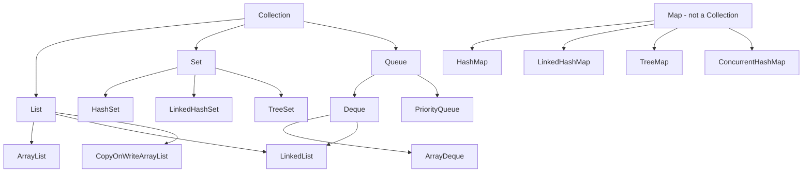
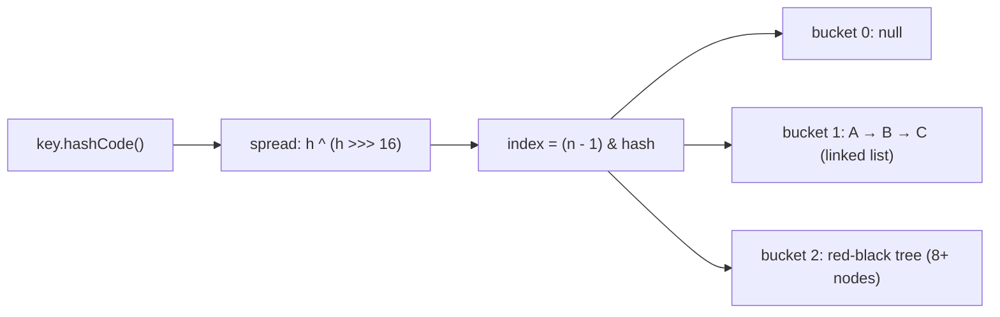

# Collections internals

> **TL;DR** `HashMap` is an array of buckets indexed by `(n - 1) & hash`; buckets start as linked lists and turn into red-black trees when they get long. `ArrayList` is a resizable array that grows by 1.5x. Know **five numbers** (16, 0.75, 8, 64, 6) and the difference between **fail-fast** and **weakly consistent** iterators, and you can answer most collections MCQs.

## Mental model: the collections family



`Map` does **not** extend `Collection`. `HashSet` is a `HashMap` underneath (values are a shared dummy object), and `TreeSet` is a `TreeMap`.

## Deep dive: HashMap



| Fact | Value |
|---|---|
| Default capacity | **16** (table allocated lazily on first `put`) |
| Default load factor | **0.75**; resize when `size > capacity × 0.75` (12 for 16) |
| Capacity | always a **power of two**, so `(n - 1) & hash` replaces `%` |
| Resize | **doubles** capacity; each node stays at index `i` or moves to `i + oldCap` |
| Treeify | bucket reaches **8** nodes **and** table capacity is at least **64** |
| If capacity < 64 | the table **resizes** instead of treeifying |
| Untreeify | when a tree bucket shrinks to **6** or fewer nodes |
| Null | one `null` key (bucket 0) and any number of `null` values |
| Complexity | O(1) average; worst case O(log n) per bucket since Java 8 (was O(n)) |

**Why spread the hash?** `h ^ (h >>> 16)` mixes the high bits into the low bits, because the index only uses the low bits when the table is small.

**Put, step by step:** compute hash → find bucket → if empty, place node → else walk the bucket: if a node has the same hash and `equals` is true, replace the value → otherwise append (or insert into the tree) → increment size → resize if over the threshold.

**Not thread-safe.** Concurrent puts can lose updates or corrupt state. (The famous infinite-loop-on-resize bug was in Java 7's head insertion; Java 8 uses tail insertion, but the map is still unsafe.)

## ConcurrentHashMap (Java 8+)

- No global lock and no segments (segments were Java 7). Empty bucket: insert with **CAS**. Non-empty bucket: **synchronize on the first node** of that bucket only.
- Reads (`get`) are mostly lock-free using volatile reads.
- **No `null` keys or values.** `get` returning `null` must unambiguously mean "absent".
- `size()` is an estimate under concurrency (computed from striped counters, similar to `LongAdder`).
- Iterators are **weakly consistent**: never throw `ConcurrentModificationException`, may or may not reflect concurrent updates.
- Use **atomic compound operations**: `computeIfAbsent`, `merge`, `compute`. `if (!map.containsKey(k)) map.put(k, v)` is a race even on a concurrent map.

```java
ConcurrentHashMap<String, LongAdder> counts = new ConcurrentHashMap<>();
counts.computeIfAbsent(word, k -> new LongAdder()).increment();
```

`Hashtable` and `Collections.synchronizedMap` lock the **whole map** on every call; they are legacy choices.

## ArrayList vs LinkedList

| | ArrayList | LinkedList |
|---|---|---|
| Backing | `Object[]` | doubly linked nodes |
| `get(i)` | O(1) | O(n) |
| Add at end | amortised O(1) | O(1) |
| Insert/remove in middle | O(n) shifting | O(1) **once you have the node**, but finding it is O(n) |
| Memory | compact, cache-friendly | ~24+ bytes overhead per node |
| Growth | default capacity 10 (allocated on first add), grows by **1.5x** | n/a |

In practice `ArrayList` (or `ArrayDeque` for queues) wins almost always because of CPU cache locality.

## Ordered maps and sets

- `LinkedHashMap`: HashMap plus a doubly linked list. Insertion order by default; **access order** with `new LinkedHashMap<>(16, 0.75f, true)`. Override `removeEldestEntry` to get an **LRU cache**.
- `TreeMap`: **red-black tree**, O(log n), sorted by `Comparable` or a `Comparator`. Navigation methods: `floorKey`, `ceilingKey`, `headMap`, `tailMap`. Does not allow a `null` key with natural ordering.
- `TreeSet`/`TreeMap` use `compareTo`, **not** `equals`, to detect duplicates. If the comparator says two items are equal, one is dropped.

## Queues and deques

- `ArrayDeque`: circular array, faster than `Stack` and `LinkedList`. Use it as both a stack (`push`/`pop`) and a queue (`offer`/`poll`). Does **not** allow `null`.
- `PriorityQueue`: binary **min-heap**. `offer`/`poll` O(log n), `peek` O(1). Its **iterator is not sorted**; only `poll` returns elements in order.
- Blocking queues (`ArrayBlockingQueue`, `LinkedBlockingQueue`, `SynchronousQueue`) are covered in [Concurrency](03-concurrency.md).

## Fail-fast vs weakly consistent vs snapshot

| Iterator type | Collections | On concurrent modification |
|---|---|---|
| **Fail-fast** | `ArrayList`, `HashMap`, most `java.util` | throws `ConcurrentModificationException` (best effort, via `modCount`) |
| **Weakly consistent** | `ConcurrentHashMap`, `ConcurrentLinkedQueue` | no exception; may see some updates |
| **Snapshot** | `CopyOnWriteArrayList` | iterates over the array as it was; never sees later writes |

Removing during a for-each loop throws CME even in **one** thread. Use `iterator.remove()` or `list.removeIf(...)`.

## Immutable vs unmodifiable

| Factory | Mutable? | Nulls? |
|---|---|---|
| `List.of(...)`, `Map.of(...)` | fully immutable | **throws NPE** on null |
| `Arrays.asList(...)` | **fixed-size**: `set` works, `add`/`remove` throw `UnsupportedOperationException`; backed by the array | allowed |
| `Collections.unmodifiableList(x)` | read-only **view**; changes to `x` show through | allowed |
| `List.copyOf(x)` | immutable copy | NPE on null |
| `stream.toList()` (16+) | unmodifiable | allowed |

## Code you should be able to write

```java
class LruCache<K, V> extends LinkedHashMap<K, V> {
    private final int capacity;
    LruCache(int capacity) {
        super(16, 0.75f, true);          // accessOrder = true
        this.capacity = capacity;
    }
    @Override
    protected boolean removeEldestEntry(Map.Entry<K, V> eldest) {
        return size() > capacity;
    }
}
```

Not thread-safe; for concurrent use, wrap it or use a library such as Caffeine.

## Traps

- "HashMap becomes a tree at 8 entries." Only that **bucket**, and only if capacity is at least 64.
- "ConcurrentHashMap allows one null key like HashMap." **No nulls at all.**
- "Iterating a PriorityQueue gives sorted order." Only `poll` does.
- "`Arrays.asList` returns an `ArrayList`." It returns `Arrays$ArrayList`, a fixed-size view.
- "`Collections.unmodifiableList` is immutable." It is a view; the source can still change.

## Say it out loud

**"Walk me through HashMap.put."**
It spreads the key's hash, masks it with table length minus one to pick a bucket, and if the bucket is empty places a node. Otherwise it walks the bucket comparing hash and then `equals`; a match replaces the value, no match appends. Buckets with eight or more nodes become red-black trees once the table is at least 64 long. After insertion, if size exceeds capacity times load factor, the table doubles and nodes split between their old index and old index plus old capacity.

**"How is ConcurrentHashMap thread-safe without locking everything?"**
It uses CAS to fill empty buckets and synchronizes only on the head node of a non-empty bucket, so writers to different buckets don't block each other, and reads are mostly lock-free through volatile fields.

## Practice MCQs

**Q1.** A `HashMap` with default settings has 13 entries after a `put`. What is its capacity?
- A) 16
- B) 24
- C) 32
- D) 64

<details markdown="1"><summary>Answer</summary>

**C.** The threshold is 16 × 0.75 = 12. Exceeding it doubles capacity to 32.
</details>

**Q2.** A bucket in a HashMap with capacity 16 reaches 8 colliding nodes. What happens?
- A) The bucket becomes a red-black tree
- B) The table resizes
- C) An exception is thrown
- D) Nothing until 16 nodes

<details markdown="1"><summary>Answer</summary>

**B.** Treeification needs table capacity of at least 64 (`MIN_TREEIFY_CAPACITY`); below that, HashMap resizes instead.
</details>

**Q3.** Which is true of `ConcurrentHashMap` in Java 8+?
- A) It locks the whole map on writes
- B) It uses 16 fixed segments
- C) It rejects null keys and null values
- D) Its iterators are fail-fast

<details markdown="1"><summary>Answer</summary>

**C.** Segments were Java 7. Java 8 uses CAS plus per-bucket synchronization, iterators are weakly consistent, and nulls are rejected.
</details>

**Q4.** What happens here?
```java
List<String> xs = Arrays.asList("a", "b");
xs.set(0, "z");
xs.add("c");
```
- A) Works; list is `[z, b, c]`
- B) `set` throws
- C) `add` throws `UnsupportedOperationException`
- D) Compile error

<details markdown="1"><summary>Answer</summary>

**C.** `Arrays.asList` is fixed-size: `set` is allowed, structural changes are not.
</details>

**Q5.** A `TreeSet<String>` uses `String.CASE_INSENSITIVE_ORDER`. You add `"Java"` and `"JAVA"`. The size is:
- A) 0
- B) 1
- C) 2
- D) Throws

<details markdown="1"><summary>Answer</summary>

**B.** TreeSet detects duplicates with the comparator, not `equals`. The comparator says they are equal.
</details>

**Q6.** Best choice for a list of event listeners that is iterated thousands of times per second and changed rarely, from many threads:
- A) `ArrayList`
- B) `Collections.synchronizedList`
- C) `CopyOnWriteArrayList`
- D) `LinkedList`

<details markdown="1"><summary>Answer</summary>

**C.** Read-mostly workloads are what copy-on-write is for: iteration needs no locking and never throws CME. Writes are expensive, which is fine when rare.
</details>

**Q7.** Which removal is safe while iterating a single-threaded `ArrayList`?
- A) `for (String s : list) if (cond) list.remove(s);`
- B) `list.removeIf(s -> cond)`
- C) `for (int i = 0; i < list.size(); i++) list.remove(i);`
- D) All of the above

<details markdown="1"><summary>Answer</summary>

**B.** A throws `ConcurrentModificationException`; C skips elements because indexes shift. `removeIf` (or `Iterator.remove`) is correct.
</details>

**Q8.** Iterating over a `PriorityQueue` of `[5, 1, 3]` with for-each:
- A) Always prints `1 3 5`
- B) Always prints `5 3 1`
- C) Prints in heap array order, not guaranteed sorted
- D) Throws `UnsupportedOperationException`

<details markdown="1"><summary>Answer</summary>

**C.** Only `poll()`/`remove()` return elements in priority order.
</details>

## Related

- [Core language traps](01-core-language.md): the `equals`/`hashCode` contract.
- [Concurrency](03-concurrency.md): blocking queues and atomic map operations.
