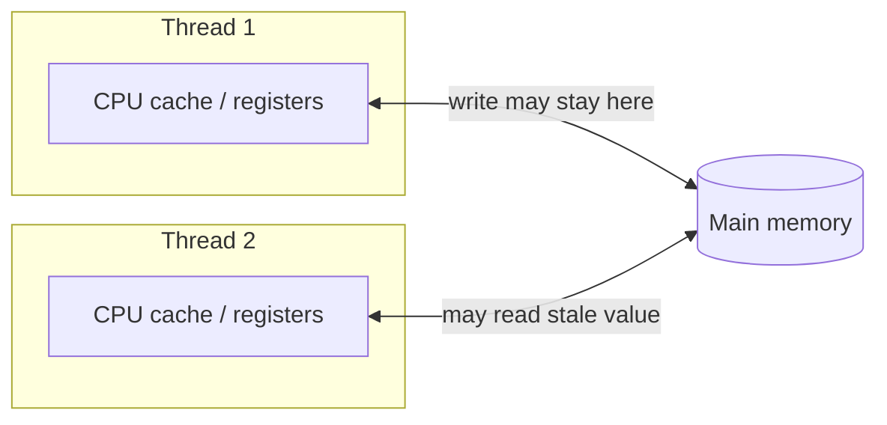
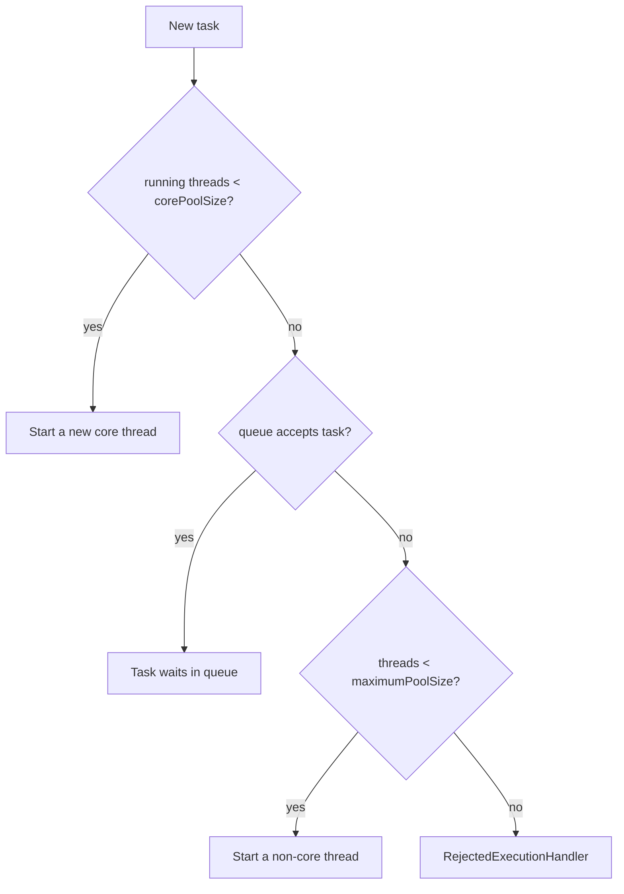

# Concurrency

> **TL;DR** Concurrency bugs come from three things: **visibility** (a thread doesn't see another's write), **atomicity** (a read-modify-write is interrupted), and **ordering** (the compiler/CPU reorders instructions). `volatile` fixes visibility and ordering, `synchronized`/locks fix all three, and **atomics** fix atomicity for single variables using CAS. The **happens-before** rules tell you which guarantee you actually have.

## Mental model: the Java Memory Model



Without a happens-before relationship, Thread 2 is allowed to see a stale value **forever**. The classic example:

```java
boolean running = true;        // NOT volatile
// Thread A: while (running) { }   ← may loop forever
// Thread B: running = false;
```

Make `running` `volatile` and the loop stops.

### Happens-before rules (memorise these)

1. **Program order**: each action in a thread happens-before later actions in that thread.
2. **Monitor lock**: unlocking a monitor happens-before every later lock of the same monitor.
3. **Volatile**: a write to a volatile field happens-before every later read of that field.
4. **Thread start**: `t.start()` happens-before any action in `t`.
5. **Thread join**: all actions in `t` happen-before `t.join()` returns.
6. **Transitivity**: if A hb B and B hb C, then A hb C.

Writes made **before** a volatile write become visible to a thread that reads that volatile. This is why a volatile "ready" flag can safely publish other data.

## Deep dive

### volatile vs synchronized vs atomic

| | Visibility | Atomic compound ops | Blocking | Typical use |
|---|---|---|---|---|
| `volatile` | yes | **no** (`count++` is unsafe) | no | flags, safe publication, DCL |
| `synchronized` | yes | yes | yes | critical sections across several fields |
| `AtomicInteger` etc. | yes | yes, single variable, via CAS | no (spins/retries) | counters, sequences |
| `LongAdder` | yes | increments | no | **high-contention** counters (striped cells) |

`count++` is three steps: read, add, write. Two threads can both read 5 and both write 6.

### synchronized details

- Locks an object's **monitor**: `synchronized` instance method → `this`; `static synchronized` → the `Class` object. These are **different** locks.
- **Reentrant**: a thread holding the lock can enter again.
- `wait()`/`notify()` must be called while **holding** the monitor, otherwise `IllegalMonitorStateException`. Always call `wait()` in a **while loop** (spurious wakeups, and the condition may change before you reacquire the lock).
- `sleep()` keeps the lock. `wait()` releases it.

### ReentrantLock and friends

- `ReentrantLock` adds `tryLock()` (with timeout), `lockInterruptibly()`, optional **fairness**, and multiple `Condition`s. Always `unlock()` in `finally`.
- `ReadWriteLock`: many readers or one writer.
- `StampedLock`: adds optimistic reads; not reentrant.

### CAS and its caveats

Compare-and-swap: "set to new value only if it still equals the expected value", done atomically by the CPU. Loops retry on failure.

- **ABA problem:** value goes A → B → A, and CAS thinks nothing changed. Fix with `AtomicStampedReference` (version stamp).
- Under heavy contention, CAS retries waste CPU; `LongAdder` spreads updates across cells.

### Thread states

`NEW → RUNNABLE ⇄ BLOCKED / WAITING / TIMED_WAITING → TERMINATED`

- **BLOCKED**: waiting to enter a `synchronized` block.
- **WAITING**: `wait()`, `join()`, `LockSupport.park()` without timeout.
- **TIMED_WAITING**: `sleep(ms)`, `wait(ms)`, `join(ms)`.

Calling `start()` twice throws `IllegalThreadStateException`. Calling `run()` directly just runs the code on the **current** thread.

### Thread pools: how ThreadPoolExecutor decides



The **queue fills before** extra threads are created. With an **unbounded** queue, `maximumPoolSize` is never reached.

| Factory | Hidden danger |
|---|---|
| `Executors.newFixedThreadPool(n)` | unbounded `LinkedBlockingQueue` → tasks pile up → **OOM** |
| `Executors.newCachedThreadPool()` | max threads = `Integer.MAX_VALUE` → thread explosion |
| `Executors.newSingleThreadExecutor()` | unbounded queue |

In production, build `ThreadPoolExecutor` yourself with a **bounded** queue and an explicit rejection policy. Default policy is `AbortPolicy` (throws `RejectedExecutionException`); `CallerRunsPolicy` gives natural back-pressure.

**Sizing rule of thumb:** CPU-bound ≈ number of cores (+1). I/O-bound ≈ cores × (1 + wait time / compute time).

Always `shutdown()` executors (or use try-with-resources on `ExecutorService` in Java 19+).

### Futures and CompletableFuture

- `Future.get()` blocks. `CompletableFuture` lets you compose.
- `thenApply` = map (sync function). `thenCompose` = flatMap (function returns another `CompletableFuture`). `thenCombine` joins two independent futures. `allOf`/`anyOf` for many.
- Error handling: `exceptionally` (recover), `handle` (result or error), `whenComplete` (side effect, does not change result).
- `*Async` methods without an executor run on **`ForkJoinPool.commonPool()`**. Pass your own executor for blocking I/O, or you starve the common pool (also used by parallel streams).
- `join()` throws unchecked `CompletionException`; `get()` throws checked `ExecutionException`.

```java
CompletableFuture<User> user = CompletableFuture.supplyAsync(() -> userClient.get(id), ioPool);
CompletableFuture<List<Order>> orders = CompletableFuture.supplyAsync(() -> orderClient.list(id), ioPool);
CompletableFuture<Profile> profile = user.thenCombine(orders, Profile::new)
        .orTimeout(2, TimeUnit.SECONDS)
        .exceptionally(ex -> Profile.empty());
```

### Coordination utilities

| Utility | Use |
|---|---|
| `CountDownLatch` | wait until N events happen; **one-shot** |
| `CyclicBarrier` | N threads wait for each other; **reusable** |
| `Semaphore` | limit concurrent access to N permits (e.g., max 10 DB calls) |
| `Phaser` | flexible, multi-phase barrier |
| `BlockingQueue` | producer/consumer hand-off with back-pressure |

### Virtual threads (Java 21)

- Lightweight threads scheduled by the JVM onto a small pool of **carrier** platform threads. Blocking I/O **unmounts** the virtual thread, freeing the carrier.
- Great for **I/O-bound, thread-per-request** code. They do **not** make CPU-bound code faster.
- **Don't pool** them; create one per task: `Executors.newVirtualThreadPerTaskExecutor()`.
- **Pinning:** in JDK 21–23, blocking while inside a `synchronized` block pins the carrier thread (JDK 24 removed most of this). On 21, prefer `ReentrantLock` around blocking calls.
- Be careful with large `ThreadLocal` values: millions of virtual threads means millions of copies.
- Limit access to scarce resources (DB connections) with a `Semaphore`, not with pool size.
- Spring Boot 3.2+: `spring.threads.virtual.enabled=true`.

### Deadlock

Four conditions must all hold: mutual exclusion, hold-and-wait, no preemption, circular wait. Break any one. Most practical fix: **always acquire locks in a global order**, or use `tryLock` with a timeout. Detect with `jstack` (it prints "Found one Java-level deadlock").

### ThreadLocal

Per-thread storage (request context, `SimpleDateFormat`). In **thread pools**, values survive between tasks: always `remove()` in a `finally`, or you leak memory and leak data between requests.

## Code you should be able to write

```java
class BoundedBuffer<T> {
    private final BlockingQueue<T> q = new ArrayBlockingQueue<>(100);
    void produce(T item) throws InterruptedException { q.put(item); }   // blocks when full
    T consume() throws InterruptedException { return q.take(); }        // blocks when empty
}

class Singleton {
    private static volatile Singleton instance;      // volatile is required
    static Singleton get() {
        Singleton local = instance;
        if (local == null) {
            synchronized (Singleton.class) {
                local = instance;
                if (local == null) instance = local = new Singleton();
            }
        }
        return local;
    }
}
```

Without `volatile`, another thread could see a non-null reference to a **partially constructed** object. (A simpler alternative: the holder-class idiom or an enum singleton.)

## Traps

- "`volatile` makes `count++` thread-safe." **No.**
- "`sleep()` releases the lock." **No**, `wait()` does.
- "`newFixedThreadPool` protects you from overload." Its queue is unbounded.
- "`maximumPoolSize` threads are created when core threads are busy." Only after the **queue is full**.
- "Virtual threads speed up CPU-heavy work." **No**, they help blocking I/O.
- "`ConcurrentHashMap` makes check-then-act safe." Use `computeIfAbsent`/`merge`.

## Say it out loud

**"volatile vs synchronized?"**
`volatile` guarantees that writes are visible to other threads and prevents reordering around the access, but it does not make compound actions atomic. `synchronized` gives mutual exclusion plus the same visibility guarantees through the monitor's happens-before edge. I use volatile for flags and safe publication, atomics for single counters, and locks when an invariant spans several fields.

**"How would you size a thread pool for an I/O-heavy service?"**
Start from cores × (1 + wait/compute), measure, and always use a bounded queue with a rejection policy so overload turns into back-pressure instead of an OOM. On Java 21 I'd consider virtual threads for thread-per-request I/O and cap the downstream resource with a semaphore.

## Practice MCQs

**Q1.** Two threads each run `counter++` 1000 times on a `volatile int counter = 0`. The final value is:
- A) Always 2000
- B) Always 1000
- C) Anything up to 2000
- D) Compile error

<details markdown="1"><summary>Answer</summary>

**C.** volatile gives visibility, not atomicity; increments can be lost. Use `AtomicInteger` or `LongAdder`.
</details>

**Q2.** A `ThreadPoolExecutor` has core 2, max 10 and an unbounded `LinkedBlockingQueue`. Under heavy load, how many threads run?
- A) 10
- B) 2
- C) Grows without limit
- D) Depends on the CPU

<details markdown="1"><summary>Answer</summary>

**B.** Extra threads are only created when the queue rejects a task. An unbounded queue never rejects.
</details>

**Q3.** Which method releases the monitor?
- A) `Thread.sleep()`
- B) `Thread.yield()`
- C) `Object.wait()`
- D) `Thread.join()` on another thread while holding a lock

<details markdown="1"><summary>Answer</summary>

**C.** `wait()` releases the monitor and reacquires it before returning. `sleep` and `yield` keep any locks held.
</details>

**Q4.** In the double-checked locking singleton, why is `volatile` needed?
- A) To make the `synchronized` block faster
- B) To prevent another thread from seeing a partially constructed object
- C) To make the field static
- D) It is not needed

<details markdown="1"><summary>Answer</summary>

**B.** Without it, the reference assignment may be reordered before the constructor finishes, so another thread can see a non-null but half-initialized object.
</details>

**Q5.** `CompletableFuture.supplyAsync(task)` without an executor runs on:
- A) A new platform thread per task
- B) The caller's thread
- C) `ForkJoinPool.commonPool()`
- D) A virtual thread

<details markdown="1"><summary>Answer</summary>

**C.** That is why blocking I/O should pass a dedicated executor.
</details>

**Q6.** You need 5 worker threads to all reach a checkpoint before any continues, then repeat for the next batch. Use:
- A) `CountDownLatch`
- B) `CyclicBarrier`
- C) `Semaphore`
- D) `Exchanger`

<details markdown="1"><summary>Answer</summary>

**B.** It is reusable. A latch is one-shot.
</details>

**Q7.** On Java 21, a virtual thread performs a blocking socket read inside a `synchronized` block. What happens?
- A) The virtual thread unmounts normally
- B) The carrier thread is pinned until the read finishes
- C) `IllegalStateException`
- D) The JVM creates a new carrier per call

<details markdown="1"><summary>Answer</summary>

**B.** Pinning in JDK 21–23. Use `ReentrantLock` around blocking calls (mostly fixed in JDK 24).
</details>

**Q8.** Which is the best fix for a counter updated by hundreds of threads where reads are rare?
- A) `synchronized` method
- B) `volatile long`
- C) `AtomicLong`
- D) `LongAdder`

<details markdown="1"><summary>Answer</summary>

**D.** It stripes updates across cells to reduce CAS contention; `sum()` adds them up when you read.
</details>

**Q9.** What does calling `t.run()` instead of `t.start()` do?
- A) Starts a new thread
- B) Runs the code on the current thread
- C) Throws `IllegalThreadStateException`
- D) Schedules the thread for later

<details markdown="1"><summary>Answer</summary>

**B.** `run()` is an ordinary method call.
</details>

## Related

- [Collections internals](02-collections-internals.md): concurrent collections.
- [Streams](04-streams.md): parallel streams share the common pool.
- [JIT & troubleshooting](../jvm/03-performance-troubleshooting.md): reading thread dumps.
