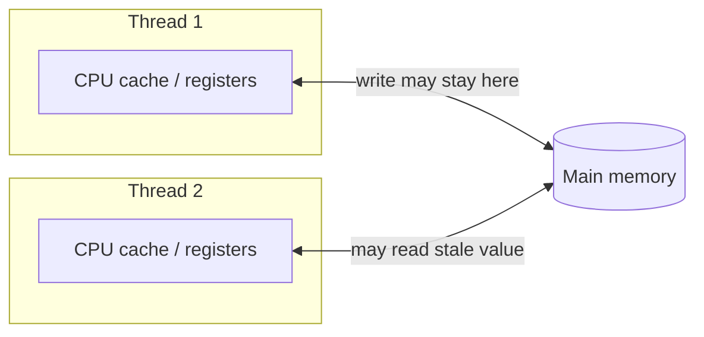
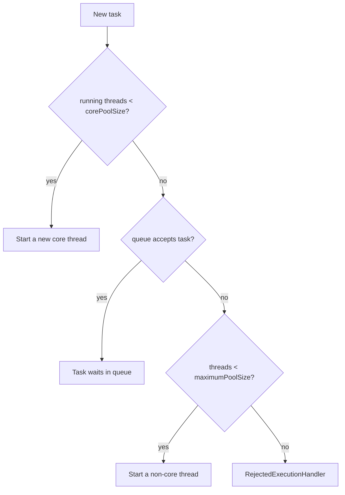

# Concurrency

> **TL;DR** Almost every concurrency bug is one of three problems. **Visibility**: one thread writes a value and another thread keeps seeing the old one. **Atomicity**: an operation that looks like one step (`count++`) is really several steps, and another thread slips in between them. **Ordering**: the compiler or CPU runs your instructions in a different order than you wrote them, which is invisible to a single thread but visible to others. `volatile` fixes visibility and ordering for one variable; `synchronized` and locks fix all three for a whole block of code; **atomic classes** fix atomicity for a single variable using a CPU instruction called CAS. The **happens-before** rules are the official way to tell which of these guarantees you actually have.

## Mental model: the Java Memory Model



Each CPU core has its own registers and caches, and the JIT compiler is free to keep a variable in a register instead of re-reading memory. So a write made by one thread can sit in that core's cache for a while, and another thread can keep reading an old copy. Both hardware and compiler also **reorder** independent instructions for speed. None of this is visible within a single thread (the result is always as if your code ran in order), but it is visible across threads.

The **Java Memory Model (JMM)** is the contract that says when one thread is *guaranteed* to see another thread's writes. The answer is: only when there is a **happens-before** relationship between the write and the read. Without one, Thread 2 is allowed to see a stale value **forever**. The classic example:

```java
boolean running = true;        // NOT volatile
// Thread A: while (running) { }   ← may loop forever
// Thread B: running = false;
```

Thread A never writes `running` inside the loop, so the JIT may legally read it once, keep it in a register and turn the loop into `while (true)`. Thread B's write then never reaches Thread A.

Make `running` `volatile` and the loop stops: every read of a volatile field must actually fetch the latest written value, and the compiler is not allowed to hoist it out of the loop.

### Happens-before rules (memorise these)

"A happens-before B" means: everything A did (including all writes before A) is visible to B, and A is ordered before B. These are the rules that create such edges:

1. **Program order**: within one thread, each action happens-before every later action in that same thread. (This is why single-threaded code behaves as written.)
2. **Monitor lock**: releasing a lock (leaving a `synchronized` block) happens-before every later acquisition of the *same* lock. So whatever a thread wrote inside or before a `synchronized` block is visible to the next thread that enters a block on the same object.
3. **Volatile**: a write to a volatile field happens-before every later read of that same field.
4. **Thread start**: `t.start()` happens-before any action in thread `t`. So values set before starting a thread are visible inside it.
5. **Thread join**: all actions in thread `t` happen-before `t.join()` returns in the waiting thread. So after `join()`, you see everything `t` wrote.
6. **Transitivity**: if A happens-before B and B happens-before C, then A happens-before C.

Rules 1, 3 and 6 combine into the most useful trick: **writes made before a volatile write become visible to any thread that later reads that volatile and sees the new value.** That is why a volatile "ready" flag can safely publish other, non-volatile data:

```java
int data;                 // plain field
volatile boolean ready;   // the "publication" flag
// Writer: data = 42; ready = true;     (data write → program order → volatile write)
// Reader: if (ready) use(data);        (volatile read → program order → data read) — guaranteed to see 42
```

Other common sources of happens-before you get for free: `final` fields are safely visible once the constructor finishes, and putting an object into a concurrent collection (or `BlockingQueue`) happens-before another thread takes it out.

## Deep dive

### volatile vs synchronized vs atomic

| | Visibility | Atomic compound ops | Blocking | Typical use |
|---|---|---|---|---|
| `volatile` | Yes | **No**: `count++` is still unsafe. | No | Stop flags, publishing a fully built object, the double-checked locking field. |
| `synchronized` | Yes | Yes, for everything inside the block. | Yes: other threads wait for the lock. | Critical sections, especially when an invariant spans **several fields** (e.g. `balance` and `history` must change together). |
| `AtomicInteger`, `AtomicLong`, `AtomicReference` | Yes | Yes, but only for **one variable**, via CAS. | No: a failed update just retries. | Counters, ID sequences, swapping a single reference. |
| `LongAdder` | Yes | Increments/adds only. | No | **High-contention** counters: spreads updates across several internal cells, summed on read. |

**Why `count++` is unsafe with only `volatile`.** It is three separate steps: read the current value, add one, write it back. Suppose `count` is 5. Thread A reads 5; Thread B reads 5; A writes 6; B writes 6. Two increments happened, but the value only went up by one, so an update was *lost*. `volatile` makes each individual read and write visible, but cannot stop another thread from running between them. Atomicity needs a lock or CAS.

### synchronized details

- **What gets locked.** Every Java object has a built-in lock called its **monitor**. A `synchronized` instance method locks `this`; a `static synchronized` method locks the class's `Class` object (e.g. `Counter.class`); a `synchronized (obj) { ... }` block locks `obj`. Instance and static methods use **different** locks, so a `synchronized` instance method and a `static synchronized` method of the same class can run at the same time, and they do *not* protect shared static data from each other.
- **Reentrant.** A thread that already holds a lock can acquire it again without deadlocking itself; the JVM keeps a hold count and releases the lock when it drops to zero. That is what lets one `synchronized` method call another `synchronized` method on the same object.
- **`wait()`/`notify()`** are how threads wait for a condition protected by a monitor. A thread calls `obj.wait()` to release `obj`'s lock and sleep until another thread calls `obj.notify()` or `notifyAll()`.
    - They must be called while **holding** that object's monitor (inside `synchronized (obj)`), otherwise they throw `IllegalMonitorStateException`. This rule exists because checking the condition and starting to wait must be atomic; otherwise a `notify` could arrive in the gap between your check and your `wait` and be lost forever.
    - Always call `wait()` in a **`while` loop that re-checks the condition**, never in an `if`. Two reasons: the JVM may wake a thread for no reason at all (**spurious wakeup**, allowed by the spec), and even after a genuine `notify`, another thread may grab the lock first and change the condition before you get the lock back.

    ```java
    synchronized (lock) {
        while (queue.isEmpty()) lock.wait();   // re-check after every wakeup
        return queue.remove();
    }
    ```

- **`sleep()` keeps the lock, `wait()` releases it.** `Thread.sleep` just pauses the current thread and knows nothing about monitors, so any locks you hold stay held, and every other thread that needs them stays blocked. `wait()` exists specifically to give the lock up while waiting and take it back before returning.

### ReentrantLock and friends

- **`ReentrantLock`** (in `java.util.concurrent.locks`) does what `synchronized` does, plus things `synchronized` cannot:
    - `tryLock()` / `tryLock(timeout)`: try to get the lock and give up instead of waiting forever. This is a way to avoid deadlock.
    - `lockInterruptibly()`: wait for the lock but respond to `Thread.interrupt()` (a thread blocked on `synchronized` cannot be interrupted).
    - **Fairness**: `new ReentrantLock(true)` hands the lock out in roughly arrival order so no thread starves. It is slower, which is why the default is unfair.
    - Multiple **`Condition`** objects per lock (`lock.newCondition()`), e.g. separate `notFull` and `notEmpty` conditions in a bounded buffer, instead of one shared `wait`/`notifyAll`.

    Unlike `synchronized`, nothing releases it automatically, so **always `unlock()` in `finally`**. Otherwise an exception leaves the lock held forever:

    ```java
    lock.lock();
    try { /* critical section */ } finally { lock.unlock(); }
    ```

- **`ReadWriteLock`** (`ReentrantReadWriteLock`): either **many readers at once** or **one writer alone**. Good when reads are frequent, writes are rare and the critical section is long enough for the extra bookkeeping to pay off.
- **`StampedLock`** (Java 8): adds **optimistic reads**. `tryOptimisticRead()` takes no lock at all and returns a stamp; you read the fields, then call `validate(stamp)`. If no write happened in between, you are done without ever blocking; if one did, you fall back to a real read lock. It is very fast for read-mostly data, but it is **not reentrant** (re-acquiring it in the same thread deadlocks) and has no `Condition`s.

### CAS and its caveats

**Compare-and-swap (CAS)** is a single atomic CPU instruction: "if this memory location still holds the value I expect, replace it with my new value; otherwise change nothing and tell me I failed". Atomic classes build updates as a retry loop on top of it:

```java
// What AtomicInteger.incrementAndGet() does, conceptually
int current, next;
do {
    current = value.get();          // read
    next = current + 1;             // compute
} while (!value.compareAndSet(current, next)); // write only if nobody changed it meanwhile; otherwise retry
```

No thread ever blocks: a thread that loses the race simply re-reads and tries again. This is called **lock-free**.

- **ABA problem.** CAS only checks the *value*, not whether it changed in between. If a value goes A → B → A while your thread is between its read and its CAS, the CAS succeeds as if nothing happened. For a counter that is harmless, but for a lock-free linked structure "A" may now be a reused node with different neighbours, which corrupts the structure. The fix is to attach a version number that increases on every change: `AtomicStampedReference` compares value *and* stamp, so A(v1) → B(v2) → A(v3) no longer matches A(v1).
- **Contention.** When many threads hammer the same atomic variable, most CAS attempts fail and retry, burning CPU and bouncing the cache line between cores. `LongAdder` avoids this by giving threads separate cells to increment (so they rarely collide) and adding the cells together only when you call `sum()`. That makes writes very cheap and reads slightly more expensive, plus the sum is not an atomic snapshot.

### Thread states

`NEW → RUNNABLE ⇄ BLOCKED / WAITING / TIMED_WAITING → TERMINATED`

- **NEW**: the `Thread` object exists but `start()` has not been called.
- **RUNNABLE**: running, or ready to run and waiting for a CPU. A thread blocked in native socket I/O also shows as `RUNNABLE` in thread dumps, which surprises people.
- **BLOCKED**: waiting to enter a `synchronized` block or method because another thread holds that monitor.
- **WAITING**: waiting with no time limit for another thread to do something: `Object.wait()`, `Thread.join()`, `LockSupport.park()` (which is what `ReentrantLock`, `Condition` and blocking queues use, so a thread waiting on a `ReentrantLock` shows as WAITING, not BLOCKED).
- **TIMED_WAITING**: the same but with a timeout: `Thread.sleep(ms)`, `wait(ms)`, `join(ms)`, `parkNanos`.
- **TERMINATED**: `run()` has finished, normally or by exception.

Calling `start()` twice throws `IllegalThreadStateException`, because a thread can only go from NEW to RUNNABLE once and cannot be restarted. Calling `run()` directly is just an ordinary method call: the code executes on the **current** thread and no new thread is created.

### Thread pools: how ThreadPoolExecutor decides

Creating a thread is expensive (it reserves a stack, typically ~1 MB, and makes an OS call), so servers reuse a fixed set of threads from a **pool**. `ThreadPoolExecutor` decides what to do with each submitted task like this:



- **`corePoolSize`**: threads kept alive even when idle.
- **`maximumPoolSize`**: hard upper limit on threads. Extra (non-core) threads die after `keepAliveTime` idle.
- **Work queue**: where tasks wait when all core threads are busy.

The surprising part: **the queue fills before extra threads are created.** The executor prefers queueing over growing. So with an **unbounded** queue (one that never says "full"), the "queue accepts task?" step always answers yes, and `maximumPoolSize` is never reached: you get exactly `corePoolSize` threads, no matter how high `max` is set.

| Factory | Hidden danger |
|---|---|
| `Executors.newFixedThreadPool(n)` | Uses an unbounded `LinkedBlockingQueue`. If tasks arrive faster than `n` threads finish them, the queue grows without limit until the heap runs out (**OOM**), and latency grows with it. |
| `Executors.newCachedThreadPool()` | No queue capacity (a `SynchronousQueue`) and max threads = `Integer.MAX_VALUE`. Under load it creates a new thread for every waiting task: thousands of threads, each with its own stack, until the OS or memory gives out. |
| `Executors.newSingleThreadExecutor()` | One thread with an unbounded queue: the same OOM risk as the fixed pool. |

In production, build `ThreadPoolExecutor` yourself with a **bounded** queue (e.g. `new ArrayBlockingQueue<>(1000)`) and an explicit **rejection policy**, which decides what happens when both the queue and the threads are full:

- `AbortPolicy` (the default): throw `RejectedExecutionException`, so the caller can fail fast or return "503 busy".
- `CallerRunsPolicy`: the thread that submitted the task runs it itself. That slows the submitter down, so it automatically produces less work: natural **back-pressure**.
- `DiscardPolicy` / `DiscardOldestPolicy`: silently drop the new task or the oldest queued one. Only for work that is safe to lose.

**Sizing rule of thumb.**

- **CPU-bound work** (computation, no waiting): about the **number of cores** (+1 to cover the occasional pause). More threads than cores just adds context-switching.
- **I/O-bound work** (mostly waiting for databases or HTTP calls): **cores × (1 + wait time / compute time)**. If each task waits 90 ms and computes 10 ms, on 8 cores that is 8 × (1 + 9) = 80 threads, because each thread is idle 90 % of the time and other threads can use the CPU meanwhile.

Treat these as starting points and measure, because the real limit is often the downstream system (a 20-connection database pool makes 200 threads pointless).

**Always shut executors down.** Pool threads are by default non-daemon, so a forgotten executor keeps the JVM from exiting, and in tests and app restarts it leaks threads. Call `shutdown()` (finish queued tasks, accept no new ones) and `awaitTermination(...)`, or, since Java 19, use try-with-resources: `ExecutorService` is `AutoCloseable` and `close()` shuts down and waits.

### Futures and CompletableFuture

- **`Future`** represents a result that will be available later. Its only way to get the value is `get()`, which **blocks** the calling thread until the task completes, so you cannot say "when it's done, do X" without tying up a thread. **`CompletableFuture`** lets you attach the next step as a callback and **compose** steps into a pipeline without blocking.
- **Composition methods**, using stream vocabulary:
    - `thenApply(f)`: like `map`. Transform the result with a plain function `T -> U`.
    - `thenCompose(f)`: like `flatMap`. Use it when `f` itself returns a `CompletableFuture` (e.g. "after loading the user, call another async service"). With `thenApply` you would end up with a nested `CompletableFuture<CompletableFuture<U>>`.
    - `thenCombine(other, f)`: wait for **two independent** futures running in parallel and merge their results.
    - `allOf(...)` completes when all given futures complete; `anyOf(...)` when the first one does.
- **Error handling**: an exception in any stage skips the following "normal" stages until one of these handles it:
    - `exceptionally(ex -> fallback)`: runs **only on failure** and replaces the error with a recovery value.
    - `handle((result, ex) -> ...)`: runs **always**, receives either the result or the exception, and returns a new value. Good for "map success and failure into one response".
    - `whenComplete((result, ex) -> ...)`: runs always, for **side effects** like logging or metrics. It does **not** change the result: an exception passes through unchanged.
- **Where async stages run.** `*Async` methods called without an executor (`supplyAsync(task)`, `thenApplyAsync(f)`) run on **`ForkJoinPool.commonPool()`**, a JVM-wide shared pool sized to about *(cores − 1)* threads. It is meant for short CPU work. If you put blocking I/O there, a handful of slow HTTP calls can occupy every thread in it, and everything else that uses the common pool, including **parallel streams** anywhere in the application, stalls. Pass your own executor for anything that blocks.
- **`join()` vs `get()`.** Both wait for the result. `get()` throws checked exceptions (`ExecutionException`, `InterruptedException`), so it needs `try/catch`. `join()` wraps failures in the unchecked `CompletionException`, which is more convenient inside lambdas and streams. In both cases the original exception is available via `getCause()`.

```java
CompletableFuture<User> user = CompletableFuture.supplyAsync(() -> userClient.get(id), ioPool);           // starts now, on ioPool
CompletableFuture<List<Order>> orders = CompletableFuture.supplyAsync(() -> orderClient.list(id), ioPool); // runs in parallel with the user call
CompletableFuture<Profile> profile = user.thenCombine(orders, Profile::new) // when BOTH finish, build the Profile
        .orTimeout(2, TimeUnit.SECONDS)                                     // Java 9+: fail with TimeoutException if not done in 2 s
        .exceptionally(ex -> Profile.empty());                              // on any failure (including timeout), return a fallback
```

The two remote calls run concurrently, so the total latency is roughly the slower of the two rather than their sum.

### Coordination utilities

| Utility | What it does | Example |
|---|---|---|
| `CountDownLatch(n)` | A counter starting at `n`. Threads call `countDown()`; threads calling `await()` block until it reaches 0. It is **one-shot**: once at zero it stays open and cannot be reset. | The main thread waits until 5 services have finished starting. |
| `CyclicBarrier(n)` | `n` threads each call `await()` and all block until the last one arrives; then all are released together and the barrier **resets automatically** for the next round. It can run an optional action each time it trips. | Simulation workers that must all finish step *k* before anyone starts step *k+1*. |
| `Semaphore(n)` | A pool of `n` **permits**. `acquire()` takes one (waiting if none are left) and `release()` returns it. It limits how many threads do something at the same time. | Allow at most 10 concurrent calls to a fragile downstream API. |
| `Phaser` | A reusable barrier where the number of participating threads can change between phases (`register`/`arriveAndDeregister`). | Multi-stage jobs where workers join or leave mid-way. |
| `BlockingQueue` | A thread-safe queue whose `put` waits when full and `take` waits when empty. That waiting is the **back-pressure**: fast producers are slowed down to the speed of the consumers instead of exhausting memory. | Producer/consumer hand-off, the buffer below. |

### Virtual threads (Java 21)

- **What they are.** A normal (*platform*) thread is a thin wrapper around an OS thread: expensive to create, with a big fixed stack, so you can only have a few thousand. A **virtual thread** is a lightweight thread managed by the JVM: its stack lives on the heap and grows as needed, so you can have millions. The JVM runs virtual threads on a small pool of platform threads called **carriers** (by default one per core). When a virtual thread makes a blocking call such as a socket read, the JVM **unmounts** it: it saves its stack and frees the carrier to run another virtual thread. When the data arrives, the virtual thread is mounted again, possibly on a different carrier.
- **Great for I/O-bound, thread-per-request code.** A service that spends most of its time waiting on databases and HTTP calls can use one simple, blocking-style thread per request and still handle huge concurrency, without callbacks or reactive code. They do **not** make CPU-bound code faster: computation still needs a real core, and there are no more cores than before.
- **Don't pool them.** Pools exist because platform threads are expensive; virtual threads are cheap, so a pool only adds limits and overhead. Create one per task with `Executors.newVirtualThreadPerTaskExecutor()` or `Thread.ofVirtual().start(...)`.
- **Pinning.** In JDK 21–23, if a virtual thread blocks while inside a `synchronized` block or method, the JVM cannot unmount it (the monitor implementation is tied to the carrier thread), so it **pins** the carrier: that platform thread is stuck doing nothing until the blocking call returns. With few carriers, a few pinned threads can stall the whole application. JDK 24 (JEP 491) removed this limitation for `synchronized`. On 21, use `ReentrantLock` around blocking calls (it is built on `LockSupport.park`, which unmounts correctly) and diagnose with `-Djdk.tracePinnedThreads=full`.
- **Be careful with large `ThreadLocal` values.** Every thread gets its own copy of a `ThreadLocal` value. With 200 platform threads, a 1 MB per-thread cache costs 200 MB; with a million virtual threads it costs a terabyte. Keep thread-locals small, or use `ScopedValue` where available.
- **Limit scarce resources with a `Semaphore`, not with pool size.** With platform threads, a 50-thread pool implicitly limited you to 50 concurrent database calls. With unlimited virtual threads that implicit limit disappears, so 10,000 requests would all try to grab one of your 20 database connections. Guard the resource explicitly: `semaphore.acquire()` before the call, `release()` in `finally`.
- **Spring Boot 3.2+**: set `spring.threads.virtual.enabled=true` and Tomcat request handling, `@Async` and other executors switch to virtual threads.

### Deadlock

A **deadlock** happens when threads wait for each other in a cycle, so none can ever proceed: Thread 1 holds lock A and waits for B, while Thread 2 holds B and waits for A. Four conditions must **all** hold for a deadlock (the Coffman conditions):

1. **Mutual exclusion**: a resource can be held by only one thread at a time.
2. **Hold and wait**: a thread holds one resource while waiting for another.
3. **No preemption**: a resource cannot be taken away from a thread; it must be released voluntarily.
4. **Circular wait**: there is a cycle of threads each waiting for the next one's resource.

Break any one condition and deadlock becomes impossible. The most practical fixes:

- **Always acquire locks in one global order** (e.g. by account ID: always lock the lower ID first). With a consistent order, a cycle cannot form, which breaks condition 4.
- **Use `tryLock` with a timeout**: if you can't get the second lock, release the first and retry later, which breaks condition 2.

To detect one, take a thread dump with `jstack <pid>` (or `jcmd <pid> Thread.print`). The JVM checks for monitor and `ReentrantLock` cycles and prints "Found one Java-level deadlock", listing which thread holds which lock.

### ThreadLocal

`ThreadLocal<T>` gives **each thread its own independent copy** of a value. Typical uses: request-scoped context (the current user, a trace ID, Spring's transaction and security context), or reusing an object that is not thread-safe, such as `SimpleDateFormat`, without locking.

The trap is **thread pools**: pool threads are reused for many tasks and never die, so a value set during one request is still there when the same thread picks up the next request. That causes two problems. **Memory leaks**: the values are never collected (and in app servers they can pin a whole old class loader after a redeploy). **Data leaks**: request B can see request A's user ID. Always clear it in `finally`:

```java
CURRENT_USER.set(user);
try { handle(request); } finally { CURRENT_USER.remove(); }
```

## Code you should be able to write

```java
class BoundedBuffer<T> {
    private final BlockingQueue<T> q = new ArrayBlockingQueue<>(100);  // fixed capacity = built-in back-pressure
    void produce(T item) throws InterruptedException { q.put(item); }   // waits while the queue is full
    T consume() throws InterruptedException { return q.take(); }        // waits while the queue is empty
}
```

All the locking and `wait`/`notify` logic lives inside `ArrayBlockingQueue` (a `ReentrantLock` with `notFull`/`notEmpty` conditions), so the class has no locking code of its own. The methods declare `InterruptedException` so a waiting thread can be cancelled cleanly.

```java
class Singleton {
    private static volatile Singleton instance;      // volatile is required (see below)
    static Singleton get() {
        Singleton local = instance;                  // read the volatile once into a local (faster on the common path)
        if (local == null) {                         // 1st check, no lock: after initialization, every call returns here
            synchronized (Singleton.class) {         // only the first few callers ever reach the lock
                local = instance;
                if (local == null)                   // 2nd check, inside the lock: another thread may have created it while we waited
                    instance = local = new Singleton();
            }
        }
        return local;
    }
}
```

This is **double-checked locking (DCL)**. Why `volatile` is required: `instance = new Singleton()` is really three steps: (1) allocate memory, (2) run the constructor, (3) store the reference in `instance`. Without `volatile` the compiler or CPU may reorder (3) before (2). Another thread doing the unlocked first check could then see a non-null `instance` and use it before the constructor has finished, reading default values like `null` or `0` from its fields. The volatile write forbids that reordering and creates a happens-before edge to the reader.

Simpler alternatives that are correct with no `volatile` at all:

- **Holder-class idiom**: `private static class Holder { static final Singleton I = new Singleton(); }` and return `Holder.I`. The JVM loads and initializes `Holder` only on first use, and class initialization is guaranteed thread-safe.
- **Enum singleton**: `enum Singleton { INSTANCE; }`, which is also safe against serialization and reflection creating a second instance.

## Traps

- "`volatile` makes `count++` thread-safe." **No.** `volatile` makes each read and write visible, but `count++` is read-add-write, and another thread can run between those steps. Use `AtomicInteger` / `LongAdder` or a lock.
- "`sleep()` releases the lock." **No.** `sleep` keeps every lock the thread holds; only `wait()` releases the monitor it is called on.
- "`newFixedThreadPool` protects you from overload." It caps threads, but its queue is **unbounded**, so excess tasks pile up in memory until `OutOfMemoryError`.
- "`maximumPoolSize` threads are created when core threads are busy." Extra threads are created only after the **queue is full**. With an unbounded queue that never happens.
- "Virtual threads speed up CPU-heavy work." **No.** They let you have many more threads *waiting* cheaply on I/O; the number of cores doing actual computation is unchanged.
- "`ConcurrentHashMap` makes check-then-act safe." Each call is atomic, but `containsKey` followed by `put` is two calls with a gap between them. Use `computeIfAbsent`, `putIfAbsent` or `merge`, which do both steps atomically.

## Say it out loud

**"volatile vs synchronized?"**
`volatile` guarantees that a write to that one variable is visible to all other threads and stops the compiler and CPU from reordering memory operations around it, but it does not make compound actions like increment or check-then-set atomic. `synchronized` gives mutual exclusion, so only one thread runs the block at a time, plus the same visibility guarantee, because releasing a monitor happens-before the next acquisition of it. I use volatile for flags and safe publication, atomics for single counters or references, and locks when an invariant spans several fields that must change together.

**"How would you size a thread pool for an I/O-heavy service?"**
I start from cores × (1 + wait time / compute time), then measure under load, and I check the downstream limits, because a small database connection pool caps useful concurrency regardless of thread count. I always use a bounded queue with an explicit rejection policy, so overload turns into fast rejections or back-pressure instead of an ever-growing queue and an OutOfMemoryError. On Java 21 I would consider virtual threads for thread-per-request I/O instead, and then cap access to the scarce downstream resource with a semaphore.

## Practice MCQs

**Q1.** Two threads each run `counter++` 1000 times on a `volatile int counter = 0`. The final value is:

- A) Always 2000
- B) Always 1000
- C) Anything up to 2000
- D) Compile error

<details markdown="1"><summary>Answer</summary>

**C.** `volatile` guarantees each read and write is visible, but `counter++` is read-add-write, and when both threads read the same value and write the same incremented value, one increment is lost. How many are lost depends on timing, so you get some value up to 2000 (in theory it can be as low as 2). It compiles fine. Use `AtomicInteger.incrementAndGet()` or `LongAdder` for a correct 2000.
</details>

**Q2.** A `ThreadPoolExecutor` has core 2, max 10 and an unbounded `LinkedBlockingQueue`. Under heavy load, how many threads run?

- A) 10
- B) 2
- C) Grows without limit
- D) Depends on the CPU

<details markdown="1"><summary>Answer</summary>

**B.** Once 2 core threads exist, each new task is offered to the queue first, and extra threads are created only if the queue *rejects* the task. An unbounded queue never rejects, so the pool stays at 2 threads while the queue grows. A would need a bounded queue that fills up. C describes the queue length, not the thread count.
</details>

**Q3.** Which method releases the monitor?

- A) `Thread.sleep()`
- B) `Thread.yield()`
- C) `Object.wait()`
- D) `Thread.join()` on another thread while holding a lock

<details markdown="1"><summary>Answer</summary>

**C.** `wait()` releases the monitor of the object it is called on, waits, and then reacquires that monitor before returning. `sleep` and `yield` keep every lock the thread holds. `join()` is implemented with `wait()` on the *target thread object*, so it releases only that thread object's monitor, not any other lock you hold, which is why joining while holding a lock can deadlock.
</details>

**Q4.** In the double-checked locking singleton, why is `volatile` needed?

- A) To make the `synchronized` block faster
- B) To prevent another thread from seeing a partially constructed object
- C) To make the field static
- D) It is not needed

<details markdown="1"><summary>Answer</summary>

**B.** `instance = new Singleton()` is allocate, construct, assign, and without `volatile` the assignment may be reordered before the constructor finishes. A thread doing the unlocked first check could then see a non-null reference to an object whose fields are not yet set. A volatile write forbids that reordering and creates a happens-before edge to the reading thread. It does not make anything faster (A) and has nothing to do with `static` (C).
</details>

**Q5.** `CompletableFuture.supplyAsync(task)` without an executor runs on:

- A) A new platform thread per task
- B) The caller's thread
- C) `ForkJoinPool.commonPool()`
- D) A virtual thread

<details markdown="1"><summary>Answer</summary>

**C.** The no-executor overloads use the JVM-wide common pool, which has only about cores − 1 threads and is shared with parallel streams. Blocking I/O there can occupy every thread and stall unrelated code, which is why blocking work should pass a dedicated executor: `supplyAsync(task, ioPool)`. (On a machine with a single core it falls back to a new thread per task, but that is an edge case.)
</details>

**Q6.** You need 5 worker threads to all reach a checkpoint before any continues, then repeat for the next batch. Use:

- A) `CountDownLatch`
- B) `CyclicBarrier`
- C) `Semaphore`
- D) `Exchanger`

<details markdown="1"><summary>Answer</summary>

**B.** A `CyclicBarrier(5)` blocks each worker in `await()` until all 5 arrive, releases them together, and resets itself for the next batch. A `CountDownLatch` would work for one round but cannot be reset. A `Semaphore` limits concurrency rather than making threads wait for each other. An `Exchanger` swaps data between exactly two threads.
</details>

**Q7.** On Java 21, a virtual thread performs a blocking socket read inside a `synchronized` block. What happens?

- A) The virtual thread unmounts normally
- B) The carrier thread is pinned until the read finishes
- C) `IllegalStateException`
- D) The JVM creates a new carrier per call

<details markdown="1"><summary>Answer</summary>

**B.** In JDK 21–23 a virtual thread holding a monitor cannot be unmounted, so it *pins* its carrier platform thread, and that carrier can't run other virtual threads until the read returns. It still works (no exception), but with few carriers it can cause throughput collapse. Use `ReentrantLock` around blocking calls; JDK 24 (JEP 491) removed this limitation for `synchronized`.
</details>

**Q8.** Which is the best fix for a counter updated by hundreds of threads where reads are rare?

- A) `synchronized` method
- B) `volatile long`
- C) `AtomicLong`
- D) `LongAdder`

<details markdown="1"><summary>Answer</summary>

**D.** `LongAdder` gives contending threads separate internal cells to increment, so they rarely fight over the same memory, and `sum()` adds the cells together when you read. C is correct but slows down under heavy contention because most CAS attempts fail and retry. A is correct but serializes every update through one lock. B is not even correct, since increments can be lost.
</details>

**Q9.** What does calling `t.run()` instead of `t.start()` do?

- A) Starts a new thread
- B) Runs the code on the current thread
- C) Throws `IllegalThreadStateException`
- D) Schedules the thread for later

<details markdown="1"><summary>Answer</summary>

**B.** `run()` is an ordinary method call: the body executes immediately on the calling thread, and `t` stays in the NEW state. Only `start()` asks the JVM to create a new thread, which then calls `run()`. `IllegalThreadStateException` (C) comes from calling `start()` a second time.
</details>

## Related

- [Collections internals](02-collections-internals.md): how `ConcurrentHashMap` uses CAS and per-bucket locks, and fail-fast vs weakly consistent iterators.
- [Streams](04-streams.md): parallel streams run on the same common pool as `CompletableFuture`'s default async methods.
- [JIT & troubleshooting](../jvm/03-performance-troubleshooting.md): reading thread dumps and finding deadlocks.
