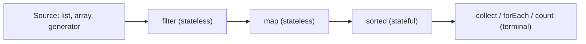

# Streams & functional Java

> **TL;DR** A stream is a **lazy pipeline**: calling `filter` or `map` only *describes* work, and nothing runs until you call a **terminal** operation such as `collect` or `findFirst`. When it does run, elements flow through the whole pipeline **one at a time** (element 1 goes through every stage, then element 2, and so on), not stage by stage. A stream can be consumed **once**. Most stream MCQs test laziness, `toMap` with duplicate keys, `Optional.orElse` vs `orElseGet`, and parallel stream pitfalls.

## Mental model



A stream has three parts: a **source** that supplies elements (a collection, an array, `Stream.iterate`, a file's lines), zero or more **intermediate operations** that each return a new stream, and exactly one **terminal operation** that produces a result or side effect. Intermediate operations just build up a recipe; the terminal operation runs the recipe by pulling elements from the source one by one.

A stream is not a data structure: it stores nothing and never modifies its source. `list.stream().map(...)` leaves `list` unchanged.

```java
Stream.of("a", "bb", "ccc")
      .filter(s -> { System.out.println("filter " + s); return s.length() > 1; })
      .map(s -> { System.out.println("map " + s); return s.toUpperCase(); })
      .findFirst();
// filter a        ← "a" fails the filter, so it never reaches map
// filter bb
// map bb          ← "bb" passes, is mapped, and findFirst has its answer: stop
//                   "ccc" is never touched (findFirst short-circuits)
```

Notice the order: it is *not* "filter everything, then map everything". Each element travels down the pipeline before the next one starts, which is what makes short-circuiting possible and why streams can even work on infinite sources.

Without the terminal `findFirst`, **nothing** prints, because no one ever asks the pipeline for an element.

## Deep dive

### Operation types

| Kind | Examples | Notes |
|---|---|---|
| Intermediate, stateless | `filter`, `map`, `flatMap`, `peek` | Each element is handled on its own, with no memory of other elements, so these stream elements through with no buffering. |
| Intermediate, stateful | `sorted`, `distinct`, `limit`, `skip` | They need information about other elements. `distinct` remembers every element seen so far; `sorted` must **buffer the entire stream** before it can emit even the first element (the smallest might be the last one), so it never finishes on an infinite stream. |
| Terminal | `collect`, `forEach`, `reduce`, `count`, `toList`, `min`, `findFirst` | Triggers execution and consumes the stream. Returns a non-stream result (or `void`). |
| Short-circuiting | `limit`, `findFirst`, `findAny`, `anyMatch`, `allMatch`, `noneMatch` | They can stop before seeing every element: `anyMatch` stops at the first `true`, `allMatch` at the first `false`, `limit(n)` after `n` elements. That lets them finish even on infinite streams: `Stream.iterate(1, x -> x + 1).filter(x -> x % 7 == 0).findFirst()` returns 7. |

- **Streams are single-use.** A stream is an iterator-like pipeline over its source, not a reusable collection. After a terminal operation it is marked consumed, and any further operation throws `IllegalStateException: stream has already been operated upon or closed`. If you need to traverse twice, call `list.stream()` again, or keep a `Supplier<Stream<T>>`.
- **`peek` is for debugging only**: it lets you see elements passing through without changing them. Don't put real logic in it, because the stream is allowed to skip stages whose results can't affect the answer. Since Java 9, `count()` may compute the size directly from the source when it is known (a `List` knows its `size()`) and the pipeline can't change the count, so `list.stream().peek(System.out::println).count()` may print **nothing**. Add a `filter` and the pipeline has to run again, because the count is no longer known up front.
- **`map` vs `flatMap`.** `map` turns each element into exactly **one** new element (`String → Integer` via `String::length`). `flatMap` turns each element into a **stream of zero or more** elements and then *flattens* all those streams into one. Use it when each element contains a collection: `orders.stream().flatMap(o -> o.lines().stream())` gives a single `Stream<Line>` instead of a `Stream<List<Line>>`.
- **Use primitive streams to avoid boxing.** A `Stream<Integer>` holds `Integer` objects, and arithmetic on them unboxes and reboxes repeatedly, creating garbage. `IntStream`, `LongStream` and `DoubleStream` work on raw primitives and add numeric operations that `Stream<T>` lacks: `sum()`, `average()` (returns `OptionalDouble`), `max()`, and `summaryStatistics()` (count, sum, min, average and max in one pass). Convert with `mapToInt(Emp::age)` and go back with `boxed()`.

### Collectors you must know

`collect(...)` is the terminal operation that gathers elements into a result, and a `Collector` describes *how*. The static methods in `java.util.stream.Collectors` (usually statically imported, as below) cover almost every need:

```java
// Group employees by department: Dept -> list of its employees
Map<Dept, List<Emp>> byDept = emps.stream().collect(groupingBy(Emp::dept));

// The second argument is a "downstream" collector applied to each group: here, count the group
Map<Dept, Long> countByDept = emps.stream().collect(groupingBy(Emp::dept, counting()));

// Average salary per department
Map<Dept, Double> avgSalary = emps.stream().collect(groupingBy(Emp::dept, averagingDouble(Emp::salary)));

// Highest-paid employee per department (Optional, because maxBy works on possibly-empty input)
Map<Dept, Optional<Emp>> topPaid = emps.stream().collect(groupingBy(Emp::dept, maxBy(comparing(Emp::salary))));

// Split into exactly two groups by a yes/no condition
Map<Boolean, List<Emp>> seniorSplit = emps.stream().collect(partitioningBy(e -> e.years() > 5));

// Join strings with a separator, prefix and suffix: "[Ana, Bo, Cy]"
String csv = names.stream().collect(joining(", ", "[", "]"));

// Three-argument groupingBy: key function, map factory (sorted TreeMap), downstream collector.
// mapping() transforms each employee to its name before collecting the names into a sorted TreeSet.
Map<Dept, TreeSet<String>> sortedNames = emps.stream()
        .collect(groupingBy(Emp::dept, TreeMap::new, mapping(Emp::name, toCollection(TreeSet::new))));
```

- **`partitioningBy` always returns both `true` and `false` keys**, even if one list is empty, because there are always exactly two partitions and callers can rely on `map.get(true)` never being `null`. **`groupingBy` only creates keys that actually occur** in the data; a department with no employees simply isn't in the map.
- **`groupingBy` returns a `HashMap` by default**, so iteration order of the keys is unspecified. If you need sorted keys, pass `TreeMap::new` as the map factory; for first-seen order, pass `LinkedHashMap::new`.

### The `toMap` traps

```java
Map<String, Emp> byName = emps.stream().collect(toMap(Emp::name, e -> e)); // key function, value function
```

- **Duplicate key → `IllegalStateException`** ("Duplicate key Ana"). The collector refuses to silently pick a winner, because quietly losing data is a worse bug than failing loudly. If duplicates are expected, pass a **merge function** that decides which value to keep: `toMap(Emp::name, e -> e, (a, b) -> a)` keeps the first; `(a, b) -> b` keeps the last; `(a, b) -> a.salary() > b.salary() ? a : b` keeps the higher-paid. If you actually want *all* values per key, you want `groupingBy` instead.
- **A null value → `NullPointerException`.** `toMap` builds the map with `HashMap.merge`, and `merge` treats a `null` value as "remove this key", so it rejects `null` outright, even though a `HashMap` can normally store `null` values. Filter out nulls first, or replace them with a default in the value function.
- **Want a specific map type?** The three-argument version returns a `HashMap`. Use the four-argument version, `toMap(keyFn, valueFn, mergeFn, LinkedHashMap::new)`, to keep encounter order (or `TreeMap::new` to sort by key).

### `toList()` variants

| Call | Result |
|---|---|
| `collect(Collectors.toList())` | In practice an `ArrayList` you can modify, but the Javadoc **guarantees neither the type nor mutability**, so code that modifies it depends on an implementation detail. If you need a mutable list, say so: `toCollection(ArrayList::new)`. |
| `collect(Collectors.toUnmodifiableList())` (Java 10+) | Unmodifiable (any `add`/`set` throws `UnsupportedOperationException`), and **rejects nulls** with `NullPointerException`, like `List.of`. |
| `stream.toList()` (Java 16+) | Unmodifiable, but **allows nulls**. The shortest and usually the right default for results. |

### reduce

`reduce` combines all elements into one value by repeatedly applying a function: `Stream.of(1, 2, 3).reduce(0, Integer::sum)` computes `((0 + 1) + 2) + 3 = 6`. The three-argument form is `reduce(identity, accumulator, combiner)`. For parallel streams it is used like this: each thread reduces its own chunk starting from the `identity`, then the `combiner` merges the partial results.

That is why **the identity must be a true identity** for the operation: a value that changes nothing when combined, `0` for addition and `1` for multiplication (`x + 0 == x`, `x * 1 == x`). With a wrong identity such as `10`, a sequential stream adds 10 once, but a **parallel** stream adds 10 once **per chunk**, so the answer changes depending on how many chunks were created. The accumulator must also be **associative** (`(a+b)+c == a+(b+c)`), because parallel execution groups elements differently. Subtraction is not associative, so `reduce(0, (a, b) -> a - b)` gives inconsistent results in parallel.

### Optional

- **What it is for.** `Optional<T>` is a container that holds either one value or nothing. It is meant as a **return type** for methods that might legitimately find nothing (`findById`, `findFirst`, `max`), so the type signature forces the caller to deal with absence instead of forgetting a `null` check. Don't use it for **fields** (it isn't `Serializable` and adds an object per field), for **parameters** (callers then pass `Optional`, `null`, *or* empty, which makes things worse), or to wrap **collections** (just return an empty list; "no results" is already representable).
- **`Optional.of(null)` throws NPE**, because `of` promises the value is present. Use `Optional.ofNullable(x)` when `x` might be `null`, and `Optional.empty()` to say "nothing" explicitly.
- **`orElse` vs `orElseGet`.** `orElse(x)` takes a ready-made value, and Java evaluates method arguments *before* calling the method, so `x` is **always computed**, even when the optional has a value and `x` is thrown away. `orElseGet(supplier)` takes a function and calls it **only when empty**. It matters when the fallback is expensive or has side effects: `findCached(id).orElse(loadFromDatabase(id))` hits the database on *every* call, cache hit or not; `orElseGet(() -> loadFromDatabase(id))` hits it only on a miss. For cheap constants (`orElse("unknown")`), `orElse` is fine.
- **Prefer `map`, `filter`, `orElseThrow` over `isPresent()` + `get()`.** `if (opt.isPresent()) return opt.get();` is just a `null` check with extra steps, and calling `get()` without checking throws `NoSuchElementException`. Chaining keeps the "maybe absent" logic in one expression where each step only runs if a value is present:

```java
String city = userRepo.findById(id)   // Optional<User>
        .map(User::address)           // Optional<Address>; empty if the user is absent OR address() returns null
        .map(Address::city)           // Optional<String>
        .orElse("unknown");           // fallback if any step came up empty
```

Note that `map` wraps the function's result with `ofNullable`, so a `null` returned midway simply turns the chain empty instead of throwing.

### Parallel streams

- **Where they run.** `.parallel()` or `parallelStream()` splits the source into chunks and processes them on **`ForkJoinPool.commonPool()`**, a single JVM-wide pool with about *cores − 1* threads (plus the calling thread, which also does work). Because that pool is shared, **blocking calls inside a parallel stream** (HTTP, JDBC, `sleep`) tie up its few threads and **starve everything else** that uses the pool, including every `CompletableFuture.supplyAsync(...)` without an explicit executor, anywhere in the application.
- **When they pay off.** Splitting the work, scheduling it on threads and merging the results has a fixed cost. It is only worth it for **large** inputs (typically tens of thousands of elements or more), **CPU-bound** work per element, and **easily splittable** sources. Arrays, `ArrayList` and `IntStream.range` can be cut in half instantly by index. A `LinkedList` must be walked to find its middle, and `Stream.iterate` is inherently sequential (each element depends on the previous one), so they split badly and parallelism gains little or nothing. Measure before adopting it.
- **Order.** In parallel, `forEach` runs the action on whichever thread finishes a chunk first, so output order is **unpredictable**. `forEachOrdered` preserves the source's *encounter order*, at the cost of making threads wait for each other. Collecting with `toList()` keeps encounter order automatically.
- **Never mutate shared state in lambdas.** `parallelStream().forEach(x -> results.add(x))` with a plain `ArrayList` has several threads calling `add` at once on a non-thread-safe list: elements get lost, `null`s appear, or `ArrayIndexOutOfBoundsException` is thrown. Let the stream build the result for you with `collect`/`toList()`, which gives each thread its own container and merges them safely.
- **`findAny` is faster than `findFirst` in parallel.** `findFirst` must return the element that comes first *in encounter order*, so threads that find a match early may have to wait for earlier chunks to finish. `findAny` can return whichever match any thread finds first. Use it when you don't care which matching element you get.

### Functional interfaces

A **functional interface** has exactly one abstract method, and a lambda or method reference is simply a compact implementation of that method. These are the ones in `java.util.function` you must recognise:

| Interface | Signature | Typical use |
|---|---|---|
| `Supplier<T>` | `() -> T` | Produce a value lazily: `orElseGet`, `Collectors.toCollection(ArrayList::new)`. |
| `Consumer<T>` | `T -> void` | Do something with a value: `forEach(System.out::println)`. |
| `Function<T,R>` | `T -> R` | Transform: `map(String::length)`. |
| `Predicate<T>` | `T -> boolean` | Test: `filter(s -> !s.isBlank())`. Combine with `and`, `or`, `negate`. |
| `BiFunction<T,U,R>` | `(T,U) -> R` | Two inputs, one result: `map.merge(k, v, Integer::sum)`. |
| `UnaryOperator<T>` / `BinaryOperator<T>` | `T -> T` / `(T,T) -> T` | Special cases of `Function`/`BiFunction` where all types are the same: `replaceAll(String::trim)`, `reduce(0, Integer::sum)`. |

**Lambdas can only capture *effectively final* local variables**, meaning locals that are never reassigned after initialization (you don't have to write `final`; the compiler checks). The lambda receives a *copy* of the variable's value and may run later, even on another thread. If the variable could still change, the lambda's copy and the real variable could disagree, and reading a mutable local from another thread would be a data race. Forbidding reassignment avoids both problems. Fields and the *contents* of objects are not restricted, which is exactly why mutating shared objects from lambdas (previous section) is dangerous.

## Code you should be able to write

```java
// Top 3 most frequent words, ties broken alphabetically
List<String> top3 = Arrays.stream(text.toLowerCase().split("\\W+")) // lowercase, then split on runs of non-word characters
        .filter(w -> !w.isBlank())                                    // a leading separator produces one empty string; drop it
        .collect(groupingBy(w -> w, counting()))                      // Map<String, Long>: word -> number of occurrences
        .entrySet().stream()                                          // start a second stream over the (word, count) pairs
        .sorted(Map.Entry.<String, Long>comparingByValue().reversed() // highest count first
                .thenComparing(Map.Entry.comparingByKey()))           // equal counts: alphabetical order
        .limit(3)                                                     // keep the top three
        .map(Map.Entry::getKey)                                       // just the words
        .toList();
```

The explicit type witness `Map.Entry.<String, Long>comparingByValue()` is needed because calling `.reversed()` on the result leaves the compiler without enough context to infer the generic types by itself.

## Traps

- "Intermediate operations run when called." They only build the pipeline. Nothing runs until the **terminal** operation, and then each element flows through all stages in turn.
- "`toMap` keeps the last value on duplicates." It **throws `IllegalStateException`** unless you pass a merge function saying which value to keep.
- "`orElse` is lazy." **No**: its argument is evaluated before the call, every time. `orElseGet` takes a supplier and is the lazy one.
- "Parallel is always faster." Often slower for small inputs, cheap per-element work, badly splitting sources, or I/O-bound work, and it competes for the shared common pool.
- "`peek` always runs." Not if the stream can compute the result without running the pipeline, as `count()` on a sized source does since Java 9.

## Say it out loud

**"When would you avoid a parallel stream?"**
When the data is small, because splitting and merging costs more than it saves; when the work is I/O-bound or blocking; when the source splits badly, like a `LinkedList` or `Stream.iterate`; or when the lambdas touch shared mutable state. And in a server application in general, because parallel streams all share the JVM-wide common ForkJoinPool with only about cores minus one threads, so one blocking pipeline can stall unrelated async work across the whole application. If I need parallel I/O, I use an executor sized for it instead.

## Practice MCQs

**Q1.** What prints?
```java
Stream.of(1, 2, 3).map(x -> { System.out.print(x); return x * 2; });
```

- A) `123`
- B) `246`
- C) Nothing
- D) Compile error

<details markdown="1"><summary>Answer</summary>

**C.** `map` is intermediate: it only records the step and returns a new stream. Without a terminal operation (like `toList()` or `forEach`), no element is ever pulled through, so the lambda never runs. It compiles fine: an unused stream is legal. Adding `.toList()` would print `123`.
</details>

**Q2.** `toMap(Emp::name, e -> e)` on a list with two employees named "Ana" results in:

- A) The first Ana is kept
- B) The last Ana is kept
- C) `IllegalStateException`
- D) A `Map<String, List<Emp>>`

<details markdown="1"><summary>Answer</summary>

**C.** The two-argument `toMap` has no rule for resolving a duplicate key, so it throws `IllegalStateException: Duplicate key Ana` rather than silently dropping data. Passing a merge function gives A (`(a, b) -> a`) or B (`(a, b) -> b`). D is what `groupingBy(Emp::name)` returns.
</details>

**Q3.** Which is evaluated even when the Optional has a value?

- A) `orElseGet(() -> load())`
- B) `orElse(load())`
- C) `orElseThrow()`
- D) `map(x -> load())`

<details markdown="1"><summary>Answer</summary>

**B.** Java evaluates method arguments before calling the method, so `load()` runs to produce the argument for `orElse`, whether or not it will be used. In A, the lambda is passed *unevaluated* and called only when the optional is empty. C never calls `load()`. In D, `load()` runs only when a value is *present*, which is the opposite case.
</details>

**Q4.** `partitioningBy(x -> x > 100)` on `[1, 2, 3]` returns:

- A) `{false=[1, 2, 3]}`
- B) `{false=[1, 2, 3], true=[]}`
- C) `{true=[]}`
- D) An empty map

<details markdown="1"><summary>Answer</summary>

**B.** `partitioningBy` always creates both partitions, so the `true` key is present with an empty list even though no element matched. A is what `groupingBy(x -> x > 100)` would return, since `groupingBy` only creates keys that occur.
</details>

**Q5.** `IntStream.range(0, 4).parallel().reduce(10, Integer::sum)` might return:

- A) Always 16
- B) Possibly more than 16
- C) Always 6
- D) Throws

<details markdown="1"><summary>Answer</summary>

**B.** Sequentially it would be 10 + 0 + 1 + 2 + 3 = 16. In parallel, each chunk starts its own partial sum from the identity, so 10 is added once *per chunk*: with 4 chunks you get 40 + 6 = 46. The result depends on how the stream was split. The fix is to use a real identity, `reduce(0, Integer::sum)`, and add 10 afterwards.
</details>

**Q6.** What happens when you call a terminal operation twice on the same stream object?

- A) It reruns the pipeline
- B) Returns cached results
- C) `IllegalStateException`
- D) Returns an empty result

<details markdown="1"><summary>Answer</summary>

**C.** A stream is marked as consumed when its terminal operation starts, and any further use throws `IllegalStateException: stream has already been operated upon or closed`. Streams hold no data, so there is nothing to cache or rerun. Create a new stream from the source instead.
</details>

**Q7.** Which returns an unmodifiable list that may contain nulls?

- A) `Collectors.toList()`
- B) `Collectors.toUnmodifiableList()`
- C) `Stream.toList()`
- D) `Arrays.asList()`

<details markdown="1"><summary>Answer</summary>

**C.** `Stream.toList()` (Java 16+) returns an unmodifiable list and accepts `null` elements. B is unmodifiable but throws on `null`. A guarantees nothing about mutability and in practice returns a mutable `ArrayList`. D is not a stream collector and is fixed-size rather than unmodifiable: `set` works.
</details>

## Related

- [Concurrency](03-concurrency.md): the common ForkJoinPool shared by parallel streams and `CompletableFuture`.
- [Modern Java](05-modern-java.md): records make concise, correct stream DTOs and grouping keys.
