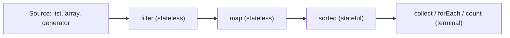

# Streams & functional Java

> **TL;DR** A stream is a **lazy pipeline**: nothing runs until a **terminal** operation. Elements flow through the pipeline **one at a time** (vertically), not stage by stage. A stream can be consumed **once**. Most stream MCQs test laziness, `toMap` duplicates, `Optional.orElse` vs `orElseGet`, and parallel stream pitfalls.

## Mental model



```java
Stream.of("a", "bb", "ccc")
      .filter(s -> { System.out.println("filter " + s); return s.length() > 1; })
      .map(s -> { System.out.println("map " + s); return s.toUpperCase(); })
      .findFirst();
// filter a
// filter bb
// map bb          ← stops here: findFirst short-circuits; "ccc" is never touched
```

Without the terminal `findFirst`, **nothing** prints.

## Deep dive

### Operation types

| Kind | Examples | Notes |
|---|---|---|
| Intermediate, stateless | `filter`, `map`, `flatMap`, `peek` | process each element independently |
| Intermediate, stateful | `sorted`, `distinct`, `limit`, `skip` | need to see other elements; `sorted` buffers everything |
| Terminal | `collect`, `forEach`, `reduce`, `count`, `toList` | triggers execution |
| Short-circuiting | `limit`, `findFirst`, `anyMatch`, `allMatch`, `noneMatch` | can finish early, even on infinite streams |

- Reusing a consumed stream throws `IllegalStateException: stream has already been operated upon or closed`.
- `peek` is for debugging. Since Java 9, `count()` may **skip** the pipeline when the size is known from the source, so `list.stream().peek(System.out::println).count()` may print nothing.
- `map` is one-to-one; `flatMap` is one-to-many and flattens (`List<List<T>>` → `Stream<T>`).
- Use primitive streams (`IntStream`, `mapToInt`) to avoid boxing: `sum()`, `average()`, `summaryStatistics()`.

### Collectors you must know

```java
Map<Dept, List<Emp>> byDept = emps.stream().collect(groupingBy(Emp::dept));
Map<Dept, Long> countByDept = emps.stream().collect(groupingBy(Emp::dept, counting()));
Map<Dept, Double> avgSalary = emps.stream().collect(groupingBy(Emp::dept, averagingDouble(Emp::salary)));
Map<Dept, Optional<Emp>> topPaid = emps.stream().collect(groupingBy(Emp::dept, maxBy(comparing(Emp::salary))));
Map<Boolean, List<Emp>> seniorSplit = emps.stream().collect(partitioningBy(e -> e.years() > 5));
String csv = names.stream().collect(joining(", ", "[", "]"));
Map<Dept, TreeSet<String>> sortedNames = emps.stream()
        .collect(groupingBy(Emp::dept, TreeMap::new, mapping(Emp::name, toCollection(TreeSet::new))));
```

- `partitioningBy` **always** returns both `true` and `false` keys, even if one list is empty. `groupingBy` only has keys that occur.
- `groupingBy` returns a `HashMap` by default (no order). Pass a map factory for order.

### The `toMap` traps

```java
Map<String, Emp> byName = emps.stream().collect(toMap(Emp::name, e -> e));
```

- **Duplicate key** → `IllegalStateException`. Pass a merge function: `toMap(Emp::name, e -> e, (a, b) -> a)`.
- **Null value** → `NullPointerException` (it uses `HashMap.merge` internally).
- Want a specific map type? Use the four-argument version with `LinkedHashMap::new`.

### `toList()` variants

| Call | Result |
|---|---|
| `collect(Collectors.toList())` | mutable in practice (`ArrayList`), but type/mutability **not guaranteed** |
| `collect(Collectors.toUnmodifiableList())` | unmodifiable, **rejects nulls** |
| `stream.toList()` (Java 16+) | unmodifiable, **allows nulls** |

### reduce

`reduce(identity, accumulator, combiner)`: the identity must be a true identity (`0` for sum, `1` for product). A wrong identity such as `10` gives a different answer for **parallel** streams because each chunk adds the identity again.

### Optional

- Return type for "maybe absent". Not for fields, parameters or collections (return an empty list instead).
- `Optional.of(null)` throws NPE; use `ofNullable`.
- `orElse(x)` **always evaluates** `x`, even when the value is present. `orElseGet(supplier)` is lazy. Matters when `x` is expensive or has side effects.
- Prefer `map`, `filter`, `orElseThrow` over `isPresent()` + `get()`.

```java
String city = userRepo.findById(id)
        .map(User::address)
        .map(Address::city)
        .orElse("unknown");
```

### Parallel streams

- Run on `ForkJoinPool.commonPool()` (size ≈ cores − 1). Blocking calls inside starve **everything else** using that pool, including `CompletableFuture` async defaults.
- Worth it only for **large, CPU-bound, easily splittable** work (arrays, `ArrayList`, ranges). `LinkedList` and `Stream.iterate` split badly.
- Order: `forEach` is unordered in parallel; `forEachOrdered` preserves encounter order (with a cost).
- Never mutate shared state in lambdas (`list.add` into an `ArrayList` from a parallel stream loses data or throws). Collect instead.
- `findAny` is faster than `findFirst` in parallel.

### Functional interfaces

| Interface | Signature |
|---|---|
| `Supplier<T>` | `() -> T` |
| `Consumer<T>` | `T -> void` |
| `Function<T,R>` | `T -> R` |
| `Predicate<T>` | `T -> boolean` |
| `BiFunction<T,U,R>` | `(T,U) -> R` |
| `UnaryOperator<T>` / `BinaryOperator<T>` | `T -> T` / `(T,T) -> T` |

Lambdas can only capture **effectively final** local variables.

## Code you should be able to write

```java
// Top 3 most frequent words, ties broken alphabetically
List<String> top3 = Arrays.stream(text.toLowerCase().split("\\W+"))
        .filter(w -> !w.isBlank())
        .collect(groupingBy(w -> w, counting()))
        .entrySet().stream()
        .sorted(Map.Entry.<String, Long>comparingByValue().reversed()
                .thenComparing(Map.Entry.comparingByKey()))
        .limit(3)
        .map(Map.Entry::getKey)
        .toList();
```

## Traps

- "Intermediate operations run when called." They run at the **terminal** op.
- "`toMap` keeps the last value on duplicates." It **throws** unless you pass a merge function.
- "`orElse` is lazy." `orElseGet` is.
- "Parallel is always faster." Often slower for small or I/O-bound work.
- "`peek` always runs." Not if the terminal op can skip the pipeline.

## Say it out loud

**"When would you avoid a parallel stream?"**
When the data is small, the work is I/O-bound or blocking, the source splits badly, or the lambdas touch shared state. Parallel streams share the common ForkJoinPool, so one blocking pipeline can slow down unrelated async work across the application.

## Practice MCQs

**Q1.** What prints?
```java
Stream.of(1, 2, 3).map(x -> { System.out.print(x); return x * 2; });
```
- A) `123`
- B) `246`
- C) Nothing
- D) Compile error

<details markdown="1"><summary>Answer</summary>

**C.** No terminal operation, so the pipeline never runs.
</details>

**Q2.** `toMap(Emp::name, e -> e)` on a list with two employees named "Ana" results in:
- A) The first Ana is kept
- B) The last Ana is kept
- C) `IllegalStateException`
- D) A `Map<String, List<Emp>>`

<details markdown="1"><summary>Answer</summary>

**C.** Duplicate keys throw without a merge function.
</details>

**Q3.** Which is evaluated even when the Optional has a value?
- A) `orElseGet(() -> load())`
- B) `orElse(load())`
- C) `orElseThrow()`
- D) `map(x -> load())`

<details markdown="1"><summary>Answer</summary>

**B.** Method arguments are evaluated before the call.
</details>

**Q4.** `partitioningBy(x -> x > 100)` on `[1, 2, 3]` returns:
- A) `{false=[1, 2, 3]}`
- B) `{false=[1, 2, 3], true=[]}`
- C) `{true=[]}`
- D) An empty map

<details markdown="1"><summary>Answer</summary>

**B.** Both keys are always present.
</details>

**Q5.** `IntStream.range(0, 4).parallel().reduce(10, Integer::sum)` might return:
- A) Always 16
- B) Possibly more than 16
- C) Always 6
- D) Throws

<details markdown="1"><summary>Answer</summary>

**B.** 10 is not an identity for addition, so each parallel chunk adds 10 again. Sequentially it would be 16.
</details>

**Q6.** What happens when you call a terminal operation twice on the same stream object?
- A) It reruns the pipeline
- B) Returns cached results
- C) `IllegalStateException`
- D) Returns an empty result

<details markdown="1"><summary>Answer</summary>

**C.** Streams are single-use.
</details>

**Q7.** Which returns an unmodifiable list that may contain nulls?
- A) `Collectors.toList()`
- B) `Collectors.toUnmodifiableList()`
- C) `Stream.toList()`
- D) `Arrays.asList()`

<details markdown="1"><summary>Answer</summary>

**C.** `toUnmodifiableList` rejects nulls; `Collectors.toList` makes no unmodifiability guarantee.
</details>

## Related

- [Concurrency](03-concurrency.md): the common ForkJoinPool.
- [Modern Java](05-modern-java.md): records make great stream DTOs.
