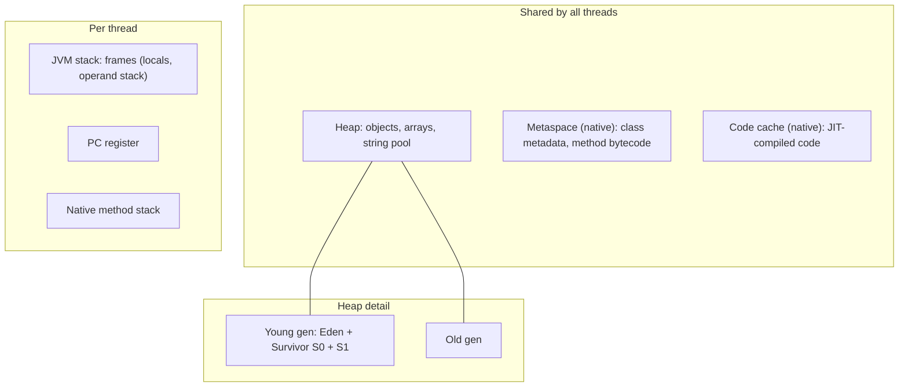
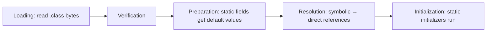

# JVM memory & class loading

> **TL;DR** Objects live on the **heap**, one big memory area shared by all threads and cleaned up automatically by the garbage collector. Each thread has its own **stack**, a pile of *frames* (one per method call in progress) holding that call's local variables and references. Class metadata lives in **Metaspace**, which since Java 8 is *native* memory (memory the JVM gets straight from the operating system, outside the heap). Most memory MCQs ask "where does X live?" and "which error do you get when Y runs out?"

## Mental model: runtime data areas



What each area is for:

- **Heap**: every object and array created with `new`. Shared, so any thread holding a reference can reach the object. This is the only area the garbage collector manages in the usual sense.
- **Metaspace**: the description of each loaded class (its fields, methods, bytecode, constant pool). There is one copy per loaded class, not per object.
- **Code cache**: machine code produced when the JIT compiler turns hot methods into native instructions (see [JIT & troubleshooting](03-performance-troubleshooting.md)).
- **JVM stack** (per thread): one frame per method call that is currently running. A frame holds the method's local variables, a small *operand stack* the bytecode uses as scratch space for calculations, and where to return to.
- **PC register** (per thread): the address of the bytecode instruction the thread is currently executing, so each thread can be paused and resumed at its own position.
- **Native method stack** (per thread): the stack used when Java calls into C/C++ code (JNI).

```java
void handle() {
    int count = 3;                   // primitive local → lives directly in this method's stack frame
    User u = new User("Ana");        // the reference u → stack frame; the User object itself → heap
    String s = "hello";              // the reference s → stack frame; the literal "hello" → string pool (on the heap)
}                                    // frame is popped: count, u, s disappear; the User object becomes garbage if nothing else references it
```

A frame lives exactly as long as its method call, which is why stack memory needs no garbage collector: when the method returns, the whole frame is discarded at once. Objects on the heap outlive the call that created them for as long as something still references them, so they need the GC.

## Deep dive

### Heap

- **Holds all objects and arrays.** Its size is set with `-Xms` (initial size, reserved at startup) and `-Xmx` (maximum size it may grow to). Setting them equal avoids resize pauses and is common for servers. In containers it is often better to use `-XX:MaxRAMPercentage=75` so the heap scales with the container's memory limit.
- **Generational layout** (used by generational collectors such as G1, Parallel and Serial). It is based on the *weak generational hypothesis*: most objects die very young (temporary strings, request DTOs), while a few live a long time (caches, singletons). So the heap is split up:
    - **Eden**: where almost every new object is allocated. Allocation is extremely cheap: each thread has a private chunk of Eden (a TLAB, thread-local allocation buffer), so allocating is just bumping a pointer.
    - **Two Survivor spaces (S0, S1)**: objects that survive an Eden collection are copied here, and bounce between S0 and S1 on each young GC while their *age* counter increases. Only one survivor space is in use at a time; the other is the empty destination for the next copy.
    - **Old generation**: objects that survive enough young collections (the *tenuring threshold*, up to 15) are **promoted** here. It is collected less often, because it mostly holds objects that are still in use.

    See [Garbage collection](02-garbage-collection.md) for how each collector uses these areas.

- **The string pool moved from PermGen to the heap in Java 7.** PermGen was a small, fixed-size area, so applications that interned many strings could crash with `OutOfMemoryError: PermGen space`. On the heap, pooled strings are sized by `-Xmx` and are garbage-collected when unused.

### Stack

- **One per thread**, sized with **`-Xss`** (default about 1 MB on 64-bit Linux). Each method call pushes a **frame** containing its local variables, its operand stack and a return address; returning pops it. Stack allocation and cleanup are therefore free, but the size is fixed when the thread starts, which is why huge numbers of platform threads cost a lot of memory (virtual threads keep their stacks on the heap instead; see [Concurrency](../java/03-concurrency.md)).
- **Primitives and references that are local variables live here; the objects they point to do not.** `int count` stores the number 3 right in the frame. `User u` stores only a reference; the `User` object is on the heap. Primitive *fields* of an object live inside that object on the heap.
- **Deep or infinite recursion → `StackOverflowError`.** Every nested call adds a frame, and when the thread's stack is full, the JVM throws `StackOverflowError`. It is an **`Error`, not an `Exception`**, so `catch (Exception e)` does not catch it. Errors mean the JVM is in trouble and you normally shouldn't try to recover. The usual fix is to turn the recursion into a loop or fix the missing base case; `-Xss` can raise the limit for legitimately deep recursion.

### Metaspace

- **It replaced PermGen in Java 8.** PermGen ("permanent generation") was part of the heap with a fixed maximum, `-XX:MaxPermSize`, which was hard to size and caused frequent `OutOfMemoryError: PermGen space`. Metaspace lives in **native memory** and **grows automatically** as more classes are loaded, limited only by available memory unless you cap it with `-XX:MaxMetaspaceSize`. A cap is recommended in production, so a leak fails fast with a clear error instead of slowly eating all of the machine's or container's memory.
- **Leaks usually come from classloader leaks.** Class metadata can only be freed when the **classloader that loaded the class** becomes unreachable, and a classloader stays alive as long as *any* single object of *any* of its classes is reachable. Typical causes:
    - **Redeploying an application in an app server** (Tomcat, WildFly) without restarting the JVM: if anything outside the app (a JDBC driver registry, a static field in a shared library, a thread that never stops, a `ThreadLocal`) still references one object from the old deployment, the whole old classloader and all its classes stay in Metaspace. After a few redeploys: `OutOfMemoryError: Metaspace`.
    - **Libraries that generate classes at runtime** (CGLIB and ByteBuddy proxies, scripting engines, some serialization frameworks): if they create a new class per call or per request instead of caching them, Metaspace grows without limit.

### Other native memory

The JVM also uses native memory outside both the heap and Metaspace:

- **Direct buffers** (`ByteBuffer.allocateDirect`, used heavily by Netty and NIO): memory allocated outside the heap so the OS can read and write network or file data straight into it without an extra copy. They are freed only when the small `ByteBuffer` object that owns them is garbage-collected, or explicitly by libraries like Netty's pooled allocator. The total is limited by **`-XX:MaxDirectMemorySize`** (by default about the same as `-Xmx`).
- **Thread stacks** (about 1 MB each × number of threads), the **code cache**, **GC data structures** (G1's remembered sets can be several percent of the heap), symbol tables and memory used by native libraries.

This is why **a container's memory limit must be larger than `-Xmx`**. The kernel's OOM killer looks at the *whole* process's memory, so a JVM with `-Xmx` equal to the container limit will be killed as soon as native memory pushes it over. A common rule: give the heap 50–75 % of the container limit and leave the rest as headroom.

### Object layout (64-bit HotSpot)

Every object on the heap starts with a **header** used by the JVM itself, followed by its fields:

- **Header** (12 bytes by default):
    - **Mark word** (8 bytes): stores the identity hash code once computed, the **lock state** (used by `synchronized`), and the **GC age** (how many young collections the object has survived).
    - **Class pointer** (4 bytes with *compressed class pointers*, the default): points to the class metadata in Metaspace, which is how the JVM knows the object's type.
- **Fields**, then **padding** up to a multiple of 8 bytes, because objects are aligned to 8-byte boundaries for fast memory access.
- **Sizes to remember.** `new Object()` has 12 bytes of header and no fields, padded to **16 bytes**. An `Integer` is 12 bytes of header plus a 4-byte `int` field = **16 bytes**, versus **4** for a plain `int`, and a `List<Integer>` additionally stores a 4-byte reference to each one. So a list of a million boxed integers takes roughly 20 MB, while an `int[]` of the same values takes 4 MB. That is why boxing large collections is expensive and why `IntStream` and primitive arrays matter for big data. (Java 25 adds optional *compact object headers*, `-XX:+UseCompactObjectHeaders`, which shrink the header to 8 bytes.)
- **Compressed oops** ("ordinary object pointers"): on a 64-bit JVM a reference would naturally be 8 bytes. Because objects are 8-byte aligned, the last 3 bits of every address are always 0, so the JVM can store `address / 8` in 32 bits and reach 2³² × 8 bytes = **32 GB**. This is on by default for heaps under about 32 GB and makes every reference 4 bytes instead of 8. Once `-Xmx` crosses that limit, compression switches off and every reference doubles in size. Since references are a large share of a typical heap, a 33 GB heap can actually hold **less** data than a 31 GB one; you typically need roughly 40+ GB to break even. So don't set `-Xmx` slightly above 32 GB.

### Escape analysis

The JIT compiler analyses whether an object **escapes** the method that creates it: is it returned, stored in a field, or passed to code that might keep it? If it provably never escapes, the JIT can:

- **Scalar-replace** it: not allocate the object at all, but keep its fields as plain local variables in CPU registers or the stack frame. No heap allocation means no GC cost.
- **Eliminate locks** on it (*lock elision*): if no other thread can ever see the object, `synchronized` on it can do nothing, so the lock is removed.

So "every `new` hits the heap" is not strictly true once code is JIT-compiled. This is also why tiny short-lived objects (iterators, small wrappers, `Optional` in a hot loop) are often cheaper than people expect. It only applies to compiled hot code, and the analysis is conservative.

### Class loading

Before a class can be used, the JVM must find its bytecode, check it and set it up. That happens in these phases:



1. **Loading**: a classloader finds the `.class` bytes (in a JAR, a directory, over the network, or generated in memory) and creates the class's internal representation in Metaspace.
2. **Verification**: the bytecode is checked to be well-formed and type-safe (no jumping into the middle of an instruction, no treating an `int` as a reference). This protects the JVM from corrupt or malicious class files.
3. **Preparation**: memory for **static fields** is allocated and set to **default values** (`0`, `false`, `null`), *not* yet to the values in your code.
4. **Resolution**: symbolic references in the class (the *name* `"java/util/List"`) are replaced with direct pointers to the loaded classes, methods and fields. HotSpot does this lazily, on first use of each reference.
5. **Initialization**: static field initializers and `static { }` blocks run, in source order. Only now does `static int MAX = compute();` get its real value. The JVM guarantees this happens exactly once, even with many threads, which is what makes the holder-class singleton idiom thread-safe.

**Parent-delegation model.** When a classloader is asked to load a class, it first asks its **parent** loader, and only tries to load the class itself if the parent can't find it.

| Loader | Loads |
|---|---|
| Bootstrap | The core JDK classes (`java.lang.*`, `java.util.*`). Built into the JVM, written in native code; in Java it shows up as `null` (e.g. `String.class.getClassLoader()` returns `null`). |
| Platform (Java 9+; was the "Extension" loader before) | Other JDK modules such as `java.sql` and `java.xml.crypto`. |
| Application (System) | Your application's classpath or module path: your code and its JAR dependencies. |

Why delegation matters:

- **Security and consistency.** If you put your own `java/lang/String.class` on the classpath, the application loader first asks its parent, the bootstrap loader already provides the real `String`, and yours is never used. Core classes cannot be replaced by user code.
- **No duplicates.** Each class is loaded once, by the highest loader that can see it, so everyone shares the same `String` class.
- **A class's identity is its name *plus* its defining classloader.** The same `.class` file loaded by two different loaders produces two **different, incompatible** types. That is the source of the confusing `ClassCastException: com.x.Foo cannot be cast to com.x.Foo`, typically in app servers, plugin systems, or with Spring Boot DevTools, which uses a separate *restart* classloader for your code.

**Initialization is lazy.** A class is initialized on its **first active use**: creating an instance, calling a static method, reading or writing a non-constant static field, initializing a subclass, or reflection like `Class.forName("X")`. It is *not* initialized just because it is mentioned in a variable declaration or a method signature. Reading a `static final` **compile-time constant** (a primitive or `String` initialized with a constant expression, like `static final int MAX = 10;`) does **not** trigger initialization, because the compiler copies (*inlines*) the value `10` into the calling class's bytecode, so at runtime the caller never touches the class at all. A side effect: if you change the constant and recompile only its own class, callers keep the old value until they are recompiled too.

### OutOfMemoryError variants

`OutOfMemoryError` (OOM) is thrown when the JVM cannot get memory it needs. The message tells you **which** area ran out, which points straight at the cause:

| Message | Meaning | First thing to check |
|---|---|---|
| `Java heap space` | An allocation didn't fit in the heap, even after a full GC. | Take a heap dump and check: is something growing without bound (a leak), or is the live data genuinely bigger than `-Xmx` (heap too small)? |
| `GC overhead limit exceeded` | (Parallel GC) The JVM spent about **98 %** of its time in GC while recovering less than **2 %** of the heap. The heap is not technically full, but the application is making no progress, so the JVM gives up instead of crawling forever. | The same as above: the heap is nearly full of live objects. |
| `Metaspace` | Too much class metadata, more than `MaxMetaspaceSize` or the available native memory. | A classloader leak (redeploys) or code generating classes on every call (dynamic proxies, scripting). |
| `unable to create native thread` | The **operating system** refused to create another thread. This is not about the heap at all. | A thread leak (executors never shut down), the OS per-user process limit (`ulimit -u`), the container's PID limit, or not enough native memory for another thread stack. |
| `Direct buffer memory` | Off-heap NIO buffers have reached `MaxDirectMemorySize`. | Netty/NIO buffers that aren't released (Netty's leak detector helps), or a limit set too low for the workload. |
| `Requested array size exceeds VM limit` | Code tried to create an array larger than the JVM's maximum (about `Integer.MAX_VALUE` elements). | Almost always a bug, such as a size computed from corrupted input or an overflowed length. |

Add `-XX:+HeapDumpOnOutOfMemoryError -XX:HeapDumpPath=/dumps` in production, so the evidence is captured automatically at the moment of failure.

## Common memory leaks in Java

The GC frees objects that are **unreachable**: no chain of references leads to them from a *GC root* (local variables of running threads, static fields, JNI references). It cannot know whether you still *need* a reachable object. So a Java memory leak is an object you no longer need that is still **reachable**, and therefore never collected:

- **Static collections and caches that only grow.** A `static Map` used as a cache lives as long as its class, and if entries are added and never removed, it grows until the heap is full. Use a bounded cache with size limits and expiry, such as Caffeine.
- **`ThreadLocal` values in pooled threads never `remove()`d.** Pool threads live forever, and so do their thread-local values (see [Concurrency](../java/03-concurrency.md)).
- **Listeners and callbacks registered but never unregistered.** The event source holds a reference to the listener, and through it to everything the listener references.
- **Non-static inner classes or lambdas capturing a large outer object.** An inner class instance silently holds a reference to its outer object, and a lambda that uses `this` (or any field) captures it. Storing such a callback somewhere long-lived keeps the whole outer object alive.
- **Keys with broken `equals`/`hashCode` in a `HashMap`.** If equal keys don't produce equal hash codes, `put` with a "same" key never finds the existing entry and adds a new one every time, so the map keeps growing with duplicates (see [Core language traps](../java/01-core-language.md)).
- **Unclosed resources** (streams, JDBC connections, sockets) often hold native memory or OS handles that the GC can't see or reclaim promptly. Use try-with-resources.

## Traps

- "Local objects live on the stack." Only the **reference** lives in the stack frame; the object itself is on the heap (unless escape analysis eliminates the allocation altogether).
- "Metaspace is part of the heap." It is **native** memory outside the heap, which is exactly why it replaced the fixed-size PermGen.
- "`StackOverflowError` is an Exception." It is an **`Error`** (`VirtualMachineError` → `Error` → `Throwable`), so `catch (Exception e)` does not catch it.
- "`-Xmx2g` means the process uses at most 2 GB." `-Xmx` limits only the heap. Add Metaspace, thread stacks, the code cache, GC structures and direct memory; real process memory is often 1.3–2× the heap.
- "Java can't have memory leaks because of GC." The GC only frees *unreachable* objects. Objects you've forgotten about but that are still referenced, for example from a static cache, are never freed.

## Say it out loud

**"Where do objects, references, and class metadata live?"**
Objects and arrays live on the heap, which is shared by all threads and managed by the garbage collector. Local primitives and local references live in the current thread's stack frame and disappear when the method returns; the objects those references point to stay on the heap as long as something references them. Class metadata lives in Metaspace, which since Java 8 is native memory outside the heap. JIT-compiled machine code lives in another native area, the code cache.

**"Our container keeps getting OOM-killed but the heap looks fine."**
The kernel kills the container based on total process memory, not just the heap, so something outside the heap is growing or `-Xmx` leaves no headroom. I'd turn on Native Memory Tracking with `-XX:NativeMemoryTracking=summary` and compare `jcmd <pid> VM.native_memory summary` snapshots over time, look at thread count (each stack is about a megabyte), direct buffers and Metaspace, and then size the heap with `-Xmx` or `MaxRAMPercentage` at around 50 to 75 percent of the container limit so native memory has room.

## Practice MCQs

**Q1.** In Java 8+, where is class metadata stored?

- A) PermGen
- B) Heap old generation
- C) Metaspace in native memory
- D) Thread stack

<details markdown="1"><summary>Answer</summary>

**C.** Java 8 removed PermGen (A), which was a fixed-size heap area, and moved class metadata to Metaspace, which is native memory that grows on demand up to `MaxMetaspaceSize`. The old generation (B) holds long-lived *objects*, not class definitions. Stacks (D) hold method frames.
</details>

**Q2.** Infinite recursion results in:

- A) `OutOfMemoryError: Java heap space`
- B) `StackOverflowError`
- C) `IllegalStateException`
- D) The JVM optimises it into a loop

<details markdown="1"><summary>Answer</summary>

**B.** Each call pushes a new frame onto the thread's fixed-size stack until it is full. D is wrong because the JVM does not do tail-call optimisation, so even a recursive call in tail position needs a new frame. A is wrong because frames live on the stack, not the heap.
</details>

**Q3.** Which access does **not** trigger class initialization?

- A) Calling a static method
- B) Creating an instance
- C) Reading a `static final int MAX = 10;` constant
- D) Reading a non-final static field

<details markdown="1"><summary>Answer</summary>

**C.** `MAX` is a compile-time constant, so the compiler copies the value `10` into the caller's bytecode, and at runtime the caller never touches the class. A, B and D are all "active uses" that run the class's static initializers first. (If `MAX` were `static final int MAX = compute();`, it would *not* be a constant and reading it *would* trigger initialization.)
</details>

**Q4.** What is the main purpose of parent-delegation class loading?

- A) Faster startup
- B) Prevent user classes from replacing core JDK classes and avoid duplicate loading
- C) Allow hot reload
- D) Reduce heap usage

<details markdown="1"><summary>Answer</summary>

**B.** Because every loader asks its parent first, a request for `java.lang.String` always ends at the bootstrap loader, which returns the real JDK class. A fake `String` on the classpath is never used, and each class is loaded only once, by the highest loader that can find it. Hot reload (C) actually works *around* delegation, using child-first or throwaway classloaders.
</details>

**Q5.** `ClassCastException: com.x.Foo cannot be cast to com.x.Foo` most likely means:

- A) A JVM bug
- B) The class was loaded by two different classloaders
- C) Generics were erased
- D) The class is final

<details markdown="1"><summary>Answer</summary>

**B.** At runtime a type is identified by its fully qualified name **plus** the classloader that defined it. If two loaders each loaded `com.x.Foo`, there are two distinct `Foo` types, and an object of one cannot be cast to the other even though the names are identical. Common in app servers, plugin systems and with Spring Boot DevTools' restart classloader.
</details>

**Q6.** A service using Netty fails with `OutOfMemoryError: Direct buffer memory`. The heap is half empty. What's the likely cause?

- A) `-Xmx` too small
- B) Off-heap buffers not being released or `MaxDirectMemorySize` too low
- C) Metaspace leak
- D) Too many threads

<details markdown="1"><summary>Answer</summary>

**B.** This message specifically means the off-heap direct buffer pool hit its limit, which is separate from the heap, so the half-empty heap is irrelevant and raising `-Xmx` (A) wouldn't address it directly. Either buffers are not being released (in Netty, usually a `ByteBuf` that was never `release()`d; enable `-Dio.netty.leakDetection.level=advanced` to find it) or the limit is too low for the load. C and D would produce different OOM messages.
</details>

## Related

- [Garbage collection](02-garbage-collection.md): how the young and old generations are collected, and the collectors that use them.
- [JIT & troubleshooting](03-performance-troubleshooting.md): heap dumps, Native Memory Tracking and the code cache.
