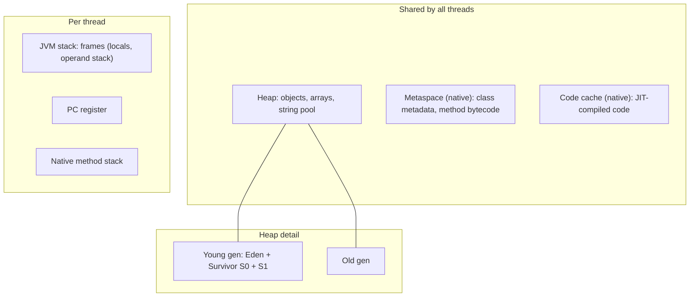

# JVM memory & class loading

> **TL;DR** Objects live on the **heap** (shared, garbage-collected). Each thread has its own **stack** of frames holding local variables and references. Class metadata lives in **Metaspace** (native memory, since Java 8). Most memory MCQs ask "where does X live?" and "which error do you get when Y runs out?"

## Mental model: runtime data areas



```java
void handle() {
    int count = 3;                   // primitive local → stack frame
    User u = new User("Ana");        // reference u → stack; User object → heap
    String s = "hello";              // literal → string pool (heap)
}
```

## Deep dive

### Heap

- Holds all objects and arrays. Sized with `-Xms` (initial) and `-Xmx` (maximum).
- Generational layout (for generational collectors): **Eden** (new objects), two **Survivor** spaces, and **Old** gen for long-lived objects.
- The **string pool** moved from PermGen to the heap in Java 7.

### Stack

- One per thread, sized with `-Xss`. Each method call pushes a **frame** with local variables, operand stack and a return address.
- Primitives and **references** that are local variables live here; the objects they point to do not.
- Deep or infinite recursion → `StackOverflowError` (an `Error`, not an `Exception`).

### Metaspace

- Replaced **PermGen** in Java 8. Lives in **native** memory and grows automatically unless capped with `-XX:MaxMetaspaceSize`.
- Leaks usually come from **classloader leaks**: redeploying apps in a container, or libraries generating classes (proxies, scripting) without unloading them.

### Other native memory

- **Direct buffers** (`ByteBuffer.allocateDirect`, used by Netty/NIO): limited by `-XX:MaxDirectMemorySize`.
- Thread stacks, code cache, GC structures. This is why a container's memory limit must be larger than `-Xmx`.

### Object layout (64-bit HotSpot)

- **Header**: mark word (8 bytes: hash, lock state, GC age) + class pointer (4 bytes with compressed class pointers).
- Fields, then padding to a multiple of 8 bytes.
- A `new Object()` is about **16 bytes**. An `Integer` is 16 bytes versus 4 for an `int`, which is why boxing large collections is expensive.
- **Compressed oops** (on by default for heaps under ~32 GB) store references in 4 bytes. Going just above 32 GB can **reduce** usable capacity.

### Escape analysis

The JIT can prove an object never escapes a method and then **scalar-replace** it (keep its fields in registers) and remove locks on it. So "every `new` hits the heap" is not strictly true after JIT.

### Class loading


**Parent-delegation model:** a classloader first asks its parent.

| Loader | Loads |
|---|---|
| Bootstrap | core JDK classes (`java.lang.*`) |
| Platform (Java 9+; was "Extension") | other JDK modules |
| Application (System) | your classpath |

Delegation stops user code from replacing `java.lang.String`. The same class loaded by two loaders is two **different** types (classic `ClassCastException: X cannot be cast to X`).

**Initialization is lazy:** static initializers run on first active use (creating an instance, calling a static method, reading a non-constant static field). Reading a `static final` compile-time **constant** does not trigger initialization, because the value is inlined.

### OutOfMemoryError variants

| Message | Meaning | First thing to check |
|---|---|---|
| `Java heap space` | heap full after GC | heap dump: leak or undersized `-Xmx` |
| `GC overhead limit exceeded` | spending ~98% of time in GC, recovering under ~2% | same as above, it's nearly full |
| `Metaspace` | too much class metadata | classloader leak, dynamic proxies |
| `unable to create native thread` | OS refused a new thread | thread leak, ulimit, container limits |
| `Direct buffer memory` | off-heap NIO buffers exhausted | Netty/NIO buffer leaks, `MaxDirectMemorySize` |
| `Requested array size exceeds VM limit` | array too large | a bug creating a giant array |

## Common memory leaks in Java

GC removes **unreachable** objects; a leak is an object you no longer need that is still **reachable**:

- Static collections and caches that only grow (use bounded caches, e.g. Caffeine).
- `ThreadLocal` values in pooled threads never `remove()`d.
- Listeners/callbacks registered but never unregistered.
- Non-static inner classes or lambdas capturing a large outer object.
- Keys with broken `equals`/`hashCode` in a `HashMap` (duplicates pile up).
- Unclosed resources (streams, connections), often holding native memory.

## Traps

- "Local objects live on the stack." The **reference** does; the object is on the heap (unless escape analysis removes it).
- "Metaspace is part of the heap." It is native memory.
- "`StackOverflowError` is an Exception." It is an `Error`.
- "`-Xmx2g` means the process uses at most 2 GB." Add Metaspace, thread stacks, code cache, direct memory.
- "Java can't have memory leaks because of GC." Reachable-but-unused objects leak.

## Say it out loud

**"Where do objects, references, and class metadata live?"**
Objects and arrays live on the shared heap. Local primitives and references live in the calling thread's stack frame. Class metadata lives in Metaspace, which is native memory since Java 8. JIT-compiled code lives in the code cache.

**"Our container keeps getting OOM-killed but the heap looks fine."**
The kernel kills on total process memory, not heap. I'd check native memory with Native Memory Tracking (`-XX:NativeMemoryTracking=summary` and `jcmd <pid> VM.native_memory`), look at thread count, direct buffers and Metaspace, and size `-Xmx` (or `MaxRAMPercentage`) to leave headroom.

## Practice MCQs

**Q1.** In Java 8+, where is class metadata stored?
- A) PermGen
- B) Heap old generation
- C) Metaspace in native memory
- D) Thread stack

<details markdown="1"><summary>Answer</summary>

**C.**
</details>

**Q2.** Infinite recursion results in:
- A) `OutOfMemoryError: Java heap space`
- B) `StackOverflowError`
- C) `IllegalStateException`
- D) The JVM optimises it into a loop

<details markdown="1"><summary>Answer</summary>

**B.** The JVM does not do tail-call optimisation.
</details>

**Q3.** Which access does **not** trigger class initialization?
- A) Calling a static method
- B) Creating an instance
- C) Reading a `static final int MAX = 10;` constant
- D) Reading a non-final static field

<details markdown="1"><summary>Answer</summary>

**C.** Compile-time constants are inlined into the caller.
</details>

**Q4.** What is the main purpose of parent-delegation class loading?
- A) Faster startup
- B) Prevent user classes from replacing core JDK classes and avoid duplicate loading
- C) Allow hot reload
- D) Reduce heap usage

<details markdown="1"><summary>Answer</summary>

**B.**
</details>

**Q5.** `ClassCastException: com.x.Foo cannot be cast to com.x.Foo` most likely means:
- A) A JVM bug
- B) The class was loaded by two different classloaders
- C) Generics were erased
- D) The class is final

<details markdown="1"><summary>Answer</summary>

**B.** Type identity is class name plus defining classloader.
</details>

**Q6.** A service using Netty fails with `OutOfMemoryError: Direct buffer memory`. The heap is half empty. What's the likely cause?
- A) `-Xmx` too small
- B) Off-heap buffers not being released or `MaxDirectMemorySize` too low
- C) Metaspace leak
- D) Too many threads

<details markdown="1"><summary>Answer</summary>

**B.**
</details>

## Related

- [Garbage collection](02-garbage-collection.md)
- [JIT & troubleshooting](03-performance-troubleshooting.md): heap dumps and NMT.
