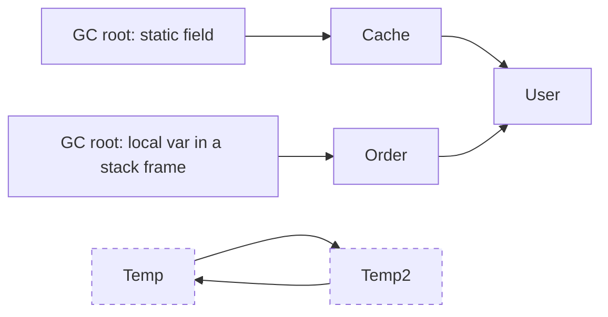
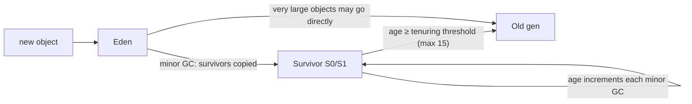

# Garbage collection

> **TL;DR** The garbage collector (GC) frees objects that are **unreachable from GC roots**: it starts from references the program definitely still holds and marks everything it can reach; whatever it can't reach is garbage. Java does *not* use reference counting, so objects that only point at each other in a cycle are still collected. Because most objects die young, heaps are split into **young** and **old** generations and the young one is cleaned often and cheaply. **G1** is the default since Java 9 (a balance of throughput and pause time); **ZGC** and **Shenandoah** aim for pauses of about a millisecond; **Parallel** maximises raw throughput. You choose by goal: throughput, latency, or memory footprint.

## Mental model: reachability



The GC never asks "is this object still needed?" (it can't know that). It asks "can the program still *reach* this object by following references from somewhere it is definitely using?" Those starting points are the **GC roots**:

- **Local variables and parameters** in the frames of every live thread's stack (the code currently running can use them).
- **Static fields** of loaded classes (any code can read them at any time).
- **Active threads** themselves, and objects used as locks by `synchronized` blocks currently running.
- **JNI references** held by native code.

Everything reachable from a root by following references is *live*: in the diagram, `Order`, `Cache` and `User` (reachable two ways). `D` and `E` reference each other but **nothing reachable points to them**, so no code can ever use them again, and both are garbage.

This is why Java does not need reference counting. A reference-counting system (as in CPython or C++'s `shared_ptr`) frees an object when its count drops to zero, but `D` and `E` each have a count of 1 from the other, so they would leak forever. Tracing from roots handles cycles naturally.

## Deep dive

### Generational collection



The design rests on the **weak generational hypothesis**: most objects die very soon after they are created (a request's DTOs, temporary strings, iterators), and the few that survive a while tend to live a long time (caches, connection pools, Spring beans). So the GC focuses its effort where the garbage is.

- **Minor (young) GC**: collects **Eden** and the in-use **survivor** space. It finds the live objects (usually only a small percentage) and **copies** them into the other, empty survivor space, incrementing each object's *age*; then the whole of Eden and the old survivor space are simply declared empty. The cost is proportional to the number of **live** objects, not to the size of Eden, so it is fast precisely because most objects are already dead. Objects whose age reaches the **tenuring threshold** (at most 15, because the age is stored in 4 bits of the object header) are **promoted** to the old generation. Very large objects may be allocated directly in the old generation, to avoid copying them repeatedly.
- **Major/old GC**: collects the old generation. It is slower, because old regions are full of live objects that must all be traced. A **Full GC** collects the **whole heap** (and usually unloads unused classes from Metaspace too), typically single-pass and stop-the-world, and can take seconds on large heaps. These are the pauses you want to avoid. A Full GC in a G1 log usually means the collector fell behind (it ran out of space before its concurrent work finished).
- **The basic algorithms**, which collectors combine:
    - **Mark**: trace from the GC roots and flag every reachable object as live.
    - **Sweep**: walk the heap and add the unmarked (dead) objects' memory to a free list. Fast, but leaves free memory scattered in small gaps (**fragmentation**), so a large allocation might fail even though plenty of total memory is free.
    - **Compact**: slide live objects together so that free memory becomes one contiguous block. It cures fragmentation, but every reference to a moved object must be updated.
    - **Copy**: move live objects into a separate empty area, which compacts as a side effect. Fast when few objects survive, but needs spare space to copy into (that is why there are two survivor spaces).
- **Stop-the-world (STW) pauses** halt all application threads so the GC can work on a heap that isn't changing under it. Pause length is what users feel as latency spikes. Modern collectors do most of the expensive marking (and ZGC/Shenandoah even the compaction) **concurrently**, while the application keeps running, leaving only very short STW phases. The price is extra CPU and some overhead on the application's own reads and writes (*barriers*) to keep track of changes made during the concurrent phase.

### The collectors

| Collector | Flag | Goal | Notes |
|---|---|---|---|
| Serial | `-XX:+UseSerialGC` | Small footprint | One GC thread, everything stop-the-world. Lowest memory and CPU overhead, fine for small heaps. The JVM picks it **automatically on small machines and containers** (see below). |
| Parallel | `-XX:+UseParallelGC` | **Throughput** | Like Serial but with many GC threads, still fully stop-the-world. It maximises the share of time spent running your code, at the cost of longer individual pauses. It was the **default in Java 8**. Good for batch jobs and data processing, where nobody waits on a single request. |
| **G1** ("Garbage First") | `-XX:+UseG1GC` | Balanced | **Default since Java 9.** Splits the heap into regions, marks concurrently, and tries to keep each pause under a target set with `-XX:MaxGCPauseMillis` (**default 200 ms**) by choosing how much to collect per pause. |
| **ZGC** | `-XX:+UseZGC` | **Very low latency** | Does marking *and* compaction concurrently, so pauses are typically **under a millisecond** and don't grow with heap size (it scales to terabyte heaps). Costs more CPU and memory. Generational mode was added in 21 (`-XX:+ZGenerational`), became the default mode in 23, and the old non-generational mode was removed in 24. |
| Shenandoah | `-XX:+UseShenandoahGC` | Low latency | Also concurrent compaction, with goals similar to ZGC; developed by Red Hat and included in many OpenJDK builds (not in Oracle's JDK). |
| CMS (Concurrent Mark Sweep) | (removed) | Low latency | The original concurrent collector. It did not compact, so fragmentation eventually forced long Full GCs. **Deprecated in 9, removed in 14.** |
| Epsilon | `-XX:+UseEpsilonGC` | None | Allocates memory but **never collects**; the JVM exits with OOM when the heap is full. Useful for performance testing (to measure an application without GC noise) and very short-lived jobs. |

### How G1 works

- **Regions.** Instead of a few large, fixed generations, G1 divides the heap into many equal-sized **regions** (1 to 32 MB, chosen from the heap size, aiming for about 2048 regions). At any moment each region plays one role: **Eden**, **Survivor**, **Old** or **Humongous**. The generations still exist logically, but as *sets of regions*, so G1 can resize them freely.
- **Humongous objects** are objects of at least **half a region** (e.g. ≥ 2 MB with 4 MB regions). They are allocated directly into one or more **contiguous** regions of their own. That is expensive: it needs contiguous free regions (fragmentation can force a Full GC), and the leftover space in their last region is wasted. Large arrays and big byte buffers are the usual cause. If GC logs show many humongous allocations, raise the region size (`-XX:G1HeapRegionSize`) or avoid allocating such large objects.
- **"Garbage First".** G1 periodically runs a **concurrent marking** cycle (mostly while the application runs) to measure how much live data each old region still has. Then, during subsequent pauses, it runs **mixed collections**: all young regions *plus* the old regions with the most garbage, the ones that give the most free space per millisecond of copying. Collecting the emptiest regions first is what gives the collector its name.
- **You set a pause *goal*, not a guarantee.** G1 uses statistics from previous pauses to decide how many regions it can collect within `MaxGCPauseMillis`. If the allocation rate is too high or live data too large, it will miss the target, and in the worst case it falls back to a Full GC. Setting the goal very low makes G1 collect less per pause, which means more frequent pauses and lower throughput.

### Reference types

Normally any reference keeps its target alive. `java.lang.ref` provides weaker references that let the GC reclaim the target under certain conditions:

| Type | Cleared when | Use |
|---|---|---|
| Strong | Never, while the object is reachable through it. | All normal references (`User u = ...`). |
| `SoftReference` | Only when memory runs short. The JVM guarantees all softly reachable objects are cleared **before** it throws `OutOfMemoryError`, and otherwise keeps recently used ones. | Memory-sensitive caches, in theory. In practice a real cache library with size limits (Caffeine) is more predictable, because soft references give you no control over *what* gets evicted or *when*, and can cause GC thrashing. |
| `WeakReference` | At the **next GC** after the object becomes reachable only through weak references, regardless of free memory. | `WeakHashMap` keys (an entry disappears once nobody else holds its key), canonicalising maps, and metadata attached to objects you don't own, without keeping them alive. |
| `PhantomReference` | Enqueued after the object has become unreachable (and any finalization has run). Its `get()` **always returns `null`**, so you can never resurrect the object. | Post-mortem cleanup: being notified that an object is gone in order to free an associated native resource. `java.lang.ref.Cleaner` is the friendly API built on it, and the replacement for `finalize()`. |

### Containers and default sizing

- **The JVM is container-aware** (Java 10+, backported to 8u191). It reads the **cgroup** CPU and memory limits that Docker or Kubernetes set, instead of seeing the whole host machine. Before this, a JVM in a 1 GB container on a 64 GB host would size its heap for 64 GB and promptly get OOM-killed.
- **The default max heap is 25 % of available memory** (`-XX:MaxRAMPercentage=25`). In a 1 GB container you get only about **256 MB** of heap unless you change it, which leaves most of the container's memory unused. (For very small memory sizes a different default, `MinRAMPercentage`, of 50 % applies.) For a container that runs only one JVM, a common setting is **`-XX:MaxRAMPercentage=70` to `75`**, leaving the rest for Metaspace, thread stacks and other native memory (see [Memory](01-memory.md)).
- **With fewer than 2 CPUs or under about 1792 MB of memory, the JVM picks Serial GC.** The JVM only treats a machine as a *server-class machine* (and picks G1) if it has at least 2 processors and about 1.8 GB of memory. Many Kubernetes pods are given 1 CPU or 1 GB, so they silently run the single-threaded Serial collector. Check with `java -Xlog:gc -version` or `-XX:+PrintCommandLineFlags`, and set the collector explicitly if needed.

### Useful flags

```text
-Xms2g -Xmx2g                         # initial = maximum heap: no pauses to grow/shrink the heap on servers
-XX:+UseG1GC -XX:MaxGCPauseMillis=100 # choose G1 explicitly and aim for 100 ms pauses (a goal, not a guarantee)
-XX:MaxRAMPercentage=75               # in containers, size the heap as a % of the memory limit instead of a fixed -Xmx
-XX:+HeapDumpOnOutOfMemoryError -XX:HeapDumpPath=/dumps   # write a heap dump at the moment of OOM, for later analysis
-Xlog:gc*:file=gc.log:time,uptime     # unified GC logging (Java 9+): every GC event, with wall-clock time and JVM uptime
-XX:+ExitOnOutOfMemoryError           # exit on the first OOM so the orchestrator restarts a pod that is now in an unknown state
```

The last flag matters because after an `OutOfMemoryError`, threads may have died halfway through their work and the application can be half-broken while still answering health checks. Exiting lets Kubernetes replace it with a clean instance.

### Tuning approach

1. **Define the goal**: p99 latency (how slow the slowest 1 % of requests are), throughput (work done per second or total batch time), or memory footprint. They trade off against each other, so you can't optimise all three at once.
2. **Turn on GC logs and measure** under realistic load. Tools such as GCeasy or GCViewer visualise GC logs; Java Flight Recorder (JFR) also shows allocation hot spots. Look at pause times, GC frequency, allocation rate and how full the old generation stays after collections.
3. **Fix allocation first.** The cheapest garbage is garbage you never create: excessive temporary objects in hot loops, boxing (`List<Integer>` instead of `int[]`), huge collections, string concatenation in loops, unbounded caches. Halving the allocation rate roughly halves GC work, no matter which collector you use.
4. **Only then change the collector or sizes, one knob at a time**, and re-measure after each change, otherwise you can't tell which change helped.

**`System.gc()` is only a hint.** The JVM may run a **Full GC** (a long stop-the-world pause, exactly what you are trying to avoid), or ignore it entirely when started with `-XX:+DisableExplicitGC`. Libraries sometimes call it (old RMI versions did periodically), which is a common source of mysterious Full GCs in logs.

## Traps

- "Java uses reference counting." It uses **reachability tracing** from GC roots, so cycles of objects that only reference each other are collected normally.
- "`System.gc()` forces collection." It is a **hint** that may be ignored, and when honoured it usually causes an expensive Full GC.
- "G1 guarantees the pause target." It is a **goal** that G1 tries to meet with statistics; high allocation rates or large live sets can exceed it, and a Full GC can far exceed it.
- "CMS is a good low-latency option today." It was deprecated in 9 and **removed in 14**. Use G1, ZGC or Shenandoah.
- "Default heap is whatever the container has." The default maximum is only **25 %** of the container's memory limit; set `MaxRAMPercentage` explicitly.
- "Soft and weak references are cleared at the same time." **Weak**: at the next GC once only weakly reachable. **Soft**: only when memory runs short, and in any case before an OOM.

## Say it out loud

**"How would you choose a GC?"**
G1 is a sound default for most services, because it balances throughput with pause times of tens to a few hundred milliseconds. If p99 latency matters and the GC logs show pauses are the cause, I'd try ZGC, which keeps pauses around a millisecond even on very large heaps, at the cost of more CPU and memory. For batch jobs where only total throughput matters and nobody waits on individual requests, Parallel GC. Before switching anything, I'd look at the allocation rate, because creating less garbage usually helps more than tuning the collector, and I'd change one setting at a time and measure.

## Practice MCQs

**Q1.** Two objects reference only each other and nothing else references them. They are:

- A) Never collected
- B) Collected, because they are unreachable from GC roots
- C) Collected only by Full GC
- D) Moved to Metaspace

<details markdown="1"><summary>Answer</summary>

**B.** The JVM traces from GC roots (stack locals, static fields, threads, JNI handles). The two objects point at each other, but no chain of references from any root reaches them, so they are garbage. A would be true only with reference counting, which Java doesn't use. C is wrong: they are collected in whichever generation they are in, by a young GC if they are young.
</details>

**Q2.** Default collector in Java 17 on a typical multi-core server:

- A) Parallel
- B) CMS
- C) G1
- D) ZGC

<details markdown="1"><summary>Answer</summary>

**C.** G1 has been the default on server-class machines since Java 9. Parallel (A) was the default in Java 8. CMS (B) was removed in Java 14. ZGC (D) must be enabled explicitly with `-XX:+UseZGC`. (On a machine with fewer than 2 CPUs or less than about 1.8 GB of memory, the default would be Serial.)
</details>

**Q3.** In G1, a humongous object is one whose size is at least:

- A) 1 MB
- B) Half a region
- C) A full region
- D) 10% of the heap

<details markdown="1"><summary>Answer</summary>

**B.** Any object of at least 50 % of the region size is humongous and gets its own contiguous region(s). Since region size varies from 1 to 32 MB depending on heap size, a fixed number like A is wrong; with 2 MB regions, a 1 MB array would already be humongous.
</details>

**Q4.** A JVM in a container with a 2 GB memory limit and no heap flags gets a default max heap of about:

- A) 2 GB
- B) 1.5 GB
- C) 512 MB
- D) 256 MB

<details markdown="1"><summary>Answer</summary>

**C.** The container-aware JVM reads the 2 GB cgroup limit and applies the default `MaxRAMPercentage` of 25 %: 2 GB × 0.25 = 512 MB. A would leave no room for native memory; B is what you'd get after setting `-XX:MaxRAMPercentage=75`.
</details>

**Q5.** Which reference type is cleared at the next GC once the object is only reachable through it?

- A) Strong
- B) Soft
- C) Weak
- D) Phantom (it is never cleared)

<details markdown="1"><summary>Answer</summary>

**C.** A `WeakReference` does not keep its target alive at all, so the next GC that finds the object only weakly reachable clears it. Soft references (B) are kept until memory is short. Strong references (A) are never cleared while reachable. D is wrong: phantom references are enqueued once the object is unreachable; their `get()` simply always returns `null`.
</details>

**Q6.** A low-latency trading API sees 400 ms G1 pauses on a 64 GB heap. The best first experiment:

- A) Switch to Serial GC
- B) Try ZGC and compare p99 latency and CPU
- C) Call `System.gc()` every minute
- D) Remove `-Xmx`

<details markdown="1"><summary>Answer</summary>

**B.** ZGC does its compaction concurrently, so its pauses stay around a millisecond regardless of heap size, which is exactly the property a latency-critical API on a large heap needs. Compare p99 latency *and* CPU usage, since ZGC trades CPU for lower pauses, and in parallel look at the allocation rate. A would make pauses far longer (single-threaded, fully stop-the-world). C triggers Full GCs, which are even worse. D only changes the heap to the default 25 % of memory.
</details>

**Q7.** Which collector was removed in Java 14?

- A) G1
- B) Parallel
- C) CMS
- D) Serial

<details markdown="1"><summary>Answer</summary>

**C.** CMS (Concurrent Mark Sweep) was deprecated in Java 9 and removed in Java 14 (JEP 363), because it never compacted the old generation and was costly to maintain alongside G1. G1, Parallel and Serial are all still available.
</details>

## Related

- [JVM memory](01-memory.md): heap layout, Metaspace, native memory and the different OutOfMemoryErrors.
- [JIT & troubleshooting](03-performance-troubleshooting.md): reading GC logs, heap dumps and JFR recordings.
