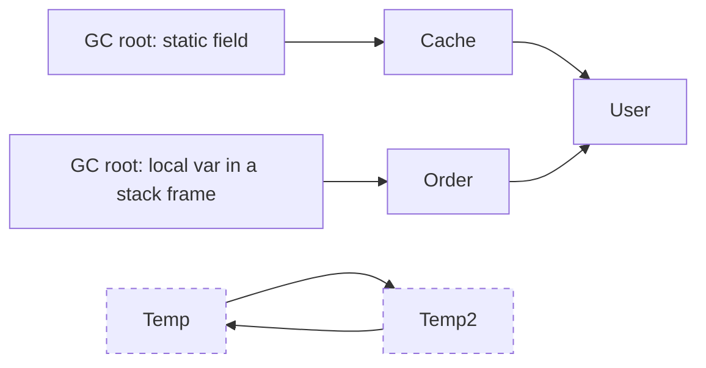
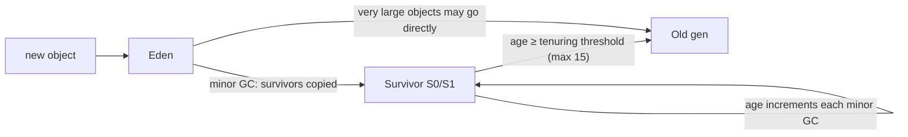

# Garbage collection

> **TL;DR** The GC frees objects that are **unreachable from GC roots** (not reference counting, so cycles are collected). Most objects die young, so heaps are split into **young** and **old** generations. **G1** is the default since Java 9 (balanced pauses); **ZGC** and **Shenandoah** target very low pauses; **Parallel** maximises throughput. Choose by goal: throughput, latency, or footprint.

## Mental model: reachability



`D` and `E` reference each other but nothing reachable points to them, so both are garbage. **GC roots** include local variables and parameters on thread stacks, static fields, active threads, and JNI references.

## Deep dive

### Generational collection



- **Minor (young) GC**: collects Eden and one survivor space by **copying** live objects. Fast, because most objects are already dead.
- **Major/old GC**: collects old gen. **Full GC**: the whole heap (and often Metaspace); the pauses you want to avoid.
- Algorithms: **mark** live objects, then **sweep** (free the rest) and/or **compact** (move live objects together to defeat fragmentation), or **copy** to another space.
- **Stop-the-world (STW)** pauses halt all application threads. Modern collectors do most marking **concurrently**.

### The collectors

| Collector | Flag | Goal | Notes |
|---|---|---|---|
| Serial | `-XX:+UseSerialGC` | small footprint | single-threaded; chosen automatically on small machines/containers |
| Parallel | `-XX:+UseParallelGC` | **throughput** | multi-threaded STW; default in Java 8; good for batch jobs |
| **G1** | `-XX:+UseG1GC` | balanced | **default since Java 9**; region-based; pause target `-XX:MaxGCPauseMillis` (default 200 ms) |
| **ZGC** | `-XX:+UseZGC` | **very low latency** | concurrent compaction, pauses typically sub-millisecond, scales to huge heaps; generational in 21 with `-XX:+ZGenerational`, default mode from 23 |
| Shenandoah | `-XX:+UseShenandoahGC` | low latency | concurrent compaction; available in many OpenJDK builds |
| CMS | (removed) | low latency | deprecated in 9, **removed in 14** |
| Epsilon | `-XX:+UseEpsilonGC` | none | allocates, never collects; for testing |

### How G1 works

- Heap divided into equal **regions** (1–32 MB). Each region is Eden, Survivor, Old or **Humongous** at any time.
- **Humongous objects** are those of at least **half a region**; they get contiguous regions and are expensive. Large arrays can trigger them.
- Concurrent marking finds which old regions are mostly garbage; **mixed collections** then collect young regions plus the most profitable old regions ("Garbage First").
- You set a pause **goal**, not a guarantee.

### Reference types

| Type | Cleared when | Use |
|---|---|---|
| Strong | never while reachable | normal references |
| `SoftReference` | before an `OutOfMemoryError`, under memory pressure | memory-sensitive caches (prefer a real cache library) |
| `WeakReference` | at the next GC once only weakly reachable | `WeakHashMap` keys, canonicalising maps |
| `PhantomReference` | after the object is finalized; `get()` always returns null | post-mortem cleanup (`Cleaner`) |

### Containers and default sizing

- The JVM is container-aware (Java 10+, backported to 8u191). It reads cgroup CPU and memory limits.
- Default max heap is **25% of available memory** (`-XX:MaxRAMPercentage=25`). In a 1 GB container you get ~256 MB of heap unless you change it. Commonly set `-XX:MaxRAMPercentage=70` to `75`.
- With fewer than 2 CPUs or under ~1792 MB of memory, the JVM may pick **Serial GC**. Surprise!

### Useful flags

```text
-Xms2g -Xmx2g                         # equal sizes avoid resize pauses on servers
-XX:+UseG1GC -XX:MaxGCPauseMillis=100
-XX:MaxRAMPercentage=75               # in containers instead of -Xmx
-XX:+HeapDumpOnOutOfMemoryError -XX:HeapDumpPath=/dumps
-Xlog:gc*:file=gc.log:time,uptime     # unified GC logging (Java 9+)
-XX:+ExitOnOutOfMemoryError           # let the orchestrator restart a broken pod
```

### Tuning approach

1. Define the goal: p99 latency, throughput, or memory.
2. Turn on GC logs and measure (GCeasy, GCViewer, JFR).
3. Fix allocation first: excess object churn, boxing, giant collections, unbounded caches.
4. Only then change collector or sizes, one knob at a time.

`System.gc()` is only a **hint**; it may trigger a full GC (bad) or be ignored (`-XX:+DisableExplicitGC`).

## Traps

- "Java uses reference counting." It uses **reachability tracing**; cycles are collected.
- "`System.gc()` forces collection." It's a hint.
- "G1 guarantees the pause target." It's a **goal**.
- "CMS is a good low-latency option today." It was **removed in 14**.
- "Default heap is whatever the container has." **25%** by default.
- "Soft and weak references are cleared at the same time." Weak: next GC. Soft: only under memory pressure.

## Say it out loud

**"How would you choose a GC?"**
G1 is a sound default for most services. If p99 latency matters and pauses show up in GC logs, I'd try ZGC, which keeps pauses around a millisecond even on large heaps, at some CPU and memory cost. For batch jobs where only total throughput matters, Parallel GC. Before switching, I'd check the allocation rate, because reducing garbage usually beats tuning the collector.

## Practice MCQs

**Q1.** Two objects reference only each other and nothing else references them. They are:
- A) Never collected
- B) Collected, because they are unreachable from GC roots
- C) Collected only by Full GC
- D) Moved to Metaspace

<details markdown="1"><summary>Answer</summary>

**B.**
</details>

**Q2.** Default collector in Java 17 on a typical multi-core server:
- A) Parallel
- B) CMS
- C) G1
- D) ZGC

<details markdown="1"><summary>Answer</summary>

**C.**
</details>

**Q3.** In G1, a humongous object is one whose size is at least:
- A) 1 MB
- B) Half a region
- C) A full region
- D) 10% of the heap

<details markdown="1"><summary>Answer</summary>

**B.**
</details>

**Q4.** A JVM in a container with a 2 GB memory limit and no heap flags gets a default max heap of about:
- A) 2 GB
- B) 1.5 GB
- C) 512 MB
- D) 256 MB

<details markdown="1"><summary>Answer</summary>

**C.** 25% of 2 GB.
</details>

**Q5.** Which reference type is cleared at the next GC once the object is only reachable through it?
- A) Strong
- B) Soft
- C) Weak
- D) Phantom (it is never cleared)

<details markdown="1"><summary>Answer</summary>

**C.**
</details>

**Q6.** A low-latency trading API sees 400 ms G1 pauses on a 64 GB heap. The best first experiment:
- A) Switch to Serial GC
- B) Try ZGC and compare p99 latency and CPU
- C) Call `System.gc()` every minute
- D) Remove `-Xmx`

<details markdown="1"><summary>Answer</summary>

**B.** And check allocation rate in parallel.
</details>

**Q7.** Which collector was removed in Java 14?
- A) G1
- B) Parallel
- C) CMS
- D) Serial

<details markdown="1"><summary>Answer</summary>

**C.**
</details>

## Related

- [JVM memory](01-memory.md)
- [JIT & troubleshooting](03-performance-troubleshooting.md)
