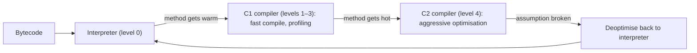
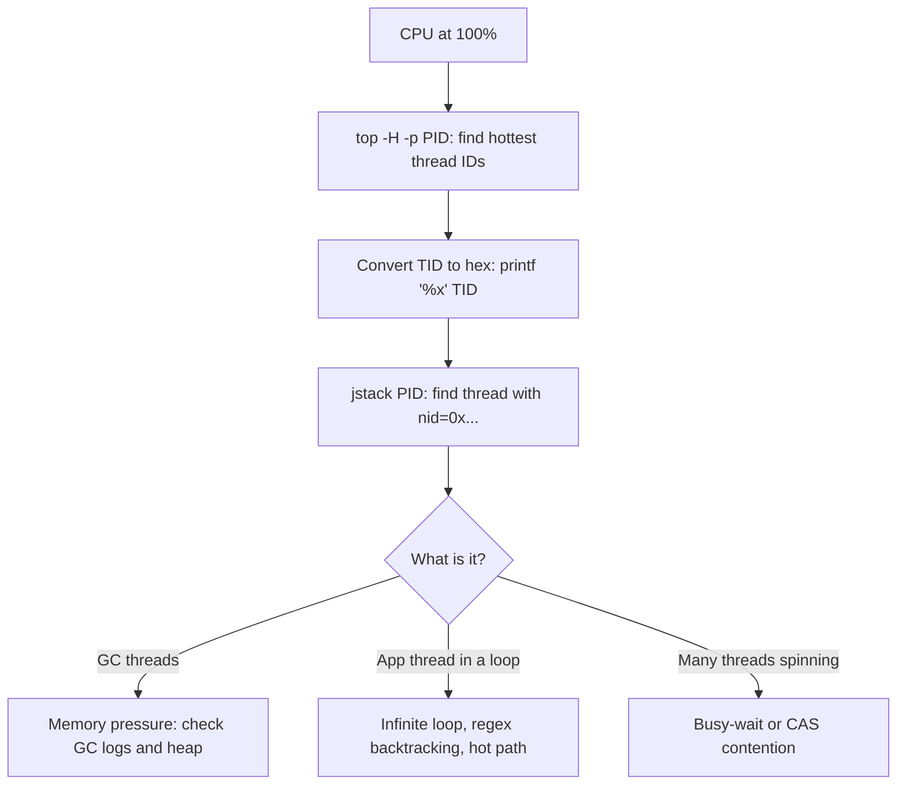

# JIT, tools & troubleshooting

> **TL;DR** The JVM starts by **interpreting** bytecode, then **JIT-compiles** hot methods (C1 quickly, C2 aggressively) using runtime profiling. That's why Java "warms up". For production problems, learn three runbooks: **high CPU** (thread dump), **memory growth** (heap dump / NMT), and **latency spikes** (GC logs + JFR). `jcmd` does almost everything.

## Mental model: tiered compilation



C2 optimises based on what it has **observed**: inlining hot callees, devirtualising calls with one observed receiver type, eliminating bounds checks, escape analysis, loop unrolling. If an assumption breaks (a new subclass shows up), the code is **deoptimised**.

Consequences:

- **Warm-up**: first requests are slow. Mitigate with warm-up traffic, readiness probes that wait, or CDS/AOT options (Class Data Sharing, GraalVM native image, Project Leyden work in newer JDKs).
- **Micro-benchmarks lie** unless you use **JMH**, which handles warm-up, dead-code elimination and forking.
- Megamorphic call sites (many receiver types) are harder to inline.

## The toolbox

| Tool | Use |
|---|---|
| `jps` | list Java processes |
| `jcmd <pid> help` | the Swiss-army knife: thread dumps, heap dumps, GC info, flags, JFR, NMT |
| `jstack <pid>` / `jcmd <pid> Thread.print` | thread dump |
| `jmap -dump:live,format=b,file=heap.hprof <pid>` / `jcmd <pid> GC.heap_dump` | heap dump |
| `jstat -gcutil <pid> 1000` | live GC stats every second |
| `jcmd <pid> JFR.start duration=60s filename=rec.jfr` | **Java Flight Recorder**: low-overhead production profiling |
| JDK Mission Control (JMC) | analyse JFR recordings |
| Eclipse MAT / VisualVM | analyse heap dumps (dominator tree, leak suspects) |
| async-profiler | CPU/allocation flame graphs |
| `jcmd <pid> VM.native_memory summary` | native memory (start JVM with `-XX:NativeMemoryTracking=summary`) |

## Runbook 1: high CPU



Take **3 thread dumps ~5 seconds apart**: a thread in the same frame across all three is your culprit.

## Runbook 2: memory keeps growing

1. Confirm with GC logs: does **old gen after full GC** keep rising? If yes, it's a leak; if it drops back, it's just load.
2. Heap dump (ideally automatic: `-XX:+HeapDumpOnOutOfMemoryError`).
3. Open in Eclipse MAT: **dominator tree** → biggest retained sizes → path to GC roots.
4. Typical finds: a static map, an unbounded cache, `ThreadLocal`s, listeners, session state.
5. If heap is stable but the **process** grows: native memory (NMT), thread count, direct buffers, Metaspace.

Warning: a heap dump **pauses** the JVM and can be as large as the heap. Do it on one instance taken out of the load balancer.

## Runbook 3: latency spikes

1. Correlate spikes with **GC pause** times in GC logs.
2. Check thread dumps for **BLOCKED** threads (lock contention) or threads waiting on a **connection pool** (HikariCP `getConnection`).
3. Record JFR for a few minutes: hot methods, lock contention, I/O waits, allocation pressure.
4. Look outside the JVM: CPU throttling in containers (cgroup quota), noisy neighbours, slow downstream calls.

## Reading a thread dump

```text
"http-nio-8080-exec-7" #42 daemon prio=5 os_prio=0 tid=0x... nid=0x2f1a waiting for monitor entry
   java.lang.Thread.State: BLOCKED (on object monitor)
    at com.app.Cache.get(Cache.java:31)
    - waiting to lock <0x000000076b1c2a30> (a java.util.HashMap)
```

- Many threads **BLOCKED** on the same lock → contention.
- Many threads **WAITING** in `HikariPool.getConnection` → pool exhausted or slow queries.
- `jstack` reports **deadlocks** explicitly at the end of the dump.

## Traps

- "Java is slow because it's interpreted." Hot code is JIT-compiled to optimised machine code.
- "Measure with `System.nanoTime()` around a loop." Use **JMH**.
- "A heap dump is free." It pauses the JVM and can be huge.
- "If the heap is fine, memory is fine." Check native memory.

## Say it out loud

**"Production CPU is pegged. What do you do?"**
Identify the hottest threads with `top -H`, convert their IDs to hex, and match them in a few thread dumps taken seconds apart. If they're GC threads, it's memory pressure and I move to GC logs and a heap dump. If it's application code, the stack shows the loop or hot path. For less obvious cases I record JFR or an async-profiler flame graph.

## Practice MCQs

**Q1.** Which tool would you use for low-overhead continuous profiling in production?
- A) `jmap -histo`
- B) Java Flight Recorder
- C) `System.out` timing
- D) Debugger with breakpoints

<details markdown="1"><summary>Answer</summary>

**B.**
</details>

**Q2.** Why do Java services often have slow first requests?
- A) GC runs at startup
- B) Code is interpreted until the JIT compiles hot methods
- C) Metaspace is empty
- D) Thread stacks are allocated lazily

<details markdown="1"><summary>Answer</summary>

**B.** Plus class loading and lazy initialisation.
</details>

**Q3.** `top -H` shows thread ID 12058 using 99% CPU. To find it in `jstack` output you look for:
- A) `tid=12058`
- B) `nid=0x2f1a`
- C) `#12058`
- D) The thread name

<details markdown="1"><summary>Answer</summary>

**B.** `nid` is the native thread ID in hexadecimal (12058 = 0x2f1a).
</details>

**Q4.** Old-gen usage after each full GC keeps rising over hours until OOM. This indicates:
- A) Normal load variation
- B) A memory leak (reachable objects accumulating)
- C) JIT deoptimisation
- D) Too many CPU cores

<details markdown="1"><summary>Answer</summary>

**B.**
</details>

**Q5.** Many threads are WAITING inside `HikariPool.getConnection`. The most likely cause:
- A) GC pauses
- B) The DB connection pool is exhausted or queries are slow
- C) A deadlock in `HashMap`
- D) Metaspace exhaustion

<details markdown="1"><summary>Answer</summary>

**B.**
</details>

## Related

- [Garbage collection](02-garbage-collection.md)
- [Concurrency](../java/03-concurrency.md): thread states.
