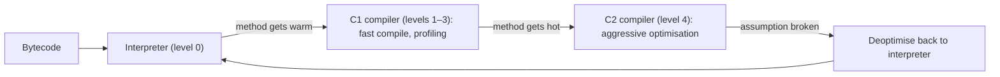
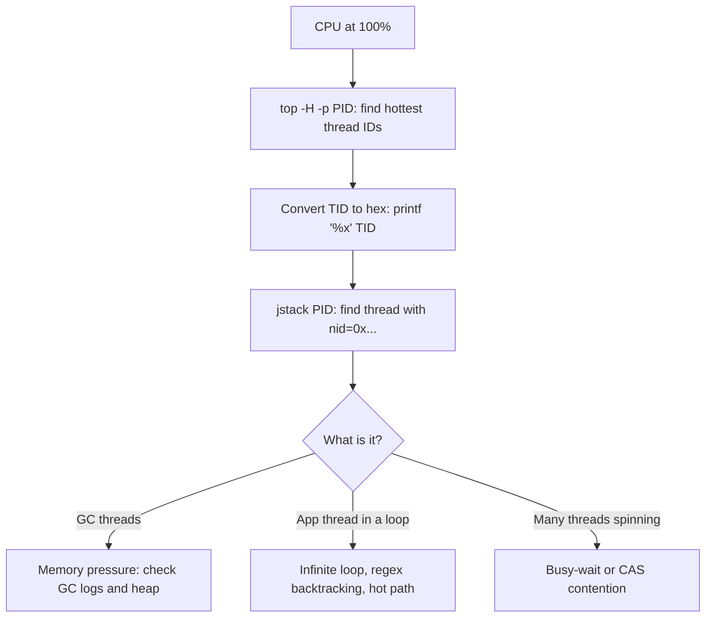

# JIT, tools & troubleshooting

> **TL;DR** The JVM starts by **interpreting** bytecode (executing it one instruction at a time, which is slow), then **JIT-compiles** ("just-in-time") the methods that run often into native machine code: first quickly with the **C1** compiler, then aggressively with **C2**, using statistics gathered while the code ran. That's why Java services "warm up": they get faster after the first few thousand requests. For production problems, learn three runbooks: **high CPU** (thread dumps), **memory growth** (heap dump / Native Memory Tracking), and **latency spikes** (GC logs + Java Flight Recorder). The `jcmd` command does almost everything.

## Mental model: tiered compilation



`javac` does not produce machine code; it produces portable **bytecode**. At runtime the JVM decides how to execute each method:

- **Level 0, interpreter**: every method starts here. No compile delay, but slow. The JVM counts invocations and loop iterations for each method.
- **Levels 1–3, C1** (the "client" compiler): once a method gets *warm* (on the order of a few hundred to a couple of thousand calls), C1 compiles it quickly with light optimisation. At level 3 it also inserts **profiling**: which branches are taken, which concrete classes actually show up at each call site.
- **Level 4, C2** (the "server" compiler): once a method is *hot* (on the order of 10,000+ calls), C2 recompiles it slowly but very aggressively, using that profile. Compiled code goes into the **code cache**.

Running fast code early and great code later is why this is called *tiered* compilation.

**C2 optimises based on what it has *observed*, not on what is merely possible:**

- **Inlining** hot callees: copying a small method's body into its caller removes the call overhead and, more importantly, lets the other optimisations see across method boundaries. It is the single most important optimisation.
- **Devirtualisation**: if a call like `shape.area()` has only ever seen `Circle` objects, C2 compiles a direct (even inlined) call to `Circle.area()` guarded by a cheap type check, instead of a slower virtual dispatch.
- **Bounds-check elimination**: Java checks every array index; if C2 can prove the loop index always stays in range, it removes the checks.
- **Escape analysis**: objects that never leave a method are not allocated on the heap at all (see [Memory](01-memory.md)).
- **Loop unrolling**: repeating the loop body several times per iteration to reduce loop overhead and enable vector (SIMD) instructions.

If an assumption breaks (for example a `Square` shows up at that `shape.area()` call site, or a new subclass is loaded), the guard fails and the compiled code is **deoptimised**: the JVM discards it, continues in the interpreter, gathers a new profile, and may recompile later. This is invisible to your code except as a temporary slowdown.

Consequences:

- **Warm-up**: the first requests after startup are slow, because the code is still interpreted, classes are still being loaded, and caches and connection pools are still cold. Mitigations: send synthetic warm-up traffic before taking real traffic; use **readiness probes** that only report ready after warm-up, so Kubernetes doesn't route users to a cold pod; or use startup-optimisation technologies such as **CDS** (Class Data Sharing: a pre-parsed archive of classes loaded at startup), **GraalVM native image** (compiles the whole app ahead of time into a native executable: instant startup, but no runtime JIT profiling), or the **Project Leyden** AOT cache features arriving in newer JDKs.
- **Micro-benchmarks lie** unless you use **JMH** (the Java Microbenchmark Harness). A naive `System.nanoTime()` loop measures the interpreter instead of compiled code, or measures nothing at all, because C2 noticed the result is never used and deleted the computation (*dead-code elimination*), or is skewed by profile pollution from an earlier test in the same JVM. JMH runs warm-up iterations, consumes results with a `Blackhole` so they can't be eliminated, and **forks** a fresh JVM per benchmark.
- **Megamorphic call sites are harder to inline.** A call site that has seen 1 receiver type is *monomorphic* (easy to inline), 2 is *bimorphic* (inlined with two guards), and 3 or more is *megamorphic*: C2 typically falls back to a regular virtual call and can't inline through it. That is why very generic code in a hot path (a visitor over many types, a heavily polymorphic interface) can be slower than expected.

## The toolbox

All of these ship with the JDK (not the bare JRE) except where noted. `<pid>` is the Java process ID.

| Tool | Use |
|---|---|
| `jps` | Lists running Java processes with their PIDs and main class, to find the `<pid>` for the other tools. |
| `jcmd <pid> help` | The Swiss-army knife: one command for thread dumps, heap dumps, GC info, JVM flags, JFR recordings and Native Memory Tracking. `help` lists everything that process supports. Prefer it over the older single-purpose tools. |
| `jstack <pid>` / `jcmd <pid> Thread.print` | **Thread dump**: the current stack trace and state of every thread. Cheap and safe to take repeatedly. The first tool for high CPU, hangs and deadlocks. |
| `jmap -dump:live,format=b,file=heap.hprof <pid>` / `jcmd <pid> GC.heap_dump heap.hprof` | **Heap dump**: a snapshot of every object on the heap and who references whom. `live` triggers a full GC first, so only reachable objects are written. The tool for memory leaks. |
| `jstat -gcutil <pid> 1000` | Prints GC statistics every 1000 ms: how full Eden, survivor, old and Metaspace are (%), plus GC counts and total GC time. A quick live view without restarting with GC logs. |
| `jcmd <pid> JFR.start duration=60s filename=rec.jfr` | **Java Flight Recorder**: a profiler built into the JVM with about 1–2 % overhead, so it is safe in production. It records CPU samples, allocations, locks, I/O, GC and thread events. |
| JDK Mission Control (JMC) | A desktop app (separate download) for analysing JFR recordings: hot methods, allocation pressure, lock contention, GC pauses. |
| Eclipse MAT / VisualVM | Analyse heap dumps. Eclipse MAT's **dominator tree** shows which objects keep the most memory alive, and its **leak suspects** report automates the first pass. |
| async-profiler | An open-source, very low-overhead profiler (separate download) that produces **flame graphs** of CPU time, allocations or lock waits, including native and kernel frames that JFR can miss. |
| `jcmd <pid> VM.native_memory summary` | Breaks down **native** memory by area (heap, class/Metaspace, threads, code, GC, internal). It only works if the JVM was started with `-XX:NativeMemoryTracking=summary` (about 5–10 % overhead). |

## Runbook 1: high CPU



1. **`top -H -p <pid>`**: the `-H` flag shows individual **threads** instead of processes, so you see which threads inside the JVM are burning CPU, by their OS thread ID (TID, decimal).
2. **Convert the TID to hexadecimal** with `printf '%x\n' 12058` (→ `2f1a`), because thread dumps print the OS thread ID in hex as `nid=0x2f1a` ("native ID").
3. **Find that `nid` in the thread dump** to see the thread's name and what it is executing.
4. **Interpret what you find**:
    - **GC threads** (named like `GC Thread#0`, `G1 Conc#0`): the JVM is spending its CPU collecting garbage. The real problem is memory pressure: a nearly full heap or a very high allocation rate. Go to the GC logs and Runbook 2.
    - **An application thread in a loop**: a genuine infinite loop, **catastrophic regex backtracking** (a pattern like `(a+)+$` on certain input takes exponential time), or just a legitimately hot code path that needs optimising.
    - **Many threads spinning**: busy-wait loops (`while (!flag) {}`) or heavy CAS retry contention on one atomic variable.

**Take 3 thread dumps about 5 seconds apart.** A single dump is a snapshot and can be misleading: a thread might just happen to be in a normal method at that instant. A thread that sits in the **same frame across all three** is almost certainly your culprit.

## Runbook 2: memory keeps growing

1. **Confirm with GC logs**: look at how much of the **old generation is still used *right after* each full or mixed GC**, which is your *live* data. If that baseline keeps rising over hours, objects are accumulating that never become unreachable: a **leak**. If it drops back to the same level after each collection, the heap is just absorbing load, and that's normal behaviour (heap usage *before* GC always looks like a saw-tooth).
2. **Take a heap dump**, ideally automatically at the moment of failure with `-XX:+HeapDumpOnOutOfMemoryError -XX:HeapDumpPath=...`, or manually with `jcmd <pid> GC.heap_dump` while memory is high. Two dumps taken an hour apart can be compared to see what grew.
3. **Open it in Eclipse MAT** and use the **dominator tree**, which ranks objects by **retained size**: the memory that would be freed if that object were collected (its own size plus everything only it keeps alive). Pick the biggest, then use **"path to GC roots"** to see *why* it is still reachable: which static field, thread or cache holds it.
4. **Typical finds**: a static `Map` used as a cache that only grows, an unbounded cache without eviction, `ThreadLocal` values in pooled threads, listeners that were never unregistered, HTTP session state piling up (see [Memory](01-memory.md) for the full list).
5. **If the heap is stable but the *process* keeps growing** (high RSS in `top`, or the container gets OOM-killed), the growth is outside the heap: use Native Memory Tracking, and check thread count, direct buffers and Metaspace.

**Warning:** taking a heap dump **pauses the JVM** for seconds to minutes (it must stop all threads to write a consistent snapshot), and the file can be **as large as the heap**, possibly filling the disk. It also contains everything in memory, including passwords, tokens and customer data, so handle it as sensitive. Do it on one instance that you have first taken out of the load balancer.

## Runbook 3: latency spikes

1. **Correlate spikes with GC pause times** in the GC logs: if the slow requests line up with long stop-the-world pauses, the fix is in GC tuning or allocation (see [Garbage collection](02-garbage-collection.md)).
2. **Check thread dumps** for threads in **BLOCKED** state on the same lock (**lock contention**: requests are queueing behind one `synchronized` block) or threads stuck waiting for a database **connection** in `HikariPool.getConnection` (the connection pool is too small, or queries hold connections too long).
3. **Record JFR for a few minutes** under load: it shows hot methods, lock contention with the exact monitors involved, file and socket I/O wait times, and allocation pressure, all with timestamps you can match against the spikes.
4. **Look outside the JVM**:
    - **CPU throttling in containers**: if the pod has a CPU *limit*, the kernel's cgroup quota can pause the whole process for the rest of a 100 ms period once its share is used up. Multi-threaded bursts (including GC threads) hit this easily, producing spikes that look like GC but aren't. Check `nr_throttled` in the cgroup `cpu.stat`.
    - **Noisy neighbours** on the same host competing for CPU, memory bandwidth or disk.
    - **Slow downstream calls**: the database, another service, DNS resolution.

## Reading a thread dump

```text
"http-nio-8080-exec-7" #42 daemon prio=5 os_prio=0 tid=0x... nid=0x2f1a waiting for monitor entry
   java.lang.Thread.State: BLOCKED (on object monitor)
    at com.app.Cache.get(Cache.java:31)
    - waiting to lock <0x000000076b1c2a30> (a java.util.HashMap)
```

Piece by piece:

- `"http-nio-8080-exec-7"`: the thread's **name**, here a Tomcat request-handling thread on port 8080. Naming your own executors' threads makes dumps far easier to read.
- `#42`: the JVM's own thread number. `daemon`: a daemon thread does not keep the JVM alive on its own. `prio`: Java and OS priority.
- `tid=0x...`: the address of the JVM's internal thread structure. Not useful for matching with `top`.
- **`nid=0x2f1a`**: the **native (OS) thread ID in hex**. This is what you match against `top -H`.
- `java.lang.Thread.State: BLOCKED (on object monitor)`: it is waiting to enter a `synchronized` block (see thread states in [Concurrency](../java/03-concurrency.md)).
- `at com.app.Cache.get(Cache.java:31)`: the top of its stack, i.e. where it is right now.
- `- waiting to lock <0x...76b1c2a30> (a java.util.HashMap)`: it wants the monitor of a specific `HashMap` object. Search the dump for **`- locked <0x...76b1c2a30>`** to find the thread that currently holds it, and see what *that* thread is doing.

Patterns to recognise:

- **Many threads BLOCKED on the same lock address** → lock contention; one thread holds the lock while the others queue. Shrink the critical section, use a concurrent data structure, or avoid the shared lock.
- **Many threads WAITING or TIMED_WAITING in `HikariPool.getConnection`** → every database connection is in use and requests are queueing for one: the pool is exhausted, either because it is too small for the load or, more often, because slow queries or long transactions hold connections too long.
- **`jstack` reports deadlocks explicitly** at the end of the dump ("Found one Java-level deadlock:"), listing each thread, the lock it holds and the lock it waits for.

## Traps

- "Java is slow because it's interpreted." Only cold code is interpreted. Hot code is JIT-compiled to machine code optimised with real runtime profiles, which can sometimes beat ahead-of-time compiled code.
- "Measure with `System.nanoTime()` around a loop." That measures warm-up, interpreter speed or dead-code elimination instead of steady-state performance. Use **JMH**.
- "A heap dump is free." It **pauses** the JVM while writing, can be as large as the heap, and contains sensitive data.
- "If the heap is fine, memory is fine." The process also uses native memory: thread stacks, Metaspace, direct buffers, code cache, GC structures. Check it with Native Memory Tracking.

## Say it out loud

**"Production CPU is pegged. What do you do?"**
First I find which threads are hot with `top -H` on the Java process, convert their thread IDs to hex, and match them against the `nid` values in three thread dumps taken a few seconds apart. If the hot threads are GC threads, the real problem is memory pressure, so I move to the GC logs and possibly a heap dump. If it's application code, a thread stuck in the same frame across the dumps shows me the loop or hot path, such as a runaway regex. For less obvious cases, like CPU spread across many threads, I record JFR or an async-profiler flame graph to see where time is actually spent.

## Practice MCQs

**Q1.** Which tool would you use for low-overhead continuous profiling in production?

- A) `jmap -histo`
- B) Java Flight Recorder
- C) `System.out` timing
- D) Debugger with breakpoints

<details markdown="1"><summary>Answer</summary>

**B.** JFR is built into the JVM and designed for production: about 1–2 % overhead, recording CPU samples, allocations, locks, I/O and GC events continuously. A gives a one-off class histogram (and `-histo:live` forces a full GC). C needs code changes and distorts timing. D stops threads, which is unacceptable in production.
</details>

**Q2.** Why do Java services often have slow first requests?

- A) GC runs at startup
- B) Code is interpreted until the JIT compiles hot methods
- C) Metaspace is empty
- D) Thread stacks are allocated lazily

<details markdown="1"><summary>Answer</summary>

**B.** Every method starts in the interpreter, and only after enough calls does C1, and later C2, compile it to optimised machine code. Class loading, lazy initialisation of beans and caches, and opening pool connections add to the early slowness. Hence warm-up traffic and readiness probes.
</details>

**Q3.** `top -H` shows thread ID 12058 using 99% CPU. To find it in `jstack` output you look for:

- A) `tid=12058`
- B) `nid=0x2f1a`
- C) `#12058`
- D) The thread name

<details markdown="1"><summary>Answer</summary>

**B.** `top -H` shows the OS thread ID in decimal, and the thread dump shows the same ID in hexadecimal as `nid` (native ID): 12058 decimal = 0x2f1a. A is wrong because `tid` is the address of the JVM's internal thread structure. C is the JVM's own thread counter, unrelated to the OS ID. D is only found *after* matching the nid.
</details>

**Q4.** Old-gen usage after each full GC keeps rising over hours until OOM. This indicates:

- A) Normal load variation
- B) A memory leak (reachable objects accumulating)
- C) JIT deoptimisation
- D) Too many CPU cores

<details markdown="1"><summary>Answer</summary>

**B.** Usage right after a full GC is the amount of *live* (reachable) data. If that floor keeps rising, objects are being kept alive that are never released, which is the definition of a Java memory leak. Normal load variation (A) makes usage go up and down but returns to a stable floor after collection. Take a heap dump and look at the dominator tree.
</details>

**Q5.** Many threads are WAITING inside `HikariPool.getConnection`. The most likely cause:

- A) GC pauses
- B) The DB connection pool is exhausted or queries are slow
- C) A deadlock in `HashMap`
- D) Metaspace exhaustion

<details markdown="1"><summary>Answer</summary>

**B.** Threads wait in `getConnection` only when every connection in the pool is currently borrowed. Either the pool is too small for the concurrency, or, more commonly, connections are held too long by slow queries, long transactions, or remote calls made while a transaction is open. Check database query times and the pool's active/idle metrics. GC pauses (A) would freeze all threads, not park them in one place.
</details>

## Related

- [Garbage collection](02-garbage-collection.md): reading GC logs and choosing a collector.
- [Concurrency](../java/03-concurrency.md): thread states (BLOCKED vs WAITING) and deadlock conditions.
