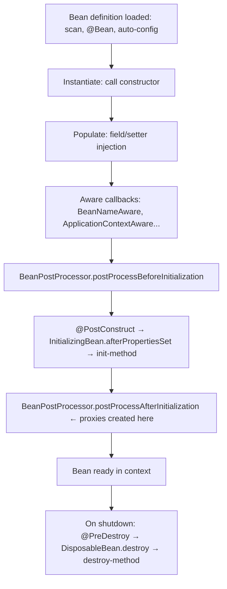

# IoC, DI & bean lifecycle

> **TL;DR** The Spring container reads **bean definitions** (recipes saying which objects to create and how), creates those objects (**beans**), hands each one the other beans it needs (**dependency injection**), runs lifecycle callbacks, and wraps beans in **proxies** where extra behaviour is needed (transactions, security, AOP). Beans are **singletons by default**: one shared instance used by every thread, so they must be stateless or thread-safe. Prefer **constructor injection**. Since Spring Boot 2.6, **circular references are prohibited by default**.

## Mental model: the bean lifecycle



Step by step:

1. **Bean definition loaded.** Before creating anything, Spring collects *definitions*: the class, scope, dependencies and init/destroy methods of every bean, from component scanning, `@Bean` methods and Boot auto-configuration. Definitions are metadata, not objects yet.
2. **Instantiate.** Spring calls the constructor. With constructor injection, the dependencies are resolved (created first if needed) and passed in here.
3. **Populate.** Spring sets `@Autowired` fields and calls `@Autowired` setters.
4. **Aware callbacks.** If the bean implements `BeanNameAware`, `ApplicationContextAware` and similar interfaces, Spring passes it its bean name, the application context, and so on. Rarely needed in application code.
5. **`postProcessBeforeInitialization`** of every registered `BeanPostProcessor`: a hook that can inspect or modify every bean before its init methods run.
6. **Init methods**, in this order: the `@PostConstruct` method, then `InitializingBean.afterPropertiesSet()`, then a custom `initMethod` declared on `@Bean`. At this point all dependencies are set, so this is the place for validation or warming a cache. (Technically `@PostConstruct` is itself invoked by a built-in `BeanPostProcessor` during step 5, but it always runs before the other two.)
7. **`postProcessAfterInitialization`**: the hook where Spring's infrastructure post-processors **wrap the bean in a proxy** if it needs one (`@Transactional`, `@Async`, `@Cacheable`, aspects). Whatever this step returns is what gets stored in the container and injected everywhere else.
8. **Ready.** The bean is available.
9. **Shutdown.** When the context closes (e.g. on SIGTERM), Spring calls `@PreDestroy`, then `DisposableBean.destroy()`, then a custom `destroyMethod`, **for singletons only**, to release resources such as thread pools and connections.

Key point: **the object you get injected is often a proxy** (a generated wrapper class that intercepts method calls), created by a `BeanPostProcessor` *after* initialization. The proxy runs the extra behaviour (begin a transaction, check a permission) and then calls your real object, the *target*. That's why `@Transactional`, `@Async`, `@Cacheable` and `@PreAuthorize` only work for calls that **go through the proxy**: a call from one method of the bean to another method of the same bean (`this.other()`) goes straight to the target and skips the proxy. See [Proxies & AOP](03-proxies-aop.md).

## Deep dive

### IoC container

- **IoC (Inversion of Control):** normally an object creates its own dependencies (`this.repo = new JdbcUserRepository(...)`), so it controls *which* implementation it gets and *how* it is built. With IoC that control is *inverted*: the object only declares what it needs (a `UserRepository` constructor parameter), and an outside party, the container, decides what to supply. **Dependency injection** is the technique: the container *injects* the dependencies. Benefits: you can swap implementations (a fake in tests, a different database in production) without touching the class, and object creation and configuration live in one place.
- **`BeanFactory`** is the basic container interface: it can create beans and look them up. **`ApplicationContext`** extends it, and is what you use in practice, adding:
    - **Events**: publish and listen for `ApplicationEvent`s.
    - **i18n**: `MessageSource` for localised messages.
    - **Resource loading**: `classpath:` and `file:` resources.
    - **Environment and profiles**: properties, and `@Profile("prod")` beans.
    - **Eager singleton creation at startup.** A plain `BeanFactory` creates beans lazily, on first request. `ApplicationContext` creates all (non-lazy) singletons during startup, so a missing dependency, a typo in a property or a failing constructor **crashes the app at startup** rather than on the first user request hours later. That is *failing fast*.

### Ways to define beans

| Style | Example | When |
|---|---|---|
| Stereotype + component scanning | `@Component`, `@Service`, `@Repository`, `@Controller` on the class | Your own classes. Spring scans the packages under your `@SpringBootApplication` class and registers every annotated class as a bean. `@Service` and `@Controller` are just `@Component` with a name that documents intent (and `@Controller` is also recognised by Spring MVC). |
| `@Bean` method in a `@Configuration` class | `@Bean DataSource ds() { ... }` | **Third-party classes** you can't annotate (you can't put `@Component` on a library's class), or beans whose construction needs logic or conditions. The method's return value becomes the bean, and its parameters are injected. |
| Auto-configuration | Spring Boot starters | Infrastructure beans (`DataSource`, `ObjectMapper`, the web server) that Boot creates for you based on the classpath and properties, and that back off if you define your own. See [Boot internals](02-boot-internals.md). |

**`@Repository` additionally enables exception translation.** Beans annotated with it get a proxy that catches technology-specific persistence exceptions (`SQLException`, Hibernate or JPA exceptions) and rethrows them as Spring's unchecked **`DataAccessException`** hierarchy (`DuplicateKeyException`, `DataIntegrityViolationException`, ...). Your service code can then handle "duplicate key" the same way whether you use JDBC, JPA or MongoDB. (Spring Data repository interfaces get this automatically.)

### `@Configuration` full mode vs lite mode

```java
@Configuration                       // proxyBeanMethods = true by default ("full" mode)
class AppConfig {
    @Bean Clock clock() { return Clock.systemUTC(); }
    @Bean Service a() { return new Service(clock()); }  // looks like a new call, but returns the SAME singleton clock
    @Bean Service b() { return new Service(clock()); }  // same instance again
}
```

In plain Java, calling `clock()` twice would run the method twice and create two `Clock` objects. Spring makes it return the singleton anyway: at startup it **subclasses** a `@Configuration` class with CGLIB (a bytecode-generation library) and overrides every `@Bean` method. The override first checks "does the container already have this bean?" and returns the existing one if so; only the first call actually runs your method. That keeps the "one instance per container" promise even when `@Bean` methods call each other.

With `@Configuration(proxyBeanMethods = false)` (or with `@Bean` methods inside a plain `@Component`, which is called **lite mode**) there is no subclass, so `clock()` is a normal Java method call and creates a **new** `Clock` every time it is called. Spring still registers one `clock` bean, but `a` and `b` would each get their own private extra instance. In lite mode, express dependencies as method parameters instead: `@Bean Service a(Clock clock)`, which Spring resolves from the container. Boot's own auto-configurations use `proxyBeanMethods = false` because skipping CGLIB subclass generation makes startup faster and works with GraalVM native images.

### Injection styles

| Style | Verdict |
|---|---|
| **Constructor** | **Preferred.** Every dependency appears in the constructor signature, so it's explicit what the class needs. Fields can be `final`, so they can never be reassigned or left `null`, and the object is never seen half-built. In unit tests you just call `new MyService(fakeRepo)`, with no Spring needed. A missing bean fails fast at startup. If the class has a **single constructor, no `@Autowired` is needed**; Spring uses it automatically. A constructor with very many parameters is a useful warning that the class does too much. |
| Setter | For genuinely **optional** dependencies or ones that may be changed later. The object is created first and dependencies are set afterwards, so it can briefly exist without them. |
| Field (`@Autowired` on a field) | **Discouraged.** Dependencies are hidden inside the class body; the fields can't be `final`; the class can't be constructed correctly without Spring (in tests you need reflection or a Spring context to set private fields); and it makes it easy to keep adding dependencies unnoticed. Acceptable in test classes. |

### Choosing between candidates

- **Two beans of the same type → `NoUniqueBeanDefinitionException`** at startup, when something injects that type: Spring refuses to guess which one you meant. (If the parameter name matches one bean's name, Spring uses that as a fallback tie-breaker, but relying on it is fragile.)
- **`@Primary`** on one bean marks it as the **default** whenever the type is ambiguous. **`@Qualifier("name")`** at the **injection point** asks for one specific bean by name or qualifier value. **The qualifier wins over primary**: `@Primary` is a general default, while `@Qualifier` is an explicit, local request, and the specific request takes precedence.
- **Inject `List<PaymentGateway>` or `Map<String, PaymentGateway>` to get *all* implementations.** Spring fills the list with every bean of that type (ordered by `@Order` / `Ordered` if present), or the map with bean name → bean. This is the natural way to implement the **strategy pattern**: adding a new implementation is just adding a new `@Component`, with no `if/else` to edit (see the code below).
- **Optional dependencies**: inject `Optional<T>` (empty if no such bean exists) or `ObjectProvider<T>`, which adds `getIfAvailable()`, `getIfUnique()` and lazy, repeated `getObject()` calls. `@Autowired(required = false)` also works for fields and setters.

### Scopes

A bean's **scope** decides how many instances exist and how long each lives.

| Scope | Lifetime |
|---|---|
| **singleton** (default) | One instance per container, created at startup and shared by every caller and thread until shutdown. Note this is "one per Spring container", not the GoF Singleton pattern (one per JVM): two contexts mean two instances. |
| prototype | A **new instance every time** it is requested (each injection point or `getBean` call). Spring creates and initializes it, then hands it over and forgets it, so **it does not manage its destruction**: `@PreDestroy` is never called. If it holds resources, the caller must clean them up. |
| request / session / application | Web scopes: one instance per HTTP request, per HTTP session, or per `ServletContext`. |
| websocket | One per WebSocket session. |

**Prototype-in-singleton trap.** Injection happens **once**, when the singleton is created. So a prototype injected into a singleton's constructor or field is created exactly once and then reused for the singleton's entire life, which defeats the purpose of making it a prototype. To get a fresh instance each time:

- inject `ObjectProvider<T>` and call `getObject()` whenever you need a new one (the simplest option);
- annotate an abstract-style method with `@Lookup`, and Spring overrides it to return a new bean on each call;
- or declare the bean with a **scoped proxy** (`@Scope(value = "prototype", proxyMode = ScopedProxyMode.TARGET_CLASS)`), so the singleton holds a proxy that fetches a fresh target on every method call. This is also how request- and session-scoped beans can be injected into singletons.

**Singleton ≠ thread-safe.** A singleton `@Service` is one object, and under load dozens of request threads call its methods **at the same time**. If it stores per-request data in a field (`this.currentUser = ...`), one request overwrites another's data. Keep per-request state in local variables and method parameters, keep fields to immutable dependencies, and if shared mutable state is genuinely needed, use thread-safe types (`ConcurrentHashMap`, atomics).

### Circular dependencies

- **Constructor injection cycles always fail**: to construct A, Spring needs a finished B; to construct B it needs a finished A. There is no order that works, so startup fails with `BeanCurrentlyInCreationException` ("Requested bean is currently in creation: Is there an unresolvable circular reference?").
- **Field/setter cycles** *could* technically be resolved: Spring creates A with its constructor, exposes the half-built A early, creates B and injects the early A, then finishes A. But that means beans can see each other half-initialized, and it hides a design problem. **Since Spring Boot 2.6 even these fail by default** (`spring.main.allow-circular-references=false`). You can switch the property to `true`, but treat that as temporary.
- **Fix the design**: a cycle usually means two classes each hold part of one responsibility.
    - **Extract** the logic both need into a third bean that both depend on (A → C ← B).
    - **Use events**: A publishes an event that B listens to, so A no longer depends on B directly.
    - **Last resort: `@Lazy`** on one injection point. Spring injects a lazy *proxy* instead of the real bean, and resolves the real bean on first method call, which breaks the cycle at startup. It works, but the cycle is still there.

### Startup ordering and hooks

- **`@DependsOn("otherBean")`** forces another bean to be created first, for dependencies Spring can't see through injection (e.g. a bean that must run a database migration before another bean starts).
- **`@Lazy`** on a bean defers its creation until it is first used. That makes startup faster, but configuration errors only surface later. `spring.main.lazy-initialization=true` makes every bean lazy, which is useful in development.
- **`ApplicationRunner` / `CommandLineRunner`** beans run once, after the context has fully started: a good place for start-up jobs such as seeding data. `ApplicationRunner` receives parsed arguments; `CommandLineRunner` gets the raw `String[]`.
- **`ApplicationReadyEvent`** is published after the runners, when the application is **ready to serve traffic**. Listen for it (`@EventListener(ApplicationReadyEvent.class)`) for things that should only happen once everything is up.
- **`BeanFactoryPostProcessor` vs `BeanPostProcessor`.** A `BeanFactoryPostProcessor` runs **before any bean is created** and modifies **bean definitions**, the recipes. For example, `PropertySourcesPlaceholderConfigurer` replaces `${db.url}` placeholders in definitions with actual values. A `BeanPostProcessor` runs **for every bean instance** after it is created, as in the lifecycle above, and modifies or wraps the **objects** themselves (that's where proxies come from). One changes the recipe, the other decorates the dish.

## Code you should be able to write

```java
public interface PaymentGateway { String code(); Receipt pay(Payment p); }

@Service
class PaymentRouter {
    private final Map<String, PaymentGateway> byCode;                 // final: set once in the constructor, never null
    PaymentRouter(List<PaymentGateway> gateways) {                     // Spring injects EVERY PaymentGateway bean (single constructor, no @Autowired needed)
        this.byCode = gateways.stream().collect(toMap(PaymentGateway::code, g -> g)); // index them by their own code; a duplicate code fails at startup
    }
    Receipt pay(Payment p) { return byCode.get(p.method()).pay(p); }   // pick the strategy at runtime
}
```

Adding PayPal support is just adding a new `@Component class PayPalGateway implements PaymentGateway` with `code()` returning `"paypal"`; `PaymentRouter` doesn't change (the open/closed principle). Because `toMap` throws on duplicate keys, two gateways claiming the same code crash the app at startup instead of silently routing to the wrong one. In real code, also handle an unknown method (`byCode.get` returning `null`) with a clear error.

## Traps

- "Beans are created when first used." Singletons are created **eagerly** at startup by the `ApplicationContext`, so wiring errors fail fast, unless the bean is marked `@Lazy`.
- "Spring calls `@PreDestroy` on prototype beans." **It doesn't.** Spring hands prototypes over and stops tracking them, so their cleanup is the caller's job.
- "`@Primary` beats `@Qualifier`." **`@Qualifier` wins**: an explicit request at the injection point overrides the global default.
- "Singleton beans are thread-safe." Only if you make them so: one instance is shared by all request threads, so no mutable per-request state in fields.
- "`@PostConstruct` runs on the proxy." It runs on the **target object, before the proxy exists** (proxies are created in the after-initialization step), so `@Transactional`, `@Async` and other proxy-based features do **not** apply to code inside `@PostConstruct`. Use `ApplicationReadyEvent`, or call another bean's proxied method.

## Say it out loud

**"Why constructor injection?"**
Dependencies become explicit in the signature and can be final, so the object is immutable and can never exist half-built. Unit tests can construct it with plain `new` and fakes, with no Spring context. And a missing bean or a circular dependency shows up immediately as a startup failure, instead of being hidden behind field injection. A constructor that keeps growing is also a visible sign the class has too many responsibilities.

**"Explain the bean lifecycle."**
Spring first collects bean definitions. For each singleton it instantiates the bean through its constructor, injects field and setter dependencies, calls any Aware callbacks, and runs the before-initialization hook of every BeanPostProcessor. Then it calls the init methods: `@PostConstruct`, then `afterPropertiesSet`, then a custom init method. Then come the after-initialization hooks, which is where proxies for transactions, async, caching or aspects are created, so the proxy is what gets stored and injected. On shutdown it calls `@PreDestroy` and the other destroy callbacks, but only for singletons, not prototypes.

## Practice MCQs

**Q1.** Default bean scope in Spring:

- A) prototype
- B) request
- C) singleton
- D) session

<details markdown="1"><summary>Answer</summary>

**C.** Unless you specify `@Scope`, each bean definition produces exactly one shared instance per container, created eagerly at startup. Prototype (A) must be requested explicitly; request and session (B, D) exist only in web applications.
</details>

**Q2.** At which lifecycle stage are AOP/transaction proxies typically created?

- A) Before instantiation
- B) `postProcessAfterInitialization` of a BeanPostProcessor
- C) In `@PostConstruct`
- D) At first method call

<details markdown="1"><summary>Answer</summary>

**B.** Infrastructure post-processors such as the auto-proxy creator wrap the fully initialized bean in a proxy in the *after*-initialization hook, and that proxy replaces the bean in the container. That's also why `@PostConstruct` (C), which runs earlier, executes on the raw target with no transactional behaviour. Proxies are not created lazily on the first call (D).
</details>

**Q3.** A prototype bean is injected into a singleton via constructor. How many prototype instances does the singleton see over its lifetime?

- A) One per method call
- B) One
- C) One per thread
- D) One per request

<details markdown="1"><summary>Answer</summary>

**B.** Injection happens once, when the singleton is constructed, so Spring creates the prototype once and the singleton keeps that same reference forever. To get a fresh instance per use, inject `ObjectProvider<T>` and call `getObject()`, use `@Lookup`, or give the prototype a scoped proxy.
</details>

**Q4.** Two beans implement `Notifier`; one has `@Primary`, and an injection point has `@Qualifier("sms")` pointing at the other. Which is injected?

- A) The `@Primary` bean
- B) The `sms` bean
- C) Startup fails
- D) A random one

<details markdown="1"><summary>Answer</summary>

**B.** `@Qualifier` narrows the candidates at that specific injection point to the `sms` bean, and `@Primary` only acts as a tie-breaker when several candidates remain. Every other `Notifier` injection point without a qualifier gets the `@Primary` bean. Spring never picks randomly (D); without `@Primary` or `@Qualifier`, startup would fail (C).
</details>

**Q5.** In Spring Boot 3, service A and service B inject each other through constructors. What happens?

- A) Works with a proxy
- B) Startup fails with a circular reference error
- C) One gets `null`
- D) Works only with `@Primary`

<details markdown="1"><summary>Answer</summary>

**B.** Neither constructor can run without the other bean already existing, so there is no valid creation order and startup fails with `BeanCurrentlyInCreationException`. Field and setter cycles have also been blocked by default since Boot 2.6. A only works if you explicitly add `@Lazy` to one of the constructor parameters (which injects a lazy proxy), and Spring never injects `null` (C) for a required dependency.
</details>

**Q6.** In a `@Configuration` class (default settings), `@Bean a()` calls `clock()` and `@Bean b()` calls `clock()`. How many `Clock` instances exist?

- A) One
- B) Two
- C) Three
- D) Zero

<details markdown="1"><summary>Answer</summary>

**A.** By default `@Configuration` classes are subclassed by CGLIB, and the overridden `clock()` returns the existing singleton instead of running the method again, so the container's bean and both calls share one instance. With `proxyBeanMethods = false` (lite mode) there would be three: the registered `clock` bean plus one new object for each direct call from `a()` and `b()`.
</details>

**Q7.** Which callback is **not** called for prototype beans?

- A) Constructor
- B) `@PostConstruct`
- C) `@PreDestroy`
- D) BeanPostProcessors

<details markdown="1"><summary>Answer</summary>

**C.** Spring fully creates and initializes each prototype (A, B and D all run), then hands it to the caller and stops tracking it. Since the container doesn't know when the caller is done with it, it never calls destruction callbacks; releasing resources is up to the code that requested the bean.
</details>

## Related

- [Proxies & AOP](03-proxies-aop.md): how the proxies created in the after-initialization step work, and why self-invocation bypasses them.
- [Boot internals](02-boot-internals.md): auto-configuration, conditional beans and `proxyBeanMethods = false` in practice.
