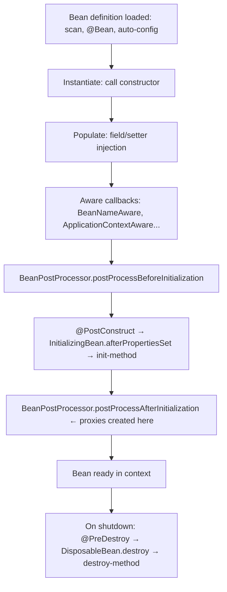

# IoC, DI & bean lifecycle

> **TL;DR** The Spring container reads **bean definitions**, creates beans, injects their dependencies, runs lifecycle callbacks, and wraps beans in **proxies** where needed (transactions, security, AOP). Beans are **singletons by default**, so they must be stateless or thread-safe. Prefer **constructor injection**. Since Spring Boot 2.6, **circular references are prohibited by default**.

## Mental model: the bean lifecycle



Key point: **the object you get injected is often a proxy**, created by a `BeanPostProcessor` *after* initialization. That's why `@Transactional`, `@Async`, `@Cacheable` and `@PreAuthorize` work only through calls that go through the proxy.

## Deep dive

### IoC container

- **IoC (Inversion of Control):** objects don't create their dependencies; the container supplies them.
- `BeanFactory` is the basic container. `ApplicationContext` extends it with events, i18n, resource loading, environment/profiles, and **eager** singleton creation at startup (so wiring errors fail fast).

### Ways to define beans

| Style | Example | When |
|---|---|---|
| Stereotype + scanning | `@Component`, `@Service`, `@Repository`, `@Controller` | your own classes |
| `@Bean` method in `@Configuration` | `@Bean DataSource ds() {...}` | third-party classes, conditional or complex construction |
| Auto-configuration | Spring Boot starters | infrastructure beans |

`@Repository` additionally enables **exception translation** (SQL exceptions → Spring's `DataAccessException`).

### `@Configuration` full mode vs lite mode

```java
@Configuration                       // proxyBeanMethods = true by default
class AppConfig {
    @Bean Clock clock() { return Clock.systemUTC(); }
    @Bean Service a() { return new Service(clock()); }  // returns the SAME singleton clock
    @Bean Service b() { return new Service(clock()); }  // same instance again
}
```

A `@Configuration` class is subclassed with CGLIB so inter-bean method calls return the container's singleton. With `@Configuration(proxyBeanMethods = false)` (or `@Bean` methods in a plain `@Component`), each call creates a **new** object. Boot's own auto-configurations use `proxyBeanMethods = false` for faster startup.

### Injection styles

| Style | Verdict |
|---|---|
| **Constructor** | Preferred: dependencies are explicit, fields can be `final`, easy to unit test, fails fast. A single constructor needs no `@Autowired`. |
| Setter | For truly optional dependencies |
| Field (`@Autowired` on a field) | Discouraged: hides dependencies, can't be `final`, needs reflection in tests |

### Choosing between candidates

- Two beans of the same type → `NoUniqueBeanDefinitionException`.
- `@Primary` marks the default; `@Qualifier("name")` picks a specific one at the injection point (**qualifier wins over primary**).
- Inject `List<PaymentGateway>` or `Map<String, PaymentGateway>` to get **all** implementations (great for strategy patterns).
- `Optional<T>` or `ObjectProvider<T>` for optional dependencies.

### Scopes

| Scope | Lifetime |
|---|---|
| **singleton** (default) | one instance per container |
| prototype | new instance every time it's requested; Spring does **not** manage its destruction |
| request / session / application | web scopes |
| websocket | per WebSocket session |

**Prototype-in-singleton trap:** a prototype injected into a singleton is created **once**, at the singleton's creation. To get a fresh one each time, inject `ObjectProvider<T>` and call `getObject()`, use `@Lookup`, or use a scoped proxy.

**Singleton ≠ thread-safe.** A singleton service shared by all request threads must not hold mutable per-request state in fields.

### Circular dependencies

- **Constructor** injection cycles (A needs B, B needs A) **always fail**: `BeanCurrentlyInCreationException`.
- Since **Spring Boot 2.6**, even field/setter cycles fail by default (`spring.main.allow-circular-references=false`).
- Fix the design: extract the shared logic into a third bean, use events, or (last resort) `@Lazy` on one injection point, which injects a lazy proxy.

### Startup ordering and hooks

- `@DependsOn` forces creation order.
- `@Lazy` defers creation until first use.
- `ApplicationRunner` / `CommandLineRunner` run after the context starts.
- `ApplicationReadyEvent` fires when the app is ready to serve traffic.
- `BeanFactoryPostProcessor` modifies **bean definitions** before any bean is created (e.g., property placeholder resolution). `BeanPostProcessor` modifies **bean instances**.

## Code you should be able to write

```java
public interface PaymentGateway { String code(); Receipt pay(Payment p); }

@Service
class PaymentRouter {
    private final Map<String, PaymentGateway> byCode;
    PaymentRouter(List<PaymentGateway> gateways) {               // all implementations injected
        this.byCode = gateways.stream().collect(toMap(PaymentGateway::code, g -> g));
    }
    Receipt pay(Payment p) { return byCode.get(p.method()).pay(p); }
}
```

## Traps

- "Beans are created when first used." Singletons are created **eagerly** at startup (unless `@Lazy`).
- "Spring calls `@PreDestroy` on prototype beans." It doesn't.
- "`@Primary` beats `@Qualifier`." `@Qualifier` wins.
- "Singleton beans are thread-safe." Only if you make them so.
- "`@PostConstruct` runs on the proxy." It runs on the target, **before** the proxy is created, so `@Transactional` doesn't apply inside `@PostConstruct`.

## Say it out loud

**"Why constructor injection?"**
Dependencies become explicit and immutable, the object is never half-built, unit tests can construct it with plain `new`, and a cycle shows up immediately as a startup failure instead of hiding behind field injection.

**"Explain the bean lifecycle."**
Spring instantiates the bean, injects dependencies, calls Aware callbacks, runs BeanPostProcessors' before-init hooks, calls `@PostConstruct` and other init methods, then runs the after-init hooks, which is where proxies for transactions or AOP are created. On shutdown it calls `@PreDestroy` for singletons.

## Practice MCQs

**Q1.** Default bean scope in Spring:
- A) prototype
- B) request
- C) singleton
- D) session

<details markdown="1"><summary>Answer</summary>

**C.**
</details>

**Q2.** At which lifecycle stage are AOP/transaction proxies typically created?
- A) Before instantiation
- B) `postProcessAfterInitialization` of a BeanPostProcessor
- C) In `@PostConstruct`
- D) At first method call

<details markdown="1"><summary>Answer</summary>

**B.**
</details>

**Q3.** A prototype bean is injected into a singleton via constructor. How many prototype instances does the singleton see over its lifetime?
- A) One per method call
- B) One
- C) One per thread
- D) One per request

<details markdown="1"><summary>Answer</summary>

**B.** Use `ObjectProvider` or `@Lookup` for a fresh instance.
</details>

**Q4.** Two beans implement `Notifier`; one has `@Primary`, and an injection point has `@Qualifier("sms")` pointing at the other. Which is injected?
- A) The `@Primary` bean
- B) The `sms` bean
- C) Startup fails
- D) A random one

<details markdown="1"><summary>Answer</summary>

**B.**
</details>

**Q5.** In Spring Boot 3, service A and service B inject each other through constructors. What happens?
- A) Works with a proxy
- B) Startup fails with a circular reference error
- C) One gets `null`
- D) Works only with `@Primary`

<details markdown="1"><summary>Answer</summary>

**B.** Constructor cycles can never be resolved; field cycles are also blocked by default since Boot 2.6.
</details>

**Q6.** In a `@Configuration` class (default settings), `@Bean a()` calls `clock()` and `@Bean b()` calls `clock()`. How many `Clock` instances exist?
- A) One
- B) Two
- C) Three
- D) Zero

<details markdown="1"><summary>Answer</summary>

**A.** The CGLIB-enhanced configuration class routes calls to the container's singleton. With `proxyBeanMethods = false`, there would be three.
</details>

**Q7.** Which callback is **not** called for prototype beans?
- A) Constructor
- B) `@PostConstruct`
- C) `@PreDestroy`
- D) BeanPostProcessors

<details markdown="1"><summary>Answer</summary>

**C.**
</details>

## Related

- [Proxies & AOP](03-proxies-aop.md)
- [Boot internals](02-boot-internals.md)
