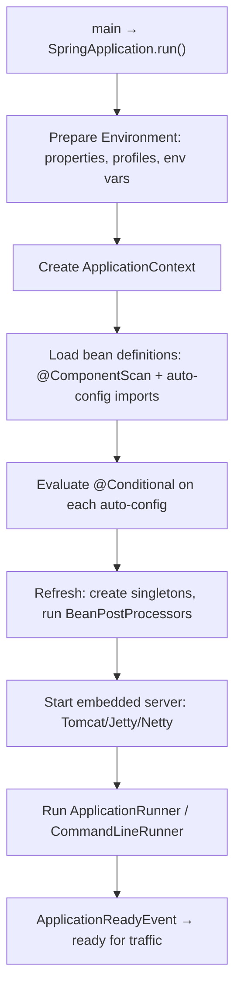

# Spring Boot internals

> **TL;DR** Spring Boot = Spring Framework + **auto-configuration** (beans created for you based on what's on the classpath) + **starters** (curated dependency bundles) + an embedded web server + opinionated defaults. Auto-configuration classes are ordinary `@Configuration` classes guarded by **`@Conditional...`** annotations ("only create this if..."), and they **back off** when you define your own bean of the same type (`@ConditionalOnMissingBean`). Run with `--debug` to see exactly which auto-configurations matched and why.

## Mental model: what happens at startup



1. **`SpringApplication.run()`** is called from your `main` method; the app is a plain Java program, not a WAR deployed into a server.
2. **Prepare the `Environment`**: gather every property source (files, environment variables, command-line arguments) and work out which profiles are active, *before* any bean exists, so conditions and beans can read configuration.
3. **Create the `ApplicationContext`**: a servlet-based context if Spring MVC is on the classpath, a reactive one for WebFlux, or a plain one for non-web apps.
4. **Load bean definitions** from component scanning of your packages and from the list of auto-configuration classes.
5. **Evaluate conditions** on each auto-configuration and each of its `@Bean` methods; those that don't match are skipped entirely. Auto-configurations are processed **after** your own configuration, so "is there already a bean of this type?" checks see your beans.
6. **Refresh**: create all singletons, inject dependencies, run `BeanPostProcessor`s and create proxies (see [IoC & DI](01-ioc-di.md)).
7. **Start the embedded server** (Tomcat by default for MVC, Netty for WebFlux) on `server.port`.
8. **Run `ApplicationRunner` / `CommandLineRunner`** beans.
9. **Publish `ApplicationReadyEvent`**: the app is now ready for traffic, and the readiness probe switches to ready.

## Deep dive

### `@SpringBootApplication`

It is a shortcut that combines three annotations:

- **`@SpringBootConfiguration`**: a specialised `@Configuration`, so the main class can contain `@Bean` methods. Tests use it to find the application's configuration automatically.
- **`@EnableAutoConfiguration`**: turns on the auto-configuration mechanism described below.
- **`@ComponentScan`** of **the package of the annotated class and all its sub-packages**: every `@Component`, `@Service`, `@Repository`, `@Controller` and `@Configuration` found there is registered as a bean.

Classes **outside** that package tree are not scanned. With the main class in `com.acme.app`, a `@Service` in `com.acme.billing` is a *sibling* package, not a sub-package, so it's ignored, and you get "No qualifying bean of type ... available" at startup. That's a classic "my bean isn't found" bug. The fix is to put the main class in the **root package** (`com.acme`), so everything is below it, rather than adding `scanBasePackages` workarounds.

### How auto-configuration is discovered

- **Boot 2.7+ / 3.x**: each auto-configure JAR lists its auto-configuration classes, one per line, in `META-INF/spring/org.springframework.boot.autoconfigure.AutoConfiguration.imports`. At startup Boot reads these files from every JAR on the classpath. That is how simply *adding a dependency* can add beans: the JAR brings its own list.
- **Older versions** used `META-INF/spring.factories` under the key `EnableAutoConfiguration`. Boot 3 no longer reads auto-configurations from there, which matters when upgrading custom starters.
- **Each class is annotated `@AutoConfiguration`** (a `@Configuration` with `proxyBeanMethods = false` that also supports ordering via `before`/`after`) and guarded by conditions.

```java
@AutoConfiguration
@ConditionalOnClass(DataSource.class)                    // skip this whole class unless DataSource is on the classpath
@ConditionalOnProperty(prefix = "app.ds", name = "enabled", matchIfMissing = true) // on by default; app.ds.enabled=false turns it off
public class MyDataSourceAutoConfiguration {
    @Bean
    @ConditionalOnMissingBean                             // back off if the user already defined a DataSource bean
    DataSource dataSource(DataSourceProperties props) { ... }
}
```

`@ConditionalOnClass` can safely reference a class that might not be on the classpath, because Boot reads the annotation's metadata from the bytecode without loading the class. That is how one auto-configure JAR can contain configurations for dozens of optional libraries.

| Condition | Matches when |
|---|---|
| `@ConditionalOnClass` / `@ConditionalOnMissingClass` | A given class is / isn't on the classpath. Usually: "did the user add this library?" |
| `@ConditionalOnBean` / `@ConditionalOnMissingBean` | A bean of the given type (or name) already exists / doesn't exist. `OnMissingBean` is what lets your bean replace Boot's default. |
| `@ConditionalOnProperty` | A property has a given value (or exists). `matchIfMissing = true` means "on unless explicitly turned off". |
| `@ConditionalOnWebApplication` | The app is a servlet or reactive web application. |
| `@Profile` | A given profile is active (Spring core's own condition, also usable on your own beans). |

**Disable an auto-configuration** you don't want, e.g. you have a database driver on the classpath but don't want Boot to create a `DataSource`: `@SpringBootApplication(exclude = DataSourceAutoConfiguration.class)` or the property `spring.autoconfigure.exclude=org.springframework.boot.autoconfigure.jdbc.DataSourceAutoConfiguration`.

**Debug it**: start with `--debug` (or set `debug=true`) to print the **conditions evaluation report**. It lists every auto-configuration under "Positive matches" (applied, with the reason) or "Negative matches" (skipped, with the exact failing condition, e.g. `@ConditionalOnClass did not find required class 'com.zaxxer.hikari.HikariDataSource'`). In a running app, the `/actuator/conditions` endpoint shows the same report.

### Starters

A **starter** contains no code of its own: it is just a dependency (a POM) that pulls in a curated set of libraries that work together. For example, `spring-boot-starter-web` brings Spring MVC, Jackson for JSON, an embedded Tomcat and logging. Combined with auto-configuration, adding one dependency gives you a working, configured feature.

Versions are managed by the Boot **BOM** (bill of materials, `spring-boot-dependencies`, inherited through `spring-boot-starter-parent` or the Gradle plugin). It pins a tested version of hundreds of libraries, so you **omit version numbers** on managed dependencies and they are guaranteed to be compatible with each other. To change one, override the version property (e.g. `<jackson-bom.version>`) instead of hard-coding a version on a single dependency, which could mismatch its siblings.

### Externalised configuration: precedence

Boot reads the same property from many sources, and when several define it, **the source higher in this list wins** (simplified to the common sources):

1. **Test properties** (`@TestPropertySource`, `@SpringBootTest(properties = ...)`): tests must be able to override anything.
2. **Command-line arguments** (`--server.port=9000`): the most deliberate, per-run choice.
3. **`SPRING_APPLICATION_JSON`**: a JSON blob of properties in an environment variable or system property.
4. **Java system properties** (`-Dserver.port=9000`).
5. **OS environment variables** (`SERVER_PORT=9000`): the standard way to configure containers and Kubernetes pods.
6. **Config files**, in this order (higher wins):
    1. profile-specific file **outside** the JAR (`./application-prod.yml`, or in `./config/`)
    2. `application.yml` / `.properties` **outside** the JAR
    3. profile-specific file **inside** the JAR (`classpath:application-prod.yml`)
    4. `application.yml` / `.properties` **inside** the JAR
7. **`@PropertySource`** on `@Configuration` classes (applied late, so it can't configure early things like logging).
8. **Default properties** (`SpringApplication.setDefaultProperties`).

The logic: the closer a setting is to the specific deployment and run, the higher its priority. Values packaged in the JAR are defaults, files next to the JAR override them per server, environment variables override them per container, and command-line arguments override everything for a single run. Note that a file *outside* the JAR beats even a profile-specific file *inside* it.

**Relaxed binding** means Boot accepts several spellings of the same property name. `SPRING_DATASOURCE_URL` maps to `spring.datasource.url` (environment variables can't contain dots or dashes, so the convention is uppercase with `_` for `.`), and `my.max-retries`, `my.maxRetries`, `my.max_retries` and `MY_MAXRETRIES` all bind to the same property. The canonical form in files is lowercase kebab-case: `my.max-retries`.

### `@ConfigurationProperties` vs `@Value`

```java
@ConfigurationProperties(prefix = "payment")   // binds payment.gateway-url, payment.timeout, payment.max-retries
@Validated                                     // run Bean Validation at startup: a blank URL stops the app
public record PaymentProperties(@NotBlank String gatewayUrl, Duration timeout, int maxRetries) {}
// enable with @EnableConfigurationProperties(PaymentProperties.class) or @ConfigurationPropertiesScan
```

Boot binds every property under `payment.` to the matching component and converts types for you: `payment.timeout=5s` becomes a `Duration`, `10MB` a `DataSize`, and so on. Then you inject `PaymentProperties` like any other bean. A record makes the configuration immutable.

| | `@ConfigurationProperties` | `@Value("${payment.timeout}")` |
|---|---|---|
| Grouped, type-safe | **Yes**: one object holds the whole group, with real types and IDE autocompletion (via the configuration processor). | **No**: one string expression per field, scattered across classes. A typo in the key fails at runtime. |
| Relaxed binding | **Yes**, fully. | **Limited**: it works with the canonical kebab-case form only. |
| Validation | **Yes**, with `@Validated` plus constraints, checked at startup, so a misconfigured app fails fast. | **No.** |
| SpEL | No. | **Yes**: `@Value("#{systemProperties['user.region'] ?: 'EU'}")` can compute values. |

Prefer `@ConfigurationProperties` for anything beyond a single, simple value.

### Profiles

A **profile** is a named set of configuration and beans that you switch on per environment (`dev`, `test`, `prod`).

- **Activate** with `spring.profiles.active=prod`, as a property, the environment variable `SPRING_PROFILES_ACTIVE=prod`, or `--spring.profiles.active=prod` on the command line. Active profiles load the matching `application-{profile}.yml` on top of the base file, and enable beans annotated with that profile.
- **`@Profile("!prod")`** on a bean means "every profile *except* prod", which is useful for things like a fake payment gateway or a data seeder that must never run in production.
- **Profile groups**: `spring.profiles.group.prod=db,metrics` makes activating `prod` also activate `db` and `metrics`, so you can split configuration into reusable pieces.

### Actuator

`spring-boot-starter-actuator` adds operational endpoints under `/actuator`:

- **Production endpoints**: `health` (is the app and its dependencies OK?), `info` (build and git info), `metrics` (JVM, HTTP, pool metrics via Micrometer), `env` (all properties), `loggers` (view and change log levels at runtime), `threaddump`, `heapdump`, and `prometheus` (metrics in Prometheus format, when the Micrometer Prometheus registry is on the classpath).
- **Only `health` is exposed over HTTP by default**, because the others reveal internals. Expose more explicitly with `management.endpoints.web.exposure.include=health,info,prometheus`. **Never expose `env` or `heapdump` publicly**: `env` lists configuration (values are masked by default in Boot 3, but masking is easy to misconfigure), and a heap dump contains everything in memory, including passwords, tokens and customer data.
- **Kubernetes probes**: `/actuator/health/liveness` ("is the process healthy, or should it be restarted?") and `/actuator/health/readiness` ("can it accept traffic right now?"). Keep external dependencies like the database out of *liveness*: a database outage would otherwise make Kubernetes restart every pod, which doesn't fix the database.
- **Put management on a separate port**: `management.server.port=8081`, so actuator endpoints can be reachable from inside the cluster (for Prometheus and probes) but not exposed through the public ingress.

### Things Boot 3 changed

- **Requires Java 17+** and is built on **Spring Framework 6**.
- **`javax.*` → `jakarta.*` packages**: when Java EE moved to the Eclipse Foundation as Jakarta EE, Oracle kept the `javax` trademark, so the APIs were renamed. Imports for servlet, persistence (JPA) and validation change from `javax.servlet`, `javax.persistence` and `javax.validation` to `jakarta.*`. Libraries compiled against `javax` won't work, which is the biggest effort in a 2.x → 3.x migration.
- **Observability via the Micrometer Observation API** and Micrometer Tracing, replacing **Spring Cloud Sleuth**: one instrumentation produces metrics *and* distributed traces (exported via OpenTelemetry or Brave).
- **Built-in support for RFC 9457 Problem Details** (`ProblemDetail`): a standard JSON error format (`type`, `title`, `status`, `detail`, `instance`), enabled with `spring.mvc.problemdetails.enabled=true`. See [Web & testing](07-web-testing.md).
- **AOT processing and GraalVM native images**: Boot can analyse the application at build time and compile it into a native executable that starts in tens of milliseconds with lower memory use, at the cost of longer builds and restrictions on runtime reflection.

Spring Boot 4 (late 2025) keeps the Java 17 baseline and moves to Spring Framework 7; the concepts on this page carry over unchanged.

### Graceful shutdown

With graceful shutdown, when the app receives a stop signal (SIGTERM from Kubernetes during a rolling deploy), the web server **stops accepting new requests but lets in-flight requests finish**, waiting up to a timeout before forcing the shutdown. Without it, requests being processed at that instant would be cut off with errors. Configure it with `server.shutdown=graceful` (the default since Boot 3.4) and `spring.lifecycle.timeout-per-shutdown-phase=30s`. Keep the timeout below Kubernetes' `terminationGracePeriodSeconds`, which defaults to 30 seconds, or the pod is killed before the app finishes.

## Traps

- "Auto-configuration overrides my beans." The reverse: an auto-configured bean guarded by `@ConditionalOnMissingBean` **backs off** when you define your own bean of that type, because your configuration is processed first.
- "`application.properties` beats environment variables." **Environment variables win**, and command-line arguments beat both. Values packaged in the JAR are the lowest-priority defaults.
- "Actuator exposes all endpoints by default." Only **`health`** is exposed over HTTP; everything else must be added to `management.endpoints.web.exposure.include`.
- "`@ComponentScan` scans the whole classpath." Only the main class's package **and its sub-packages**; sibling packages are not scanned.
- "Boot 3 works with `javax.persistence`." Boot 3 uses **`jakarta.persistence`** (and `jakarta.servlet`, `jakarta.validation`); `javax` imports won't compile or work.

## Say it out loud

**"How does Spring Boot auto-configuration work?"**
When `@EnableAutoConfiguration` is active, Boot reads the auto-configuration imports file from every JAR on the classpath to get a list of candidate configuration classes. Each one is a normal configuration class guarded by conditions: is this library's class on the classpath, is this property set, has the user already defined a bean of this type. They're evaluated after my own configuration, so when the conditions match, Boot registers its default beans, and when I define my own bean of that type, the auto-configured one backs off through `@ConditionalOnMissingBean`. If something isn't configured the way I expect, running with `--debug` prints the conditions evaluation report showing exactly which conditions matched or failed, and why.

## Practice MCQs

**Q1.** `@SpringBootApplication` does **not** include:

- A) `@EnableAutoConfiguration`
- B) `@ComponentScan`
- C) `@SpringBootConfiguration`
- D) `@EnableTransactionManagement`

<details markdown="1"><summary>Answer</summary>

**D.** `@SpringBootApplication` is exactly A + B + C. Transaction management is switched on by *auto-configuration* (`TransactionAutoConfiguration`) when a transaction manager bean is present, for example once you add a JPA or JDBC starter, so you rarely need to write `@EnableTransactionManagement` in a Boot app at all.
</details>

**Q2.** `server.port` is set to 8080 in `application.properties`, the env var `SERVER_PORT=9090` is set, and the app is started with `--server.port=7070`. Which port is used?

- A) 8080
- B) 9090
- C) 7070
- D) Startup fails

<details markdown="1"><summary>Answer</summary>

**C.** Command-line arguments have higher precedence than OS environment variables, which have higher precedence than config files. All three are valid sources for the same property, so there is no conflict error (D); the highest-priority value simply wins. Without the `--server.port` argument, the answer would be 9090.
</details>

**Q3.** You define your own `ObjectMapper` bean. Boot's Jackson auto-configuration:

- A) Throws a duplicate bean error
- B) Backs off for that bean because of `@ConditionalOnMissingBean`
- C) Overrides yours
- D) Creates both and picks randomly

<details markdown="1"><summary>Answer</summary>

**B.** `JacksonAutoConfiguration` declares its `ObjectMapper` with `@ConditionalOnMissingBean`. Your configuration is processed first, so the condition sees your bean and Boot skips creating its own. You also lose Boot's customisations (`spring.jackson.*` properties), which is why it is often better to declare a `Jackson2ObjectMapperBuilderCustomizer` bean that tweaks Boot's mapper instead of replacing it.
</details>

**Q4.** Fastest way to find out why an auto-configuration didn't apply:

- A) Read the Boot source code
- B) Run with `--debug` and read the conditions evaluation report
- C) Add `@Primary` everywhere
- D) Restart with `-Xmx` bigger

<details markdown="1"><summary>Answer</summary>

**B.** The conditions evaluation report lists every auto-configuration under positive or negative matches, with the exact condition that failed, such as a missing class, a missing property or an existing bean. `/actuator/conditions` shows the same in a running app. A works but is slow; C and D don't address conditions at all.
</details>

**Q5.** Which actuator endpoint is exposed over HTTP by default in Boot 3?

- A) `env`
- B) `health`
- C) `heapdump`
- D) All endpoints

<details markdown="1"><summary>Answer</summary>

**B.** Only `health` is exposed over the web by default, because the others can reveal sensitive information or are costly. `env` (A) shows configuration, and `heapdump` (C) contains all in-memory data including secrets. Anything beyond `health` must be listed in `management.endpoints.web.exposure.include`, ideally on a separate, non-public management port.
</details>

**Q6.** Main class is in `com.acme.app`. A `@Service` is in `com.acme.billing`. What happens?

- A) Found automatically
- B) Not found by component scanning
- C) Found only in tests
- D) Found if it has `@Primary`

<details markdown="1"><summary>Answer</summary>

**B.** `@SpringBootApplication` scans `com.acme.app` and its sub-packages, such as `com.acme.app.web`. `com.acme.billing` is a sibling package, not a sub-package, so the service is never registered, and anything that injects it fails with "No qualifying bean". Move the main class up to `com.acme`. `@Primary` (D) only matters for beans that are already registered.
</details>

## Related

- [IoC & DI](01-ioc-di.md): how bean definitions become beans, and what full vs lite `@Configuration` mode means.
- [Web & testing](07-web-testing.md): Problem Details error responses and test slices that load only part of the auto-configuration.
