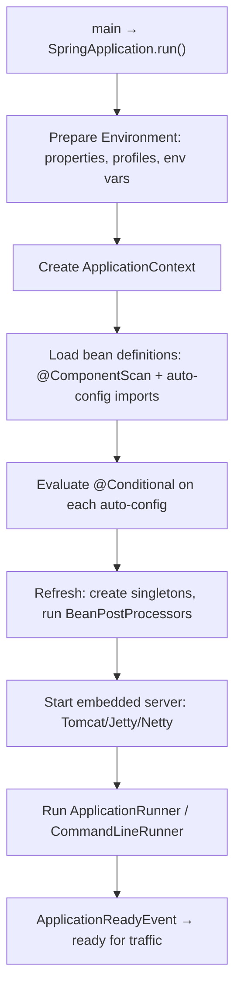

# Spring Boot internals

> **TL;DR** Spring Boot = Spring + **auto-configuration** + **starters** + embedded server + opinionated defaults. Auto-configuration classes are ordinary `@Configuration` classes guarded by **`@Conditional...`** annotations, and they **back off** when you define your own bean (`@ConditionalOnMissingBean`). Run with `--debug` to see exactly which auto-configurations matched and why.

## Mental model: what happens at startup



## Deep dive

### `@SpringBootApplication`

It combines three annotations:

- `@SpringBootConfiguration` (a `@Configuration`)
- `@EnableAutoConfiguration`
- `@ComponentScan` of **the package of the annotated class and its sub-packages**

Classes outside that package tree are not scanned. That's a classic "my bean isn't found" bug: put the main class in the root package.

### How auto-configuration is discovered

- Boot 2.7+/3.x: listed in `META-INF/spring/org.springframework.boot.autoconfigure.AutoConfiguration.imports` inside each auto-configure jar.
- Older versions used `META-INF/spring.factories`.
- Each class is annotated `@AutoConfiguration` and guarded by conditions.

```java
@AutoConfiguration
@ConditionalOnClass(DataSource.class)                    // only if the class is on the classpath
@ConditionalOnProperty(prefix = "app.ds", name = "enabled", matchIfMissing = true)
public class MyDataSourceAutoConfiguration {
    @Bean
    @ConditionalOnMissingBean                             // back off if the user defined one
    DataSource dataSource(DataSourceProperties props) { ... }
}
```

| Condition | Matches when |
|---|---|
| `@ConditionalOnClass` / `OnMissingClass` | a class is / isn't on the classpath |
| `@ConditionalOnBean` / `OnMissingBean` | a bean exists / doesn't |
| `@ConditionalOnProperty` | a property has a value |
| `@ConditionalOnWebApplication` | it's a servlet or reactive web app |
| `@Profile` | a profile is active |

**Disable** an auto-configuration: `@SpringBootApplication(exclude = DataSourceAutoConfiguration.class)` or `spring.autoconfigure.exclude=...`.

**Debug** it: start with `--debug` (or `debug=true`) to print the **conditions evaluation report**, or call the `/actuator/conditions` endpoint.

### Starters

A starter is just a dependency bundle (e.g., `spring-boot-starter-web` brings Spring MVC, Jackson, embedded Tomcat, validation-ready setup). Versions are managed by the Boot BOM (`spring-boot-dependencies`), so you usually omit version numbers.

### Externalised configuration: precedence

Higher wins (simplified list of the common sources):

1. Test properties (`@TestPropertySource`, `@SpringBootTest(properties=...)`)
2. **Command-line arguments** (`--server.port=9000`)
3. `SPRING_APPLICATION_JSON`
4. **OS environment variables** (`SERVER_PORT=9000`)
5. **Profile-specific** files (`application-prod.yml`), outside the jar before inside
6. `application.yml` / `application.properties`, outside the jar before inside
7. `@PropertySource` on configuration classes
8. Default properties

Relaxed binding maps `SPRING_DATASOURCE_URL` → `spring.datasource.url`, and `my.max-retries`, `my.maxRetries`, `MY_MAXRETRIES` to the same property.

### `@ConfigurationProperties` vs `@Value`

```java
@ConfigurationProperties(prefix = "payment")
@Validated
public record PaymentProperties(@NotBlank String gatewayUrl, Duration timeout, int maxRetries) {}
// enable with @EnableConfigurationProperties(PaymentProperties.class) or @ConfigurationPropertiesScan
```

| | `@ConfigurationProperties` | `@Value` |
|---|---|---|
| Grouped, type-safe | yes | no |
| Relaxed binding | yes | limited |
| Validation | yes, with `@Validated` | no |
| SpEL | no | yes |

Prefer `@ConfigurationProperties` for anything beyond a single value.

### Profiles

- Activate with `spring.profiles.active=prod` (property, env var `SPRING_PROFILES_ACTIVE`, or CLI).
- `@Profile("!prod")` for beans you don't want in production.
- Profile groups: `spring.profiles.group.prod=db,metrics`.

### Actuator

- Production endpoints: `health`, `info`, `metrics`, `env`, `loggers`, `threaddump`, `heapdump`, `prometheus` (with Micrometer registry).
- **Only `health` is exposed over HTTP by default.** Expose more with `management.endpoints.web.exposure.include=health,info,prometheus`. Never expose `env` or `heapdump` publicly; they leak secrets.
- Kubernetes probes: `/actuator/health/liveness` and `/actuator/health/readiness`.
- Put management on a separate port: `management.server.port=8081`.

### Things Boot 3 changed

- Requires **Java 17+**; Spring Framework 6.
- `javax.*` → **`jakarta.*`** packages (servlet, persistence, validation).
- Observability via **Micrometer Observation** and tracing (replaces Spring Cloud Sleuth).
- Built-in support for **RFC 9457 Problem Details** (`ProblemDetail`).
- AOT processing and **GraalVM native images**.

### Graceful shutdown

`server.shutdown=graceful` and `spring.lifecycle.timeout-per-shutdown-phase=30s` let in-flight requests finish before stopping.

## Traps

- "Auto-configuration overrides my beans." It **backs off** when you define one (when guarded by `@ConditionalOnMissingBean`).
- "`application.properties` beats environment variables." Env vars win.
- "Actuator exposes all endpoints by default." Only `health` over HTTP.
- "`@ComponentScan` scans the whole classpath." Only the main class's package and below.
- "Boot 3 works with `javax.persistence`." It's `jakarta.persistence`.

## Say it out loud

**"How does Spring Boot auto-configuration work?"**
Boot loads a list of auto-configuration classes from the imports file in each starter jar. Each is a normal configuration class guarded by conditions: is this class on the classpath, is this property set, has the user already defined this bean. When the conditions match, its beans are registered; when I define my own bean of that type, the auto-configured one backs off. The `--debug` conditions report shows exactly what matched and why.

## Practice MCQs

**Q1.** `@SpringBootApplication` does **not** include:
- A) `@EnableAutoConfiguration`
- B) `@ComponentScan`
- C) `@SpringBootConfiguration`
- D) `@EnableTransactionManagement`

<details markdown="1"><summary>Answer</summary>

**D.** Transaction management is enabled by auto-configuration when a transaction manager is present, not by the annotation itself.
</details>

**Q2.** `server.port` is set to 8080 in `application.properties`, the env var `SERVER_PORT=9090` is set, and the app is started with `--server.port=7070`. Which port is used?
- A) 8080
- B) 9090
- C) 7070
- D) Startup fails

<details markdown="1"><summary>Answer</summary>

**C.** Command-line arguments beat environment variables, which beat property files.
</details>

**Q3.** You define your own `ObjectMapper` bean. Boot's Jackson auto-configuration:
- A) Throws a duplicate bean error
- B) Backs off for that bean because of `@ConditionalOnMissingBean`
- C) Overrides yours
- D) Creates both and picks randomly

<details markdown="1"><summary>Answer</summary>

**B.**
</details>

**Q4.** Fastest way to find out why an auto-configuration didn't apply:
- A) Read the Boot source code
- B) Run with `--debug` and read the conditions evaluation report
- C) Add `@Primary` everywhere
- D) Restart with `-Xmx` bigger

<details markdown="1"><summary>Answer</summary>

**B.**
</details>

**Q5.** Which actuator endpoint is exposed over HTTP by default in Boot 3?
- A) `env`
- B) `health`
- C) `heapdump`
- D) All endpoints

<details markdown="1"><summary>Answer</summary>

**B.**
</details>

**Q6.** Main class is in `com.acme.app`. A `@Service` is in `com.acme.billing`. What happens?
- A) Found automatically
- B) Not found by component scanning
- C) Found only in tests
- D) Found if it has `@Primary`

<details markdown="1"><summary>Answer</summary>

**B.** Only `com.acme.app` and sub-packages are scanned by default.
</details>

## Related

- [IoC & DI](01-ioc-di.md)
- [Web & testing](07-web-testing.md)
