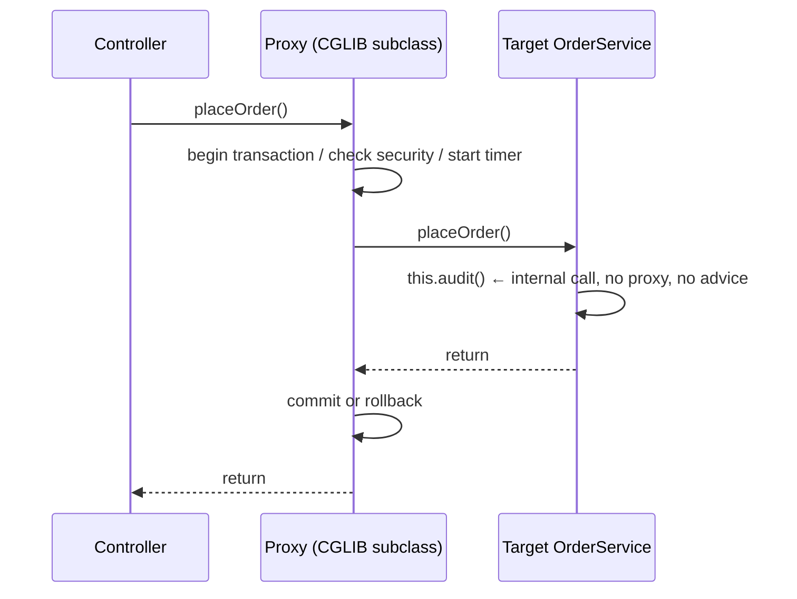

# Proxies & AOP

> **TL;DR** `@Transactional`, `@Async`, `@Cacheable`, `@Retryable` and `@PreAuthorize` all work the same way: Spring wraps your bean in a **proxy**, a generated object that stands in front of your real object, intercepts each call, and runs extra logic before and after the real method. A call only gets that extra logic if it **goes through the proxy**. Calls from inside the same class (`this.method()`), `private` methods and `final` methods **bypass** it. This one idea answers a huge share of Spring MCQs.

## Mental model



When another bean injects `OrderService`, it does not get your `OrderService` object. It gets the **proxy**, which looks like an `OrderService` (same type, same methods) and holds a reference to your real object, the **target**. When the controller calls `placeOrder()`:

1. The call lands on the **proxy**, which runs its "before" logic: begin a transaction, check a permission, start a timer.
2. The proxy calls `placeOrder()` on the **target**, your actual code.
3. Inside the target, `this` refers to the **target itself, not the proxy**. So when `placeOrder()` calls `this.audit()`, that is a plain Java method call on the same object, and the proxy never sees it. Any `@Transactional`, `@Async` or `@Cacheable` on `audit()` is ignored.
4. When the target returns (or throws), control comes back to the proxy, which runs its "after" logic: commit or roll back, record the timing.

The proxy can only intercept calls that **pass through it from outside**. Everything else in this page follows from that.

## Deep dive

### JDK dynamic proxy vs CGLIB

Spring can create a proxy in two ways:

| | JDK dynamic proxy | CGLIB |
|---|---|---|
| How | The JDK (`java.lang.reflect.Proxy`) generates a new class at runtime that **implements the same interfaces** as your bean. Every interface method call is forwarded to a handler, which runs the advice and then calls the target. | The CGLIB library generates a **subclass** of your bean class at runtime and **overrides** its methods; each override runs the advice and then calls the target. |
| Requires | The bean must implement at least one **interface**. | The class must be **non-final** (so it can be subclassed). |
| Can't intercept | Methods that aren't declared on an interface: the proxy simply doesn't have them. | **`final` methods** (can't be overridden) and **`private` methods** (not visible to the subclass). **`final` classes can't be proxied at all.** Static methods aren't intercepted by either kind. |
| Spring Boot default | No | **Yes** (`spring.aop.proxy-target-class=true` since Boot 2.0) |

**Why Boot defaults to CGLIB.** A JDK proxy *is* an instance of the interface but **not** of your concrete class. So if `OrderServiceImpl implements OrderService` is proxied with a JDK proxy, injecting `OrderService` works, but injecting `OrderServiceImpl` fails with "bean is not of required type / is a JDK proxy". A CGLIB proxy is a subclass, so it is an instance of both, and injection by interface or by class always works. Boot defaults to CGLIB to avoid that surprise.

**`final` methods are a silent trap.** The class is still proxied (only the class needs to be non-final), but CGLIB can't override the `final` method, so a call to it runs the **inherited** method body directly **on the proxy object itself** instead of on the target. Two bad things follow: no advice runs (no transaction, no security check) and there's no warning. Worse, the proxy object was created without running your constructor and its fields were never injected (they belong to the target), so if the method reads a field, you get `null` and often a `NullPointerException`. (Kotlin classes and methods are `final` by default, which is why the `kotlin-spring` compiler plugin automatically makes classes annotated with Spring annotations `open`.)

### The self-invocation problem and fixes

```java
@Service
public class ReportService {
    public void generateAll() {
        for (var id : ids) generate(id);       // really this.generate(id): `this` is the target, so the proxy is bypassed
    }
    @Transactional(propagation = Propagation.REQUIRES_NEW)
    public void generate(long id) { ... }      // REQUIRES_NEW is silently ignored here: no new transaction per report
}
```

The intent was one independent transaction per report, so one failing report wouldn't roll back the others. But `generateAll()` calls `generate()` on `this`, and the annotation is only honoured by the proxy. Every report therefore runs in whatever transaction `generateAll` has (or none), and there's no error to tell you.

Fixes, from best to worst:

1. **Move the method to another bean** and call it through injection: `reportGenerator.generate(id)`. The call now crosses a proxy. This is the cleanest, because it is plain Spring with no tricks, and it often improves the design (each class gets one job).
2. **Use programmatic control**: inject a `TransactionTemplate` and wrap the work yourself, `txTemplate.execute(status -> { ... })`. There's no proxy involved, so self-invocation doesn't matter, and the transaction boundary is visible in the code. (Configure it with `setPropagationBehavior(PROPAGATION_REQUIRES_NEW)` for this example.)
3. **Inject the proxy of yourself**: a `@Lazy` self-reference (`@Lazy @Autowired ReportService self;` then `self.generate(id)`) or an `ObjectProvider<ReportService>`. It works, because `self` is the proxy, but it's confusing to read, and `@Lazy` is needed to avoid a circular-reference startup error.
4. **`AopContext.currentProxy()`**, after enabling `@EnableAspectJAutoProxy(exposeProxy = true)`: `((ReportService) AopContext.currentProxy()).generate(id)`. It works, but couples your business code to Spring AOP internals, and it only works inside an advised call.
5. **Switch to AspectJ compile-time or load-time weaving**. Instead of wrapping the object in a proxy, AspectJ inserts the advice **directly into your class's bytecode**, so every call, including `this.generate()`, is advised. That needs an extra build plugin or a Java agent at startup, which is heavy machinery for this problem.

### Spring AOP vocabulary

**AOP (aspect-oriented programming)** is a way to add *cross-cutting* behaviour, logic needed in many places like logging, timing, transactions or security, without copying it into every method. You write it once in an *aspect* and declare *where* it applies.

| Term | Meaning |
|---|---|
| Aspect | A class holding cross-cutting logic, annotated `@Aspect` (and registered as a bean, e.g. with `@Component`). |
| Join point | A point during execution where an aspect *could* run. In Spring AOP it is always **a method execution on a Spring bean**. Full AspectJ also supports constructor calls, field reads and writes, and more. |
| Pointcut | An expression that **selects** join points, e.g. `execution(* com.acme..service..*(..))` ("any method, any return type, in any class under a `service` package below `com.acme`, any arguments") or `@annotation(com.acme.Audited)` ("any method annotated `@Audited`"). |
| Advice | The code that runs at the selected join points, and *when*: `@Before` (before the method), `@AfterReturning` (after a normal return, with access to the result), `@AfterThrowing` (after an exception), `@After` (after either, like `finally`), `@Around` (wraps the whole call; you decide if and when to call the method). |
| Weaving | Linking aspects to their targets. Spring AOP does it **at runtime, with proxies**. AspectJ weaves at compile time or class-load time by modifying bytecode. |

```java
@Aspect
@Component                                              // the aspect must itself be a Spring bean to be picked up
public class TimingAspect {
    @Around("execution(* com.acme..service..*(..))")   // pointcut: every method in any ..service.. package under com.acme
    public Object time(ProceedingJoinPoint pjp) throws Throwable {
        long start = System.nanoTime();
        try {
            return pjp.proceed();                       // call the real method (and any inner advice); forget this and the method never runs
        } finally {                                     // finally: log the time on success AND on exception
            log.info("{} took {} µs", pjp.getSignature(), (System.nanoTime() - start) / 1000);
        }
    }
}
```

- **`@Around` is the most powerful advice**: it can change the arguments (`pjp.proceed(newArgs)`), replace the return value, skip the call entirely (caching), call it several times (retrying) or translate exceptions. Because *you* decide whether the method runs, **forgetting `proceed()` silently skips the target**: the caller receives whatever the advice returns (often `null`). Use the simplest advice type that does the job.
- **Spring AOP only advises Spring-managed beans.** Proxies are created by the container while it creates beans, so an object you create yourself with `new OrderService()` is a plain object, and no annotation on it does anything.
- **Multiple aspects on one method**: control their nesting with `@Order` on the aspect classes. A **lower value means outer**: it runs first on the way in and last on the way out. For example, a security aspect with a lower order than a transaction aspect checks permissions before a transaction is even opened.
- **Spring AOP vs AspectJ**: AspectJ can advise constructors, field access, `private` and `static` methods and self-calls, and objects not managed by Spring, because it changes the bytecode itself. The cost is a weaving step (a compiler plugin or a `-javaagent`). Spring AOP covers the common case, public methods called between beans, with no build changes.

### Which annotations are proxy-based?

All of these share the same limitations: the method must be called **from another bean** (through the proxy), must be overridable (not `private`, `final` or `static`), and the object must be a **Spring-managed bean**:

`@Transactional`, `@Async`, `@Cacheable` / `@CachePut` / `@CacheEvict`, `@Retryable`, `@PreAuthorize` / `@PostAuthorize` / `@Secured`, `@Validated` method validation, `@Timed` / `@Observed`.

Historically these required **public** methods. Since Spring Framework 6, class-based (CGLIB) proxies also handle `protected` and package-private methods for `@Transactional`, but making such methods public remains the safe convention, and `private` methods are never intercepted.

## Traps

- "A `@Transactional` private method is transactional." **Never.** A private method can't be overridden by the CGLIB subclass or declared on an interface, so no proxy can intercept it, and the annotation is silently ignored.
- "Calling a `@Cacheable` method from the same class uses the cache." It **bypasses the proxy**, so the method runs every time and nothing is cached.
- "Spring AOP can intercept field access." Spring AOP intercepts **only method executions** on beans. Field access needs AspectJ.
- "Spring Boot uses JDK proxies when an interface exists." Plain Spring did, but **Boot defaults to CGLIB** (`spring.aop.proxy-target-class=true`) even when interfaces exist.
- "`@Async` on a method called internally runs asynchronously." It runs **synchronously, on the caller's thread**, because the proxy that would hand it to an executor is bypassed.

## Say it out loud

**"Why didn't my @Transactional / @Async / @Cacheable work?"**
Those features are implemented by a proxy that Spring puts in front of the bean, so they only apply when a call actually crosses that proxy. The usual culprits are self-invocation, meaning one method calling another method of the same class through `this`; a private or final method, which the CGLIB subclass can't override; or an object created with `new` instead of being a Spring bean, which never gets a proxy at all. The fix I'd reach for first is moving the annotated method into a separate bean and injecting it, and for the transactional case specifically, using `TransactionTemplate` to make the boundary explicit.

## Practice MCQs

**Q1.** Method `a()` in a bean calls `this.b()`, and `b()` is annotated `@Async`. `b()` runs:

- A) On a separate thread
- B) On the caller's thread, synchronously
- C) Never
- D) Throws `IllegalStateException`

<details markdown="1"><summary>Answer</summary>

**B.** `@Async` works by the proxy submitting the call to an executor. `this.b()` is a plain call on the target object, so the proxy never sees it, and `b()` runs immediately on the same thread, as an ordinary method. No error is raised (C and D are wrong), which is exactly why the bug is easy to miss.
</details>

**Q2.** Spring Boot's default proxying strategy is:

- A) JDK dynamic proxies always
- B) CGLIB class-based proxies
- C) AspectJ compile-time weaving
- D) No proxies

<details markdown="1"><summary>Answer</summary>

**B.** Since Boot 2.0, `spring.aop.proxy-target-class` defaults to `true`, so Boot generates CGLIB subclasses even for beans that implement interfaces, which means injection by concrete class also works. JDK proxies (A) are used only if you set that property to `false` and the bean has interfaces. AspectJ weaving (C) must be set up explicitly.
</details>

**Q3.** A CGLIB-proxied bean has a `public final` method annotated `@Transactional`. What happens when another bean calls it?

- A) Runs in a transaction
- B) Runs without a transaction (the method can't be overridden by the proxy)
- C) Startup fails
- D) A JDK proxy is used instead

<details markdown="1"><summary>Answer</summary>

**B.** CGLIB works by overriding methods, and a `final` method can't be overridden, so the call runs the original method body directly on the proxy instance, with no transaction and no warning. Because the proxy instance's own fields were never injected, the method may also hit a `NullPointerException` if it uses a field. Spring does not fail at startup (C), and it doesn't switch proxy type per method (D).
</details>

**Q4.** In an `@Around` advice you forget to call `pjp.proceed()`. The target method:

- A) Still runs
- B) Never runs, and the advice's return value is used
- C) Runs twice
- D) Throws `AopInvocationException` always

<details markdown="1"><summary>Answer</summary>

**B.** With `@Around`, the advice *replaces* the call, and the target only runs if the advice calls `proceed()`. Without it, the caller simply gets whatever the advice returned. D only happens in one specific case: if the target method returns a primitive (such as `int`) and the advice returns `null`, Spring can't convert `null` to a primitive and throws `AopInvocationException`.
</details>

**Q5.** Which can Spring AOP **not** intercept?

- A) A public method on a `@Service` called from a controller
- B) A method on an object created with `new`
- C) A method matched by an `execution(...)` pointcut
- D) A public method on a `@Repository`

<details markdown="1"><summary>Answer</summary>

**B.** Proxies are created by the Spring container while it creates beans. An object you construct yourself with `new` never passes through the container, so it is just a plain object with no proxy, and no aspect or annotation applies to it. A, C and D are all ordinary method executions on Spring beans called through their proxies.
</details>

**Q6.** The cleanest fix for a self-invoked `@Transactional(propagation = REQUIRES_NEW)` method:

- A) Make it `private`
- B) Move it to a separate bean and inject that bean
- C) Mark the class `final`
- D) Add `@Primary`

<details markdown="1"><summary>Answer</summary>

**B.** Once the method lives in another bean, the caller invokes it through that bean's proxy, so `REQUIRES_NEW` actually opens a new transaction. A and C make things worse: private methods and final classes can't be proxied at all. D only affects which bean is injected when several candidates exist; it has nothing to do with proxies.
</details>

## Related

- [Transactions](04-transactions.md): how the transactional proxy decides to commit or roll back, and the propagation modes.
- [IoC & DI](01-ioc-di.md): the lifecycle step where proxies are created, and why `@PostConstruct` runs before them.
