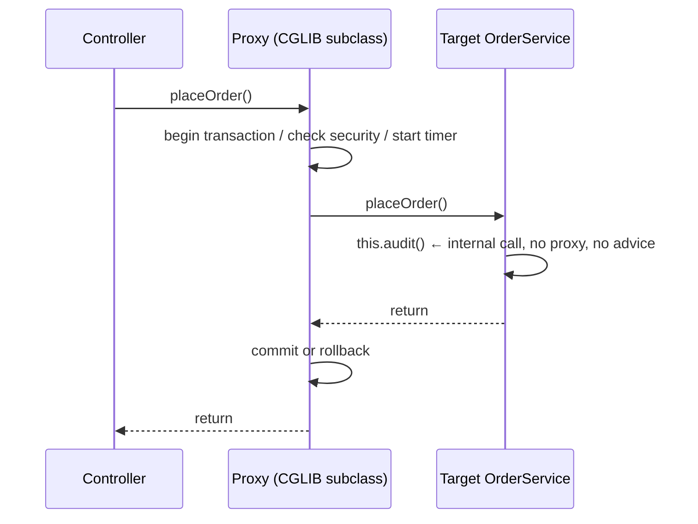

# Proxies & AOP

> **TL;DR** `@Transactional`, `@Async`, `@Cacheable`, `@Retryable` and `@PreAuthorize` all work the same way: Spring wraps your bean in a **proxy** that runs extra logic before and after the real method. A call only gets that logic if it **goes through the proxy**. Calls from inside the same class (`this.method()`), `private` methods and `final` methods **bypass** it. This one idea answers a huge share of Spring MCQs.

## Mental model



## Deep dive

### JDK dynamic proxy vs CGLIB

| | JDK dynamic proxy | CGLIB |
|---|---|---|
| How | implements the bean's **interfaces** | generates a **subclass** of the bean class |
| Requires | an interface | a non-final class |
| Can't intercept | methods not on the interface | `final` methods, `private` methods; `final` classes can't be proxied at all |
| Spring Boot default | no | **yes** (`spring.aop.proxy-target-class=true` since Boot 2.0) |

With JDK proxies, injecting the **concrete class** fails because the proxy only implements the interface. Boot defaults to CGLIB partly to avoid that surprise.

`final` methods are a silent trap: the class gets proxied, but the `final` method runs directly on the proxy instance, whose fields are not initialised, so you get no advice and sometimes a `NullPointerException`. (Kotlin classes are `final` by default; that's why the `kotlin-spring` plugin opens them.)

### The self-invocation problem and fixes

```java
@Service
public class ReportService {
    public void generateAll() {
        for (var id : ids) generate(id);       // this.generate(): bypasses the proxy
    }
    @Transactional(propagation = Propagation.REQUIRES_NEW)
    public void generate(long id) { ... }      // REQUIRES_NEW is silently ignored here
}
```

Fixes, from best to worst:

1. **Move** the method to another bean and call it through injection (cleanest).
2. Use **programmatic** control: `TransactionTemplate`.
3. Inject the proxy of yourself: `@Lazy` self-reference or `ObjectProvider<ReportService>`.
4. `AopContext.currentProxy()` with `@EnableAspectJAutoProxy(exposeProxy = true)` (couples code to Spring AOP).
5. Switch to AspectJ compile/load-time weaving, which modifies bytecode, so self-calls are advised too.

### Spring AOP vocabulary

| Term | Meaning |
|---|---|
| Aspect | a class holding cross-cutting logic (`@Aspect`) |
| Join point | a point in execution; in Spring AOP always a **method execution** on a Spring bean |
| Pointcut | an expression selecting join points |
| Advice | the code that runs: `@Before`, `@AfterReturning`, `@AfterThrowing`, `@After` (like finally), `@Around` |
| Weaving | linking aspects to targets; Spring does it at **runtime with proxies** |

```java
@Aspect
@Component
public class TimingAspect {
    @Around("execution(* com.acme..service..*(..))")
    public Object time(ProceedingJoinPoint pjp) throws Throwable {
        long start = System.nanoTime();
        try {
            return pjp.proceed();                       // forget this and the method never runs
        } finally {
            log.info("{} took {} µs", pjp.getSignature(), (System.nanoTime() - start) / 1000);
        }
    }
}
```

- `@Around` is the most powerful (can change arguments and return values, skip the call, retry), but forgetting `proceed()` silently skips the target.
- Spring AOP only advises **Spring-managed beans**. Objects created with `new` are never proxied.
- Multiple aspects on one method: control order with `@Order` (lower value = outer, runs first on the way in).
- Spring AOP vs **AspectJ**: AspectJ can advise constructors, field access, private methods and self-calls, but needs a weaving step.

### Which annotations are proxy-based?

All of these share the same limitations (public method, called from another bean, bean must be Spring-managed):

`@Transactional`, `@Async`, `@Cacheable`/`@CacheEvict`, `@Retryable`, `@PreAuthorize`/`@Secured`, `@Validated` method validation, `@Timed`/`@Observed`.

## Traps

- "A `@Transactional` private method is transactional." It's never proxied.
- "Calling a `@Cacheable` method from the same class uses the cache." It bypasses the proxy.
- "Spring AOP can intercept field access." Only method execution.
- "Spring Boot uses JDK proxies when an interface exists." Boot defaults to **CGLIB**.
- "`@Async` on a method called internally runs asynchronously." It runs synchronously.

## Say it out loud

**"Why didn't my @Transactional / @Async / @Cacheable work?"**
Those features are implemented by a proxy around the bean, so they only apply when a call crosses the proxy. The usual culprits are a self-invocation from another method in the same class, a private or final method, or an object created with `new` instead of being a Spring bean. I'd move the method into a separate bean, or use `TransactionTemplate` for the transactional case.

## Practice MCQs

**Q1.** Method `a()` in a bean calls `this.b()`, and `b()` is annotated `@Async`. `b()` runs:
- A) On a separate thread
- B) On the caller's thread, synchronously
- C) Never
- D) Throws `IllegalStateException`

<details markdown="1"><summary>Answer</summary>

**B.** Self-invocation bypasses the proxy.
</details>

**Q2.** Spring Boot's default proxying strategy is:
- A) JDK dynamic proxies always
- B) CGLIB class-based proxies
- C) AspectJ compile-time weaving
- D) No proxies

<details markdown="1"><summary>Answer</summary>

**B.**
</details>

**Q3.** A CGLIB-proxied bean has a `public final` method annotated `@Transactional`. What happens when another bean calls it?
- A) Runs in a transaction
- B) Runs without a transaction (the method can't be overridden by the proxy)
- C) Startup fails
- D) A JDK proxy is used instead

<details markdown="1"><summary>Answer</summary>

**B.**
</details>

**Q4.** In an `@Around` advice you forget to call `pjp.proceed()`. The target method:
- A) Still runs
- B) Never runs, and the advice's return value is used
- C) Runs twice
- D) Throws `AopInvocationException` always

<details markdown="1"><summary>Answer</summary>

**B.** (If the method returns a primitive and the advice returns `null`, you'll get an `AopInvocationException`.)
</details>

**Q5.** Which can Spring AOP **not** intercept?
- A) A public method on a `@Service` called from a controller
- B) A method on an object created with `new`
- C) A method matched by an `execution(...)` pointcut
- D) A public method on a `@Repository`

<details markdown="1"><summary>Answer</summary>

**B.** Only Spring-managed beans get proxies.
</details>

**Q6.** The cleanest fix for a self-invoked `@Transactional(propagation = REQUIRES_NEW)` method:
- A) Make it `private`
- B) Move it to a separate bean and inject that bean
- C) Mark the class `final`
- D) Add `@Primary`

<details markdown="1"><summary>Answer</summary>

**B.**
</details>

## Related

- [Transactions](04-transactions.md)
- [IoC & DI](01-ioc-di.md): where proxies are created.
