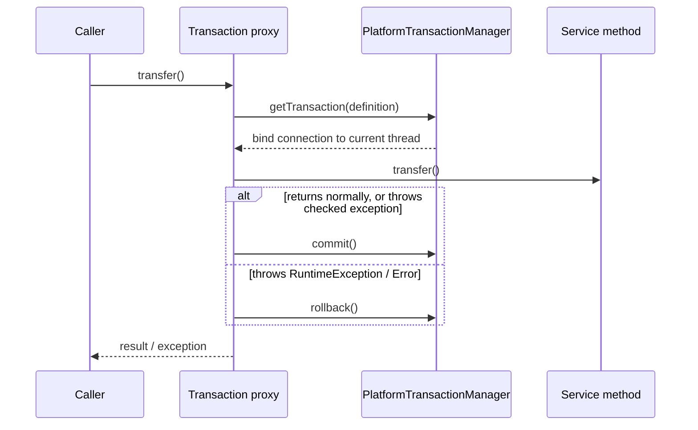

# Transactions

> **TL;DR** `@Transactional` is applied by a **proxy** (see [Proxies & AOP](03-proxies-aop.md)), bound to the **current thread**, and by default **rolls back only on unchecked exceptions** (`RuntimeException` and `Error`). Default propagation is **REQUIRED** (join the existing transaction or start one). The classic traps: self-invocation, checked exceptions committing, swallowed exceptions, and `UnexpectedRollbackException`.

## Mental model



Because the transaction (and its DB connection) is bound to a **ThreadLocal**, code running on **another thread** (`@Async`, `CompletableFuture`, parallel streams) does **not** take part in it.

## Deep dive

### Rollback rules

| Thrown from the method | Default outcome |
|---|---|
| `RuntimeException` (unchecked) | **rollback** |
| `Error` | **rollback** |
| Checked `Exception` (e.g., `IOException`) | **commit** |
| Exception caught and not rethrown | **commit** (the proxy never sees it) |

```java
@Transactional(rollbackFor = Exception.class)          // roll back on checked exceptions too
public void importFile(Path p) throws IOException { ... }

@Transactional(noRollbackFor = DuplicateEmailException.class)
public void register(User u) { ... }
```

### Propagation

| Propagation | Existing transaction | No transaction |
|---|---|---|
| **REQUIRED** (default) | join it | start new |
| **REQUIRES_NEW** | **suspend** it, start an independent one | start new |
| **NESTED** | savepoint inside it (inner rollback rolls back to savepoint) | start new |
| SUPPORTS | join | run without |
| NOT_SUPPORTED | suspend, run without | run without |
| MANDATORY | join | **throw** |
| NEVER | **throw** | run without |

**REQUIRES_NEW** commits independently of the outer transaction. Good for audit logs that must persist even if the business operation fails. It needs a **second connection** while the first is suspended: with a small pool and many concurrent requests, this can **deadlock the pool**.

**NESTED** relies on JDBC savepoints; it's supported by `DataSourceTransactionManager` but limited with JPA.

### The `UnexpectedRollbackException` trap

```java
@Transactional
public void outer() {
    try {
        inner.save();          // REQUIRED: joins outer; throws RuntimeException
    } catch (RuntimeException e) {
        log.warn("ignored");   // we "handle" it...
    }
}   // ...but commit fails: UnexpectedRollbackException
```

When the inner method (same transaction) throws an unchecked exception, its proxy marks the **shared** transaction **rollback-only**. Catching it in the outer method doesn't undo that. At commit, Spring rolls back and throws `UnexpectedRollbackException`. Fix: make the inner call `REQUIRES_NEW` (if it really should be independent), or don't swallow the exception.

### Isolation levels

| Level | Dirty read | Non-repeatable read | Phantom read |
|---|---|---|---|
| READ_UNCOMMITTED | possible | possible | possible |
| **READ_COMMITTED** | prevented | possible | possible |
| REPEATABLE_READ | prevented | prevented | possible (by the SQL standard) |
| SERIALIZABLE | prevented | prevented | prevented |

- `Isolation.DEFAULT` uses the **database's** default: **PostgreSQL, Oracle and SQL Server use READ COMMITTED**; MySQL InnoDB uses REPEATABLE READ.
- Higher isolation means fewer anomalies but more locking or serialisation failures to retry.
- Lost updates (two read-modify-writes overwriting each other) are usually solved with **optimistic locking** (`@Version`) or `SELECT ... FOR UPDATE`, not just isolation. See [JPA pitfalls](05-jpa-pitfalls.md).

### readOnly, timeout, and where to put the annotation

- `@Transactional(readOnly = true)`: with Hibernate, the flush mode becomes manual, so dirty checking and flushes are skipped (faster reads). Some setups use it to route to a read replica. It is a **hint**, not a security guarantee.
- `timeout = 5` (seconds) aborts long transactions.
- Put `@Transactional` on **service** methods that define a business unit of work, not on controllers or repositories. Class-level annotations apply to all public methods; method-level ones override.
- **Private** methods are never transactional. With class-based (CGLIB) proxies, Spring 6 also handles protected and package-private methods, but keep transactional entry points public to stay clear.
- Spring Data JPA repositories are already transactional: reads `readOnly = true`, writes in a read-write transaction.

### Keep transactions short

Don't call **remote services**, send **emails**, or publish **messages** inside a transaction:

- Holding a DB connection while waiting on HTTP exhausts the pool.
- If the transaction rolls back after the email is sent, you can't unsend it.

Use `@TransactionalEventListener` (default phase `AFTER_COMMIT`) to act **after** commit, or the **transactional outbox** pattern for reliable messaging.

```java
@Transactional
public void placeOrder(Order o) {
    orders.save(o);
    events.publishEvent(new OrderPlaced(o.id()));     // delivered only if the commit succeeds
}

@TransactionalEventListener                           // phase = AFTER_COMMIT
void onPlaced(OrderPlaced e) { mailer.sendConfirmation(e.orderId()); }
```

### Programmatic transactions

```java
transactionTemplate.executeWithoutResult(status -> {
    repo.save(entity);
    if (invalid) status.setRollbackOnly();
});
```

Useful for self-invocation cases, loops where each item needs its own transaction, or fine-grained control.

### Tests

`@Transactional` on a **test** method rolls back by default after the test (`@Commit` to keep changes). Beware: this can hide bugs that only appear on flush/commit, such as constraint violations. Call `entityManager.flush()` in tests to surface them.

## Traps

- "Any exception rolls back." Only unchecked exceptions and errors, by default.
- "Catching the inner exception saves the outer transaction." Not if the inner call joined it: rollback-only.
- "`REQUIRES_NEW` is free." It takes a second connection.
- "`@Async` methods share the caller's transaction." Different thread, no transaction.
- "`readOnly = true` prevents writes." It's an optimisation hint.
- "Default isolation is SERIALIZABLE." It's the **database** default (usually READ COMMITTED).

## Say it out loud

**"A @Transactional method threw an IOException but data was saved. Why?"**
Spring only rolls back on unchecked exceptions and errors by default; a checked exception is treated as a business outcome and the transaction commits. I'd add `rollbackFor = Exception.class` or wrap it in a runtime exception, and I'd check that the call actually went through the proxy.

**"How do you send an email only if the order commits?"**
Publish an application event inside the transaction and handle it with `@TransactionalEventListener` in the after-commit phase. For messages to a broker that must never be lost, I'd write an outbox row in the same transaction and have a relay publish it.

## Practice MCQs

**Q1.** A `@Transactional` method throws `SQLException` (checked) with default settings. The transaction:
- A) Rolls back
- B) Commits
- C) Is left open
- D) Is marked rollback-only

<details markdown="1"><summary>Answer</summary>

**B.**
</details>

**Q2.** `outer()` (REQUIRED) calls `inner()` (REQUIRED, another bean), which throws `IllegalStateException`. `outer()` catches it and returns normally. Result:
- A) Commit
- B) `UnexpectedRollbackException` and rollback
- C) Only inner's changes roll back
- D) Deadlock

<details markdown="1"><summary>Answer</summary>

**B.**
</details>

**Q3.** You want an audit record saved even if the main business transaction rolls back. Use for the audit method:
- A) REQUIRED
- B) SUPPORTS
- C) REQUIRES_NEW
- D) MANDATORY

<details markdown="1"><summary>Answer</summary>

**C.** (In a separate bean, so the proxy applies.)
</details>

**Q4.** Which propagation throws if no transaction exists?
- A) REQUIRED
- B) MANDATORY
- C) NEVER
- D) NOT_SUPPORTED

<details markdown="1"><summary>Answer</summary>

**B.** NEVER throws if one **does** exist.
</details>

**Q5.** Which anomaly does READ_COMMITTED still allow?
- A) Dirty reads
- B) Non-repeatable reads
- C) Both A and B
- D) None

<details markdown="1"><summary>Answer</summary>

**B.** (And phantoms.)
</details>

**Q6.** A `@Transactional` method calls a method annotated `@Async` on another bean that writes to the database. The async write:
- A) Joins the caller's transaction
- B) Runs on another thread outside the caller's transaction
- C) Throws `IllegalTransactionStateException`
- D) Is queued until commit

<details markdown="1"><summary>Answer</summary>

**B.** Transactions are thread-bound.
</details>

**Q7.** `Isolation.DEFAULT` on PostgreSQL means:
- A) SERIALIZABLE
- B) REPEATABLE_READ
- C) READ_COMMITTED
- D) READ_UNCOMMITTED

<details markdown="1"><summary>Answer</summary>

**C.**
</details>

**Q8.** Default phase of `@TransactionalEventListener`:
- A) BEFORE_COMMIT
- B) AFTER_COMMIT
- C) AFTER_ROLLBACK
- D) AFTER_COMPLETION

<details markdown="1"><summary>Answer</summary>

**B.**
</details>

## Related

- [Proxies & AOP](03-proxies-aop.md)
- [JPA pitfalls](05-jpa-pitfalls.md)
