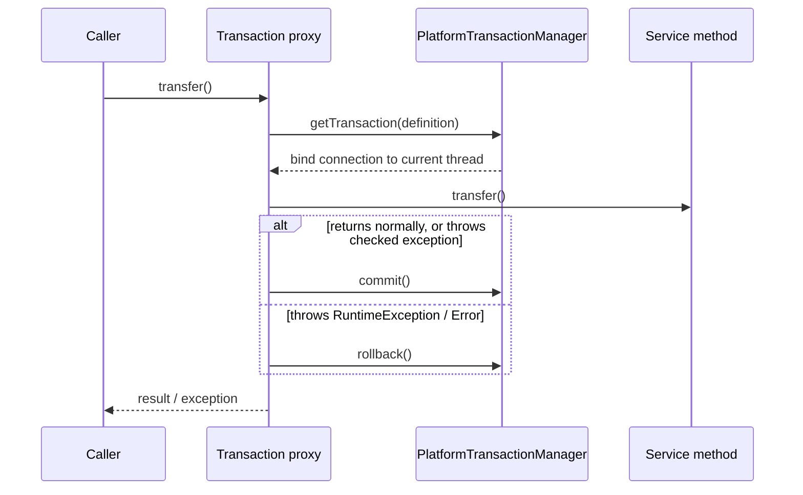

# Transactions

> **TL;DR** A **transaction** groups several database operations so they either all succeed (**commit**) or all disappear as if they never happened (**rollback**). In Spring, `@Transactional` is applied by a **proxy** (see [Proxies & AOP](03-proxies-aop.md)), the transaction is bound to the **current thread**, and by default it **rolls back only on unchecked exceptions** (`RuntimeException` and `Error`); checked exceptions commit. Default propagation is **REQUIRED**: join the transaction that's already running, or start one if there is none. The classic traps: self-invocation, checked exceptions committing, swallowed exceptions, and `UnexpectedRollbackException`.

## Mental model



1. The caller invokes `transfer()` on the **proxy**, not directly on your service.
2. The proxy asks the **`PlatformTransactionManager`** (the component that knows how to start and end transactions for your technology, e.g. `JpaTransactionManager` or `DataSourceTransactionManager`) for a transaction matching the annotation's settings (propagation, isolation, timeout, read-only).
3. The transaction manager takes a connection from the pool, turns off auto-commit, and **binds the connection to the current thread**. Every repository or `JdbcTemplate` call made on this thread during the method automatically uses that same connection, which is how separate repository calls end up in one transaction without passing anything around.
4. Your method runs.
5. If it **returns normally** or throws a **checked** exception, the proxy commits. If it throws a `RuntimeException` or `Error`, the proxy rolls back. Then the exception (if any) continues to the caller.

Because the transaction (and its connection) is stored in a **`ThreadLocal`**, i.e. attached to one thread, code running on **another thread** (`@Async` methods, `CompletableFuture.supplyAsync`, parallel streams, your own executors) does **not** see it. That code gets no transaction, or its own separate one, and its writes commit or fail independently of the caller.

## Deep dive

### Rollback rules

| Thrown from the method | Default outcome |
|---|---|
| `RuntimeException` (unchecked) | **Rollback.** Unchecked exceptions usually mean a bug or an unexpected failure, so the data may be inconsistent. |
| `Error` | **Rollback.** `OutOfMemoryError` and the like mean the JVM is in trouble. |
| Checked `Exception` (e.g. `IOException`, `SQLException` thrown directly) | **Commit.** Spring follows the old EJB convention that checked exceptions are expected *business* outcomes the caller should handle, not failures of the unit of work. This surprises almost everyone. |
| Exception caught inside the method and not rethrown | **Commit.** The proxy only sees what leaves the method, and if you swallow the exception, as far as it knows everything succeeded. |

```java
@Transactional(rollbackFor = Exception.class)          // roll back on checked exceptions too (a common team-wide convention)
public void importFile(Path p) throws IOException { ... }

@Transactional(noRollbackFor = DuplicateEmailException.class) // this runtime exception is an expected outcome: keep the other changes
public void register(User u) { ... }
```

Note that Spring's own data-access exceptions (`DataAccessException` and its subclasses) are unchecked, so failures from repositories and `JdbcTemplate` roll back by default.

### Propagation

**Propagation** answers the question: "when a transactional method is called, and a transaction may *already* be running on this thread, what should happen?"

| Propagation | Existing transaction | No transaction |
|---|---|---|
| **REQUIRED** (default) | **Join it**: the method's work becomes part of the caller's transaction and commits or rolls back with it. | Start a new one. |
| **REQUIRES_NEW** | **Suspend** it (park it, still open, on the side) and start a completely independent one, which commits or rolls back on its own. Then resume the outer one. | Start a new one. |
| **NESTED** | Create a **savepoint** inside the existing transaction. If the inner method fails, only its work is undone (back to the savepoint) and the outer transaction can carry on; if the outer one rolls back later, the inner work is undone too. | Start a new one. |
| SUPPORTS | Join it. | Run without a transaction. ("I don't care either way.") |
| NOT_SUPPORTED | Suspend it and run without a transaction. | Run without a transaction. |
| MANDATORY | Join it. | **Throw** `IllegalTransactionStateException`: this method must only be called from inside a transaction. |
| NEVER | **Throw**: this method must never run inside a transaction. | Run without a transaction. |

**REQUIRES_NEW commits independently of the outer transaction.** That's what you want for audit logs or failure records that must be kept even when the business operation fails and rolls back. But while the outer transaction is suspended, it still **holds its database connection**, and the inner transaction needs a **second connection**. With a small pool and many concurrent requests this can **deadlock the pool**: say the pool has 10 connections and 10 requests each hold one in their outer transaction, all now waiting for a second connection that will never be freed. Size the pool for it, or avoid REQUIRES_NEW on hot paths.

**NESTED** relies on JDBC **savepoints** (markers inside a transaction you can roll back to). It works with `DataSourceTransactionManager` (plain JDBC, `JdbcTemplate`), but `JpaTransactionManager` supports it only for JDBC access, not for JPA operations, because Hibernate's in-memory persistence context can't be rolled back to a savepoint.

### The `UnexpectedRollbackException` trap

```java
@Transactional
public void outer() {
    try {
        inner.save();          // inner is ANOTHER bean, @Transactional REQUIRED: joins outer's transaction; throws RuntimeException
    } catch (RuntimeException e) {
        log.warn("ignored");   // we "handle" it...
    }
}   // ...but commit fails: UnexpectedRollbackException
```

What happens, step by step:

1. `inner.save()` goes through `inner`'s transactional proxy and **joins** the existing transaction (REQUIRED). There is only one physical transaction.
2. `save()` throws a `RuntimeException`. `inner`'s proxy follows the rollback rules, but it didn't start the transaction, so it can't roll it back by itself. Instead it **marks the shared transaction rollback-only**: "this transaction is poisoned; it must not commit".
3. `outer()` catches the exception and returns normally, so its proxy tries to **commit**.
4. The transaction manager sees the rollback-only flag, rolls back **everything** (including `outer`'s own successful changes), and throws `UnexpectedRollbackException` to tell the caller "you asked for a commit, but I rolled back", since silently rolling back would hide data loss.

Catching the exception in `outer()` does not undo the rollback-only mark. Fixes:

- If the inner work really should be **independent** (its failure shouldn't affect the outer work), make the inner method `REQUIRES_NEW`, so its failure rolls back only its own transaction.
- If it shouldn't be independent, **don't swallow the exception**: let it propagate, so the whole operation fails cleanly.
- If the inner method only *might* fail and that's normal, check the condition before calling it, instead of using exceptions for control flow.

(If `save()` were a method of the *same* class, called via `this`, there would be no inner proxy, no rollback-only mark, and `outer` would commit; that's the self-invocation case from [Proxies & AOP](03-proxies-aop.md).)

### Isolation levels

**Isolation** controls how much concurrent transactions can see of each other's uncommitted or freshly committed changes. The anomalies:

- **Dirty read**: you read data another transaction has written but **not yet committed**, and it may still roll back, so you saw data that never existed.
- **Non-repeatable read**: you read the same row twice in one transaction and get **different values**, because another transaction updated and committed it in between.
- **Phantom read**: you run the same *query* twice (e.g. `WHERE status = 'NEW'`) and get **a different set of rows**, because another transaction inserted or deleted matching rows in between.

| Level | Dirty read | Non-repeatable read | Phantom read |
|---|---|---|---|
| READ_UNCOMMITTED | possible | possible | possible |
| **READ_COMMITTED** | prevented | possible | possible |
| REPEATABLE_READ | prevented | prevented | possible (by the SQL standard) |
| SERIALIZABLE | prevented | prevented | prevented |

- **`Isolation.DEFAULT`** (what you get without setting it) means "use the **database's** default": **PostgreSQL, Oracle and SQL Server use READ COMMITTED**; MySQL InnoDB uses REPEATABLE READ. Real databases often do better than the standard's minimum: PostgreSQL's REPEATABLE READ is snapshot isolation and also prevents phantoms. Check your database's documentation, not just the table.
- **Higher isolation means fewer anomalies but more cost**: more locking (waiting) or, in snapshot-based databases, more **serialization failures**, transactions aborted with an error that you must **retry**. Use the lowest level that keeps your data correct.
- **Lost updates** are the anomaly that bites most applications: two transactions both read a balance of 100, both add 10, and both write 110, so one update is lost. READ COMMITTED does not prevent this. It is usually solved not by raising isolation but with **optimistic locking** (a `@Version` column; the second writer gets an exception and retries) or **pessimistic locking** (`SELECT ... FOR UPDATE` locks the row so the second reader waits). See [JPA pitfalls](05-jpa-pitfalls.md). An atomic SQL update (`UPDATE account SET balance = balance + 10`) also avoids it.

### readOnly, timeout, and where to put the annotation

- **`@Transactional(readOnly = true)`**: with Hibernate, Spring sets the session's **flush mode to manual** and marks it read-only. Hibernate then doesn't keep a snapshot copy of each loaded entity for **dirty checking** (comparing entities to their original state at commit to find changes), and doesn't flush at the end, which saves memory and CPU on large reads. Some setups also use it to **route the query to a read replica** (via a routing `DataSource`). It is a **performance hint, not a security guarantee**: a native `UPDATE` query in a read-only transaction may still execute, depending on the driver and database.
- **`timeout = 5`** (in seconds): if the transaction runs longer, it is marked for rollback and the next statement fails, which protects the database from runaway transactions that hold locks.
- **Put `@Transactional` on *service* methods** that represent one business unit of work ("place order" = save order + reserve stock + record payment), not on controllers (too broad: the transaction would span JSON serialization and the whole web layer) or repositories (too narrow: each call would commit separately, so a failure halfway leaves partial data). An annotation on the **class** applies to all its public methods; an annotation on a **method** overrides the class-level settings for that method.
- **Private methods are never transactional**, because no proxy can intercept them. With class-based (CGLIB) proxies, Spring 6 also handles protected and package-private methods, but keep transactional entry points public to stay clear.
- **Spring Data JPA repositories are already transactional**: the default implementation (`SimpleJpaRepository`) is annotated `readOnly = true` for read methods, and its write methods (`save`, `delete`) are annotated with a normal read-write transaction. If a service method already has a transaction, repository calls simply join it (REQUIRED).

### Keep transactions short

Don't call **remote services**, send **emails**, or publish **messages** to a broker inside a transaction:

- **It exhausts the pool.** The transaction holds a database connection for its whole duration. If it waits 2 seconds on an HTTP call, that connection is idle but unavailable for 2 seconds, and under load all connections end up waiting on remote calls while other requests queue (see the HikariCP pattern in [JIT & troubleshooting](../jvm/03-performance-troubleshooting.md)). Long transactions also hold row locks longer.
- **Side effects can't be rolled back.** If you send the confirmation email and the transaction then rolls back (a constraint violation at commit, say), the customer has an email for an order that doesn't exist. You can't unsend it. The reverse problem exists too: commit succeeds but the message publish failed.

Instead, use **`@TransactionalEventListener`** (default phase `AFTER_COMMIT`) to act only **after** a successful commit, or the **transactional outbox** pattern for messaging that must be reliable: in the same transaction, insert the message into an `outbox` table, so the business data and the message commit or roll back together, and a separate process reads the table and publishes to the broker.

```java
@Transactional
public void placeOrder(Order o) {
    orders.save(o);
    events.publishEvent(new OrderPlaced(o.id()));     // held back by Spring; delivered only if the commit succeeds
}

@TransactionalEventListener                           // phase = AFTER_COMMIT by default
void onPlaced(OrderPlaced e) { mailer.sendConfirmation(e.orderId()); } // runs after commit; skipped entirely on rollback
```

Two details worth knowing. If the event is published with **no transaction active**, the listener is **not called at all** unless you set `fallbackExecution = true`. And an `AFTER_COMMIT` listener that itself needs to write to the database must use a **new** transaction (`@Transactional(propagation = REQUIRES_NEW)` on the listener), because the original one has already committed.

Also note this is not fully reliable: if the app crashes right after commit, the email is never sent. When that matters, use the outbox.

### Programmatic transactions

```java
transactionTemplate.executeWithoutResult(status -> {   // begins a transaction, runs the lambda, then commits
    repo.save(entity);
    if (invalid) status.setRollbackOnly();             // ask for rollback without throwing an exception
});                                                     // an exception thrown from the lambda also rolls back
```

`TransactionTemplate` gives you the same transaction management as `@Transactional`, but with explicit, visible boundaries in code. Useful for:

- **Self-invocation** cases, where an annotation on a method of the same class wouldn't be applied.
- **Loops where each item needs its own transaction**, so one bad record doesn't roll back the whole batch (configure the template with `PROPAGATION_REQUIRES_NEW`, or call it outside any transaction).
- **Fine-grained control**: a transaction around only part of a method, keeping slow work (like a remote call) outside it.

### Tests

`@Transactional` on a **test** method (or test class) behaves differently from production: Spring's test framework **rolls the transaction back after each test by default**, so tests don't leave data behind and don't affect each other. Use `@Commit` (or `@Rollback(false)`) to keep the changes.

Beware: this can **hide bugs that only appear on flush or commit**. Hibernate delays SQL until it *flushes* (usually at commit). If the test rolls back without ever flushing, the `INSERT` is never sent to the database, so constraint violations (unique keys, not-null columns, foreign keys) never fire and the test passes while production fails. Call `entityManager.flush()` in such tests to force the SQL out and surface the errors. Also, code under test that runs on other threads (or uses REQUIRES_NEW) is *not* rolled back.

## Traps

- "Any exception rolls back." By default only **unchecked exceptions and errors** do; a checked exception leaving the method **commits**. Use `rollbackFor` to change it.
- "Catching the inner exception saves the outer transaction." Not if the inner call went through a proxy and **joined** the transaction: it's already marked rollback-only, and the commit ends in `UnexpectedRollbackException`.
- "`REQUIRES_NEW` is free." It suspends the outer transaction, which still holds its connection, and takes a **second connection** from the pool, which can deadlock a small pool under load.
- "`@Async` methods share the caller's transaction." Transactions are bound to a thread, and `@Async` runs on a **different thread**, so it gets no transaction or its own.
- "`readOnly = true` prevents writes." It is an **optimisation hint** (skip dirty checking and flushing, maybe route to a replica), not an enforced permission.
- "Default isolation is SERIALIZABLE." `Isolation.DEFAULT` means the **database's** default, usually READ COMMITTED (REPEATABLE READ on MySQL InnoDB).

## Say it out loud

**"A @Transactional method threw an IOException but data was saved. Why?"**
By default, Spring rolls back only on unchecked exceptions and errors. `IOException` is a checked exception, which Spring treats as an expected business outcome, so the proxy commits the transaction before rethrowing it. I'd add `rollbackFor = Exception.class`, or wrap it in a runtime exception, and I'd also check that the call actually went through the proxy, because with self-invocation there's no transaction at all and each repository call commits on its own.

**"How do you send an email only if the order commits?"**
Publish an application event inside the transaction and handle it with `@TransactionalEventListener`, whose default phase is after commit, so the listener runs only if the commit succeeds and never on rollback. That still loses the email if the process dies right after the commit, so for messages to a broker that must never be lost, I'd write an outbox row in the same transaction as the business data and have a separate relay publish it and mark it sent.

## Practice MCQs

**Q1.** A `@Transactional` method throws `SQLException` (checked) with default settings. The transaction:

- A) Rolls back
- B) Commits
- C) Is left open
- D) Is marked rollback-only

<details markdown="1"><summary>Answer</summary>

**B.** `SQLException` is a checked exception, and the default rule rolls back only for `RuntimeException` and `Error`, so the proxy commits whatever was done before the exception, then rethrows it. Add `rollbackFor = SQLException.class` (or `Exception.class`) to roll back. Note that most Spring data-access code wraps `SQLException` into an unchecked `DataAccessException`, which *does* roll back; the trap only bites when your own code throws the checked exception.
</details>

**Q2.** `outer()` (REQUIRED) calls `inner()` (REQUIRED, another bean), which throws `IllegalStateException`. `outer()` catches it and returns normally. Result:

- A) Commit
- B) `UnexpectedRollbackException` and rollback
- C) Only inner's changes roll back
- D) Deadlock

<details markdown="1"><summary>Answer</summary>

**B.** `inner()` joined the same physical transaction, so when it threw a runtime exception its proxy marked that shared transaction rollback-only. Catching the exception doesn't clear the mark, so when `outer()`'s proxy tries to commit, the manager rolls back everything and throws `UnexpectedRollbackException`. C would require `REQUIRES_NEW` or `NESTED` on `inner()`.
</details>

**Q3.** You want an audit record saved even if the main business transaction rolls back. Use for the audit method:

- A) REQUIRED
- B) SUPPORTS
- C) REQUIRES_NEW
- D) MANDATORY

<details markdown="1"><summary>Answer</summary>

**C.** `REQUIRES_NEW` suspends the business transaction and runs the audit insert in its own independent transaction, which commits when the audit method returns, before the outer transaction decides its fate. A, B and D would all join the business transaction and be rolled back with it. The audit method must be in a separate bean so the call goes through its proxy.
</details>

**Q4.** Which propagation throws if no transaction exists?

- A) REQUIRED
- B) MANDATORY
- C) NEVER
- D) NOT_SUPPORTED

<details markdown="1"><summary>Answer</summary>

**B.** `MANDATORY` means "I must be called inside an existing transaction", and throws `IllegalTransactionStateException` otherwise. `NEVER` (C) is the opposite: it throws if a transaction **does** exist. `REQUIRED` (A) starts one when there is none; `NOT_SUPPORTED` (D) just runs without one.
</details>

**Q5.** Which anomaly does READ_COMMITTED still allow?

- A) Dirty reads
- B) Non-repeatable reads
- C) Both A and B
- D) None

<details markdown="1"><summary>Answer</summary>

**B.** READ COMMITTED guarantees you only ever see committed data, so no dirty reads (A is wrong). But each statement sees the latest committed data, so re-reading a row later in the same transaction can return a value another transaction committed in between. Phantom reads and lost updates are also possible at this level.
</details>

**Q6.** A `@Transactional` method calls a method annotated `@Async` on another bean that writes to the database. The async write:

- A) Joins the caller's transaction
- B) Runs on another thread outside the caller's transaction
- C) Throws `IllegalTransactionStateException`
- D) Is queued until commit

<details markdown="1"><summary>Answer</summary>

**B.** The caller's transaction and connection are bound to the caller's thread via a `ThreadLocal`. The `@Async` method runs on an executor thread that has no transaction bound, so its write runs in no transaction (or its own, if it is itself `@Transactional`), and it commits independently. It may even run before the caller commits, so it might not see the caller's uncommitted data. Nothing waits for the commit (D) unless you use a `@TransactionalEventListener`.
</details>

**Q7.** `Isolation.DEFAULT` on PostgreSQL means:

- A) SERIALIZABLE
- B) REPEATABLE_READ
- C) READ_COMMITTED
- D) READ_UNCOMMITTED

<details markdown="1"><summary>Answer</summary>

**C.** `DEFAULT` tells Spring not to set an isolation level at all, so the database's own default applies, which for PostgreSQL is READ COMMITTED. (PostgreSQL also treats a request for READ UNCOMMITTED as READ COMMITTED, so dirty reads are never possible there.) On MySQL InnoDB, the same setting would mean REPEATABLE READ.
</details>

**Q8.** Default phase of `@TransactionalEventListener`:

- A) BEFORE_COMMIT
- B) AFTER_COMMIT
- C) AFTER_ROLLBACK
- D) AFTER_COMPLETION

<details markdown="1"><summary>Answer</summary>

**B.** The default `AFTER_COMMIT` phase means the listener runs only once the transaction has successfully committed, which is what you want for side effects like emails. The other phases exist and can be selected with `phase = ...`: `BEFORE_COMMIT` (still inside the transaction), `AFTER_ROLLBACK` (only on rollback) and `AFTER_COMPLETION` (after either outcome).
</details>

## Related

- [Proxies & AOP](03-proxies-aop.md): why `@Transactional` needs the call to go through a proxy.
- [JPA pitfalls](05-jpa-pitfalls.md): flushing, dirty checking, optimistic locking and other things that happen at commit time.
