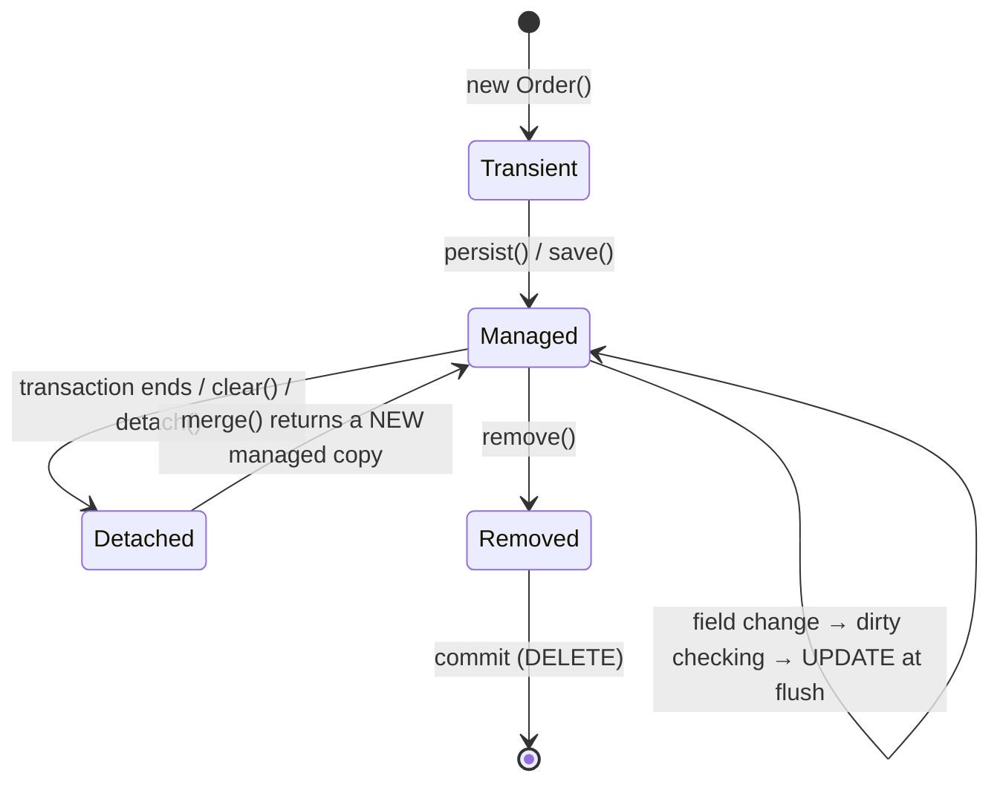

# JPA & Hibernate pitfalls

> **TL;DR** **JPA** is the standard Java API for mapping objects to database tables (ORM), and **Hibernate** is the implementation Spring Boot uses. JPA manages entities through a **persistence context**: a per-transaction workspace that remembers every entity it has loaded (the *first-level cache*) and automatically writes changes back at the end (*dirty checking*). Most production problems come from **N+1 queries**, **lazy loading outside a transaction**, the **EAGER default on `@ManyToOne`**, **IDENTITY ids disabling batch inserts**, and **lost updates** without `@Version`. Fetch what you need explicitly, per use case.

## Mental model: entity states



An entity object is always in one of four states relative to a persistence context:

- **Transient**: a plain object you just created with `new`. JPA knows nothing about it; it has no database row yet.
- **Managed**: the persistence context is tracking it, because you persisted it or loaded it in the current transaction. Its changes will be saved automatically.
- **Detached**: it *was* managed, but the persistence context has closed (the transaction ended) or explicitly let it go (`clear()`, `detach()`). It still holds data and an id, but changes to it are no longer tracked, and unloaded lazy associations can no longer be loaded.
- **Removed**: scheduled for deletion; the `DELETE` runs at flush/commit.

Inside a transaction, a **managed** entity is tracked: change a field and Hibernate issues an `UPDATE` at **flush** time (when it sends pending changes to the database, at the latest at commit), **without** you calling `save()`. This works by **dirty checking**: when Hibernate loads an entity it keeps a snapshot of its original values, and at flush it compares each managed entity with its snapshot and generates `UPDATE`s for the ones that changed.

Load the same id twice in one persistence context and you get the **same Java instance** (the first-level cache): the second `findById` doesn't even hit the database. This guarantees there is only one in-memory version of each row per transaction, so two parts of your code can't hold conflicting copies.

## Deep dive

### Default fetch types (memorise)

When you load an entity, its associations can be loaded right away (**EAGER**) or only when you first access them (**LAZY**). A lazy association is a placeholder **proxy** (or, for collections, a wrapper) that runs a query the first time you touch it.

| Relationship | Default |
|---|---|
| `@ManyToOne` | **EAGER** |
| `@OneToOne` | **EAGER** |
| `@OneToMany` | LAZY |
| `@ManyToMany` | LAZY |

The rule of thumb behind the defaults: an association pointing to **one** entity is EAGER, an association pointing to **many** is LAZY. The JPA spec chose this, not Hibernate, and it's widely considered the wrong default for the `*ToOne` cases.

**Make everything LAZY** (`@ManyToOne(fetch = FetchType.LAZY)`) and fetch explicitly per query. EAGER is a property of the *mapping*, so it applies **everywhere** the entity is loaded, by every query, and **can't be switched off for an individual query**. Loading 100 orders with an EAGER `customer` (when the query doesn't join it) triggers up to 100 extra queries for customers, even on screens that never show the customer: a surprise N+1. LAZY lets each use case decide what it needs.

### The N+1 problem

```java
List<Order> orders = orderRepo.findAll();              // 1 query: SELECT * FROM orders  → say 100 rows
for (Order o : orders) o.getCustomer().getName();      // +N queries: each lazy customer proxy runs SELECT ... WHERE id = ?
```

You run **1** query to get the list, then **N** more, one per row, to load an association: 101 round trips instead of 1 or 2. Each query is fast, so it looks fine with 10 rows in development and becomes a disaster with 10,000 rows in production, because latency grows with the data.

Fixes:

| Fix | Example | Notes |
|---|---|---|
| JOIN FETCH | `select o from Order o join fetch o.customer` | Loads orders *and* their customers in **one SQL join** and fills in the associations. Per-query and explicit: only this query pays for the join. |
| `@EntityGraph` | `@EntityGraph(attributePaths = "customer") List<Order> findByStatus(...)` | Declares "also fetch these associations" on a repository method. Works with Spring Data **derived queries** (method-name queries), where you can't write JPQL. |
| Batch fetching | `spring.jpa.properties.hibernate.default_batch_fetch_size=50` | When one lazy proxy is initialised, Hibernate loads up to 50 pending proxies of the same type at once with `WHERE id IN (?, ?, ...)`. N queries become about N/50. It needs no code changes, which makes it a good **global safety net**. |
| DTO projection | `select new com.acme.OrderView(o.id, c.name) from Order o join o.customer c` | Selects only the columns needed, directly into a plain object (a class or record). **Best for read-only screens**: no entities, so no persistence-context tracking, no dirty checking, and no lazy-loading surprises later. |

**Detect it**: enable SQL logging in development (`spring.jpa.show-sql=true` or the `org.hibernate.SQL` logger) and look for repeated identical queries, or turn on `hibernate.generate_statistics=true` in tests and **assert the query count** for important use cases, so a future change that introduces an N+1 fails the build.

### Fetch-join pitfalls

- **Pagination + collection fetch join**: joining a `@OneToMany` collection returns **one SQL row per child**: an order with 5 items appears 5 times. A SQL `LIMIT 10` would therefore cut off after 10 *rows*, maybe 2 orders, one of them with half its items. So Hibernate refuses to apply `LIMIT` in SQL: it fetches **all** matching rows, then paginates **in memory**, logging warning HHH90003004 ("firstResult/maxResults specified with collection fetch; applying in memory"). On a large table that means loading everything into the heap. Fixes: first query just one page of **parent ids** (`select o.id from Order o ... ` with `Pageable`), then fetch-join those parents with `where o.id in (:ids)`; or skip the fetch join and rely on batch fetching.
- **`MultipleBagFetchException`**: a *bag* is Hibernate's name for an unordered `List` collection with no index column. Fetch-joining **two bags** at once (e.g. `order.items` and `order.payments`, both `List`) is rejected, because the join produces a **cartesian product** (every item paired with every payment: 10 × 10 = 100 rows per order), and with bags Hibernate cannot tell genuine duplicates from join duplicates. Use `Set` for one of them, or, better, **fetch them in separate queries**, which also avoids the cartesian explosion even when `Set` would make it legal.

### LazyInitializationException

It happens when you access a lazy association **after** the persistence context has closed, i.e. outside the transaction. The proxy needs a database session to run its query, and the session is gone. Typical places: in a **controller** after the `@Transactional` service method has returned, or during **JSON serialization** when Jackson walks the entity's getters.

**Fixes**: fetch everything the use case needs **inside** the service transaction (JOIN FETCH, entity graph), or, better, return **DTOs** from the service, so nothing lazy ever leaves the transaction and the API shape is decoupled from the database model. **Don't fix it with EAGER**: that makes the error go away for this screen by loading the association for *every* query everywhere.

**Open Session in View (OSIV)**: Spring Boot sets `spring.jpa.open-in-view=true` by default (and logs a warning about it at startup). It opens the persistence context at the start of each web request and keeps it open until the response is written, so lazy loading works in controllers and during serialization. The costs: it **hides** lazy-loading problems (N+1 queries now silently happen during JSON rendering, outside any transaction), and it **holds a database connection for the whole request**, including slow serialization and network writes, which reduces the throughput of the connection pool. Most teams set it to **`false`** and fix the fetching properly.

### `save()` semantics in Spring Data

Spring Data's `repository.save(entity)` decides between two JPA operations:

- **New entity** (its id is `null`, or, if it has a `@Version` field of a wrapper type, the version is `null`) → **`persist`**: the object itself becomes managed and an `INSERT` is scheduled.
- **Otherwise** → **`merge`**: JPA loads the current row (or uses the managed instance if already loaded), **copies your object's state onto a managed instance**, and **returns that managed instance**, which is a *different object* from the one you passed in. Your original stays detached. So always use the return value: `entity = repo.save(entity);`. Changes made afterwards to the old reference are not tracked. Note that if you assign ids yourself (e.g. UUIDs set in code), every `save` of a new entity looks "not new" and takes the slower `merge` path, with an extra `SELECT`; implement `Persistable<ID>` to tell Spring Data when an entity is new.
- **Calling `save()` on an already *managed* entity is redundant**: dirty checking will write the changes anyway at flush. It does no harm, but it suggests the developer expected `save()` to be what writes the update.

### ID generation and batching

**JDBC batching** sends many `INSERT`s to the database in one network round trip instead of one each, which is often 10× faster for bulk writes. Whether Hibernate can batch depends on how ids are generated:

- **`GenerationType.IDENTITY`** (an auto-increment column, `SERIAL` / `AUTO_INCREMENT`): the database assigns the id only when the row is inserted. But a managed entity *must* have an id (it's the key in the persistence context), so Hibernate has to execute each `INSERT` **immediately** at `persist()` to learn its id. It can't hold inserts back to send them together, so **JDBC batch inserts are disabled** for that entity.
- **`GenerationType.SEQUENCE`** with an `allocationSize` (the *pooled* optimizer): Hibernate asks a database sequence for a **block** of ids, e.g. 50 at once, assigns them in memory without any database access, and can delay and batch the actual inserts. Turn batching on with `hibernate.jdbc.batch_size=50`, plus `hibernate.order_inserts=true` and `hibernate.order_updates=true`, which group statements by table so consecutive statements can share a batch. The `allocationSize` must match the sequence's `INCREMENT BY` in the database. (MySQL has no sequences, which is why it typically uses IDENTITY.)
- **For bulk loads, flush and `clear()` the persistence context every batch.** Every entity you persist stays in the persistence context (plus its snapshot for dirty checking) until the transaction ends. Inserting a million rows in one transaction keeps a million entities in memory, and dirty checking gets slower with each one. Every `batch_size` entities, call `entityManager.flush()` (send the SQL) and `entityManager.clear()` (forget the entities).

### Bulk operations bypass the persistence context

```java
@Modifying(clearAutomatically = true)   // @Modifying: this @Query changes data; clearAutomatically: clear the persistence context afterwards
@Query("update Product p set p.price = p.price * 1.1 where p.category = :c")
int raisePrices(@Param("c") String c);  // returns the number of rows updated
```

A JPQL bulk `UPDATE` or `DELETE` is translated straight into one SQL statement and executed in the **database**. It doesn't go through the managed entities, so any `Product` entities **already loaded in memory** in this persistence context still hold the **old** prices: they are **stale**. Worse, if one of them is later modified, its stale values could be written back. `clearAutomatically = true` clears the persistence context after the update, so later reads fetch fresh data. Bulk statements also skip lifecycle callbacks (`@PreUpdate`), entity listeners, cascades and optimistic version checks.

Also: **`deleteAll()` loads every entity and deletes them one by one**. It runs a `SELECT` of all rows, then one `DELETE` per entity, so that cascades and lifecycle callbacks run for each. That is very slow for big tables. **`deleteAllInBatch()`** issues a single `DELETE FROM` statement, which is fast, but for exactly that reason **skips cascades and lifecycle callbacks**, so child rows aren't removed by JPA (rely on database `ON DELETE CASCADE`, or delete the children first).

### Relationships

- **The owning side** is the side that controls the **foreign key column**. In a bidirectional `Order`/`Customer` relationship, the `@ManyToOne Customer customer` field on `Order` maps the `orders.customer_id` column, so it is the owning side. The `@OneToMany(mappedBy = "customer") List<Order> orders` on `Customer` is the **inverse** side: `mappedBy` says "this is just a mirror of the `customer` field over there". **Only changes on the owning side are persisted.** If you only do `customer.getOrders().add(order)`, nothing tells Hibernate what to write into `customer_id`, so the link is **not saved**. (A unidirectional `@OneToMany` with no `mappedBy` is itself the owner, usually through a join table, but that mapping is generally less efficient.)
- **Keep both sides in sync with helper methods**, so the in-memory object graph and the database always agree, and nobody has to remember to update both sides:

```java
public void addItem(OrderItem item) { items.add(item); item.setOrder(this); }      // set the inverse side (list) AND the owning side (FK)
public void removeItem(OrderItem item) { items.remove(item); item.setOrder(null); }
```

- **`cascade = CascadeType.ALL` belongs on parent → child** (`Order` → `@OneToMany items`): an order *owns* its items, so persisting, merging or deleting the order should do the same to its items. **Never put it on `@ManyToOne`** (child → parent): `Order.customer` with `CascadeType.REMOVE` means deleting one order deletes the customer, and with it potentially the customer's other orders.
- **`orphanRemoval = true`** deletes a child row when it is **removed from the parent's collection** (`order.removeItem(item)` issues a `DELETE` for the item), not just when the parent is deleted. Use it when children can't exist without their parent.

### equals/hashCode for entities

- **Don't use Lombok `@Data` on entities.** It generates `equals`, `hashCode` and `toString` from **all fields**, including associations. Calling them then **touches lazy associations**, which triggers extra queries, or a `LazyInitializationException` outside a transaction. In **bidirectional** relationships, `Order.toString()` calls `Customer.toString()`, which prints its orders, which print their customer, and so on: infinite recursion ending in `StackOverflowError`. Use `@Getter`/`@Setter` and write `equals`/`hashCode` deliberately.
- **Generated ids make naive equality unstable.** A database-generated id is `null` until the entity is persisted. If `hashCode` is based on the id, it **changes** when the entity is saved. A `HashSet` stores an element in a bucket based on the hash code at insertion time, so after saving, `set.contains(entity)` looks in a different bucket and returns `false`: the "mutable key" problem from [Core language traps](../java/01-core-language.md). Two safe options:
    - Base `equals`/`hashCode` on a **natural or business key** that exists from the start and never changes (an ISBN, an email address, a UUID assigned in the constructor).
    - Use an **id-based `equals`** that treats two entities as equal only when both ids are non-null and equal, together with a **constant `hashCode`** (e.g. `return getClass().hashCode();`). A constant hash code is legal, because equal objects must have equal hash codes but unequal ones may collide, and it never changes when the id is assigned. The cost, all entities of that type sharing one bucket, only matters for very large sets.

### Concurrency: lost updates

A **lost update** happens when two transactions read the same row, both modify it based on what they read, and the second write silently overwrites the first. Two users both load a balance of 100; one adds 50, the other subtracts 30; the final value is 70 or 150 instead of 120.

```java
@Entity class Account {
    @Id Long id;
    @Version Long version;     // optimistic locking: Hibernate increments it on every update
    BigDecimal balance;
}
```

- **Optimistic locking (`@Version`)**: Hibernate includes the version it originally read in every update, `UPDATE account SET balance = ?, version = version + 1 WHERE id = ? AND version = ?`. If another transaction has updated the row in the meantime, the version no longer matches, **0 rows** are updated, and Hibernate throws, which Spring translates to `ObjectOptimisticLockingFailureException`. Then you **retry** (re-read and re-apply the change) or report a conflict to the user ("this record was changed by someone else"). It takes no locks, so it is **best for low contention**, where conflicts are rare and retries cheap.
- **Pessimistic locking**: `@Lock(LockModeType.PESSIMISTIC_WRITE)` on a repository method makes Hibernate read with **`SELECT ... FOR UPDATE`**, which locks the row in the database until the transaction ends, so any other transaction trying to lock it **waits**. Best for **high-contention hot rows** (a wallet balance updated many times per second, a limited stock counter) where optimistic retries would keep failing. Keep these transactions **short** (other transactions are waiting), and when locking several rows, always acquire them **in a consistent order** (e.g. by id) to avoid deadlocks (see [Concurrency](../java/03-concurrency.md)).

## Traps

- "`@ManyToOne` is lazy by default." It's **EAGER** (so is `@OneToOne`); only the `*ToMany` associations default to LAZY. Set `fetch = LAZY` explicitly.
- "You must call `save()` after changing a managed entity." **Dirty checking** writes changes to managed entities automatically at flush/commit.
- "`IDENTITY` ids batch fine." Hibernate must execute each insert immediately to get the generated id, so it **disables insert batching** for those entities. Use a pooled SEQUENCE.
- "Fetch join + `Pageable` paginates in SQL." Not with **collection** fetch joins: Hibernate loads every row and paginates in memory.
- "`deleteAll()` is one DELETE statement." It **loads all entities and deletes them one by one** (running callbacks and cascades). `deleteAllInBatch()` is the single statement.
- "Adding to the inverse side's collection persists the relationship." Only the **owning side** (the one mapping the foreign key) is written. Set `order.setCustomer(...)`.

## Say it out loud

**"How do you find and fix N+1 queries?"**
I catch them in tests, either by logging SQL or by asserting the query count with Hibernate statistics for the important use cases, so a regression fails the build. Then I fix them per use case: a fetch join or an entity graph when I need the entities, a DTO projection for read-only views, and a global `default_batch_fetch_size` as a safety net that turns any remaining N queries into a few IN queries. I keep all associations lazy, including `@ManyToOne`, so nothing loads by surprise, and I turn off open-in-view so lazy loading can't silently happen during serialization.

**"Two users update the same account balance at once. How do you prevent a lost update?"**
For low contention, optimistic locking with a `@Version` column: the second commit finds the version changed, gets an optimistic locking exception, and I retry or report a conflict. For a hot row like a wallet balance, I'd use a pessimistic `SELECT ... FOR UPDATE` in a short transaction so writers queue instead of failing, or skip read-modify-write entirely with an atomic SQL update such as `UPDATE ... SET balance = balance - :amt WHERE id = :id AND balance >= :amt`, which also enforces the no-overdraft rule in one statement.

## Practice MCQs

**Q1.** Default fetch type of `@ManyToOne`:

- A) LAZY
- B) EAGER
- C) Depends on the database
- D) NONE

<details markdown="1"><summary>Answer</summary>

**B.** The JPA specification defaults every `*ToOne` association (`@ManyToOne`, `@OneToOne`) to EAGER and every `*ToMany` to LAZY. Fetch type is a JPA concept, independent of the database (C), and `NONE` (D) doesn't exist. Set `fetch = FetchType.LAZY` explicitly on `@ManyToOne`.
</details>

**Q2.** Inside a `@Transactional` method you load an entity and call `setName("x")`, without calling `save()`. At commit:

- A) Nothing is written
- B) An UPDATE is issued by dirty checking
- C) An exception is thrown
- D) An INSERT is issued

<details markdown="1"><summary>Answer</summary>

**B.** The loaded entity is managed, so Hibernate kept a snapshot of its original state. At flush (before commit) it compares the entity with the snapshot, sees `name` changed, and issues an `UPDATE`. An `INSERT` (D) is only for new entities. In a `readOnly = true` transaction, nothing would be flushed.
</details>

**Q3.** Which id strategy prevents Hibernate from batching inserts?

- A) SEQUENCE
- B) TABLE
- C) IDENTITY
- D) UUID assigned in code

<details markdown="1"><summary>Answer</summary>

**C.** With IDENTITY, the id exists only after the row is inserted, and a managed entity needs its id right away, so Hibernate executes each `INSERT` immediately at `persist()` and can't group them into a JDBC batch. SEQUENCE (A) and application-assigned UUIDs (D) provide the id before the insert, so inserts can be delayed and batched. TABLE (B) can batch too, but is slow for other reasons (it uses row locks on a table that simulates a sequence).
</details>

**Q4.** A controller serialises an entity and hits `LazyInitializationException` with `open-in-view=false`. Best fix:

- A) Make the association EAGER
- B) Turn `open-in-view` back on
- C) Fetch the needed data in the service transaction or return a DTO
- D) Catch the exception

<details markdown="1"><summary>Answer</summary>

**C.** The data must be loaded while the persistence context is still open, so fetch it explicitly in the service (JOIN FETCH or an entity graph), or map to a DTO there so nothing lazy reaches the web layer. A loads the association in every query everywhere. B hides the problem and holds a database connection for the whole request. D just loses the data.
</details>

**Q5.** A query fetch-joins a `@OneToMany` collection and uses `Pageable`. Hibernate:

- A) Applies LIMIT in SQL correctly
- B) Loads all rows and paginates in memory, with a warning
- C) Throws `MultipleBagFetchException`
- D) Ignores the fetch join

<details markdown="1"><summary>Answer</summary>

**B.** Joining a collection produces one SQL row per child, so `LIMIT` on rows wouldn't correspond to a number of parent entities. Hibernate therefore fetches every matching row, paginates in memory and logs warning HHH90003004. Hibernate 6 can be configured to throw instead with `hibernate.query.fail_on_pagination_over_collection_fetch=true`, which is a good setting for catching it in tests. C only happens when fetching two `List` collections at once.
</details>

**Q6.** Two transactions update the same `@Version`ed entity concurrently. The second to commit gets:

- A) A silent overwrite
- B) `ObjectOptimisticLockingFailureException`
- C) A deadlock
- D) `LazyInitializationException`

<details markdown="1"><summary>Answer</summary>

**B.** Both read version 1. The first commit runs `UPDATE ... WHERE version = 1`, which succeeds and sets version 2. The second commit runs the same statement with `version = 1`, which matches 0 rows, so Hibernate throws, and Spring translates it to `ObjectOptimisticLockingFailureException`. A silent overwrite (A) is exactly what `@Version` prevents. Optimistic locking holds no locks, so no deadlock (C).
</details>

**Q7.** You only call `customer.getOrders().add(order)` on a bidirectional relationship where `Order.customer` is the owning side. After commit:

- A) The foreign key is set
- B) The link is not persisted
- C) Hibernate throws
- D) A join table row is created

<details markdown="1"><summary>Answer</summary>

**B.** The `orders` collection has `mappedBy = "customer"`, so Hibernate ignores it when writing: the `customer_id` column is taken only from `order.getCustomer()`, which is still `null` (or the old value). No error is raised (C), and there is no join table in a `mappedBy` mapping (D). Set `order.setCustomer(customer)` too, ideally through a helper like `customer.addOrder(order)` that sets both sides.
</details>

**Q8.** After a `@Modifying` JPQL bulk update without `clearAutomatically`, entities already loaded in the same persistence context:

- A) Are refreshed automatically
- B) May hold stale values
- C) Are detached
- D) Are deleted

<details markdown="1"><summary>Answer</summary>

**B.** The bulk update runs directly in the database and doesn't touch managed objects in memory, so those keep their old field values. A later `findById` in the same transaction even returns the cached, stale instance. Use `clearAutomatically = true` (or call `entityManager.clear()`/`refresh()`) so later reads come from the database. Nothing is detached (C) or deleted (D) by the update itself.
</details>

## Related

- [Transactions](04-transactions.md): when the persistence context opens, flushes and closes, and isolation vs locking.
- [Boot internals](02-boot-internals.md): `spring.jpa.*` properties and the open-in-view default.
