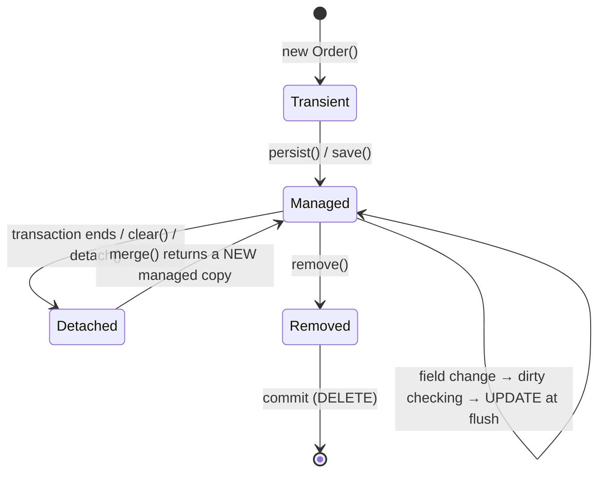

# JPA & Hibernate pitfalls

> **TL;DR** JPA manages entities through a **persistence context** (first-level cache + dirty checking) that lives for one transaction. Most production problems come from **N+1 queries**, **lazy loading outside a transaction**, **EAGER defaults on `@ManyToOne`**, **IDENTITY ids disabling batch inserts**, and **lost updates** without `@Version`. Fetch what you need explicitly, per use case.

## Mental model: entity states



Inside a transaction, a **managed** entity is tracked: change a field and Hibernate issues an `UPDATE` at flush/commit, **without** calling `save()`. Load the same id twice and you get the **same instance** (first-level cache).

## Deep dive

### Default fetch types (memorise)

| Relationship | Default |
|---|---|
| `@ManyToOne` | **EAGER** |
| `@OneToOne` | **EAGER** |
| `@OneToMany` | LAZY |
| `@ManyToMany` | LAZY |

Make **everything LAZY** (`@ManyToOne(fetch = FetchType.LAZY)`) and fetch explicitly per query. EAGER is applied everywhere, can't be turned off per query, and causes surprise N+1s.

### The N+1 problem

```java
List<Order> orders = orderRepo.findAll();              // 1 query
for (Order o : orders) o.getCustomer().getName();      // +N queries if customer isn't fetched
```

Fixes:

| Fix | Example | Notes |
|---|---|---|
| JOIN FETCH | `select o from Order o join fetch o.customer` | per-query, explicit |
| `@EntityGraph` | `@EntityGraph(attributePaths = "customer") List<Order> findByStatus(...)` | works with derived queries |
| Batch fetching | `spring.jpa.properties.hibernate.default_batch_fetch_size=50` | turns N queries into N/50 `IN (...)` queries; good global safety net |
| DTO projection | `select new com.acme.OrderView(o.id, c.name) from Order o join o.customer c` | best for read-only screens; no entities, no dirty checking |

**Detect it:** enable SQL logging or statistics in tests (`hibernate.generate_statistics=true`), or assert query counts.

### Fetch-join pitfalls

- **Pagination + collection fetch join**: Hibernate can't apply `LIMIT` in SQL, so it fetches everything and paginates **in memory** (logs a warning, HHH90003004). Fix: page the parent ids first, then fetch-join by `id in (:ids)`, or use batch fetching.
- **`MultipleBagFetchException`**: fetch-joining two `List` collections at once. Use `Set`, or fetch them in separate queries (also avoids a cartesian product).

### LazyInitializationException

Accessing a lazy association **after** the persistence context is closed (outside the transaction), e.g., in a controller or during JSON serialisation.

Fixes: fetch what's needed inside the service transaction (JOIN FETCH / entity graph), or return **DTOs** from the service. Don't fix it with EAGER.

**Open Session in View**: Spring Boot enables `spring.jpa.open-in-view=true` by default (and logs a warning). It keeps the session open during view rendering, hiding lazy-loading problems and holding DB connections for the whole request. Most teams set it to **false**.

### `save()` semantics in Spring Data

- New entity (null id, or null `@Version`) → `persist`.
- Otherwise → `merge`, which **returns a different managed instance**. Use the return value: `entity = repo.save(entity);`.
- Calling `save()` on an already **managed** entity is redundant; dirty checking handles it.

### ID generation and batching

- `GenerationType.IDENTITY` (auto-increment): Hibernate must insert immediately to learn the id, so **JDBC batch inserts are disabled**.
- `GenerationType.SEQUENCE` with an `allocationSize` (pooled optimizer) allows batching. Turn on `hibernate.jdbc.batch_size=50`, `hibernate.order_inserts=true`, `hibernate.order_updates=true`.
- For bulk loads, flush and `clear()` the persistence context every batch, or memory grows.

### Bulk operations bypass the persistence context

```java
@Modifying(clearAutomatically = true)
@Query("update Product p set p.price = p.price * 1.1 where p.category = :c")
int raisePrices(@Param("c") String c);
```

JPQL bulk updates/deletes go straight to the DB; managed entities in memory become **stale** unless you clear. Also, `deleteAll()` loads every entity and deletes them **one by one**; `deleteAllInBatch()` issues one statement (and skips cascades and lifecycle callbacks).

### Relationships

- **Owning side** = the side with the foreign key (`@ManyToOne`, or the side without `mappedBy`). **Only changes on the owning side are persisted.** Setting only `customer.getOrders().add(order)` saves nothing about the link.
- Keep both sides in sync with helper methods:

```java
public void addItem(OrderItem item) { items.add(item); item.setOrder(this); }
public void removeItem(OrderItem item) { items.remove(item); item.setOrder(null); }
```

- `cascade = CascadeType.ALL` belongs on parent → child (`@OneToMany`), **never** on `@ManyToOne` (deleting an order would delete the customer).
- `orphanRemoval = true` deletes a child removed from the collection.

### equals/hashCode for entities

- Don't use Lombok `@Data` on entities: generated `hashCode`/`toString` touch lazy associations (extra queries, `LazyInitializationException`, infinite recursion in bidirectional relations).
- A database-generated id is `null` before persist, so an entity's hash code would change after saving, breaking `HashSet`s. Use a **natural/business key**, or an id-based `equals` with a **constant** `hashCode`.

### Concurrency: lost updates

```java
@Entity class Account {
    @Id Long id;
    @Version Long version;     // optimistic locking
    BigDecimal balance;
}
```

- **Optimistic** (`@Version`): `UPDATE ... WHERE id=? AND version=?`; if 0 rows change, Spring throws `ObjectOptimisticLockingFailureException`. Retry or report a conflict. Best for low contention.
- **Pessimistic**: `@Lock(LockModeType.PESSIMISTIC_WRITE)` on a repository method → `SELECT ... FOR UPDATE`. Best for high-contention hot rows (e.g., wallet balance), within a short transaction, acquiring rows in a consistent order to avoid deadlocks.

## Traps

- "`@ManyToOne` is lazy by default." It's **EAGER**.
- "You must call `save()` after changing a managed entity." Dirty checking handles it.
- "`IDENTITY` ids batch fine." They disable insert batching in Hibernate.
- "Fetch join + `Pageable` paginates in SQL." Not with collection fetches.
- "`deleteAll()` is one DELETE statement." It loads and deletes one by one.
- "Adding to the inverse side's collection persists the relationship." Only the owning side counts.

## Say it out loud

**"How do you find and fix N+1 queries?"**
I catch them in tests by logging SQL or asserting the query count with Hibernate statistics. Then I fix per use case: a fetch join or entity graph when I need the entities, a DTO projection for read-only views, and a global `default_batch_fetch_size` as a safety net. I keep all associations lazy so nothing loads by surprise.

**"Two users update the same account balance at once. How do you prevent a lost update?"**
For low contention, optimistic locking with `@Version`, and retry on conflict. For a hot row like a wallet balance, a pessimistic `SELECT ... FOR UPDATE` in a short transaction, or an atomic SQL update such as `balance = balance - :amt WHERE balance >= :amt`.

## Practice MCQs

**Q1.** Default fetch type of `@ManyToOne`:
- A) LAZY
- B) EAGER
- C) Depends on the database
- D) NONE

<details markdown="1"><summary>Answer</summary>

**B.**
</details>

**Q2.** Inside a `@Transactional` method you load an entity and call `setName("x")`, without calling `save()`. At commit:
- A) Nothing is written
- B) An UPDATE is issued by dirty checking
- C) An exception is thrown
- D) An INSERT is issued

<details markdown="1"><summary>Answer</summary>

**B.**
</details>

**Q3.** Which id strategy prevents Hibernate from batching inserts?
- A) SEQUENCE
- B) TABLE
- C) IDENTITY
- D) UUID assigned in code

<details markdown="1"><summary>Answer</summary>

**C.**
</details>

**Q4.** A controller serialises an entity and hits `LazyInitializationException` with `open-in-view=false`. Best fix:
- A) Make the association EAGER
- B) Turn `open-in-view` back on
- C) Fetch the needed data in the service transaction or return a DTO
- D) Catch the exception

<details markdown="1"><summary>Answer</summary>

**C.**
</details>

**Q5.** A query fetch-joins a `@OneToMany` collection and uses `Pageable`. Hibernate:
- A) Applies LIMIT in SQL correctly
- B) Loads all rows and paginates in memory, with a warning
- C) Throws `MultipleBagFetchException`
- D) Ignores the fetch join

<details markdown="1"><summary>Answer</summary>

**B.** (Hibernate 6 can be configured to fail instead.)
</details>

**Q6.** Two transactions update the same `@Version`ed entity concurrently. The second to commit gets:
- A) A silent overwrite
- B) `ObjectOptimisticLockingFailureException`
- C) A deadlock
- D) `LazyInitializationException`

<details markdown="1"><summary>Answer</summary>

**B.**
</details>

**Q7.** You only call `customer.getOrders().add(order)` on a bidirectional relationship where `Order.customer` is the owning side. After commit:
- A) The foreign key is set
- B) The link is not persisted
- C) Hibernate throws
- D) A join table row is created

<details markdown="1"><summary>Answer</summary>

**B.** Set `order.setCustomer(customer)` too (use a helper method).
</details>

**Q8.** After a `@Modifying` JPQL bulk update without `clearAutomatically`, entities already loaded in the same persistence context:
- A) Are refreshed automatically
- B) May hold stale values
- C) Are detached
- D) Are deleted

<details markdown="1"><summary>Answer</summary>

**B.**
</details>

## Related

- [Transactions](04-transactions.md)
- [Boot internals](02-boot-internals.md)
