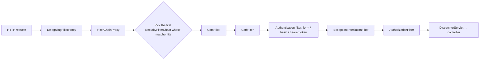
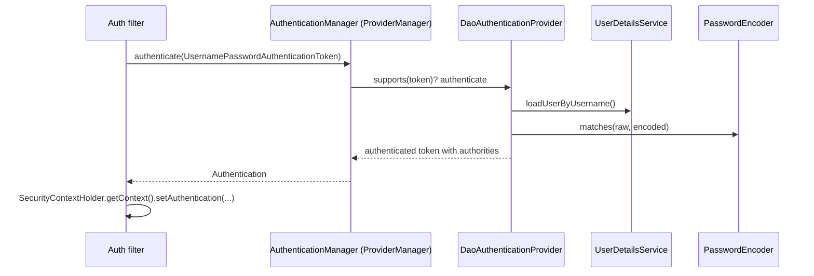

# Spring Security

> **TL;DR** Spring Security is a **chain of servlet filters** that every request passes through before it reaches your controllers. One filter extracts credentials (a password, a token), the **`AuthenticationManager`** verifies them, the result (who the user is and what they may do) is stored in the **`SecurityContext`** (thread-local, so it's available anywhere on that request's thread), and authorization checks run against it. **401** means "who are you?" (not authenticated); **403** means "I know who you are, but no" (authenticated but not allowed). In Spring Security 6 you configure it with a **`SecurityFilterChain` bean**; the old `WebSecurityConfigurerAdapter` base class is gone.

## Mental model: the filter chain



A **servlet filter** is code that runs before (and after) the request reaches the servlet, and can modify the request, reject it, or pass it on. Security is implemented as filters so it runs **before any of your code**, and an unauthorised request never reaches a controller.

- **`DelegatingFilterProxy`**: a plain servlet filter registered with the web server (Tomcat). The server knows nothing about Spring beans, so this filter's only job is to hand each request to a Spring-managed bean.
- **`FilterChainProxy`**: that Spring bean. It holds one or more **`SecurityFilterChain`s**, picks the **first** one whose request matcher fits the URL, and runs that chain's filters in order.
- The filters, in order:
    - **`CorsFilter`**: handles cross-origin rules and answers browser preflight requests (below).
    - **`CsrfFilter`**: for state-changing requests (POST, PUT, DELETE), checks that a valid CSRF token is present (below).
    - **Authentication filter(s)**: look for credentials in the request (a login form, an HTTP Basic header, a `Bearer` token) and, if present, try to authenticate. If there are no credentials, they let the request through as anonymous; the authorization step decides whether that's OK.
    - **`ExceptionTranslationFilter`**: catches security exceptions thrown further down and turns them into HTTP responses: **401** (or a redirect to the login page) if the user isn't authenticated, **403** if they are but lack permission.
    - **`AuthorizationFilter`**: checks the URL rules (`authorizeHttpRequests`) against the current user. If they fail, it throws, and the exception translation filter produces the response.
- Only then does the request reach Spring MVC's **`DispatcherServlet`** and your controller.

### Authentication flow



1. The authentication filter wraps the credentials it found in an **unauthenticated** `Authentication` object, here a `UsernamePasswordAuthenticationToken` holding the username and raw password, and passes it to the **`AuthenticationManager`**.
2. The standard implementation, **`ProviderManager`**, holds a list of **`AuthenticationProvider`s** (one per way of authenticating: database passwords, LDAP, JWT...). It asks each one "do you `support` this kind of token?" and hands the token to the first that does.
3. **`DaoAuthenticationProvider`** (for username/password) calls your **`UserDetailsService.loadUserByUsername()`** to load the stored user: username, **encoded** password hash, enabled/locked flags and authorities.
4. It calls **`PasswordEncoder.matches(raw, encoded)`**, which hashes the submitted password the same way and compares it with the stored hash. The stored password is never decrypted, because a proper hash can't be.
5. On success, it returns a new, **authenticated** `Authentication` containing the user (the *principal*) and their **authorities** (permissions), with the password erased. On failure, it throws an `AuthenticationException` (e.g. `BadCredentialsException`).
6. The filter stores the authenticated object in the **`SecurityContextHolder`**, so authorization checks and your code can ask "who is the current user?" for the rest of the request.

## Deep dive

### A typical stateless API configuration

```java
@Configuration
@EnableMethodSecurity                       // enables @PreAuthorize / @PostAuthorize on bean methods
class SecurityConfig {

    @Bean
    SecurityFilterChain api(HttpSecurity http) throws Exception {
        return http
            .csrf(csrf -> csrf.disable())                         // stateless token API: no session cookies, so CSRF can't happen
            .cors(Customizer.withDefaults())                      // use the CorsConfigurationSource bean for cross-origin rules
            .sessionManagement(s -> s.sessionCreationPolicy(SessionCreationPolicy.STATELESS)) // never create an HTTP session
            .authorizeHttpRequests(auth -> auth                   // URL rules, checked top to bottom, first match wins
                .requestMatchers("/actuator/health", "/auth/**").permitAll()      // public endpoints
                .requestMatchers(HttpMethod.DELETE, "/api/**").hasRole("ADMIN")   // deletes need ROLE_ADMIN
                .requestMatchers("/api/**").authenticated()                       // any other API call needs a logged-in user
                .anyRequest().denyAll())                                          // everything not listed is refused (safe default)
            .oauth2ResourceServer(o -> o.jwt(Customizer.withDefaults()))   // authenticate requests via JWT bearer tokens
            .build();
    }

    @Bean
    PasswordEncoder passwordEncoder() {
        return PasswordEncoderFactories.createDelegatingPasswordEncoder(); // BCrypt by default; stores "{bcrypt}..."
    }
}
```

- **Order matters:** request matchers are checked **top to bottom and the first match wins**, so later rules are never consulted for a URL that already matched. Put specific rules (`/api/public/**`) before general ones (`/api/**`), and `anyRequest()` last (Spring Security throws at startup if anything comes after `anyRequest()`). Ending with `denyAll()` means a forgotten endpoint is closed by default rather than open.
- **Multiple `SecurityFilterChain` beans can coexist**, e.g. a stateless JWT chain for `/api/**` and a session-based form-login chain for an admin UI. Give each a `securityMatcher("/api/**")` and order them with `@Order`; each request is handled by the **first** chain whose matcher fits, and only that chain.
- **Spring Security 6 removed `antMatchers`/`mvcMatchers`**: use `requestMatchers(...)`, which picks the right matching strategy automatically.

### Defaults when you add the starter and configure nothing

Adding `spring-boot-starter-security` without any configuration makes the app **secure by default**:

- **Every endpoint requires authentication**, including ones you didn't think about.
- **Form login** (a generated `/login` page) **and HTTP Basic** are enabled.
- **One user named `user`** is created, with a **random password printed in the startup logs** ("Using generated security password: ..."). It changes on every restart and is meant only to get you started; set your own with `spring.security.user.*` or a `UserDetailsService`.
- **CSRF protection on**, security response headers on (`X-Content-Type-Options`, `X-Frame-Options`, cache control, HSTS on HTTPS), and **session fixation protection** on (the session id is changed at login, so an attacker who planted a session id beforehand can't hijack the logged-in session).

As soon as you declare your own `SecurityFilterChain` bean, Boot's default chain backs off and only your rules apply.

### Roles vs authorities

- An **authority** (`GrantedAuthority`) is any permission string, such as `orders:write` or `SCOPE_read`. A **role** is just an authority whose name starts with the prefix **`ROLE_`**, e.g. `ROLE_ADMIN`. Spring Security has no separate "role" type; the prefix is purely a naming convention.
- **`hasRole("ADMIN")` checks for the authority `ROLE_ADMIN`**: it adds the prefix for you. **`hasAuthority("ADMIN")`** checks for exactly `ADMIN`, with nothing added. Mixing them up is a classic 403 bug: users stored with authority `ADMIN` fail a `hasRole("ADMIN")` check (which wants `ROLE_ADMIN`), and `hasRole("ROLE_ADMIN")` is rejected because the prefix would be doubled. Also note that JWT scopes are mapped to authorities with a `SCOPE_` prefix by default (`hasAuthority("SCOPE_orders.read")`).

### 401 vs 403

| Status | Meaning | Handled by |
|---|---|---|
| **401 Unauthorized** | **Not authenticated**: no credentials, invalid credentials, or an expired token. The client should authenticate and try again. (Despite the name, it really means "unauthenticated".) | `AuthenticationEntryPoint`, which decides how to ask for credentials: a `WWW-Authenticate` header for Basic or Bearer, or a redirect to the login page for form login. |
| **403 Forbidden** | **Authenticated, but not permitted**: the user is known but lacks the required role or authority. Re-authenticating won't help. Also returned when a CSRF token is missing or invalid. | `AccessDeniedHandler`. |

A **POST that returns 403** in a fresh app is very often **CSRF**, not a permissions problem: CSRF protection is on by default, and tools like Postman or curl don't send the CSRF token that a browser form would include. GETs work, so it looks like a mysterious permission problem with writes only.

### CSRF and CORS

- **CSRF (cross-site request forgery)**: browsers automatically attach your cookies to every request sent to a site, **even when the request was triggered by a different, malicious site**. If you're logged in to `bank.com` via a session cookie, a hidden form on `evil.com` can submit `POST bank.com/transfer`, and your browser helpfully adds the session cookie, so the bank sees an authenticated request. The defence is a **CSRF token**: a random value the server puts in its own pages and requires on every state-changing request. `evil.com` can't read it (the same-origin policy prevents that), so it can't forge it.
    - **Keep CSRF protection enabled for cookie- or session-based browser apps.**
    - It's **safe to disable for stateless APIs** that authenticate with an **`Authorization: Bearer <token>`** header, because the browser **never attaches that header automatically**: the attacker's page would have to know the token, and if it knew the token, CSRF would be the least of your problems. If you store a token in a *cookie*, CSRF applies again.
- **CORS (cross-origin resource sharing)**: by default, a browser blocks JavaScript on `app.example.com` from reading responses from `api.example.com`, a different *origin* (scheme + host + port). CORS is how the API **opts in**: it sends headers such as `Access-Control-Allow-Origin: https://app.example.com`. For non-simple requests (custom headers like `Authorization`, JSON bodies, PUT and DELETE) the browser first sends a **preflight** `OPTIONS` request to ask permission. CORS is a **browser** rule: it doesn't protect your API from curl or other servers, and it is not an authentication mechanism.
    - Configure it **in Spring Security** (`http.cors(...)` plus a `CorsConfigurationSource` bean). The preflight `OPTIONS` request carries **no credentials**, so if CORS is only configured in Spring MVC (`@CrossOrigin`, `WebMvcConfigurer`), the security filters run first, see an unauthenticated request, and reject it with 401 before MVC can answer it, so the browser reports a CORS error.

### JWT, briefly

A **JWT (JSON Web Token)** is a signed token with three Base64-encoded parts, `header.payload.signature`. The payload holds **claims**: who the user is (`sub`), who issued the token (`iss`), who it is for (`aud`), when it expires (`exp`), plus roles or scopes. Anyone can *read* the payload (it is only encoded, not encrypted), but nobody can *change* it without invalidating the signature.

- **Stateless**: to authenticate a request, the server just verifies the signature and checks the expiry. **No session lookup** and no shared session store are needed, so any instance can handle any request, and the service **scales horizontally** easily.
- **Hard to revoke**: since the server stores nothing, a stolen or no-longer-valid token stays valid until it expires. Mitigations: **short-lived access tokens** (5–15 minutes) plus longer-lived **refresh tokens** (which *are* checked against the server and can be revoked) to get new ones, and a **deny-list** of token ids for emergencies (which reintroduces some state).
- **Validate everything**: the signature, `iss` (a trusted issuer), `aud` (meant for *this* API, not some other service), and `exp`. **Never accept `alg: none`** (an unsigned token: a classic attack is to change the header to "none" and strip the signature). When tokens come from an identity provider (Keycloak, Auth0, Okta, Entra ID), prefer **asymmetric** signatures (RS256/ES256): the provider signs with its private key, and your API verifies with the public key published at a **JWKS** endpoint. That way your API holds no secret that could be used to mint tokens. Spring's resource server does all this when you set `spring.security.oauth2.resourceserver.jwt.issuer-uri`.
- **Storage in browsers**: `localStorage` is readable by any JavaScript on the page, so one **XSS** (injected script) vulnerability can steal the token. An **`HttpOnly`** (invisible to JavaScript), **`Secure`** (HTTPS only), **`SameSite`** (not sent on most cross-site requests) cookie avoids that, but because cookies are sent automatically, it **brings CSRF back into scope**. Many teams use a backend-for-frontend that keeps tokens server-side and gives the browser only a session cookie.

### Method security

```java
@PreAuthorize("hasRole('ADMIN') or #userId == authentication.name")  // checked BEFORE the method runs; #userId refers to the parameter
public UserDto getUser(String userId) { ... }                         // admins can read anyone; users only themselves

@PostAuthorize("returnObject.ownerId == authentication.name")        // checked AFTER: the method runs, then the result is inspected
public Document load(long id) { ... }                                 // throws AccessDeniedException (403) if it's not the caller's document
```

URL rules can't express "users may only read their *own* records", because that depends on the data. **Method security** expresses such rules in SpEL (Spring Expression Language) directly on service methods: `authentication` is the current user, `#paramName` refers to method arguments, and `returnObject` is the result (in `@PostAuthorize`). Note that `@PostAuthorize` still executes the method, so it must not have side effects.

Enable it with **`@EnableMethodSecurity`**. It is **proxy-based**, exactly like `@Transactional`, so **self-invocation bypasses it**, and so do `private` methods and objects not managed by Spring (see [Proxies & AOP](03-proxies-aop.md)). A security check that silently doesn't run is a vulnerability, so put these annotations on methods called from other beans, typically service entry points.

### SecurityContext and threads

- The `SecurityContext` is stored in a **`ThreadLocal`** by default, so every piece of code running on the request's thread can find the current user without passing it around. Code on **another thread** (`@Async` methods, executors, `CompletableFuture.supplyAsync`, parallel streams) sees **no authentication** (`getAuthentication()` returns `null`) unless you **propagate** it explicitly: wrap the executor in `DelegatingSecurityContextExecutor` / `DelegatingSecurityContextAsyncTaskExecutor`, or use the Micrometer context-propagation support.
- **Getting the current user**: `SecurityContextHolder.getContext().getAuthentication()` anywhere on the request thread, or, more cleanly in controllers, a parameter annotated **`@AuthenticationPrincipal`** (e.g. `@AuthenticationPrincipal Jwt jwt` or your own `UserDetails` type), which is also easy to supply in tests.

### Passwords

- Use **BCrypt** (or **Argon2**, **SCrypt**, **PBKDF2**). These are password hashing functions designed to be:
    - **slow**: deliberately expensive (BCrypt's *work factor*), so an attacker who steals the database can only try thousands of guesses per second instead of billions;
    - **salted**: a random value is generated per password and stored with the hash, so two users with the same password get different hashes, and precomputed lookup ("rainbow") tables are useless;
    - **adaptive**: the cost can be raised over time as hardware gets faster.
- **Never use MD5/SHA-1/SHA-256 alone**: they are designed to be *fast*, so GPUs can try billions per second. **Never use reversible encryption** (like AES): if the key leaks, every password leaks, and there is no reason the server ever needs the original password back.
- **`DelegatingPasswordEncoder`** prefixes each stored hash with its algorithm id, e.g. `{bcrypt}$2a$10$...`. When checking a password, it reads the prefix and uses the matching encoder. That lets you **upgrade algorithms later**: new passwords are hashed with the new default, old ones still verify, and they can be re-hashed when users next log in.

### Other API security basics

- **Bind requests to DTOs, not entities.** If a controller accepts a `User` entity directly, a client can add `"isAdmin": true` to the JSON and Jackson will happily set it (**mass assignment**). A dedicated request DTO contains only the fields a client is allowed to set.
- **Parameterised queries only** (JPA parameters, `JdbcTemplate` with `?`, Spring Data derived queries). Never build SQL by concatenating user input, which enables **SQL injection**: input like `' OR '1'='1` changes the meaning of the query.
- **Rate-limit login and expensive endpoints**, and lock out or slow down repeated failed logins, to stop **brute-force** and credential-stuffing attacks.
- **Keep secrets out of the repository**: no passwords or API keys in `application.yml` committed to git. Inject them from environment variables, HashiCorp Vault, or a cloud secret manager.
- **Don't expose Actuator `env` or `heapdump` publicly**; they can leak secrets (see [Boot internals](02-boot-internals.md)).

## Traps

- "`WebSecurityConfigurerAdapter` is how you configure security." It was deprecated in Spring Security 5.7 and **removed in 6**. Declare a `SecurityFilterChain` bean instead.
- "`hasRole('ROLE_ADMIN')` is the correct form." `hasRole` adds the `ROLE_` prefix itself, so write `hasRole('ADMIN')`, or use `hasAuthority('ROLE_ADMIN')` for the full name.
- "403 means wrong password." Wrong or missing credentials are **401** (not authenticated); 403 means authenticated but not permitted, or a missing CSRF token.
- "Disable CSRF everywhere." Only for stateless APIs that don't authenticate with cookies. Browser apps with session or auth cookies need it.
- "The SecurityContext follows `@Async` calls." **Not by default**: it's thread-local. Propagate it with a delegating executor.

## Say it out loud

**"Walk me through how a request is authenticated."**
The request passes through Spring Security's filter chain before reaching any controller. An authentication filter, say the bearer-token filter, extracts the credentials and hands them to the AuthenticationManager, which delegates to the provider that supports that credential type: for a JWT, it validates the signature, issuer, audience and expiry; for a username and password, it loads the user through the UserDetailsService and checks the password against the stored BCrypt hash. On success, the authenticated object, with the user's authorities, is stored in the SecurityContext for the current thread, and then the authorization filter's URL rules and any `@PreAuthorize` checks are evaluated against it. Failures are turned into HTTP responses by the exception translation filter: 401 through the authentication entry point if the user isn't authenticated, or 403 through the access-denied handler if they are but lack permission.

## Practice MCQs

**Q1.** An authenticated user without the required role calls an endpoint. Response:

- A) 400
- B) 401
- C) 403
- D) 404

<details markdown="1"><summary>Answer</summary>

**C.** The user's identity is known, so the problem is permission, not authentication, and the `AccessDeniedHandler` returns 403 Forbidden. 401 (B) is for missing or invalid credentials. 400 (A) is for malformed requests. 404 (D) is sometimes deliberately returned to hide that a resource exists, but it isn't Spring Security's default.
</details>

**Q2.** `hasRole("ADMIN")` checks for which authority?

- A) `ADMIN`
- B) `ROLE_ADMIN`
- C) `admin`
- D) `AUTHORITY_ADMIN`

<details markdown="1"><summary>Answer</summary>

**B.** `hasRole` automatically prepends the `ROLE_` prefix, so it looks for the exact authority string `ROLE_ADMIN`. To check for a plain `ADMIN` authority (A), use `hasAuthority("ADMIN")`. Matching is case-sensitive, so C wouldn't match, and the `AUTHORITY_` prefix (D) doesn't exist.
</details>

**Q3.** A brand-new Spring Boot app with Spring Security returns 403 on every POST from Postman, even with valid Basic credentials. Most likely cause:

- A) Wrong password
- B) CSRF protection is enabled and no token is sent
- C) CORS
- D) Missing `@EnableWebSecurity`

<details markdown="1"><summary>Answer</summary>

**B.** CSRF protection is on by default and applies to state-changing methods like POST. Postman doesn't send the CSRF token, so `CsrfFilter` rejects the request with 403 even though authentication succeeded. A wrong password (A) would give 401. CORS (C) is enforced by browsers only, and Postman is not a browser. Boot enables web security automatically, so D isn't needed.
</details>

**Q4.** In Spring Security 6, the recommended way to configure HTTP security is:

- A) Extend `WebSecurityConfigurerAdapter`
- B) Declare a `SecurityFilterChain` bean
- C) Edit `web.xml`
- D) Use `@Secured` on every controller

<details markdown="1"><summary>Answer</summary>

**B.** Since Spring Security 5.7 the component-based style is recommended, and in 6 `WebSecurityConfigurerAdapter` (A) was removed entirely: you declare one or more `SecurityFilterChain` beans built with `HttpSecurity`. `web.xml` (C) isn't used by Boot's embedded server. `@Secured` (D) is method-level security, which complements URL rules rather than replacing the filter chain configuration.
</details>

**Q5.** Rules are `.requestMatchers("/api/**").authenticated()` followed by `.requestMatchers("/api/public/**").permitAll()`. An anonymous call to `/api/public/info`:

- A) Allowed
- B) Rejected with 401
- C) Startup fails in every version
- D) Allowed only with CORS

<details markdown="1"><summary>Answer</summary>

**B.** Rules are evaluated top to bottom and the first match wins. `/api/public/info` already matches `/api/**`, which requires authentication, so the `permitAll` rule below it is never reached, and the anonymous request gets 401. (Recent versions may also detect some unreachable rules and fail at startup; either way, put more specific matchers first.) CORS (D) is unrelated to authorization.
</details>

**Q6.** Inside an `@Async` method, `SecurityContextHolder.getContext().getAuthentication()` returns `null`. Why?

- A) The user logged out
- B) The context is thread-local and wasn't propagated to the executor thread
- C) `@Async` disables security
- D) JWT expired

<details markdown="1"><summary>Answer</summary>

**B.** The default strategy keeps the `SecurityContext` in a `ThreadLocal` bound to the request thread, and `@Async` runs the method on a different executor thread, which has an empty context. Wrap the executor with `DelegatingSecurityContextAsyncTaskExecutor` (or use context propagation) to copy the context over. Nothing about the user's session or token changed (A, D), and `@Async` doesn't disable anything (C).
</details>

**Q7.** Best password storage choice:

- A) SHA-256 with a global salt
- B) AES encryption
- C) BCrypt via `DelegatingPasswordEncoder`
- D) MD5

<details markdown="1"><summary>Answer</summary>

**C.** BCrypt is deliberately slow, uses a random salt per password and has a tunable cost. `DelegatingPasswordEncoder` stores the algorithm id with each hash, so you can migrate to a stronger algorithm later. SHA-256 (A) is far too fast to resist GPU guessing, and a *global* salt means identical passwords still share a hash. AES (B) is reversible, so one leaked key exposes every password. MD5 (D) is both fast and broken.
</details>

## Related

- [Proxies & AOP](03-proxies-aop.md): method security is proxy-based, so self-invocation bypasses `@PreAuthorize`.
- [Web & testing](07-web-testing.md): testing secured endpoints with `@WithMockUser` and MockMvc.
