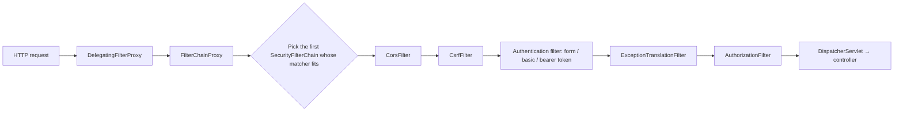
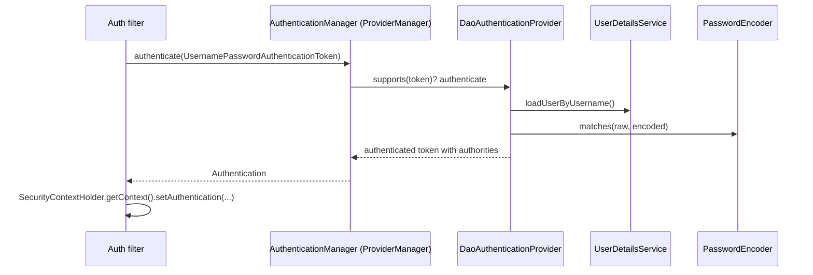

# Spring Security

> **TL;DR** Spring Security is a **chain of servlet filters** in front of your app. One filter extracts credentials, the **AuthenticationManager** verifies them, the result goes into the **SecurityContext** (thread-local), and authorization checks run against it. **401** means "who are you?" (not authenticated); **403** means "I know you, but no" (not authorised). In Spring Security 6 you configure it with a **`SecurityFilterChain` bean**; `WebSecurityConfigurerAdapter` is gone.

## Mental model: the filter chain



### Authentication flow



## Deep dive

### A typical stateless API configuration

```java
@Configuration
@EnableMethodSecurity                       // enables @PreAuthorize etc.
class SecurityConfig {

    @Bean
    SecurityFilterChain api(HttpSecurity http) throws Exception {
        return http
            .csrf(csrf -> csrf.disable())                         // stateless token API, no cookies
            .cors(Customizer.withDefaults())
            .sessionManagement(s -> s.sessionCreationPolicy(SessionCreationPolicy.STATELESS))
            .authorizeHttpRequests(auth -> auth
                .requestMatchers("/actuator/health", "/auth/**").permitAll()
                .requestMatchers(HttpMethod.DELETE, "/api/**").hasRole("ADMIN")
                .requestMatchers("/api/**").authenticated()
                .anyRequest().denyAll())
            .oauth2ResourceServer(o -> o.jwt(Customizer.withDefaults()))   // validate JWT bearer tokens
            .build();
    }

    @Bean
    PasswordEncoder passwordEncoder() {
        return PasswordEncoderFactories.createDelegatingPasswordEncoder(); // stores "{bcrypt}..."
    }
}
```

- **Order matters:** request matchers are checked top to bottom and the **first match wins**. Put specific rules before general ones; `anyRequest()` last.
- Multiple `SecurityFilterChain` beans can coexist (e.g., one for `/api/**`, one for the admin UI), ordered with `@Order`.
- Spring Security 6 removed `antMatchers`/`mvcMatchers`; use `requestMatchers`.

### Defaults when you add the starter and configure nothing

- Every endpoint requires authentication.
- Form login and HTTP Basic are enabled.
- A user named `user` with a random password printed in the logs.
- CSRF protection **on**, security headers on, session fixation protection on.

### Roles vs authorities

- An **authority** is any string (`orders:write`). A **role** is an authority with the `ROLE_` prefix.
- `hasRole("ADMIN")` checks for authority `ROLE_ADMIN`. `hasAuthority("ADMIN")` checks for exactly `ADMIN`. Mixing them up is a classic 403 bug.

### 401 vs 403

| Status | Meaning | Handled by |
|---|---|---|
| **401 Unauthorized** | not authenticated (missing/invalid credentials) | `AuthenticationEntryPoint` |
| **403 Forbidden** | authenticated but lacks permission (or CSRF token missing) | `AccessDeniedHandler` |

A **POST that returns 403** in a fresh app is very often **CSRF**, not a permissions problem.

### CSRF and CORS

- **CSRF** attacks abuse cookies the browser sends automatically. Keep it **enabled** for cookie/session-based browser apps. It's safe to disable for **stateless** APIs authenticated with an `Authorization: Bearer` header (browsers don't attach that automatically).
- **CORS** is a browser rule about which origins may call your API. Configure it in Spring Security (`http.cors(...)` with a `CorsConfigurationSource`), otherwise preflight `OPTIONS` requests may be rejected before reaching your MVC CORS config.

### JWT, briefly

- Stateless: the server validates the signature and expiry, with no session lookup. Scales horizontally.
- Hard to **revoke**: use short-lived access tokens (5–15 min) plus refresh tokens, and a deny-list for emergencies.
- Validate `iss`, `aud`, `exp`; never accept `alg: none`; prefer asymmetric keys (RS256/ES256) with a JWKS endpoint when tokens come from an identity provider.
- Storage in browsers: `localStorage` is exposed to XSS; an `HttpOnly`, `Secure`, `SameSite` cookie avoids that but brings CSRF back into scope.

### Method security

```java
@PreAuthorize("hasRole('ADMIN') or #userId == authentication.name")
public UserDto getUser(String userId) { ... }

@PostAuthorize("returnObject.ownerId == authentication.name")
public Document load(long id) { ... }
```

Enabled with `@EnableMethodSecurity`. It's **proxy-based**, so self-invocation bypasses it (see [Proxies & AOP](03-proxies-aop.md)).

### SecurityContext and threads

- Stored in a **ThreadLocal** by default. Code on another thread (`@Async`, executors, `CompletableFuture`) sees **no authentication** unless you propagate it (`DelegatingSecurityContextExecutor`, or Spring's context propagation support).
- Get the current user with `SecurityContextHolder.getContext().getAuthentication()` or `@AuthenticationPrincipal` in controllers.

### Passwords

- Use **BCrypt** (or Argon2/SCrypt/PBKDF2): slow, salted, adaptive. Never MD5/SHA-x alone, never reversible encryption.
- `DelegatingPasswordEncoder` stores the algorithm id (`{bcrypt}$2a$10$...`) so you can upgrade algorithms later.

### Other API security basics

- Bind requests to **DTOs**, not entities (prevents mass assignment of fields like `isAdmin`).
- Parameterised queries / JPA parameters only (SQL injection).
- Rate-limit login and expensive endpoints; lock out or slow down brute force.
- Keep secrets out of the repo (environment, Vault, cloud secret managers).
- Don't expose Actuator `env`/`heapdump` publicly.

## Traps

- "`WebSecurityConfigurerAdapter` is how you configure security." Removed in Spring Security 6.
- "`hasRole('ROLE_ADMIN')`" is the correct form. `hasRole` adds the prefix itself; use `hasRole('ADMIN')`.
- "403 means wrong password." Wrong/missing credentials are **401**.
- "Disable CSRF everywhere." Only for stateless, non-cookie APIs.
- "The SecurityContext follows `@Async` calls." Not by default.

## Say it out loud

**"Walk me through how a request is authenticated."**
The request passes through Spring Security's filter chain. An authentication filter, say the bearer-token filter, extracts credentials and calls the AuthenticationManager, which delegates to a provider that verifies them, for example by validating a JWT signature or by loading the user and checking a BCrypt hash. On success, the Authentication with its authorities is stored in the SecurityContext for the current thread, and the authorization filter and any `@PreAuthorize` checks use it. Failures turn into 401 via the entry point, or 403 via the access-denied handler.

## Practice MCQs

**Q1.** An authenticated user without the required role calls an endpoint. Response:
- A) 400
- B) 401
- C) 403
- D) 404

<details markdown="1"><summary>Answer</summary>

**C.**
</details>

**Q2.** `hasRole("ADMIN")` checks for which authority?
- A) `ADMIN`
- B) `ROLE_ADMIN`
- C) `admin`
- D) `AUTHORITY_ADMIN`

<details markdown="1"><summary>Answer</summary>

**B.**
</details>

**Q3.** A brand-new Spring Boot app with Spring Security returns 403 on every POST from Postman, even with valid Basic credentials. Most likely cause:
- A) Wrong password
- B) CSRF protection is enabled and no token is sent
- C) CORS
- D) Missing `@EnableWebSecurity`

<details markdown="1"><summary>Answer</summary>

**B.**
</details>

**Q4.** In Spring Security 6, the recommended way to configure HTTP security is:
- A) Extend `WebSecurityConfigurerAdapter`
- B) Declare a `SecurityFilterChain` bean
- C) Edit `web.xml`
- D) Use `@Secured` on every controller

<details markdown="1"><summary>Answer</summary>

**B.**
</details>

**Q5.** Rules are `.requestMatchers("/api/**").authenticated()` followed by `.requestMatchers("/api/public/**").permitAll()`. An anonymous call to `/api/public/info`:
- A) Allowed
- B) Rejected with 401
- C) Startup fails in every version
- D) Allowed only with CORS

<details markdown="1"><summary>Answer</summary>

**B.** The first matching rule wins. (Recent versions may also fail fast when a rule can never be reached; either way, put specific matchers first.)
</details>

**Q6.** Inside an `@Async` method, `SecurityContextHolder.getContext().getAuthentication()` returns `null`. Why?
- A) The user logged out
- B) The context is thread-local and wasn't propagated to the executor thread
- C) `@Async` disables security
- D) JWT expired

<details markdown="1"><summary>Answer</summary>

**B.**
</details>

**Q7.** Best password storage choice:
- A) SHA-256 with a global salt
- B) AES encryption
- C) BCrypt via `DelegatingPasswordEncoder`
- D) MD5

<details markdown="1"><summary>Answer</summary>

**C.**
</details>

## Related

- [Proxies & AOP](03-proxies-aop.md): method security is proxy-based.
- [Web & testing](07-web-testing.md)
