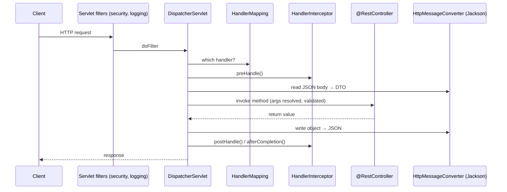

# Web, validation & testing

> **TL;DR** Every Spring MVC request flows **servlet filters → `DispatcherServlet` → `HandlerMapping` (which controller method?) → interceptors → controller → message converters (Java object ↔ JSON)**. Handle errors in one central place with `@RestControllerAdvice` and return the standard **`ProblemDetail`** error format. Validate input with `@Valid` on request DTOs. Test with the narrowest **slice** that covers the behaviour: `@WebMvcTest` for controllers, `@DataJpaTest` for repositories, `@SpringBootTest` + Testcontainers for end-to-end flows.

## Mental model: request flow



1. **Servlet filters** run first, inside the web server (Tomcat), before any Spring MVC code: Spring Security's filter chain, request logging, compression. A filter can reject the request outright.
2. The **`DispatcherServlet`** is Spring MVC's single *front controller*: every request comes through it, and it coordinates the rest.
3. It asks the **`HandlerMapping`** which controller method (the *handler*) matches the URL, HTTP method and headers, using your `@GetMapping`, `@PostMapping` and similar annotations. No match → 404.
4. **`HandlerInterceptor.preHandle()`** runs for that handler. It can stop the request by returning `false`.
5. **Argument resolution**: an **`HttpMessageConverter`** (Jackson, for JSON) converts the request body into your DTO for `@RequestBody`; path variables, query parameters and headers are converted to their types; `@Valid` arguments are validated.
6. Your **controller method** runs and returns a value (a DTO, a `ResponseEntity`).
7. The message converter **serialises** the return value to JSON, choosing the format from the request's `Accept` header.
8. **`postHandle()`** and **`afterCompletion()`** run on the interceptors. `afterCompletion` runs even when an exception occurred, so it is useful for cleanup and timing.
9. The response goes back out through the filters to the client.

## Deep dive

### Filter vs interceptor vs AOP

Three ways to run code "around" request handling, at different levels:

| | Servlet Filter | HandlerInterceptor | AOP aspect |
|---|---|---|---|
| Level | Servlet container, **before** Spring MVC: it wraps the whole `DispatcherServlet`. | Spring MVC, around the **chosen handler**. | **Any Spring bean method**, not just web code. |
| Sees | The raw request and response (it can wrap or replace them, e.g. to cache the body). Doesn't know which controller will handle the request. | The request **plus which handler matched** (the controller class and method, and its annotations). | The method's arguments and return value, as Java objects. |
| Good for | Security, CORS, request/response logging, compression, correlation ids: things that apply to *every* request, including those that never reach a controller. | Per-handler checks driven by annotations on the controller method, timing per endpoint, locale or tenant resolution. | Transactions, caching, retries, metrics on **service** methods, independent of HTTP. |

### Controllers

- **`@RestController` = `@Controller` + `@ResponseBody` on every method**: return values are written straight into the response body (as JSON), instead of being treated as the name of a view template to render.
- **Return `ResponseEntity` for full control** over status code and headers: `ResponseEntity.created(location).body(dto)` returns **201** with a `Location` header pointing at the new resource. Returning a plain DTO always gives 200 (unless you use `@ResponseStatus`).
- **Use correct status codes**, so clients and tools can react without parsing messages:
    - **201 Created** + `Location` header for successful creates.
    - **204 No Content** for successful requests with no body (typical for DELETE).
    - **400 Bad Request** for malformed input or failed validation.
    - **404 Not Found** when the resource doesn't exist.
    - **409 Conflict** when the request conflicts with the current state (a duplicate email, an optimistic-locking version mismatch).
    - **422 Unprocessable Content**: the input is well-formed but semantically invalid. Whether to use 400 or 422 for validation is a team convention; just be consistent.
- **Remember idempotency**: an operation is *idempotent* if doing it twice has the same effect as doing it once. GET, PUT ("set the resource to this") and DELETE should be idempotent, so clients and proxies can safely retry them after a timeout. POST ("create a new one") is **not**: retrying a timed-out "create payment" could charge twice. For such operations, have the client send an **idempotency key** header (a unique id per logical operation); the server stores the keys it has processed and returns the original result for a repeat instead of executing again.

### Validation

```java
public record CreateUserRequest(
        @NotBlank @Size(max = 100) String name,   // not null, not only whitespace, at most 100 characters
        @Email @NotBlank String email,            // must look like an email address (and be present: @Email alone accepts null)
        @Min(18) int age) {}

@PostMapping("/users")
ResponseEntity<UserDto> create(@Valid @RequestBody CreateUserRequest req) { ... } // @Valid: validate before the method runs
```

- **It needs `spring-boot-starter-validation`**, which brings Jakarta Bean Validation with Hibernate Validator as the implementation. Without it, the annotations are silently ignored and invalid data passes straight through, a common surprise because `spring-boot-starter-web` no longer includes it.
- **A failed `@Valid @RequestBody` throws `MethodArgumentNotValidException` → 400** by default, before your method body runs. The exception lists every field error, which you can turn into a helpful response in your `@RestControllerAdvice`.
- **Nested objects need `@Valid` on the field to cascade.** Validation only checks the constraints of the object it was asked to validate. If `CreateOrderRequest` has an `Address address` field, the address's own `@NotBlank` constraints are only checked if the field is annotated `@Valid Address address`. The same applies to collection elements: `List<@Valid Item> items`.
- **Validating `@PathVariable` / `@RequestParam`** (e.g. `@Min(1) @PathVariable long id`) works when the controller is annotated `@Validated`, or, since Spring 6.1, through built-in method validation. Failures appear as a different exception (`HandlerMethodValidationException`, or `ConstraintViolationException` on older versions), so handle both.
- **Custom rules**: write your own annotation plus a `ConstraintValidator` (e.g. `@ValidIban`), or a class-level constraint for cross-field rules ("end date after start date"). **Validation groups** let the same DTO be validated differently in different situations (e.g. `id` required on update but not on create).

### Central error handling

```java
@RestControllerAdvice                                            // applies to all controllers; return values are written as the response body
class ApiErrors {
    @ExceptionHandler(OrderNotFoundException.class)              // called whenever any controller throws this exception
    ProblemDetail notFound(OrderNotFoundException e) {
        ProblemDetail pd = ProblemDetail.forStatusAndDetail(HttpStatus.NOT_FOUND, e.getMessage()); // status 404 + human-readable detail
        pd.setTitle("Order not found");                          // short summary, the same for every occurrence of this error type
        pd.setProperty("orderId", e.orderId());                  // extra machine-readable field for clients
        return pd;
    }
}
```

`@RestControllerAdvice` gathers exception-to-response mapping in **one class** instead of `try/catch` in every controller, so every endpoint reports the same error the same way.

- **`ProblemDetail`** (Spring 6) implements the standard **Problem Details** JSON format, RFC 9457 (formerly 7807), served as `application/problem+json`: `type` (a URI identifying the kind of error), `title`, `status`, `detail` (specific to this occurrence), `instance` (the request path), plus any custom properties. Using a standard means clients and API gateways can parse your errors without custom code.
- **`spring.mvc.problemdetails.enabled=true`** makes Spring's **built-in** exceptions (validation failures, unsupported media type, missing parameters, 404s for unmapped URLs) produce the same format, so your own and the framework's errors look alike. Alternatively, extend `ResponseEntityExceptionHandler` in your advice.
- **Never leak stack traces or SQL messages to clients.** They reveal internal class names, library versions, table and column names, which helps attackers. Log the details server-side with a correlation id, and return a generic message plus that id. Add a catch-all `@ExceptionHandler(Exception.class)` that returns a plain 500.

### HTTP clients

| Client | Status |
|---|---|
| `RestTemplate` | Synchronous (blocking). In **maintenance mode**: still supported but receives no new features. Fine in existing code, but not for new code. |
| **`RestClient`** (Spring 6.1+) | A modern **synchronous** client with a **fluent** API (`restClient.get().uri("/users/{id}", id).retrieve().body(User.class)`), built on the same infrastructure as `RestTemplate`. **The default choice for blocking code**, including with virtual threads. |
| `WebClient` | **Reactive, non-blocking** (from WebFlux). It returns `Mono`/`Flux`. Use it in reactive applications or for massive concurrent fan-out. Pulling in WebFlux just for an HTTP client in a blocking app is no longer necessary. |
| HTTP interface clients (`@HttpExchange`) | **Declarative**: you write a Java interface with annotated methods (`@GetExchange("/users/{id}") User get(@PathVariable long id);`) and Spring generates the implementation, similar to Feign. Backed by `RestClient` or `WebClient`. |

**Always set connect and read timeouts.** Depending on the underlying HTTP library, the defaults can be infinite or very long, so a single slow or hung downstream service can hold your request threads (and any open transactions' connections) indefinitely, until the whole service stops responding. Set a **connect timeout** (how long to wait to establish the TCP connection, usually short, around 1–2 s) and a **read timeout** (how long to wait for response data, based on the downstream's normal latency).

## Testing

### Which annotation?

| Annotation | Loads | Use for |
|---|---|---|
| Plain JUnit + Mockito | Nothing: no Spring at all. You construct the class with `new` and pass mocks. | **Most** service logic. These run in milliseconds, which is one more benefit of constructor injection. |
| `@WebMvcTest(UserController.class)` | **Only the MVC layer**: the controller(s), `@RestControllerAdvice`, filters, converters, Jackson config, security config. **Not** services or repositories; you must mock them. Provides a `MockMvc` for sending fake requests without a real server. | Request mapping, validation, status codes, error responses, JSON shape, security rules on URLs. |
| `@DataJpaTest` | JPA repositories, `EntityManager`, Flyway/Liquibase migrations, and an embedded database by default. Each test **runs in a transaction that rolls back** afterwards. | Custom queries, entity mappings, constraints. |
| `@JsonTest` | Only Jackson configuration (`ObjectMapper`, `@JsonComponent`s). | Serialisation and deserialisation details: date formats, field names, polymorphic types. |
| `@SpringBootTest` | The **full** application context, everything. Add `webEnvironment = RANDOM_PORT` to start a real server on a free port and call it over real HTTP. | Integration tests of whole flows. The slowest option, so use it sparingly. |

The `@WebMvcTest`, `@DataJpaTest` and `@JsonTest` annotations are called **test slices**: each enables only the auto-configuration relevant to one layer, so the context starts fast and a failure points at that layer.

```java
@WebMvcTest(UserController.class)                  // MVC slice: only UserController and web infrastructure
class UserControllerTest {
    @Autowired MockMvc mvc;                         // sends requests through the full MVC stack, without a real server
    @MockitoBean UserService service;               // Boot 3.4+ (Spring 6.2): a Mockito mock registered as a bean; earlier versions use @MockBean

    @Test
    void rejectsInvalidEmail() throws Exception {
        mvc.perform(post("/users").contentType(APPLICATION_JSON)
                .content("""
                    {"name":"Ana","email":"not-an-email","age":30}
                    """))
           .andExpect(status().isBadRequest());     // validation failed before the controller ran; the service was never called
    }
}
```

The test proves the URL mapping, JSON parsing, validation annotations and error handling together, without touching a database. If security is configured, `@WebMvcTest` includes it, so add `@WithMockUser` (or a JWT request post-processor) to simulate an authenticated user, and `.with(csrf())` for POSTs in session-based apps.

### Real databases with Testcontainers

**Testcontainers** is a library that starts real services (PostgreSQL, Kafka, Redis...) in throwaway Docker containers during tests, so you test against the same engine as production.

```java
@SpringBootTest
@Testcontainers                                   // JUnit extension: start/stop the @Container fields around the tests
class OrderFlowIT {
    @Container
    @ServiceConnection                            // Boot 3.1+: points spring.datasource.* at this container automatically
    static PostgreSQLContainer<?> db = new PostgreSQLContainer<>("postgres:16-alpine"); // static: one container for all tests in the class
}
```

Before `@ServiceConnection`, you had to copy the container's random port, username and password into Spring properties yourself with `@DynamicPropertySource`.

- **`@DataJpaTest` replaces your datasource with an embedded database** (H2, HSQLDB or Derby, whichever is on the classpath) by default. To test against the real engine, annotate the test with **`@AutoConfigureTestDatabase(replace = NONE)`** and provide a Testcontainers database. It matters because **Postgres behaves differently from H2**: SQL dialect and functions, JSON and array types, case sensitivity, locking and isolation behaviour, constraint error messages, and native queries. An H2 test can pass while the same query fails in production.
- **Spring caches application contexts between tests** with the same configuration: starting a context takes seconds, so the test framework reuses an already-started one whenever a test class asks for an identical setup. But the cache key includes the **set of mocked beans**, active profiles and properties, so each different combination of `@MockitoBean`s creates (and starts) a **new context**, and large suites become very slow. Keep test configurations consistent, e.g. by moving shared mocks into a common base class or configuration.

### Testing pyramid for a Spring service

From bottom (many, fast, cheap) to top (few, slow, expensive):

1. **Many fast unit tests**: plain JUnit + Mockito for business logic, run in milliseconds, pinpoint failures exactly.
2. **Some slice tests**: `@WebMvcTest` for each controller's contract, and `@DataJpaTest` (with Testcontainers) for repositories with custom queries.
3. **A few full integration tests** with `@SpringBootTest` + Testcontainers, covering the main flows end to end through real infrastructure.
4. **A handful of end-to-end or contract tests** across services, e.g. Spring Cloud Contract or Pact, to check that your API still matches what consumers expect.

The shape keeps the suite fast while still catching integration problems that unit tests can't see.

## Traps

- "`@WebMvcTest` loads my services." It loads **only the web layer**; services and repositories aren't created, so the context fails to start unless you provide them with `@MockitoBean`.
- "`@SpringBootTest` is the default for every test." It starts the **whole** application and is the slowest option. Use plain unit tests or slices unless you really need everything wired together.
- "Interceptors run before security." Spring Security is a **servlet filter**, and filters run **before** the `DispatcherServlet`, so a request rejected by security never reaches any interceptor or controller.
- "H2 tests prove the Postgres queries work." H2 differs in dialect, types and locking. Use Testcontainers with the real engine for engine-specific SQL.
- "`RestTemplate` is the recommended new client." It's in maintenance mode. For new blocking code use **`RestClient`** (Spring 6.1+), or `WebClient` for reactive code.

## Say it out loud

**"How do you test a Spring Boot service?"**
Business logic gets plain unit tests with Mockito, because they need no Spring context and run in milliseconds, and constructor injection makes that easy. Controllers get `@WebMvcTest` with MockMvc to check request mappings, validation, security rules, status codes and the JSON shape of responses and errors. Repositories with custom queries get `@DataJpaTest` against a real Postgres in Testcontainers, because H2 behaves differently. A few `@SpringBootTest` tests cover the main flows end to end. And I keep test configurations, especially the set of mocked beans, consistent, so Spring's context cache can reuse contexts and the suite stays fast.

## Practice MCQs

**Q1.** Which runs first for an incoming request?

- A) HandlerInterceptor `preHandle`
- B) Servlet Filter
- C) `@ControllerAdvice`
- D) Controller method

<details markdown="1"><summary>Answer</summary>

**B.** Filters are run by the servlet container *before* the request reaches Spring MVC's `DispatcherServlet`. Interceptors (A) run inside the `DispatcherServlet`, once a handler has been chosen. The controller (D) comes after them, and `@ControllerAdvice` exception handlers (C) only run when a handler throws.
</details>

**Q2.** `@WebMvcTest(OrderController.class)` and the controller depends on `OrderService`. Without extra configuration:

- A) The real service is injected
- B) Context fails to start: no `OrderService` bean
- C) Spring creates a stub automatically
- D) The test is skipped

<details markdown="1"><summary>Answer</summary>

**B.** The MVC slice only registers web-layer beans, so there is no `OrderService` bean to inject into the controller's constructor, and the context fails with `NoSuchBeanDefinitionException`. Spring never invents stubs (C). Provide one with `@MockitoBean OrderService service;` (or `@MockBean` before Boot 3.4), then define its behaviour with Mockito's `when(...)`.
</details>

**Q3.** A `@Valid @RequestBody` DTO fails validation. Default response status:

- A) 200
- B) 400
- C) 422
- D) 500

<details markdown="1"><summary>Answer</summary>

**B.** Spring throws `MethodArgumentNotValidException` before the controller method runs, and its default handling maps that to 400 Bad Request. 422 (C) is only returned if you choose to map validation errors to it in your own `@RestControllerAdvice`. 500 (D) would indicate an unhandled server error.
</details>

**Q4.** By default, `@DataJpaTest`:

- A) Uses your production database
- B) Uses an embedded database and rolls back after each test
- C) Loads all controllers
- D) Commits each test

<details markdown="1"><summary>Answer</summary>

**B.** It replaces any configured datasource with an embedded in-memory database, unless you set `@AutoConfigureTestDatabase(replace = NONE)`, and it is meta-annotated `@Transactional`, so each test's changes are rolled back to keep tests independent. It loads only the JPA layer, not controllers (C). Use `@Commit` if a test should commit (D).
</details>

**Q5.** Which is the modern synchronous HTTP client in Spring 6.1+?

- A) `RestTemplate`
- B) `RestClient`
- C) `HttpURLConnection`
- D) `WebClient` only

<details markdown="1"><summary>Answer</summary>

**B.** `RestClient`, introduced in Spring 6.1, offers a fluent API like `WebClient` but is blocking, which makes it the natural choice for ordinary (and virtual-thread) code. `RestTemplate` (A) still works but is in maintenance mode. `HttpURLConnection` (C) is the low-level JDK API that has nothing to do with Spring. `WebClient` (D) is reactive and not the only option.
</details>

**Q6.** A test suite has 40 `@SpringBootTest` classes, each with a different set of `@MockitoBean`s. Why is it slow?

- A) JUnit runs tests serially
- B) Each unique configuration creates a new application context instead of reusing the cached one
- C) Mockito is slow
- D) Testcontainers restarts

<details markdown="1"><summary>Answer</summary>

**B.** Spring's test framework caches a started application context and reuses it for every test class with an identical configuration, and the set of mocked beans is part of that cache key. Forty different mock sets mean up to forty full context startups, each taking seconds. Consolidating mocks into shared configurations lets classes share one cached context. Creating mocks with Mockito (C) is cheap in comparison.
</details>

## Related

- [Security](06-security.md): the security filters that run before the `DispatcherServlet`, and testing with `@WithMockUser`.
- [Boot internals](02-boot-internals.md): auto-configuration, which test slices enable only partially.
