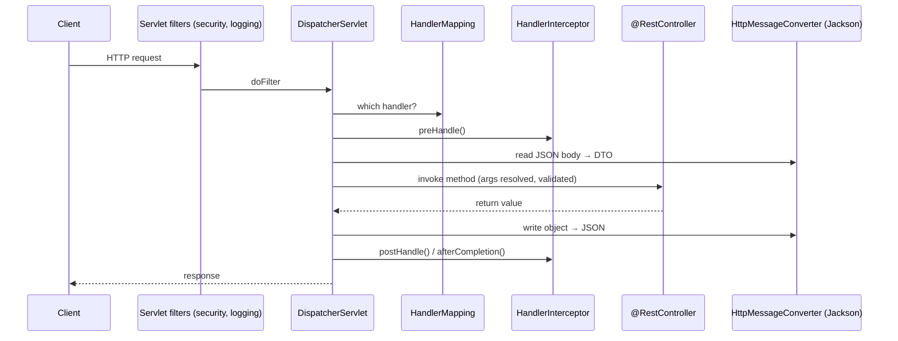

# Web, validation & testing

> **TL;DR** Every Spring MVC request goes **Filters → DispatcherServlet → HandlerMapping → Interceptors → Controller → message converters**. Handle errors centrally with `@RestControllerAdvice` and return **`ProblemDetail`**. Validate input with `@Valid` on DTOs. Test with the narrowest **slice** that covers the behaviour: `@WebMvcTest` for controllers, `@DataJpaTest` for repositories, `@SpringBootTest` + Testcontainers for end-to-end.

## Mental model: request flow



## Deep dive

### Filter vs interceptor vs AOP

| | Servlet Filter | HandlerInterceptor | AOP aspect |
|---|---|---|---|
| Level | servlet container, before Spring MVC | Spring MVC, around handler | any Spring bean method |
| Sees | raw request/response | request + which handler matched | method arguments/return value |
| Good for | security, CORS, request logging, compression | per-handler auth checks, timing, locale | transactions, caching, metrics on services |

### Controllers

- `@RestController` = `@Controller` + `@ResponseBody` on every method.
- Return `ResponseEntity` for full control (status, headers): `ResponseEntity.created(location).body(dto)`.
- Use correct status codes: **201** + `Location` for creates, **204** for no content, **400** validation, **404** not found, **409** conflict, **422** semantic validation (team convention).
- Remember idempotency: GET, PUT, DELETE should be idempotent; POST is not (use an **idempotency key** header for payments).

### Validation

```java
public record CreateUserRequest(
        @NotBlank @Size(max = 100) String name,
        @Email @NotBlank String email,
        @Min(18) int age) {}

@PostMapping("/users")
ResponseEntity<UserDto> create(@Valid @RequestBody CreateUserRequest req) { ... }
```

- Needs `spring-boot-starter-validation` (Jakarta Bean Validation / Hibernate Validator).
- A failed `@Valid @RequestBody` throws `MethodArgumentNotValidException` → **400** by default.
- Nested objects need `@Valid` on the field to cascade.
- Custom rules: write a `ConstraintValidator`, or group-based validation.

### Central error handling

```java
@RestControllerAdvice
class ApiErrors {
    @ExceptionHandler(OrderNotFoundException.class)
    ProblemDetail notFound(OrderNotFoundException e) {
        ProblemDetail pd = ProblemDetail.forStatusAndDetail(HttpStatus.NOT_FOUND, e.getMessage());
        pd.setTitle("Order not found");
        pd.setProperty("orderId", e.orderId());
        return pd;
    }
}
```

- `ProblemDetail` (Spring 6) implements the standard **Problem Details** JSON format (`type`, `title`, `status`, `detail`, `instance`).
- `spring.mvc.problemdetails.enabled=true` makes Spring's built-in exceptions use it too.
- Never leak stack traces or SQL messages to clients.

### HTTP clients

| Client | Status |
|---|---|
| `RestTemplate` | synchronous, in maintenance mode |
| **`RestClient`** (Spring 6.1+) | modern synchronous fluent API; the default choice for blocking code |
| `WebClient` | reactive/non-blocking (WebFlux) |
| HTTP interface clients (`@HttpExchange`) | declarative, Feign-like, backed by RestClient/WebClient |

Always set **connect and read timeouts**; defaults can wait far too long.

## Testing

### Which annotation?

| Annotation | Loads | Use for |
|---|---|---|
| plain JUnit + Mockito | nothing | **most** service logic (fastest) |
| `@WebMvcTest(UserController.class)` | MVC layer only: controllers, advice, filters, converters; **not** services/repositories | request mapping, validation, status codes, JSON shape |
| `@DataJpaTest` | JPA repositories, EntityManager; each test **rolls back** | queries, mappings, constraints |
| `@JsonTest` | Jackson config | serialisation |
| `@SpringBootTest` | the **full** context | integration tests; add `webEnvironment = RANDOM_PORT` for real HTTP |

```java
@WebMvcTest(UserController.class)
class UserControllerTest {
    @Autowired MockMvc mvc;
    @MockitoBean UserService service;            // Boot 3.4+; earlier versions use @MockBean

    @Test
    void rejectsInvalidEmail() throws Exception {
        mvc.perform(post("/users").contentType(APPLICATION_JSON)
                .content("""
                    {"name":"Ana","email":"not-an-email","age":30}
                    """))
           .andExpect(status().isBadRequest());
    }
}
```

### Real databases with Testcontainers

```java
@SpringBootTest
@Testcontainers
class OrderFlowIT {
    @Container
    @ServiceConnection                            // Boot 3.1+: wires the datasource automatically
    static PostgreSQLContainer<?> db = new PostgreSQLContainer<>("postgres:16-alpine");
}
```

- `@DataJpaTest` replaces your datasource with an **embedded** DB by default; use `@AutoConfigureTestDatabase(replace = NONE)` with Testcontainers to test against the real engine (Postgres behaves differently from H2).
- Spring **caches** application contexts between tests with the same configuration. Each different set of mocked beans creates a **new context**, which slows the suite. Keep test configurations consistent.

### Testing pyramid for a Spring service

Many fast unit tests → some slice tests → a few full integration tests with Testcontainers → a handful of end-to-end/contract tests.

## Traps

- "`@WebMvcTest` loads my services." It doesn't; mock them.
- "`@SpringBootTest` is the default for every test." It's the slowest option.
- "Interceptors run before security." Security filters run **before** the DispatcherServlet.
- "H2 tests prove the Postgres queries work." Use Testcontainers for engine-specific SQL.
- "`RestTemplate` is the recommended new client." `RestClient` is.

## Say it out loud

**"How do you test a Spring Boot service?"**
Business logic gets plain unit tests with Mockito because they're fast. Controllers get `@WebMvcTest` to check mappings, validation and error responses. Repositories get `@DataJpaTest` against a real Postgres in Testcontainers. A few `@SpringBootTest` tests cover the full flow. I keep test configurations consistent so Spring's context cache keeps the suite fast.

## Practice MCQs

**Q1.** Which runs first for an incoming request?
- A) HandlerInterceptor `preHandle`
- B) Servlet Filter
- C) `@ControllerAdvice`
- D) Controller method

<details markdown="1"><summary>Answer</summary>

**B.**
</details>

**Q2.** `@WebMvcTest(OrderController.class)` and the controller depends on `OrderService`. Without extra configuration:
- A) The real service is injected
- B) Context fails to start: no `OrderService` bean
- C) Spring creates a stub automatically
- D) The test is skipped

<details markdown="1"><summary>Answer</summary>

**B.** Provide it with `@MockitoBean` (or `@MockBean` before Boot 3.4).
</details>

**Q3.** A `@Valid @RequestBody` DTO fails validation. Default response status:
- A) 200
- B) 400
- C) 422
- D) 500

<details markdown="1"><summary>Answer</summary>

**B.**
</details>

**Q4.** By default, `@DataJpaTest`:
- A) Uses your production database
- B) Uses an embedded database and rolls back after each test
- C) Loads all controllers
- D) Commits each test

<details markdown="1"><summary>Answer</summary>

**B.**
</details>

**Q5.** Which is the modern synchronous HTTP client in Spring 6.1+?
- A) `RestTemplate`
- B) `RestClient`
- C) `HttpURLConnection`
- D) `WebClient` only

<details markdown="1"><summary>Answer</summary>

**B.**
</details>

**Q6.** A test suite has 40 `@SpringBootTest` classes, each with a different set of `@MockitoBean`s. Why is it slow?
- A) JUnit runs tests serially
- B) Each unique configuration creates a new application context instead of reusing the cached one
- C) Mockito is slow
- D) Testcontainers restarts

<details markdown="1"><summary>Answer</summary>

**B.**
</details>

## Related

- [Security](06-security.md): filters come before the DispatcherServlet.
- [Boot internals](02-boot-internals.md)
